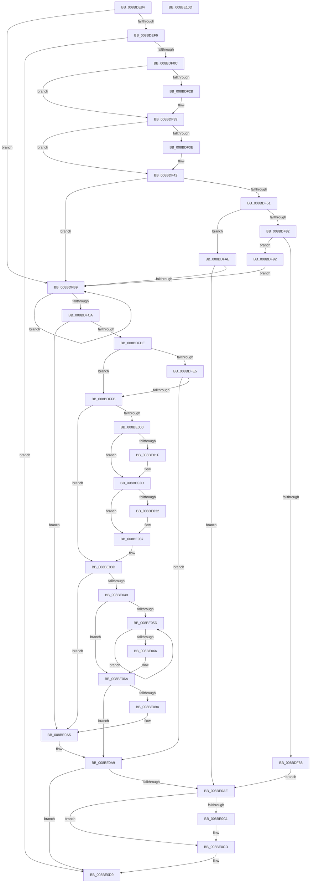

# ExpWnfAllocateNextPersistentNameSequence

- RVA: `0x008BDE84`–`0x008BE10E` (길이 `650` bytes)
- VA: `0x00000001408BDE84`
- 실행 섹션: `PAGE`
- PDB 이름 있음: `예`; PDB Function 태그: `아니요`
- unwind 정보 RVA: `0x00083124`
- 디코드: `168`개 명령, `650/650` bytes 표시
- 미해석 바이트: `0` (있으면 어셈블리에 `.byte`로 보존)

> 이 문서는 커널 이미지의 기계어와 PDB 기호를 분석해 생성했습니다. 4번과 5번은 함수 원형과 자료형을 바이너리 사용 방식에서 추정한 C 해석이며 원본 소스 복구 결과는 아닙니다.

## 1. Dependencies

- 직접 호출 지점: **14**; 고유 호출 대상: **11**
- 직접 호출자로 확인된 함수: **1**
- RIP 상대 이미지 참조: **2**

### Outgoing calls
- `0x008BDECE` → [PsAttachSiloToCurrentThread](../../text/44/PsAttachSiloToCurrentThread_function_004428C0.md) (function, `0x004428C0`)
- `0x008BDED6` → [PsGetCurrentServerSiloGlobals](../../text/2F/PsGetCurrentServerSiloGlobals_function_002FE1F0.md) (function, `0x002FE1F0`)
- `0x008BDEFD` → [ExpWnfGetNameStoreRegistryRoot](ExpWnfGetNameStoreRegistryRoot_function_008BDB00.md) (function, `0x008BDB00`)
- `0x008BDF1B` → [KeAbPreAcquire](../../text/21/KeAbPreAcquire_function_00210230.md) (function, `0x00210230`)
- `0x008BDF34` → [ExfAcquirePushLockExclusiveEx](../../text/20/ExfAcquirePushLockExclusiveEx_function_0020FC90.md) (function, `0x0020FC90`)
- `0x008BDF77` → [ZwQueryValueKey](../../text/6A/ZwQueryValueKey_function_006AD3B0.md) (function, `0x006AD3B0`)
- `0x008BDFEC` → [ExpWnfGetNameStoreRegistryRoot](ExpWnfGetNameStoreRegistryRoot_function_008BDB00.md) (function, `0x008BDB00`)
- `0x008BE00F` → [KeAbPreAcquire](../../text/21/KeAbPreAcquire_function_00210230.md) (function, `0x00210230`)
- `0x008BE028` → [ExfAcquirePushLockExclusiveEx](../../text/20/ExfAcquirePushLockExclusiveEx_function_0020FC90.md) (function, `0x0020FC90`)
- `0x008BE08F` → [ZwSetValueKey](../../text/6A/ZwSetValueKey_function_006ADCD0.md) (function, `0x006ADCD0`)
- `0x008BE0C8` → [ExfTryToWakePushLock](../../text/26/ExfTryToWakePushLock_function_00265DD0.md) (function, `0x00265DD0`)
- `0x008BE0D4` → [KeAbPostRelease](../../text/2E/KeAbPostRelease_function_002E1600.md) (function, `0x002E1600`)
- `0x008BE0DC` → [PsDetachSiloFromCurrentThread](../../text/44/PsDetachSiloFromCurrentThread_function_00449AC0.md) (function, `0x00449AC0`)
- `0x008BE0EA` → [_security_check_cookie](../../text/6A/_security_check_cookie_function_006AC640.md) (function, `0x006AC640`)

### Direct callers
- [ExpWnfGenerateStateName](ExpWnfGenerateStateName_function_008BE738.md) at `0x008BE823`

### Static image references
- `0x008BDEA3` → RVA `0x00E0A740` (`.data`; read)
- `0x008BDF70` → RVA `0x00B4B4F0` (`ExpWnfPermanentNameSequenceNumberValueName`; read)

## 2. Other-region calls and transfers

- 다른 실행 섹션으로 향하는 call: **12**
  - `0x008BDECE` → [PsAttachSiloToCurrentThread](../../text/44/PsAttachSiloToCurrentThread_function_004428C0.md) (`PAGE` → `.text`)
  - `0x008BDED6` → [PsGetCurrentServerSiloGlobals](../../text/2F/PsGetCurrentServerSiloGlobals_function_002FE1F0.md) (`PAGE` → `.text`)
  - `0x008BDF1B` → [KeAbPreAcquire](../../text/21/KeAbPreAcquire_function_00210230.md) (`PAGE` → `.text`)
  - `0x008BDF34` → [ExfAcquirePushLockExclusiveEx](../../text/20/ExfAcquirePushLockExclusiveEx_function_0020FC90.md) (`PAGE` → `.text`)
  - `0x008BDF77` → [ZwQueryValueKey](../../text/6A/ZwQueryValueKey_function_006AD3B0.md) (`PAGE` → `.text`)
  - `0x008BE00F` → [KeAbPreAcquire](../../text/21/KeAbPreAcquire_function_00210230.md) (`PAGE` → `.text`)
  - `0x008BE028` → [ExfAcquirePushLockExclusiveEx](../../text/20/ExfAcquirePushLockExclusiveEx_function_0020FC90.md) (`PAGE` → `.text`)
  - `0x008BE08F` → [ZwSetValueKey](../../text/6A/ZwSetValueKey_function_006ADCD0.md) (`PAGE` → `.text`)
  - `0x008BE0C8` → [ExfTryToWakePushLock](../../text/26/ExfTryToWakePushLock_function_00265DD0.md) (`PAGE` → `.text`)
  - `0x008BE0D4` → [KeAbPostRelease](../../text/2E/KeAbPostRelease_function_002E1600.md) (`PAGE` → `.text`)
  - `0x008BE0DC` → [PsDetachSiloFromCurrentThread](../../text/44/PsDetachSiloFromCurrentThread_function_00449AC0.md) (`PAGE` → `.text`)
  - `0x008BE0EA` → [_security_check_cookie](../../text/6A/_security_check_cookie_function_006AC640.md) (`PAGE` → `.text`)
- 별도 외부 분기/꼬리 이동을 확인하지 못했습니다.

## 3. Assembly (complete function range)

```asm
008BDE84  48 89 5C 24 08                  mov qword ptr [rsp + 8], rbx
008BDE89  48 89 74 24 18                  mov qword ptr [rsp + 0x18], rsi
008BDE8E  48 89 7C 24 20                  mov qword ptr [rsp + 0x20], rdi
008BDE93  55                              push rbp
008BDE94  41 54                           push r12
008BDE96  41 55                           push r13
008BDE98  41 56                           push r14
008BDE9A  41 57                           push r15
008BDE9C  48 8B EC                        mov rbp, rsp
008BDE9F  48 83 EC 70                     sub rsp, 0x70
008BDEA3  48 8B 05 96 C8 54 00            mov rax, qword ptr [rip + 0x54c896]
008BDEAA  48 33 C4                        xor rax, rsp
008BDEAD  48 89 45 F0                     mov qword ptr [rbp - 0x10], rax
008BDEB1  83 65 D0 00                     and dword ptr [rbp - 0x30], 0
008BDEB5  33 C0                           xor eax, eax
008BDEB7  48 21 45 C8                     and qword ptr [rbp - 0x38], rax
008BDEBB  0F 57 C0                        xorps xmm0, xmm0
008BDEBE  0F 11 45 D8                     movups xmmword ptr [rbp - 0x28], xmm0
008BDEC2  48 89 45 E8                     mov qword ptr [rbp - 0x18], rax
008BDEC6  4C 8B EA                        mov r13, rdx
008BDEC9  45 33 F6                        xor r14d, r14d
008BDECC  33 FF                           xor edi, edi
008BDECE  E8 ED 49 B8 FF                  call 0x1404428c0
008BDED3  4C 8B E0                        mov r12, rax
008BDED6  E8 15 03 A4 FF                  call 0x1402fe1f0
008BDEDB  48 8B D8                        mov rbx, rax
008BDEDE  45 8D 7E 01                     lea r15d, [r14 + 1]
008BDEE2  48 8B 80 98 03 00 00            mov rax, qword ptr [rax + 0x398]
008BDEE9  48 89 45 C0                     mov qword ptr [rbp - 0x40], rax
008BDEED  48 85 C0                        test rax, rax
008BDEF0  0F 85 C3 00 00 00               jne 0x1408bdfb9
008BDEF6  48 8D 55 C8                     lea rdx, [rbp - 0x38]
008BDEFA  41 8B CF                        mov ecx, r15d
008BDEFD  E8 FE FB FF FF                  call 0x1408bdb00
008BDF02  8B F8                           mov edi, eax
008BDF04  85 C0                           test eax, eax
008BDF06  0F 88 CD 01 00 00               js 0x1408be0d9
008BDF0C  48 8D B3 90 03 00 00            lea rsi, [rbx + 0x390]
008BDF13  45 33 C0                        xor r8d, r8d
008BDF16  48 8B CE                        mov rcx, rsi
008BDF19  33 D2                           xor edx, edx
008BDF1B  E8 10 23 95 FF                  call 0x140210230
008BDF20  F0 48 0F BA 2E 00               lock bts qword ptr [rsi], 0
008BDF26  4C 8B F0                        mov r14, rax
008BDF29  73 0E                           jae 0x1408bdf39
008BDF2B  4C 8B C6                        mov r8, rsi
008BDF2E  48 8B D0                        mov rdx, rax
008BDF31  48 8B CE                        mov rcx, rsi
008BDF34  E8 57 1D 95 FF                  call 0x14020fc90
008BDF39  4D 85 F6                        test r14, r14
008BDF3C  74 04                           je 0x1408bdf42
008BDF3E  45 88 7E 0A                     mov byte ptr [r14 + 0xa], r15b
008BDF42  48 8B 83 98 03 00 00            mov rax, qword ptr [rbx + 0x398]
008BDF49  45 8B F7                        mov r14d, r15d
008BDF4C  48 85 C0                        test rax, rax
008BDF4F  75 68                           jne 0x1408bdfb9
008BDF51  48 8B 4D C8                     mov rcx, qword ptr [rbp - 0x38]
008BDF55  48 8D 45 D0                     lea rax, [rbp - 0x30]
008BDF59  48 89 44 24 28                  mov qword ptr [rsp + 0x28], rax
008BDF5E  4C 8D 4D D8                     lea r9, [rbp - 0x28]
008BDF62  41 B8 02 00 00 00               mov r8d, 2
008BDF68  C7 44 24 20 18 00 00 00         mov dword ptr [rsp + 0x20], 0x18
008BDF70  48 8D 15 79 D5 28 00            lea rdx, [rip + 0x28d579]
008BDF77  E8 34 F4 DE FF                  call 0x1406ad3b0
008BDF7C  8B F8                           mov edi, eax
008BDF7E  85 C0                           test eax, eax
008BDF80  78 2C                           js 0x1408bdfae
008BDF82  83 7D E0 08                     cmp dword ptr [rbp - 0x20], 8
008BDF86  74 0A                           je 0x1408bdf92
008BDF88  BF 01 00 00 C0                  mov edi, 0xc0000001
008BDF8D  E9 1C 01 00 00                  jmp 0x1408be0ae
008BDF92  48 8B 45 E4                     mov rax, qword ptr [rbp - 0x1c]
008BDF96  48 89 45 C0                     mov qword ptr [rbp - 0x40], rax
008BDF9A  48 87 83 88 03 00 00            xchg qword ptr [rbx + 0x388], rax
008BDFA1  48 8B 45 C0                     mov rax, qword ptr [rbp - 0x40]
008BDFA5  48 87 83 98 03 00 00            xchg qword ptr [rbx + 0x398], rax
008BDFAC  EB 0B                           jmp 0x1408bdfb9
008BDFAE  3D 34 00 00 C0                  cmp eax, 0xc0000034
008BDFB3  0F 85 F5 00 00 00               jne 0x1408be0ae
008BDFB9  49 8B F7                        mov rsi, r15
008BDFBC  F0 48 0F C1 B3 88 03 00 00      lock xadd qword ptr [rbx + 0x388], rsi
008BDFC5  49 03 F7                        add rsi, r15
008BDFC8  74 EF                           je 0x1408bdfb9
008BDFCA  48 8B 83 98 03 00 00            mov rax, qword ptr [rbx + 0x398]
008BDFD1  48 89 45 C0                     mov qword ptr [rbp - 0x40], rax
008BDFD5  48 3B F0                        cmp rsi, rax
008BDFD8  0F 86 C7 00 00 00               jbe 0x1408be0a5
008BDFDE  48 83 7D C8 00                  cmp qword ptr [rbp - 0x38], 0
008BDFE3  75 16                           jne 0x1408bdffb
008BDFE5  48 8D 55 C8                     lea rdx, [rbp - 0x38]
008BDFE9  41 8B CF                        mov ecx, r15d
008BDFEC  E8 0F FB FF FF                  call 0x1408bdb00
008BDFF1  8B F8                           mov edi, eax
008BDFF3  85 C0                           test eax, eax
008BDFF5  0F 88 AE 00 00 00               js 0x1408be0a9
008BDFFB  45 85 F6                        test r14d, r14d
008BDFFE  75 3D                           jne 0x1408be03d
008BE000  4C 8D B3 90 03 00 00            lea r14, [rbx + 0x390]
008BE007  45 33 C0                        xor r8d, r8d
008BE00A  49 8B CE                        mov rcx, r14
008BE00D  33 D2                           xor edx, edx
008BE00F  E8 1C 22 95 FF                  call 0x140210230
008BE014  F0 49 0F BA 2E 00               lock bts qword ptr [r14], 0
008BE01A  4C 8B F8                        mov r15, rax
008BE01D  73 0E                           jae 0x1408be02d
008BE01F  4D 8B C6                        mov r8, r14
008BE022  48 8B D0                        mov rdx, rax
008BE025  49 8B CE                        mov rcx, r14
008BE028  E8 63 1C 95 FF                  call 0x14020fc90
008BE02D  4D 85 FF                        test r15, r15
008BE030  74 05                           je 0x1408be037
008BE032  41 C6 47 0A 01                  mov byte ptr [r15 + 0xa], 1
008BE037  41 BE 01 00 00 00               mov r14d, 1
008BE03D  48 8B 83 98 03 00 00            mov rax, qword ptr [rbx + 0x398]
008BE044  48 3B F0                        cmp rsi, rax
008BE047  76 5C                           jbe 0x1408be0a5
008BE049  48 8B 83 98 03 00 00            mov rax, qword ptr [rbx + 0x398]
008BE050  48 83 C0 64                     add rax, 0x64
008BE054  48 89 45 C0                     mov qword ptr [rbp - 0x40], rax
008BE058  48 3B C6                        cmp rax, rsi
008BE05B  73 0D                           jae 0x1408be06a
008BE05D  48 83 C0 64                     add rax, 0x64
008BE061  48 3B C6                        cmp rax, rsi
008BE064  72 F7                           jb 0x1408be05d
008BE066  48 89 45 C0                     mov qword ptr [rbp - 0x40], rax
008BE06A  48 8B 4D C8                     mov rcx, qword ptr [rbp - 0x38]
008BE06E  48 8D 45 C0                     lea rax, [rbp - 0x40]
008BE072  C7 44 24 28 08 00 00 00         mov dword ptr [rsp + 0x28], 8
008BE07A  48 8D 15 6F D4 28 00            lea rdx, [rip + 0x28d46f]
008BE081  41 B9 03 00 00 00               mov r9d, 3
008BE087  48 89 44 24 20                  mov qword ptr [rsp + 0x20], rax
008BE08C  45 33 C0                        xor r8d, r8d
008BE08F  E8 3C FC DE FF                  call 0x1406adcd0
008BE094  8B F8                           mov edi, eax
008BE096  85 C0                           test eax, eax
008BE098  78 0F                           js 0x1408be0a9
008BE09A  48 8B 45 C0                     mov rax, qword ptr [rbp - 0x40]
008BE09E  48 87 83 98 03 00 00            xchg qword ptr [rbx + 0x398], rax
008BE0A5  49 89 75 00                     mov qword ptr [r13], rsi
008BE0A9  45 85 F6                        test r14d, r14d
008BE0AC  74 2B                           je 0x1408be0d9
008BE0AE  48 83 C8 FF                     or rax, 0xffffffffffffffff
008BE0B2  F0 48 0F C1 83 90 03 00 00      lock xadd qword ptr [rbx + 0x390], rax
008BE0BB  24 06                           and al, 6
008BE0BD  3C 02                           cmp al, 2
008BE0BF  75 0C                           jne 0x1408be0cd
008BE0C1  48 8D 8B 90 03 00 00            lea rcx, [rbx + 0x390]
008BE0C8  E8 03 7D 9A FF                  call 0x140265dd0
008BE0CD  48 8D 8B 90 03 00 00            lea rcx, [rbx + 0x390]
008BE0D4  E8 27 35 A2 FF                  call 0x1402e1600
008BE0D9  49 8B CC                        mov rcx, r12
008BE0DC  E8 DF B9 B8 FF                  call 0x140449ac0
008BE0E1  8B C7                           mov eax, edi
008BE0E3  48 8B 4D F0                     mov rcx, qword ptr [rbp - 0x10]
008BE0E7  48 33 CC                        xor rcx, rsp
008BE0EA  E8 51 E5 DE FF                  call 0x1406ac640
008BE0EF  4C 8D 5C 24 70                  lea r11, [rsp + 0x70]
008BE0F4  49 8B 5B 30                     mov rbx, qword ptr [r11 + 0x30]
008BE0F8  49 8B 73 40                     mov rsi, qword ptr [r11 + 0x40]
008BE0FC  49 8B 7B 48                     mov rdi, qword ptr [r11 + 0x48]
008BE100  49 8B E3                        mov rsp, r11
008BE103  41 5F                           pop r15
008BE105  41 5E                           pop r14
008BE107  41 5D                           pop r13
008BE109  41 5C                           pop r12
008BE10B  5D                              pop rbp
008BE10C  C3                              ret
008BE10D  CC                              int3
```

## 4. C-style interpretation (structured pseudocode)

```c
__int64 __fastcall ExpWnfAllocateNextPersistentNameSequence(__int64 a1, __int64 a2, int a3)
{
    __int64 result;
    __int64 v_r14;
    __int64 v_rdi;
    __int64 v_rsi;
    __int64 v_rsp;
    unsigned __int64 v_stack_m28;
    unsigned __int64 v_stack_m38;
    unsigned __int64 v_stack_m40;
    unsigned __int64 v_stack_m44;
    unsigned int v_stack_m48;
    unsigned __int64 v_stack_m50;
    unsigned int v_stack_m58;
    unsigned __int64 v_stack_m60;
    unsigned __int64 v_stack_m68;
    unsigned __int64 v_stack_m70;
    unsigned int v_stack_m78;
    unsigned __int64 v_stack_p18;
    unsigned __int64 v_stack_p20;
    unsigned __int64 v_stack_p8;

    v_stack_p8 = v_rbx;
    v_stack_p18 = v_rsi;
    v_stack_p20 = v_rdi;
    v_rsp = (v_rsp) - (112);
    result = (*(unsigned __int64 *)(v_rip + 5556374)) ^ (v_rsp);
    v_stack_m38 = result;
    result = 0;
    v_stack_m50 = v_xmm0;
    v_stack_m40 = 0;
    v_r14 = 0;
    v_rdi = 0;
    result = PsAttachSiloToCurrentThread(a1, a2, a3, a4);
    result = PsGetCurrentServerSiloGlobals(a1, a2, a3, a4);
    v_stack_m68 = *(unsigned __int64 *)(result + 920);
    if (*(unsigned __int64 *)(result + 920) != 0) goto loc_008BDFB9;
    result = ExpWnfGetNameStoreRegistryRoot((unsigned int)((unsigned int)(v_r14 + 1)), v_stack_m60, a3, a4);
    if (sign_flag) goto loc_008BE0D9;
    a3 = 0;
    a2 = 0;
    result = KeAbPreAcquire(result + 912, a2, a3, a4);
    if (!(condition_is_above_or_equal)) {
        a3 = result + 912;
        a2 = result;
        a1 = result + 912;
        result = ExfAcquirePushLockExclusiveEx(a1, a2, a3, a4);
    }
    if (result != 0) {
        *(unsigned __int8 *)(result + 10) = (unsigned __int8)(v_r14 + 1);
    }
    if (*(unsigned __int64 *)(result + 920) != 0) goto loc_008BDFB9;
    v_stack_m70 = v_stack_m58;
    v_stack_m78 = 24;
    result = ZwQueryValueKey(v_stack_m60, v_rip + 2676089, 2, v_stack_m50);
    if (sign_flag) goto loc_008BDFAE;
    if (v_stack_m48 == 8) goto loc_008BDF92;
    goto loc_008BE0AE;
loc_008BDF92:
    v_stack_m68 = v_stack_m44;
    goto loc_008BDFB9;
loc_008BDFAE:
    if (((unsigned int)(v_stack_m68)) != 0xC0000034ULL) goto loc_008BE0AE;
loc_008BDFB9:
    v_rsi = (v_r14 + 1) + (v_r14 + 1);
    if (condition_is_equal) goto loc_008BDFB9;
    v_stack_m68 = *(unsigned __int64 *)(result + 920);
    if (v_rsi <= (*(unsigned __int64 *)(result + 920))) goto loc_008BE0A5;
    if (v_stack_m60 != 0) goto loc_008BDFFB;
    result = ExpWnfGetNameStoreRegistryRoot((unsigned int)((unsigned int)(v_r14 + 1)), v_stack_m60, 2, v_stack_m50);
    if (sign_flag) goto loc_008BE0A9;
loc_008BDFFB:
    if ((unsigned int)((unsigned int)((unsigned int)(v_r14 + 1))) != 0) goto loc_008BE03D;
    a3 = 0;
    a2 = 0;
    result = KeAbPreAcquire(result + 912, a2, a3, v_stack_m50);
    if (!(condition_is_above_or_equal)) {
        a3 = result + 912;
        a2 = result;
        a1 = result + 912;
        result = ExfAcquirePushLockExclusiveEx(a1, a2, a3, v_stack_m50);
    }
    if (result != 0) {
        *(unsigned __int8 *)(result + 10) = 1;
    }
loc_008BE03D:
    if (v_rsi <= (*(unsigned __int64 *)(result + 920))) goto loc_008BE0A5;
    result = (*(unsigned __int64 *)(result + 920)) + (100);
    v_stack_m68 = result;
    if (result >= v_rsi) goto loc_008BE06A;
loc_008BE05D:
    result = (result) + (100);
    if (result < v_rsi) goto loc_008BE05D;
    v_stack_m68 = result;
loc_008BE06A:
    v_stack_m70 = 8;
    v_stack_m78 = v_stack_m68;
    a3 = 0;
    result = ZwSetValueKey(v_stack_m60, v_rip + 2675823, a3, 3);
    if (sign_flag) goto loc_008BE0A9;
loc_008BE0A5:
    *(unsigned __int64 *)(a2) = v_rsi;
loc_008BE0A9:
    if (1 == 0) goto loc_008BE0D9;
loc_008BE0AE:
    result = (v_stack_m68) | (-1);
    result = (unsigned __int8)((result) & (6));
    if (((unsigned __int8)(result)) == 2) {
        a1 = result + 912;
        result = ExfTryToWakePushLock(a1, v_rip + 2675823, a3, 3);
    }
    result = KeAbPostRelease(result + 912, v_rip + 2675823, a3, 3);
loc_008BE0D9:
    result = PsDetachSiloFromCurrentThread(result, v_rip + 2675823, a3, 3);
    a1 = (v_stack_m38) ^ (v_rsp);
    result = _security_check_cookie(a1, v_rip + 2675823, a3, 3);
    return result;
}
```

## 5. (Beta) C Style

```c
int64_t ExpWnfAllocateNextPersistentNameSequence(int64_t Arg1, void *Arg2, int32_t Arg3)
{
    uint8_t *arg2 = (uint8_t *)Arg2;

    int64_t result;
    int64_t local_r14;
    int64_t local_rdi;
    int64_t local_rsi;
    int64_t local_rsp;
    uint64_t v_stack_m28;
    uint64_t v_stack_m38;
    uint64_t v_stack_m40;
    uint64_t v_stack_m44;
    uint32_t v_stack_m48;
    uint64_t v_stack_m50;
    uint32_t v_stack_m58;
    uint64_t v_stack_m60;
    uint64_t v_stack_m68;
    uint64_t v_stack_m70;
    uint32_t v_stack_m78;
    uint64_t v_stack_p18;
    uint64_t v_stack_p20;
    uint64_t v_stack_p8;

    v_stack_p8 = local_rbx;
    v_stack_p18 = local_rsi;
    v_stack_p20 = local_rdi;
    local_rsp = (local_rsp) - (112);
    result = (*(uint64_t *)(v_rip + 0x54C896)) ^ (local_rsp);
    v_stack_m38 = result;
    result = 0;
    v_stack_m50 = v_xmm0;
    v_stack_m40 = 0;
    local_r14 = 0;
    local_rdi = 0;
    result = PsAttachSiloToCurrentThread(Arg1, Arg2, Arg3, a4);
    result = PsGetCurrentServerSiloGlobals(Arg1, Arg2, Arg3, a4);
    v_stack_m68 = *(uint64_t *)(result + 0x398);
    if (*(uint64_t *)(result + 0x398) != 0) goto loc_008BDFB9;
    result = ExpWnfGetNameStoreRegistryRoot((uint32_t)((uint32_t)(local_r14 + 1)), v_stack_m60, Arg3, a4);
    if (sign_flag) goto loc_008BE0D9;
    Arg3 = 0;
    Arg2 = 0;
    result = KeAbPreAcquire(result + 912, Arg2, Arg3, a4);
    if (!(condition_is_above_or_equal)) {
        Arg3 = result + 912;
        Arg2 = result;
        Arg1 = result + 912;
        result = ExfAcquirePushLockExclusiveEx(Arg1, Arg2, Arg3, a4);
    }
    if (result != 0) {
        *(uint8_t *)(result + 0xA) = (uint8_t)(local_r14 + 1);
    }
    if (*(uint64_t *)(result + 0x398) != 0) goto loc_008BDFB9;
    v_stack_m70 = v_stack_m58;
    v_stack_m78 = 24;
    result = ZwQueryValueKey(v_stack_m60, v_rip + 2676089, 2, v_stack_m50);
    if (sign_flag) goto loc_008BDFAE;
    if (v_stack_m48 == 8) goto loc_008BDF92;
    goto loc_008BE0AE;
loc_008BDF92:
    v_stack_m68 = v_stack_m44;
    goto loc_008BDFB9;
loc_008BDFAE:
    if (((uint32_t)(v_stack_m68)) != 0xC0000034ULL) goto loc_008BE0AE;
loc_008BDFB9:
    local_rsi = (local_r14 + 1) + (local_r14 + 1);
    if (condition_is_equal) goto loc_008BDFB9;
    v_stack_m68 = *(uint64_t *)(result + 0x398);
    if (local_rsi <= (*(uint64_t *)(result + 0x398))) goto loc_008BE0A5;
    if (v_stack_m60 != 0) goto loc_008BDFFB;
    result = ExpWnfGetNameStoreRegistryRoot((uint32_t)((uint32_t)(local_r14 + 1)), v_stack_m60, 2, v_stack_m50);
    if (sign_flag) goto loc_008BE0A9;
loc_008BDFFB:
    if ((uint32_t)((uint32_t)((uint32_t)(local_r14 + 1))) != 0) goto loc_008BE03D;
    Arg3 = 0;
    Arg2 = 0;
    result = KeAbPreAcquire(result + 912, Arg2, Arg3, v_stack_m50);
    if (!(condition_is_above_or_equal)) {
        Arg3 = result + 912;
        Arg2 = result;
        Arg1 = result + 912;
        result = ExfAcquirePushLockExclusiveEx(Arg1, Arg2, Arg3, v_stack_m50);
    }
    if (result != 0) {
        *(uint8_t *)(result + 0xA) = 1;
    }
loc_008BE03D:
    if (local_rsi <= (*(uint64_t *)(result + 0x398))) goto loc_008BE0A5;
    result = (*(uint64_t *)(result + 0x398)) + (100);
    v_stack_m68 = result;
    if (result >= local_rsi) goto loc_008BE06A;
loc_008BE05D:
    result = (result) + (100);
    if (result < local_rsi) goto loc_008BE05D;
    v_stack_m68 = result;
loc_008BE06A:
    v_stack_m70 = 8;
    v_stack_m78 = v_stack_m68;
    Arg3 = 0;
    result = ZwSetValueKey(v_stack_m60, v_rip + 2675823, Arg3, 3);
    if (sign_flag) goto loc_008BE0A9;
loc_008BE0A5:
    *(uint64_t *)(arg2) = local_rsi;
loc_008BE0A9:
    if (1 == 0) goto loc_008BE0D9;
loc_008BE0AE:
    result = (v_stack_m68) | (-1);
    result = (uint8_t)((result) & (6));
    if (((uint8_t)(result)) == 2) {
        Arg1 = result + 912;
        result = ExfTryToWakePushLock(Arg1, v_rip + 2675823, Arg3, 3);
    }
    result = KeAbPostRelease(result + 912, v_rip + 2675823, Arg3, 3);
loc_008BE0D9:
    result = PsDetachSiloFromCurrentThread(result, v_rip + 2675823, Arg3, 3);
    Arg1 = (v_stack_m38) ^ (local_rsp);
    result = _security_check_cookie(Arg1, v_rip + 2675823, Arg3, 3);
    return result;
}
```

### 관측된 메모리 오프셋

구조체 형식이 확인되지 않은 접근은 인자 기준의 오프셋으로만 기록했습니다.

| 기준 인자 | 오프셋 표현 | 폭 (bit) | 접근 |
|---|---:|---:|---|
| `Arg2` | `+ 0x0` | `64` | `W` |

## 6. Execution-region graph

[열기: 2D/3D 그래프와 함수 탐색 컨트롤 패널](../../../control-panel.html?section=page&rva=0x008BDE84&view=graph)

- 2D 그래프는 위에서 아래로 흐르고, 3D 그래프는 빈 공간을 드래그해 회전합니다. Shift+드래그는 이동, 휠은 확대·축소, 함수 노드 선택은 대상 보고서 이동입니다.

### Static fallback


