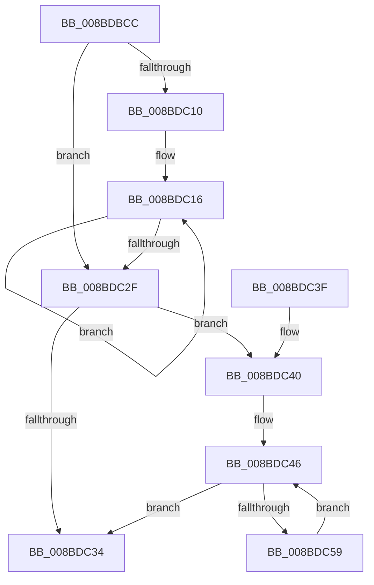

# ExpWnfComposeValueName

- RVA: `0x008BDBCC`–`0x008BDC5B` (길이 `143` bytes)
- VA: `0x00000001408BDBCC`
- 실행 섹션: `PAGE`
- PDB 이름 있음: `예`; PDB Function 태그: `아니요`
- unwind 정보 RVA: `0x0007CED0`
- 디코드: `42`개 명령, `143/143` bytes 표시
- 미해석 바이트: `0` (있으면 어셈블리에 `.byte`로 보존)

> 이 문서는 커널 이미지의 기계어와 PDB 기호를 분석해 생성했습니다. 4번과 5번은 함수 원형과 자료형을 바이너리 사용 방식에서 추정한 C 해석이며 원본 소스 복구 결과는 아닙니다.

## 1. Dependencies

- 직접 호출 지점: **1**; 고유 호출 대상: **1**
- 직접 호출자로 확인된 함수: **5**
- RIP 상대 이미지 참조: **0**

### Outgoing calls
- `0x008BDBF0` → [RtlInt64ToUnicodeString](RtlInt64ToUnicodeString_function_008BDDE0.md) (function, `0x008BDDE0`)

### Direct callers
- [ExpWnfDeletePermanentStateData](../7D/ExpWnfDeletePermanentStateData_function_007D6254.md) at `0x007D62BF`
- [ExpWnfLookupPermanentName](ExpWnfLookupPermanentName_function_008BD914.md) at `0x008BD96B`
- [ExpWnfRegisterPermanentName](ExpWnfRegisterPermanentName_function_008BE17C.md) at `0x008BE1C5`
- [ExpWnfPopulateStateData](ExpWnfPopulateStateData_function_008BF354.md) at `0x008BF42B`
- [ExpWnfDeletePermanentName](../A9/ExpWnfDeletePermanentName_function_00A99434.md) at `0x00A99471`

### Static image references
- 디코드된 RIP-relative 메모리 참조가 없습니다.

## 2. Other-region calls and transfers

- 다른 실행 섹션으로 향하는 call: **0**
- 별도 외부 분기/꼬리 이동을 확인하지 못했습니다.

## 3. Assembly (complete function range)

```asm
008BDBCC  48 89 5C 24 08                  mov qword ptr [rsp + 8], rbx
008BDBD1  57                              push rdi
008BDBD2  48 83 EC 20                     sub rsp, 0x20
008BDBD6  48 B8 74 00 BC A3 6D 4E C6 41   movabs rax, 0x41c64e6da3bc0074
008BDBE0  48 8B DA                        mov rbx, rdx
008BDBE3  4C 8B C2                        mov r8, rdx
008BDBE6  BF 10 00 00 00                  mov edi, 0x10
008BDBEB  48 33 C8                        xor rcx, rax
008BDBEE  8B D7                           mov edx, edi
008BDBF0  E8 EB 01 00 00                  call 0x1408bdde0
008BDBF5  44 0F B7 13                     movzx r10d, word ptr [rbx]
008BDBF9  44 8B C7                        mov r8d, edi
008BDBFC  41 D1 EA                        shr r10d, 1
008BDBFF  41 83 CB FF                     or r11d, 0xffffffff
008BDC03  45 2B C2                        sub r8d, r10d
008BDC06  66 C7 03 20 00                  mov word ptr [rbx], 0x20
008BDC0B  45 85 D2                        test r10d, r10d
008BDC0E  74 1F                           je 0x1408bdc2f
008BDC10  45 8B CA                        mov r9d, r10d
008BDC13  4D 03 C9                        add r9, r9
008BDC16  48 8B 53 08                     mov rdx, qword ptr [rbx + 8]
008BDC1A  4D 8D 49 FE                     lea r9, [r9 - 2]
008BDC1E  41 03 FB                        add edi, r11d
008BDC21  41 0F B7 04 11                  movzx eax, word ptr [r9 + rdx]
008BDC26  66 89 04 7A                     mov word ptr [rdx + rdi*2], ax
008BDC2A  45 03 D3                        add r10d, r11d
008BDC2D  75 E7                           jne 0x1408bdc16
008BDC2F  45 85 C0                        test r8d, r8d
008BDC32  75 0C                           jne 0x1408bdc40
008BDC34  48 8B 5C 24 30                  mov rbx, qword ptr [rsp + 0x30]
008BDC39  48 83 C4 20                     add rsp, 0x20
008BDC3D  5F                              pop rdi
008BDC3E  C3                              ret
008BDC3F  CC                              int3
008BDC40  41 8B C8                        mov ecx, r8d
008BDC43  48 03 C9                        add rcx, rcx
008BDC46  48 8B 43 08                     mov rax, qword ptr [rbx + 8]
008BDC4A  48 8D 49 FE                     lea rcx, [rcx - 2]
008BDC4E  66 C7 04 01 30 00               mov word ptr [rcx + rax], 0x30
008BDC54  45 03 C3                        add r8d, r11d
008BDC57  74 DB                           je 0x1408bdc34
008BDC59  EB EB                           jmp 0x1408bdc46
```

## 4. C-style interpretation (structured pseudocode)

```c
__int64 __fastcall ExpWnfComposeValueName(__int64 a1, __int64 a2)
{
    __int64 result;
    __int64 v_r10;
    __int64 v_r11;
    __int64 v_rdi;
    __int64 v_rsp;
    unsigned __int64 v_stack_p8;

    v_stack_p8 = v_rbx;
    v_rsp = (v_rsp) - (32);
    a1 = (a1) ^ (result);
    result = RtlInt64ToUnicodeString(a1, 16, a2, a4);
    v_r10 = (unsigned int)((*(unsigned __int16 *)(a2)) >> (1));
    v_r11 = (unsigned int)((v_r11) | (0xFFFFFFFFULL));
    a3 = (unsigned int)((16) - ((unsigned int)(v_r10)));
    *(unsigned __int16 *)(a2) = 32;
    if ((unsigned int)(v_r10) == 0) goto loc_008BDC2F;
    a4 = ((unsigned int)((unsigned int)(v_r10))) + ((unsigned int)((unsigned int)(v_r10)));
loc_008BDC16:
    v_rdi = (unsigned int)((16) + ((unsigned int)(v_r11)));
    *(unsigned __int16 *)(*(unsigned __int64 *)(a2 + 8) + v_rdi * 2) = (unsigned __int16)(*(unsigned __int16 *)(a4 - 2 + *(unsigned __int64 *)(a2 + 8) * 1));
    v_r10 = (unsigned int)((v_r10) + ((unsigned int)(v_r11)));
    if (condition_is_not_equal) goto loc_008BDC16;
loc_008BDC2F:
    if ((unsigned int)(a3) != 0) goto loc_008BDC40;
loc_008BDC34:
    v_rsp = (v_rsp) + (32);
    return *(unsigned __int16 *)(a4 - 2 + *(unsigned __int64 *)(a2 + 8) * 1);
loc_008BDC40:
    a1 = ((unsigned int)((unsigned int)(a3))) + ((unsigned int)((unsigned int)(a3)));
loc_008BDC46:
    *(unsigned __int16 *)(a1 - 2 + *(unsigned __int64 *)(v_stack_p8 + 8) * 1) = 48;
    a3 = (unsigned int)((a3) + ((unsigned int)(v_r11)));
    if (condition_is_equal) goto loc_008BDC34;
    goto loc_008BDC46;
}
```

## 5. (Beta) C Style

```c
int64_t ExpWnfComposeValueName(int64_t Arg1, void *Arg2)
{
    uint8_t *arg2 = (uint8_t *)Arg2;

    int64_t result;
    int64_t local_r10;
    int64_t local_r11;
    int64_t local_rdi;
    int64_t local_rsp;
    uint64_t v_stack_p8;

    v_stack_p8 = local_rbx;
    local_rsp = (local_rsp) - (32);
    Arg1 = (Arg1) ^ (result);
    result = RtlInt64ToUnicodeString(Arg1, 16, Arg2, a4);
    local_r10 = (uint32_t)((*(uint16_t *)(arg2)) >> (1));
    local_r11 = (uint32_t)((local_r11) | (0xFFFFFFFFULL));
    a3 = (uint32_t)((16) - ((uint32_t)(local_r10)));
    *(uint16_t *)(arg2) = 32;
    if ((uint32_t)(local_r10) == 0) goto loc_008BDC2F;
    a4 = ((uint32_t)((uint32_t)(local_r10))) + ((uint32_t)((uint32_t)(local_r10)));
loc_008BDC16:
    local_rdi = (uint32_t)((16) + ((uint32_t)(local_r11)));
    *(uint16_t *)(*(uint64_t *)(arg2 + 0x8) + local_rdi * 2) = (uint16_t)(*(uint16_t *)(a4 - 0x2 + *(uint64_t *)(arg2 + 0x8) * 1));
    local_r10 = (uint32_t)((local_r10) + ((uint32_t)(local_r11)));
    if (condition_is_not_equal) goto loc_008BDC16;
loc_008BDC2F:
    if ((uint32_t)(a3) != 0) goto loc_008BDC40;
loc_008BDC34:
    local_rsp = (local_rsp) + (32);
    return *(uint16_t *)(a4 - 0x2 + *(uint64_t *)(arg2 + 0x8) * 1);
loc_008BDC40:
    Arg1 = ((uint32_t)((uint32_t)(a3))) + ((uint32_t)((uint32_t)(a3)));
loc_008BDC46:
    *(uint16_t *)(Arg1 - 0x2 + *(uint64_t *)(v_stack_p8 + 0x8) * 1) = 48;
    a3 = (uint32_t)((a3) + ((uint32_t)(local_r11)));
    if (condition_is_equal) goto loc_008BDC34;
    goto loc_008BDC46;
}
```

### 관측된 메모리 오프셋

구조체 형식이 확인되지 않은 접근은 인자 기준의 오프셋으로만 기록했습니다.

| 기준 인자 | 오프셋 표현 | 폭 (bit) | 접근 |
|---|---:|---:|---|
| `Arg2` | `+ 0x0` | `16` | `R` |
| `Arg2` | `+ 0x0` | `16` | `W` |
| `Arg2` | `+ 0x8` | `64` | `R` |

## 6. Execution-region graph

[열기: 2D/3D 그래프와 함수 탐색 컨트롤 패널](../../../control-panel.html?section=page&rva=0x008BDBCC&view=graph)

- 2D 그래프는 위에서 아래로 흐르고, 3D 그래프는 빈 공간을 드래그해 회전합니다. Shift+드래그는 이동, 휠은 확대·축소, 함수 노드 선택은 대상 보고서 이동입니다.

### Static fallback


