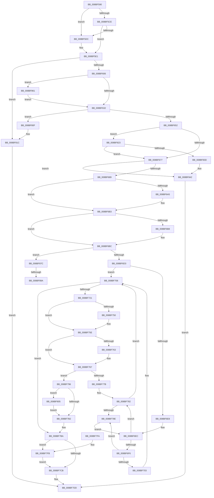

# ExpWnfCreateNameInstance

- RVA: `0x008BF590`–`0x008BF8A8` (길이 `792` bytes)
- VA: `0x00000001408BF590`
- 실행 섹션: `PAGE`
- PDB 이름 있음: `예`; PDB Function 태그: `예`
- unwind 정보 RVA: `0x00083308`
- 디코드: `212`개 명령, `792/792` bytes 표시
- 미해석 바이트: `0` (있으면 어셈블리에 `.byte`로 보존)

> 이 문서는 커널 이미지의 기계어와 PDB 기호를 분석해 생성했습니다. 4번과 5번은 함수 원형과 자료형을 바이너리 사용 방식에서 추정한 C 해석이며 원본 소스 복구 결과는 아닙니다.

## 1. Dependencies

- 직접 호출 지점: **21**; 고유 호출 대상: **14**
- 직접 호출자로 확인된 함수: **4**
- RIP 상대 이미지 참조: **1**

### Outgoing calls
- `0x008BF5F5` → [ExAllocatePool2](../../poolcode/B8/ExAllocatePool2_function_00B820F0.md) (function, `0x00B820F0`)
- `0x008BF60E` → [memset](../../text/6C/memset_function_006C6C40.md) (function, `0x006C6C40`)
- `0x008BF645` → [ObLogSecurityDescriptor](../8C/ObLogSecurityDescriptor_function_008C0020.md) (function, `0x008C0020`)
- `0x008BF67A` → [ExpWnfPopulateStateData](ExpWnfPopulateStateData_function_008BF354.md) (function, `0x008BF354`)
- `0x008BF695` → [KeAbPreAcquire](../../text/21/KeAbPreAcquire_function_00210230.md) (function, `0x00210230`)
- `0x008BF6AE` → [ExfAcquirePushLockExclusiveEx](../../text/20/ExfAcquirePushLockExclusiveEx_function_0020FC90.md) (function, `0x0020FC90`)
- `0x008BF6C2` → [ExpWnfFindStateName](ExpWnfFindStateName_function_008BF550.md) (function, `0x008BF550`)
- `0x008BF6D7` → [ExAcquireRundownProtection](../../text/21/ExAcquireRundownProtection_function_00216620.md) (function, `0x00216620`)
- `0x008BF70E` → [RtlAvlInsertNodeEx](../../text/26/RtlAvlInsertNodeEx_function_00265790.md) (function, `0x00265790`)
- `0x008BF740` → [KeAbPreAcquire](../../text/21/KeAbPreAcquire_function_00210230.md) (function, `0x00210230`)
- `0x008BF759` → [ExfAcquirePushLockExclusiveEx](../../text/20/ExfAcquirePushLockExclusiveEx_function_0020FC90.md) (function, `0x0020FC90`)
- `0x008BF7B5` → [KeAbPostRelease](../../text/2E/KeAbPostRelease_function_002E1600.md) (function, `0x002E1600`)
- `0x008BF7CE` → [KeAbPostRelease](../../text/2E/KeAbPostRelease_function_002E1600.md) (function, `0x002E1600`)
- `0x008BF7FE` → [ExfTryToWakePushLock](../../text/26/ExfTryToWakePushLock_function_00265DD0.md) (function, `0x00265DD0`)
- `0x008BF808` → [ExfTryToWakePushLock](../../text/26/ExfTryToWakePushLock_function_00265DD0.md) (function, `0x00265DD0`)
- `0x008BF817` → [ExFreePoolWithTag](../../poolcode/B8/ExFreePoolWithTag_function_00B82870.md) (function, `0x00B82870`)
- `0x008BF830` → [ExpWnfGetPermanentDataStore](../AA/ExpWnfGetPermanentDataStore_function_00AA39F0.md) (function, `0x00AA39F0`)
- `0x008BF848` → [ObDereferenceSecurityDescriptor](../87/ObDereferenceSecurityDescriptor_function_008740A0.md) (function, `0x008740A0`)
- `0x008BF855` → [ExFreePoolWithTag](../../poolcode/B8/ExFreePoolWithTag_function_00B82870.md) (function, `0x00B82870`)
- `0x008BF880` → [ExAcquireRundownProtection](../../text/21/ExAcquireRundownProtection_function_00216620.md) (function, `0x00216620`)
- `0x008BF89D` → [ExfTryToWakePushLock](../../text/26/ExfTryToWakePushLock_function_00265DD0.md) (function, `0x00265DD0`)

### Direct callers
- [NtCreateWnfStateName](NtCreateWnfStateName_function_008BE2B0.md) at `0x008BE4F7`
- [NtQueryWnfStateData](../90/NtQueryWnfStateData_function_00909DF0.md) at `0x0090A71E`
- [ExpNtUpdateWnfStateData](../90/ExpNtUpdateWnfStateData_function_0090A7A0.md) at `0x0090B156`
- [ExpWnfSubscribeWnfStateChange](../9D/ExpWnfSubscribeWnfStateChange_function_009D4D0C.md) at `0x009D5025`

### Static image references
- `0x008BF5CE` → RVA `0x00FC6AB0` (`ALMOSTRO`; read)

## 2. Other-region calls and transfers

- 다른 실행 섹션으로 향하는 call: **16**
  - `0x008BF5F5` → [ExAllocatePool2](../../poolcode/B8/ExAllocatePool2_function_00B820F0.md) (`PAGE` → `POOLCODE`)
  - `0x008BF60E` → [memset](../../text/6C/memset_function_006C6C40.md) (`PAGE` → `.text`)
  - `0x008BF695` → [KeAbPreAcquire](../../text/21/KeAbPreAcquire_function_00210230.md) (`PAGE` → `.text`)
  - `0x008BF6AE` → [ExfAcquirePushLockExclusiveEx](../../text/20/ExfAcquirePushLockExclusiveEx_function_0020FC90.md) (`PAGE` → `.text`)
  - `0x008BF6D7` → [ExAcquireRundownProtection](../../text/21/ExAcquireRundownProtection_function_00216620.md) (`PAGE` → `.text`)
  - `0x008BF70E` → [RtlAvlInsertNodeEx](../../text/26/RtlAvlInsertNodeEx_function_00265790.md) (`PAGE` → `.text`)
  - `0x008BF740` → [KeAbPreAcquire](../../text/21/KeAbPreAcquire_function_00210230.md) (`PAGE` → `.text`)
  - `0x008BF759` → [ExfAcquirePushLockExclusiveEx](../../text/20/ExfAcquirePushLockExclusiveEx_function_0020FC90.md) (`PAGE` → `.text`)
  - `0x008BF7B5` → [KeAbPostRelease](../../text/2E/KeAbPostRelease_function_002E1600.md) (`PAGE` → `.text`)
  - `0x008BF7CE` → [KeAbPostRelease](../../text/2E/KeAbPostRelease_function_002E1600.md) (`PAGE` → `.text`)
  - `0x008BF7FE` → [ExfTryToWakePushLock](../../text/26/ExfTryToWakePushLock_function_00265DD0.md) (`PAGE` → `.text`)
  - `0x008BF808` → [ExfTryToWakePushLock](../../text/26/ExfTryToWakePushLock_function_00265DD0.md) (`PAGE` → `.text`)
  - `0x008BF817` → [ExFreePoolWithTag](../../poolcode/B8/ExFreePoolWithTag_function_00B82870.md) (`PAGE` → `POOLCODE`)
  - `0x008BF855` → [ExFreePoolWithTag](../../poolcode/B8/ExFreePoolWithTag_function_00B82870.md) (`PAGE` → `POOLCODE`)
  - `0x008BF880` → [ExAcquireRundownProtection](../../text/21/ExAcquireRundownProtection_function_00216620.md) (`PAGE` → `.text`)
  - `0x008BF89D` → [ExfTryToWakePushLock](../../text/26/ExfTryToWakePushLock_function_00265DD0.md) (`PAGE` → `.text`)
- call이 아닌 외부 분기/꼬리 이동: **2**
  - `0x008BF894` → [sub_00B1ADD2](../B1/Unknown_function_00B1ADD2.md) (`tail-transfer`)
  - `0x008BF8A3` → [sub_00B1ADD2](../B1/Unknown_function_00B1ADD2.md) (`tail-transfer`)

## 3. Assembly (complete function range)

```asm
008BF590  48 8B C4                        mov rax, rsp
008BF593  48 89 58 08                     mov qword ptr [rax + 8], rbx
008BF597  48 89 68 10                     mov qword ptr [rax + 0x10], rbp
008BF59B  48 89 70 18                     mov qword ptr [rax + 0x18], rsi
008BF59F  4C 89 48 20                     mov qword ptr [rax + 0x20], r9
008BF5A3  57                              push rdi
008BF5A4  41 54                           push r12
008BF5A6  41 55                           push r13
008BF5A8  41 56                           push r14
008BF5AA  41 57                           push r15
008BF5AC  48 83 EC 20                     sub rsp, 0x20
008BF5B0  49 8B 40 08                     mov rax, qword ptr [r8 + 8]
008BF5B4  4C 8B FA                        mov r15, rdx
008BF5B7  49 C1 EF 04                     shr r15, 4
008BF5BB  4D 8B F0                        mov r14, r8
008BF5BE  41 83 E7 03                     and r15d, 3
008BF5C2  48 8B DA                        mov rbx, rdx
008BF5C5  4C 8B E9                        mov r13, rcx
008BF5C8  41 83 FF 03                     cmp r15d, 3
008BF5CC  75 0E                           jne 0x1408bf5dc
008BF5CE  4C 39 0D DB 74 70 00            cmp qword ptr [rip + 0x7074db], r9
008BF5D5  B9 01 01 00 00                  mov ecx, 0x101
008BF5DA  75 05                           jne 0x1408bf5e1
008BF5DC  B9 00 01 00 00                  mov ecx, 0x100
008BF5E1  BA B8 00 00 00                  mov edx, 0xb8
008BF5E6  48 85 C0                        test rax, rax
008BF5E9  41 B8 57 6E 66 20               mov r8d, 0x20666e57
008BF5EF  8D 72 F0                        lea esi, [rdx - 0x10]
008BF5F2  0F 44 D6                        cmove edx, esi
008BF5F5  E8 F6 2A 2C 00                  call 0x140b820f0
008BF5FA  48 8B F8                        mov rdi, rax
008BF5FD  48 85 C0                        test rax, rax
008BF600  0F 84 16 02 00 00               je 0x1408bf81c
008BF606  44 8B C6                        mov r8d, esi
008BF609  33 D2                           xor edx, edx
008BF60B  48 8B C8                        mov rcx, rax
008BF60E  E8 2D 76 E0 FF                  call 0x1406c6c40
008BF613  C7 07 03 09 A8 00               mov dword ptr [rdi], 0xa80903
008BF619  4C 89 6F 30                     mov qword ptr [rdi + 0x30], r13
008BF61D  48 89 5F 28                     mov qword ptr [rdi + 0x28], rbx
008BF621  41 8B 06                        mov eax, dword ptr [r14]
008BF624  89 47 38                        mov dword ptr [rdi + 0x38], eax
008BF627  49 83 7E 08 00                  cmp qword ptr [r14 + 8], 0
008BF62C  0F 85 2F 02 00 00               jne 0x1408bf861
008BF632  49 8B 4E 10                     mov rcx, qword ptr [r14 + 0x10]
008BF636  4C 8D 67 48                     lea r12, [rdi + 0x48]
008BF63A  BD 01 00 00 00                  mov ebp, 1
008BF63F  49 8B D4                        mov rdx, r12
008BF642  44 8B C5                        mov r8d, ebp
008BF645  E8 D6 09 00 00                  call 0x1408c0020
008BF64A  85 C0                           test eax, eax
008BF64C  0F 88 BD 01 00 00               js 0x1408bf80f
008BF652  48 8D 47 78                     lea rax, [rdi + 0x78]
008BF656  48 89 40 08                     mov qword ptr [rax + 8], rax
008BF65A  48 89 00                        mov qword ptr [rax], rax
008BF65D  48 8B C3                        mov rax, rbx
008BF660  48 83 67 70 00                  and qword ptr [rdi + 0x70], 0
008BF665  48 83 67 50 00                  and qword ptr [rdi + 0x50], 0
008BF66A  48 C1 E8 0A                     shr rax, 0xa
008BF66E  40 84 C5                        test bpl, al
008BF671  0F 85 AC 01 00 00               jne 0x1408bf823
008BF677  48 8B CF                        mov rcx, rdi
008BF67A  E8 D5 FC FF FF                  call 0x1408bf354
008BF67F  8B F0                           mov esi, eax
008BF681  85 C0                           test eax, eax
008BF683  0F 85 B9 01 00 00               jne 0x1408bf842
008BF689  49 8D 75 30                     lea rsi, [r13 + 0x30]
008BF68D  45 33 C0                        xor r8d, r8d
008BF690  48 8B CE                        mov rcx, rsi
008BF693  33 D2                           xor edx, edx
008BF695  E8 96 0B 95 FF                  call 0x140210230
008BF69A  F0 48 0F BA 2E 00               lock bts qword ptr [rsi], 0
008BF6A0  48 8B E8                        mov rbp, rax
008BF6A3  73 0E                           jae 0x1408bf6b3
008BF6A5  4C 8B C6                        mov r8, rsi
008BF6A8  48 8B D0                        mov rdx, rax
008BF6AB  48 8B CE                        mov rcx, rsi
008BF6AE  E8 DD 05 95 FF                  call 0x14020fc90
008BF6B3  48 85 ED                        test rbp, rbp
008BF6B6  74 04                           je 0x1408bf6bc
008BF6B8  C6 45 0A 01                     mov byte ptr [rbp + 0xa], 1
008BF6BC  48 8B D3                        mov rdx, rbx
008BF6BF  49 8B CD                        mov rcx, r13
008BF6C2  E8 89 FE FF FF                  call 0x1408bf550
008BF6C7  48 8B E8                        mov rbp, rax
008BF6CA  48 85 C0                        test rax, rax
008BF6CD  0F 85 A9 01 00 00               jne 0x1408bf87c
008BF6D3  48 8D 4F 08                     lea rcx, [rdi + 8]
008BF6D7  E8 44 6F 95 FF                  call 0x140216620
008BF6DC  49 8B 55 38                     mov rdx, qword ptr [r13 + 0x38]
008BF6E0  45 32 C0                        xor r8b, r8b
008BF6E3  48 85 D2                        test rdx, rdx
008BF6E6  74 1E                           je 0x1408bf706
008BF6E8  48 8B 4F 28                     mov rcx, qword ptr [rdi + 0x28]
008BF6EC  48 3B 4A 18                     cmp rcx, qword ptr [rdx + 0x18]
008BF6F0  0F 82 8C 00 00 00               jb 0x1408bf782
008BF6F6  48 8B 42 08                     mov rax, qword ptr [rdx + 8]
008BF6FA  48 85 C0                        test rax, rax
008BF6FD  0F 85 8B 00 00 00               jne 0x1408bf78e
008BF703  41 B0 01                        mov r8b, 1
008BF706  4C 8D 4F 10                     lea r9, [rdi + 0x10]
008BF70A  49 8D 4D 38                     lea rcx, [r13 + 0x38]
008BF70E  E8 7D 60 9A FF                  call 0x140265790
008BF713  48 83 CB FF                     or rbx, 0xffffffffffffffff
008BF717  41 83 FF 03                     cmp r15d, 3
008BF71B  0F 85 99 00 00 00               jne 0x1408bf7ba
008BF721  4C 8B 74 24 68                  mov r14, qword ptr [rsp + 0x68]
008BF726  45 33 C0                        xor r8d, r8d
008BF729  4C 89 B7 98 00 00 00            mov qword ptr [rdi + 0x98], r14
008BF730  33 D2                           xor edx, edx
008BF732  4D 8B B6 E8 05 00 00            mov r14, qword ptr [r14 + 0x5e8]
008BF739  49 8D 76 38                     lea rsi, [r14 + 0x38]
008BF73D  48 8B CE                        mov rcx, rsi
008BF740  E8 EB 0A 95 FF                  call 0x140210230
008BF745  F0 48 0F BA 2E 00               lock bts qword ptr [rsi], 0
008BF74B  48 8B E8                        mov rbp, rax
008BF74E  73 0E                           jae 0x1408bf75e
008BF750  4C 8B C6                        mov r8, rsi
008BF753  48 8B D0                        mov rdx, rax
008BF756  48 8B CE                        mov rcx, rsi
008BF759  E8 32 05 95 FF                  call 0x14020fc90
008BF75E  48 85 ED                        test rbp, rbp
008BF761  74 04                           je 0x1408bf767
008BF763  C6 45 0A 01                     mov byte ptr [rbp + 0xa], 1
008BF767  49 8D 46 40                     lea rax, [r14 + 0x40]
008BF76B  4C 8B 40 08                     mov r8, qword ptr [rax + 8]
008BF76F  48 8D 97 88 00 00 00            lea rdx, [rdi + 0x88]
008BF776  49 39 00                        cmp qword ptr [r8], rax
008BF779  74 1B                           je 0x1408bf796
008BF77B  B9 03 00 00 00                  mov ecx, 3
008BF780  CD 29                           int 0x29
008BF782  48 8B 02                        mov rax, qword ptr [rdx]
008BF785  48 85 C0                        test rax, rax
008BF788  0F 84 78 FF FF FF               je 0x1408bf706
008BF78E  48 8B D0                        mov rdx, rax
008BF791  E9 56 FF FF FF                  jmp 0x1408bf6ec
008BF796  48 89 02                        mov qword ptr [rdx], rax
008BF799  4C 89 42 08                     mov qword ptr [rdx + 8], r8
008BF79D  49 89 10                        mov qword ptr [r8], rdx
008BF7A0  48 89 50 08                     mov qword ptr [rax + 8], rdx
008BF7A4  48 8B C3                        mov rax, rbx
008BF7A7  F0 48 0F C1 06                  lock xadd qword ptr [rsi], rax
008BF7AC  24 06                           and al, 6
008BF7AE  3C 02                           cmp al, 2
008BF7B0  74 53                           je 0x1408bf805
008BF7B2  48 8B CE                        mov rcx, rsi
008BF7B5  E8 46 1E A2 FF                  call 0x1402e1600
008BF7BA  49 8D 75 30                     lea rsi, [r13 + 0x30]
008BF7BE  F0 48 0F C1 1E                  lock xadd qword ptr [rsi], rbx
008BF7C3  80 E3 06                        and bl, 6
008BF7C6  80 FB 02                        cmp bl, 2
008BF7C9  74 30                           je 0x1408bf7fb
008BF7CB  48 8B CE                        mov rcx, rsi
008BF7CE  E8 2D 1E A2 FF                  call 0x1402e1600
008BF7D3  48 8B 44 24 70                  mov rax, qword ptr [rsp + 0x70]
008BF7D8  48 89 38                        mov qword ptr [rax], rdi
008BF7DB  33 C0                           xor eax, eax
008BF7DD  48 8B 5C 24 50                  mov rbx, qword ptr [rsp + 0x50]
008BF7E2  48 8B 6C 24 58                  mov rbp, qword ptr [rsp + 0x58]
008BF7E7  48 8B 74 24 60                  mov rsi, qword ptr [rsp + 0x60]
008BF7EC  48 83 C4 20                     add rsp, 0x20
008BF7F0  41 5F                           pop r15
008BF7F2  41 5E                           pop r14
008BF7F4  41 5D                           pop r13
008BF7F6  41 5C                           pop r12
008BF7F8  5F                              pop rdi
008BF7F9  C3                              ret
008BF7FA  CC                              int3
008BF7FB  48 8B CE                        mov rcx, rsi
008BF7FE  E8 CD 65 9A FF                  call 0x140265dd0
008BF803  EB C6                           jmp 0x1408bf7cb
008BF805  48 8B CE                        mov rcx, rsi
008BF808  E8 C3 65 9A FF                  call 0x140265dd0
008BF80D  EB A3                           jmp 0x1408bf7b2
008BF80F  BA 57 6E 66 20                  mov edx, 0x20666e57
008BF814  48 8B CF                        mov rcx, rdi
008BF817  E8 54 30 2C 00                  call 0x140b82870
008BF81C  B8 9A 00 00 C0                  mov eax, 0xc000009a
008BF821  EB BA                           jmp 0x1408bf7dd
008BF823  4C 8D 4F 68                     lea r9, [rdi + 0x68]
008BF827  44 8B C5                        mov r8d, ebp
008BF82A  41 8B D7                        mov edx, r15d
008BF82D  49 8B CD                        mov rcx, r13
008BF830  E8 BB 41 1E 00                  call 0x140aa39f0
008BF835  85 C0                           test eax, eax
008BF837  0F 89 3A FE FF FF               jns 0x1408bf677
008BF83D  BE 9A 00 00 C0                  mov esi, 0xc000009a
008BF842  49 8B 0C 24                     mov rcx, qword ptr [r12]
008BF846  8B D5                           mov edx, ebp
008BF848  E8 53 48 FB FF                  call 0x1408740a0
008BF84D  BA 57 6E 66 20                  mov edx, 0x20666e57
008BF852  48 8B CF                        mov rcx, rdi
008BF855  E8 16 30 2C 00                  call 0x140b82870
008BF85A  8B C6                           mov eax, esi
008BF85C  E9 7C FF FF FF                  jmp 0x1408bf7dd
008BF861  48 8D 8F A8 00 00 00            lea rcx, [rdi + 0xa8]
008BF868  48 89 4F 40                     mov qword ptr [rdi + 0x40], rcx
008BF86C  49 8B 46 08                     mov rax, qword ptr [r14 + 8]
008BF870  0F 10 00                        movups xmm0, xmmword ptr [rax]
008BF873  F3 0F 7F 01                     movdqu xmmword ptr [rcx], xmm0
008BF877  E9 B6 FD FF FF                  jmp 0x1408bf632
008BF87C  48 8D 48 08                     lea rcx, [rax + 8]
008BF880  E8 9B 6D 95 FF                  call 0x140216620
008BF885  48 83 CB FF                     or rbx, 0xffffffffffffffff
008BF889  F0 48 0F C1 1E                  lock xadd qword ptr [rsi], rbx
008BF88E  80 E3 06                        and bl, 6
008BF891  80 FB 02                        cmp bl, 2
008BF894  0F 85 38 B5 25 00               jne 0x140b1add2
008BF89A  48 8B CE                        mov rcx, rsi
008BF89D  E8 2E 65 9A FF                  call 0x140265dd0
008BF8A2  90                              nop
008BF8A3  E9 2A B5 25 00                  jmp 0x140b1add2
```

## 4. C-style interpretation (structured pseudocode)

```c
__int64 __fastcall ExpWnfCreateNameInstance(__int64 a1, __int64 a2, __int64 a3, __int64 a4, __int64 a5)
{
    __int64 result;
    __int64 v_r15;
    __int64 v_rbx;
    __int64 v_rsp;
    unsigned __int64 v_stack_p10;
    unsigned __int64 v_stack_p18;
    unsigned __int64 v_stack_p20;
    unsigned __int64 v_stack_p8;

    *(unsigned __int64 *)(v_rsp + 8) = v_rbx;
    *(unsigned __int64 *)(v_rsp + 16) = v_rbp;
    *(unsigned __int64 *)(v_rsp + 24) = v_rsi;
    *(unsigned __int64 *)(v_rsp + 32) = a4;
    v_rsp = (v_rsp) - (32);
    v_r15 = (a2) >> (4);
    v_r15 = (unsigned int)((v_r15) & (3));
    if (((unsigned int)(v_r15)) != 3) goto loc_008BF5DC;
    if ((*(unsigned __int64 *)(v_rip + 7369947)) == a4) {
        a1 = 256;
    }
    a2 = 184;
    if (*(unsigned __int64 *)(a3 + 8) == 0) { a2 = (unsigned int)(184 - 16); }
    result = ExAllocatePool2(a1, a2, (unsigned int)(0x20666E57ULL), a4);
    if (result == 0) goto loc_008BF81C;
    a2 = 0;
    result = memset(result, a2, (unsigned int)((unsigned int)(184 - 16)), a4);
    *(unsigned int *)(result) = 0xA80903ULL;
    *(unsigned __int64 *)(result + 48) = a1;
    *(unsigned __int64 *)(result + 40) = 0;
    *(unsigned int *)(result + 56) = (unsigned int)((unsigned int)(*(unsigned int *)(a3)));
    if ((*(unsigned __int64 *)(a3 + 8)) != 0) goto loc_008BF861;
loc_008BF632:
    result = ObLogSecurityDescriptor(*(unsigned __int64 *)(a3 + 16), result + 72, 1, a4);
    if (sign_flag) goto loc_008BF80F;
    *(unsigned __int64 *)(result + 120 + 8) = result + 120;
    *(unsigned __int64 *)(result + 120) = result + 120;
    result = (0) >> (10);
    if (((1) & ((unsigned __int8)(result))) != 0) goto loc_008BF823;
loc_008BF677:
    result = ExpWnfPopulateStateData(result, result + 72, 1, a4);
    if ((unsigned int)(result) != 0) goto loc_008BF842;
    a3 = 0;
    a2 = 0;
    result = KeAbPreAcquire(a1 + 48, a2, a3, a4);
    if (!(condition_is_above_or_equal)) {
        a3 = a1 + 48;
        a2 = result;
        a1 = a1 + 48;
        result = ExfAcquirePushLockExclusiveEx(a1, a2, a3, a4);
    }
    if (result != 0) {
        *(unsigned __int8 *)(result + 10) = 1;
    }
    result = ExpWnfFindStateName(a1, a2, a3, a4);
    if (result != 0) goto loc_008BF87C;
    result = ExAcquireRundownProtection(result + 8, a2, a3, a4);
    a3 = 0;
    if (*(unsigned __int64 *)(a1 + 56) == 0) goto loc_008BF706;
loc_008BF6EC:
    if ((*(unsigned __int64 *)(result + 40)) < (*(unsigned __int64 *)(*(unsigned __int64 *)(a1 + 56) + 24))) goto loc_008BF782;
    if (*(unsigned __int64 *)(*(unsigned __int64 *)(a1 + 56) + 8) != 0) goto loc_008BF78E;
loc_008BF706:
    result = RtlAvlInsertNodeEx(a1 + 56, *(unsigned __int64 *)(a1 + 56), 1, result + 16);
    v_rbx = (a2) | (-1);
    if (((unsigned int)(v_r15)) != 3) goto loc_008BF7BA;
    a3 = 0;
    *(unsigned __int64 *)(result + 152) = v_stack_p20;
    a2 = 0;
    result = KeAbPreAcquire(*(unsigned __int64 *)(v_stack_p20 + 1512) + 56, a2, a3, result + 16);
    if (!(condition_is_above_or_equal)) {
        a3 = *(unsigned __int64 *)(v_stack_p20 + 1512) + 56;
        a2 = result;
        a1 = *(unsigned __int64 *)(v_stack_p20 + 1512) + 56;
        result = ExfAcquirePushLockExclusiveEx(a1, a2, a3, result + 16);
    }
    if (result != 0) {
        *(unsigned __int8 *)(result + 10) = 1;
    }
    if ((*(unsigned __int64 *)(*(unsigned __int64 *)(*(unsigned __int64 *)(v_stack_p20 + 1512) + 64 + 8))) == (*(unsigned __int64 *)(v_stack_p20 + 1512) + 64)) goto loc_008BF796;
loc_008BF782:
    if (*(unsigned __int64 *)(result + 136) == 0) goto loc_008BF706;
loc_008BF78E:
    goto loc_008BF6EC;
loc_008BF796:
    *(unsigned __int64 *)(*(unsigned __int64 *)(result + 136)) = *(unsigned __int64 *)(result + 136);
    *(unsigned __int64 *)(*(unsigned __int64 *)(result + 136) + 8) = *(unsigned __int64 *)(*(unsigned __int64 *)(v_stack_p20 + 1512) + 64 + 8);
    *(unsigned __int64 *)(*(unsigned __int64 *)(*(unsigned __int64 *)(v_stack_p20 + 1512) + 64 + 8)) = *(unsigned __int64 *)(result + 136);
    *(unsigned __int64 *)(*(unsigned __int64 *)(result + 136) + 8) = *(unsigned __int64 *)(result + 136);
    result = (unsigned __int8)((v_rbx) & (6));
    if (((unsigned __int8)(result)) == 2) goto loc_008BF805;
loc_008BF7B2:
    result = KeAbPostRelease(*(unsigned __int64 *)(v_stack_p20 + 1512) + 56, *(unsigned __int64 *)(result + 136), *(unsigned __int64 *)(*(unsigned __int64 *)(v_stack_p20 + 1512) + 64 + 8), result + 16);
loc_008BF7BA:
    v_rbx = (unsigned __int8)((v_rbx) & (6));
    if (((unsigned __int8)(v_rbx)) == 2) goto loc_008BF7FB;
loc_008BF7CB:
    result = KeAbPostRelease(a1 + 48, *(unsigned __int64 *)(result + 136), *(unsigned __int64 *)(*(unsigned __int64 *)(v_stack_p20 + 1512) + 64 + 8), result + 16);
    *(unsigned __int64 *)(a5) = result;
    result = 0;
loc_008BF7DD:
    v_rsp = (v_rsp) + (32);
    return result;
loc_008BF7FB:
    result = ExfTryToWakePushLock(v_stack_p18, *(unsigned __int64 *)(result + 136), *(unsigned __int64 *)(*(unsigned __int64 *)(v_stack_p20 + 1512) + 64 + 8), result + 16);
    goto loc_008BF7CB;
loc_008BF805:
    result = ExfTryToWakePushLock(v_stack_p18, *(unsigned __int64 *)(result + 136), *(unsigned __int64 *)(*(unsigned __int64 *)(v_stack_p20 + 1512) + 64 + 8), result + 16);
    goto loc_008BF7B2;
loc_008BF80F:
    result = ExFreePoolWithTag(result, (unsigned int)(0x20666E57ULL), *(unsigned __int64 *)(*(unsigned __int64 *)(v_stack_p20 + 1512) + 64 + 8), result + 16);
loc_008BF81C:
    goto loc_008BF7DD;
loc_008BF823:
    result = ExpWnfGetPermanentDataStore(a1, (unsigned int)((unsigned int)(v_r15)), (unsigned int)((unsigned int)(v_stack_p10)), result + 104);
    if (!sign_flag) goto loc_008BF677;
loc_008BF842:
    result = ObDereferenceSecurityDescriptor(*(unsigned __int64 *)(result + 72), (unsigned int)((unsigned int)(v_stack_p10)), (unsigned int)((unsigned int)(v_stack_p10)), result + 104);
    result = ExFreePoolWithTag(result, (unsigned int)(0x20666E57ULL), (unsigned int)((unsigned int)(v_stack_p10)), result + 104);
    goto loc_008BF7DD;
loc_008BF861:
    *(unsigned __int64 *)(result + 64) = result + 168;
    *(unsigned __int64 *)(result + 168) = v_xmm0;
    goto loc_008BF632;
loc_008BF87C:
    result = ExAcquireRundownProtection(*(unsigned __int64 *)(*(unsigned __int64 *)(v_stack_p20 + 1512) + 8) + 8, (unsigned int)(0x20666E57ULL), (unsigned int)((unsigned int)(v_stack_p10)), result + 104);
    v_rbx = (v_stack_p8) | (-1);
    v_rbx = (unsigned __int8)((v_rbx) & (6));
    result = ExfTryToWakePushLock((unsigned int)(0xC000009AULL), (unsigned int)(0x20666E57ULL), (unsigned int)((unsigned int)(v_stack_p10)), result + 104);
}
```

## 5. (Beta) C Style

```c
int64_t ExpWnfCreateNameInstance(void *Arg1, int64_t Arg2, void *Arg3, int64_t Arg4, void *Arg5)
{
    uint8_t *arg1 = (uint8_t *)Arg1;
    uint8_t *arg3 = (uint8_t *)Arg3;
    uint8_t *arg5 = (uint8_t *)Arg5;

    int64_t result;
    int64_t local_r15;
    int64_t local_rbx;
    int64_t local_rsp;
    uint64_t v_stack_p10;
    uint64_t v_stack_p18;
    uint64_t v_stack_p20;
    uint64_t v_stack_p8;

    *(uint64_t *)(local_rsp + 0x8) = local_rbx;
    *(uint64_t *)(local_rsp + 0x10) = local_rbp;
    *(uint64_t *)(local_rsp + 0x18) = local_rsi;
    *(uint64_t *)(local_rsp + 0x20) = Arg4;
    local_rsp = (local_rsp) - (32);
    local_r15 = (Arg2) >> (4);
    local_r15 = (uint32_t)((local_r15) & (3));
    if (((uint32_t)(local_r15)) != 3) goto loc_008BF5DC;
    if ((*(uint64_t *)(v_rip + 0x7074DB)) == Arg4) {
        Arg1 = 256;
    }
    Arg2 = 184;
    if (*(uint64_t *)(arg3 + 0x8) == 0) { Arg2 = (uint32_t)(184 - 16); }
    result = ExAllocatePool2(Arg1, Arg2, (uint32_t)(0x20666E57ULL), Arg4);
    if (result == 0) goto loc_008BF81C;
    Arg2 = 0;
    result = memset(result, Arg2, (uint32_t)((uint32_t)(184 - 16)), Arg4);
    *(uint32_t *)(result) = 0xA80903ULL;
    *(void **)(result + 0x30) = Arg1;
    *(uint64_t *)(result + 0x28) = 0;
    *(uint32_t *)(result + 0x38) = (uint32_t)((uint32_t)(*(uint32_t *)(arg3)));
    if ((*(uint64_t *)(arg3 + 0x8)) != 0) goto loc_008BF861;
loc_008BF632:
    result = ObLogSecurityDescriptor(*(uint64_t *)(arg3 + 0x10), result + 72, 1, Arg4);
    if (sign_flag) goto loc_008BF80F;
    *(uint64_t *)(result + 0x78 + 0x8) = result + 120;
    *(uint64_t *)(result + 0x78) = result + 120;
    result = (0) >> (10);
    if (((1) & ((uint8_t)(result))) != 0) goto loc_008BF823;
loc_008BF677:
    result = ExpWnfPopulateStateData(result, result + 72, 1, Arg4);
    if ((uint32_t)(result) != 0) goto loc_008BF842;
    Arg3 = 0;
    Arg2 = 0;
    result = KeAbPreAcquire(Arg1 + 48, Arg2, Arg3, Arg4);
    if (!(condition_is_above_or_equal)) {
        Arg3 = Arg1 + 48;
        Arg2 = result;
        Arg1 = Arg1 + 48;
        result = ExfAcquirePushLockExclusiveEx(Arg1, Arg2, Arg3, Arg4);
    }
    if (result != 0) {
        *(uint8_t *)(result + 0xA) = 1;
    }
    result = ExpWnfFindStateName(Arg1, Arg2, Arg3, Arg4);
    if (result != 0) goto loc_008BF87C;
    result = ExAcquireRundownProtection(result + 8, Arg2, Arg3, Arg4);
    Arg3 = 0;
    if (*(uint64_t *)(arg1 + 0x38) == 0) goto loc_008BF706;
loc_008BF6EC:
    if ((*(uint64_t *)(result + 0x28)) < (*(uint64_t *)(*(uint64_t *)(arg1 + 0x38) + 0x18))) goto loc_008BF782;
    if (*(uint64_t *)(*(uint64_t *)(arg1 + 0x38) + 0x8) != 0) goto loc_008BF78E;
loc_008BF706:
    result = RtlAvlInsertNodeEx(Arg1 + 56, *(uint64_t *)(arg1 + 0x38), 1, result + 16);
    local_rbx = (Arg2) | (-1);
    if (((uint32_t)(local_r15)) != 3) goto loc_008BF7BA;
    Arg3 = 0;
    *(uint64_t *)(result + 0x98) = v_stack_p20;
    Arg2 = 0;
    result = KeAbPreAcquire(*(uint64_t *)(v_stack_p20 + 0x5E8) + 56, Arg2, Arg3, result + 16);
    if (!(condition_is_above_or_equal)) {
        Arg3 = *(uint64_t *)(v_stack_p20 + 0x5E8) + 56;
        Arg2 = result;
        Arg1 = *(uint64_t *)(v_stack_p20 + 0x5E8) + 56;
        result = ExfAcquirePushLockExclusiveEx(Arg1, Arg2, Arg3, result + 16);
    }
    if (result != 0) {
        *(uint8_t *)(result + 0xA) = 1;
    }
    if ((*(uint64_t *)(*(uint64_t *)(*(uint64_t *)(v_stack_p20 + 0x5E8) + 0x40 + 0x8))) == (*(uint64_t *)(v_stack_p20 + 0x5E8) + 64)) goto loc_008BF796;
loc_008BF782:
    if (*(uint64_t *)(result + 0x88) == 0) goto loc_008BF706;
loc_008BF78E:
    goto loc_008BF6EC;
loc_008BF796:
    *(uint64_t *)(*(uint64_t *)(result + 0x88)) = *(uint64_t *)(result + 0x88);
    *(uint64_t *)(*(uint64_t *)(result + 0x88) + 0x8) = *(uint64_t *)(*(uint64_t *)(v_stack_p20 + 0x5E8) + 0x40 + 0x8);
    *(uint64_t *)(*(uint64_t *)(*(uint64_t *)(v_stack_p20 + 0x5E8) + 0x40 + 0x8)) = *(uint64_t *)(result + 0x88);
    *(uint64_t *)(*(uint64_t *)(result + 0x88) + 0x8) = *(uint64_t *)(result + 0x88);
    result = (uint8_t)((local_rbx) & (6));
    if (((uint8_t)(result)) == 2) goto loc_008BF805;
loc_008BF7B2:
    result = KeAbPostRelease(*(uint64_t *)(v_stack_p20 + 0x5E8) + 56, *(uint64_t *)(result + 0x88), *(uint64_t *)(*(uint64_t *)(v_stack_p20 + 0x5E8) + 0x40 + 0x8), result + 16);
loc_008BF7BA:
    local_rbx = (uint8_t)((local_rbx) & (6));
    if (((uint8_t)(local_rbx)) == 2) goto loc_008BF7FB;
loc_008BF7CB:
    result = KeAbPostRelease(Arg1 + 48, *(uint64_t *)(result + 0x88), *(uint64_t *)(*(uint64_t *)(v_stack_p20 + 0x5E8) + 0x40 + 0x8), result + 16);
    *(uint64_t *)(arg5) = result;
    result = 0;
loc_008BF7DD:
    local_rsp = (local_rsp) + (32);
    return result;
loc_008BF7FB:
    result = ExfTryToWakePushLock(v_stack_p18, *(uint64_t *)(result + 0x88), *(uint64_t *)(*(uint64_t *)(v_stack_p20 + 0x5E8) + 0x40 + 0x8), result + 16);
    goto loc_008BF7CB;
loc_008BF805:
    result = ExfTryToWakePushLock(v_stack_p18, *(uint64_t *)(result + 0x88), *(uint64_t *)(*(uint64_t *)(v_stack_p20 + 0x5E8) + 0x40 + 0x8), result + 16);
    goto loc_008BF7B2;
loc_008BF80F:
    result = ExFreePoolWithTag(result, (uint32_t)(0x20666E57ULL), *(uint64_t *)(*(uint64_t *)(v_stack_p20 + 0x5E8) + 0x40 + 0x8), result + 16);
loc_008BF81C:
    goto loc_008BF7DD;
loc_008BF823:
    result = ExpWnfGetPermanentDataStore(Arg1, (uint32_t)((uint32_t)(local_r15)), (uint32_t)((uint32_t)(v_stack_p10)), result + 104);
    if (!sign_flag) goto loc_008BF677;
loc_008BF842:
    result = ObDereferenceSecurityDescriptor(*(uint64_t *)(result + 0x48), (uint32_t)((uint32_t)(v_stack_p10)), (uint32_t)((uint32_t)(v_stack_p10)), result + 104);
    result = ExFreePoolWithTag(result, (uint32_t)(0x20666E57ULL), (uint32_t)((uint32_t)(v_stack_p10)), result + 104);
    goto loc_008BF7DD;
loc_008BF861:
    *(uint64_t *)(result + 0x40) = result + 168;
    *(uint64_t *)(result + 0xA8) = v_xmm0;
    goto loc_008BF632;
loc_008BF87C:
    result = ExAcquireRundownProtection(*(uint64_t *)(*(uint64_t *)(v_stack_p20 + 0x5E8) + 0x8) + 8, (uint32_t)(0x20666E57ULL), (uint32_t)((uint32_t)(v_stack_p10)), result + 104);
    local_rbx = (v_stack_p8) | (-1);
    local_rbx = (uint8_t)((local_rbx) & (6));
    result = ExfTryToWakePushLock((uint32_t)(0xC000009AULL), (uint32_t)(0x20666E57ULL), (uint32_t)((uint32_t)(v_stack_p10)), result + 104);
}
```

### 관측된 메모리 오프셋

구조체 형식이 확인되지 않은 접근은 인자 기준의 오프셋으로만 기록했습니다.

| 기준 인자 | 오프셋 표현 | 폭 (bit) | 접근 |
|---|---:|---:|---|
| `Arg1` | `+ 0x0` | `64` | `R/W` |
| `Arg1` | `+ 0x30` | `64` | `R` |
| `Arg1` | `+ 0x38` | `64` | `R` |
| `Arg3` | `+ 0x0` | `32` | `R` |
| `Arg3` | `+ 0x8` | `64` | `R` |
| `Arg3` | `+ 0x10` | `64` | `R` |
| `Arg5` | `+ 0x0` | `64` | `W` |

## 6. Execution-region graph

[열기: 2D/3D 그래프와 함수 탐색 컨트롤 패널](../../../control-panel.html?section=page&rva=0x008BF590&view=graph)

- 2D 그래프는 위에서 아래로 흐르고, 3D 그래프는 빈 공간을 드래그해 회전합니다. Shift+드래그는 이동, 휠은 확대·축소, 함수 노드 선택은 대상 보고서 이동입니다.

### Static fallback


