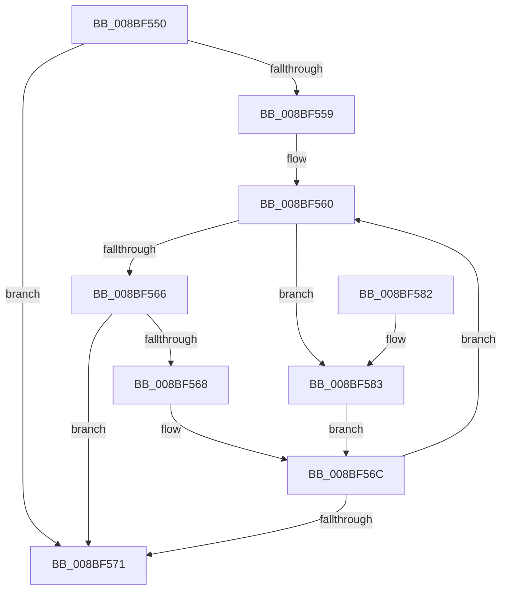

# ExpWnfFindStateName

- RVA: `0x008BF550`–`0x008BF588` (길이 `56` bytes)
- VA: `0x00000001408BF550`
- 실행 섹션: `PAGE`
- PDB 이름 있음: `예`; PDB Function 태그: `아니요`
- unwind 정보 RVA: `0x000DB714`
- 디코드: `19`개 명령, `56/56` bytes 표시
- 미해석 바이트: `0` (있으면 어셈블리에 `.byte`로 보존)

> 이 문서는 커널 이미지의 기계어와 PDB 기호를 분석해 생성했습니다. 4번과 5번은 함수 원형과 자료형을 바이너리 사용 방식에서 추정한 C 해석이며 원본 소스 복구 결과는 아닙니다.

## 1. Dependencies

- 직접 호출 지점: **0**; 고유 호출 대상: **0**
- 직접 호출자로 확인된 함수: **1**
- RIP 상대 이미지 참조: **0**

### Outgoing calls
- 직접 디코드된 call 명령이 없습니다.

### Direct callers
- [ExpWnfCreateNameInstance](ExpWnfCreateNameInstance_function_008BF590.md) at `0x008BF6C2`

### Static image references
- 디코드된 RIP-relative 메모리 참조가 없습니다.

## 2. Other-region calls and transfers

- 다른 실행 섹션으로 향하는 call: **0**
- 별도 외부 분기/꼬리 이동을 확인하지 못했습니다.

## 3. Assembly (complete function range)

```asm
008BF550  48 8B 41 38                     mov rax, qword ptr [rcx + 0x38]
008BF554  48 85 C0                        test rax, rax
008BF557  74 18                           je 0x1408bf571
008BF559  0F 1F 80 00 00 00 00            nop dword ptr [rax]
008BF560  48 3B 50 18                     cmp rdx, qword ptr [rax + 0x18]
008BF564  72 1D                           jb 0x1408bf583
008BF566  76 09                           jbe 0x1408bf571
008BF568  48 8B 40 08                     mov rax, qword ptr [rax + 8]
008BF56C  48 85 C0                        test rax, rax
008BF56F  75 EF                           jne 0x1408bf560
008BF571  33 D2                           xor edx, edx
008BF573  48 8D 48 F0                     lea rcx, [rax - 0x10]
008BF577  48 85 C0                        test rax, rax
008BF57A  48 0F 44 CA                     cmove rcx, rdx
008BF57E  48 8B C1                        mov rax, rcx
008BF581  C3                              ret
008BF582  CC                              int3
008BF583  48 8B 00                        mov rax, qword ptr [rax]
008BF586  EB E4                           jmp 0x1408bf56c
```

## 4. C-style interpretation (structured pseudocode)

```c
__int64 __fastcall ExpWnfFindStateName(__int64 a1, __int64 a2)
{
    if (*(unsigned __int64 *)(a1 + 56) == 0) goto loc_008BF571;
loc_008BF560:
    if (a2 < (*(unsigned __int64 *)(*(unsigned __int64 *)(a1 + 56) + 24))) goto loc_008BF583;
    if (a2 <= (*(unsigned __int64 *)(*(unsigned __int64 *)(a1 + 56) + 24))) goto loc_008BF571;
loc_008BF56C:
    if (*(unsigned __int64 *)(*(unsigned __int64 *)(a1 + 56) + 8) != 0) goto loc_008BF560;
loc_008BF571:
    a2 = 0;
    a1 = *(unsigned __int64 *)(*(unsigned __int64 *)(a1 + 56) + 8) - 16;
    if (*(unsigned __int64 *)(*(unsigned __int64 *)(a1 + 56) + 8) == 0) { a1 = 0; }
    return a1;
loc_008BF583:
    goto loc_008BF56C;
}
```

## 5. (Beta) C Style

```c
void *ExpWnfFindStateName(void *Arg1, int64_t Arg2)
{
    uint8_t *arg1 = (uint8_t *)Arg1;

    if (*(uint64_t *)(arg1 + 0x38) == 0) goto loc_008BF571;
loc_008BF560:
    if (Arg2 < (*(uint64_t *)(*(uint64_t *)(arg1 + 0x38) + 0x18))) goto loc_008BF583;
    if (Arg2 <= (*(uint64_t *)(*(uint64_t *)(arg1 + 0x38) + 0x18))) goto loc_008BF571;
loc_008BF56C:
    if (*(uint64_t *)(*(uint64_t *)(arg1 + 0x38) + 0x8) != 0) goto loc_008BF560;
loc_008BF571:
    Arg2 = 0;
    Arg1 = *(uint64_t *)(*(uint64_t *)(arg1 + 0x38) + 0x8) - 16;
    if (*(uint64_t *)(*(uint64_t *)(arg1 + 0x38) + 0x8) == 0) { Arg1 = 0; }
    return Arg1;
loc_008BF583:
    goto loc_008BF56C;
}
```

### 관측된 메모리 오프셋

구조체 형식이 확인되지 않은 접근은 인자 기준의 오프셋으로만 기록했습니다.

| 기준 인자 | 오프셋 표현 | 폭 (bit) | 접근 |
|---|---:|---:|---|
| `Arg1` | `+ 0x38` | `64` | `R` |

## 6. Execution-region graph

[열기: 2D/3D 그래프와 함수 탐색 컨트롤 패널](../../../control-panel.html?section=page&rva=0x008BF550&view=graph)

- 2D 그래프는 위에서 아래로 흐르고, 3D 그래프는 빈 공간을 드래그해 회전합니다. Shift+드래그는 이동, 휠은 확대·축소, 함수 노드 선택은 대상 보고서 이동입니다.

### Static fallback


