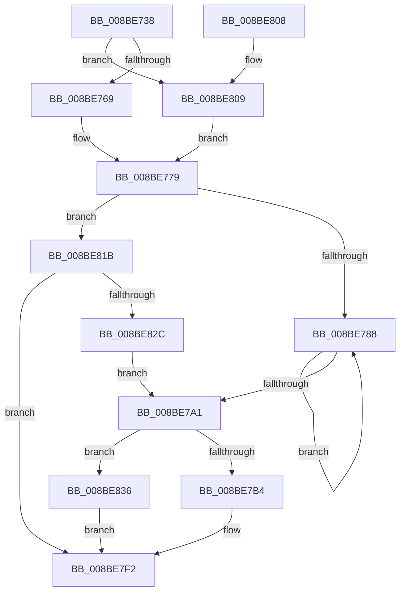

# ExpWnfGenerateStateName

- RVA: `0x008BE738`–`0x008BE83D` (길이 `261` bytes)
- VA: `0x00000001408BE738`
- 실행 섹션: `PAGE`
- PDB 이름 있음: `예`; PDB Function 태그: `아니요`
- unwind 정보 RVA: `0x000831F4`
- 디코드: `67`개 명령, `261/261` bytes 표시
- 미해석 바이트: `0` (있으면 어셈블리에 `.byte`로 보존)

> 이 문서는 커널 이미지의 기계어와 PDB 기호를 분석해 생성했습니다. 4번과 5번은 함수 원형과 자료형을 바이너리 사용 방식에서 추정한 C 해석이며 원본 소스 복구 결과는 아닙니다.

## 1. Dependencies

- 직접 호출 지점: **5**; 고유 호출 대상: **5**
- 직접 호출자로 확인된 함수: **1**
- RIP 상대 이미지 참조: **0**

### Outgoing calls
- `0x008BE769` → [HalAdjustResourceList](../../text/48/HalAdjustResourceList_function_0048FDC0.md) (function, `0x0048FDC0`)
- `0x008BE774` → [PsGetServerSiloGlobals](../../text/22/PsGetServerSiloGlobals_function_002250A0.md) (function, `0x002250A0`)
- `0x008BE809` → [PsGetCurrentServerSilo](../../text/22/PsGetCurrentServerSilo_function_00225710.md) (function, `0x00225710`)
- `0x008BE811` → [PsGetCurrentServerSiloGlobals](../../text/2F/PsGetCurrentServerSiloGlobals_function_002FE1F0.md) (function, `0x002FE1F0`)
- `0x008BE823` → [ExpWnfAllocateNextPersistentNameSequence](ExpWnfAllocateNextPersistentNameSequence_function_008BDE84.md) (function, `0x008BDE84`)

### Direct callers
- [NtCreateWnfStateName](NtCreateWnfStateName_function_008BE2B0.md) at `0x008BE434`

### Static image references
- 디코드된 RIP-relative 메모리 참조가 없습니다.

## 2. Other-region calls and transfers

- 다른 실행 섹션으로 향하는 call: **4**
  - `0x008BE769` → [HalAdjustResourceList](../../text/48/HalAdjustResourceList_function_0048FDC0.md) (`PAGE` → `.text`)
  - `0x008BE774` → [PsGetServerSiloGlobals](../../text/22/PsGetServerSiloGlobals_function_002250A0.md) (`PAGE` → `.text`)
  - `0x008BE809` → [PsGetCurrentServerSilo](../../text/22/PsGetCurrentServerSilo_function_00225710.md) (`PAGE` → `.text`)
  - `0x008BE811` → [PsGetCurrentServerSiloGlobals](../../text/2F/PsGetCurrentServerSiloGlobals_function_002FE1F0.md) (`PAGE` → `.text`)
- 별도 외부 분기/꼬리 이동을 확인하지 못했습니다.

## 3. Assembly (complete function range)

```asm
008BE738  48 8B C4                        mov rax, rsp
008BE73B  48 89 58 08                     mov qword ptr [rax + 8], rbx
008BE73F  48 89 70 10                     mov qword ptr [rax + 0x10], rsi
008BE743  48 89 78 18                     mov qword ptr [rax + 0x18], rdi
008BE747  41 56                           push r14
008BE749  48 83 EC 30                     sub rsp, 0x30
008BE74D  48 83 60 E8 00                  and qword ptr [rax - 0x18], 0
008BE752  41 8A F1                        mov sil, r9b
008BE755  41 8B F8                        mov edi, r8d
008BE758  4C 8B F1                        mov r14, rcx
008BE75B  8B DA                           mov ebx, edx
008BE75D  8D 47 FC                        lea eax, [rdi - 4]
008BE760  83 F8 01                        cmp eax, 1
008BE763  0F 87 A0 00 00 00               ja 0x1408be809
008BE769  E8 52 16 BD FF                  call 0x14048fdc0
008BE76E  48 8B C8                        mov rcx, rax
008BE771  4C 8B D0                        mov r10, rax
008BE774  E8 27 69 96 FF                  call 0x1402250a0
008BE779  4C 8B C8                        mov r9, rax
008BE77C  8D 43 FE                        lea eax, [rbx - 2]
008BE77F  83 F8 01                        cmp eax, 1
008BE782  0F 87 93 00 00 00               ja 0x1408be81b
008BE788  BA 01 00 00 00                  mov edx, 1
008BE78D  F0 49 0F C1 91 A0 03 00 00      lock xadd qword ptr [r9 + 0x3a0], rdx
008BE796  48 83 C2 01                     add rdx, 1
008BE79A  48 89 54 24 20                  mov qword ptr [rsp + 0x20], rdx
008BE79F  74 E7                           je 0x1408be788
008BE7A1  48 B8 00 00 00 00 00 00 E0 FF   movabs rax, 0xffe0000000000000
008BE7AB  48 85 D0                        test rax, rdx
008BE7AE  0F 85 82 00 00 00               jne 0x1408be836
008BE7B4  0F B6 C3                        movzx eax, bl
008BE7B7  48 C1 E0 04                     shl rax, 4
008BE7BB  83 E0 30                        and eax, 0x30
008BE7BE  40 0F B6 CF                     movzx ecx, dil
008BE7C2  48 C1 E1 06                     shl rcx, 6
008BE7C6  81 E1 C0 03 00 00               and ecx, 0x3c0
008BE7CC  48 33 C8                        xor rcx, rax
008BE7CF  48 83 F1 01                     xor rcx, 1
008BE7D3  40 F6 DE                        neg sil
008BE7D6  48 1B C0                        sbb rax, rax
008BE7D9  48 C1 E2 0B                     shl rdx, 0xb
008BE7DD  25 00 04 00 00                  and eax, 0x400
008BE7E2  25 FF 07 00 00                  and eax, 0x7ff
008BE7E7  48 0B C8                        or rcx, rax
008BE7EA  48 0B CA                        or rcx, rdx
008BE7ED  49 89 0E                        mov qword ptr [r14], rcx
008BE7F0  33 C0                           xor eax, eax
008BE7F2  48 8B 5C 24 40                  mov rbx, qword ptr [rsp + 0x40]
008BE7F7  48 8B 74 24 48                  mov rsi, qword ptr [rsp + 0x48]
008BE7FC  48 8B 7C 24 50                  mov rdi, qword ptr [rsp + 0x50]
008BE801  48 83 C4 30                     add rsp, 0x30
008BE805  41 5E                           pop r14
008BE807  C3                              ret
008BE808  CC                              int3
008BE809  E8 02 6F 96 FF                  call 0x140225710
008BE80E  4C 8B D0                        mov r10, rax
008BE811  E8 DA F9 A3 FF                  call 0x1402fe1f0
008BE816  E9 5E FF FF FF                  jmp 0x1408be779
008BE81B  48 8D 54 24 20                  lea rdx, [rsp + 0x20]
008BE820  49 8B CA                        mov rcx, r10
008BE823  E8 5C F6 FF FF                  call 0x1408bde84
008BE828  85 C0                           test eax, eax
008BE82A  78 C6                           js 0x1408be7f2
008BE82C  48 8B 54 24 20                  mov rdx, qword ptr [rsp + 0x20]
008BE831  E9 6B FF FF FF                  jmp 0x1408be7a1
008BE836  B8 01 00 00 C0                  mov eax, 0xc0000001
008BE83B  EB B5                           jmp 0x1408be7f2
```

## 4. C-style interpretation (structured pseudocode)

```c
__int64 __fastcall ExpWnfGenerateStateName(__int64 a1, int a2, int a3, unsigned __int8 a4)
{
    __int64 result;
    __int64 v_rsi;
    __int64 v_rsp;
    unsigned __int64 v_stack_m18;
    unsigned __int64 v_stack_p10;
    unsigned __int64 v_stack_p18;
    unsigned __int64 v_stack_p20;
    unsigned __int64 v_stack_p8;

    *(unsigned __int64 *)(v_rsp + 8) = v_rbx;
    *(unsigned __int64 *)(v_rsp + 16) = v_rsi;
    *(unsigned __int64 *)(v_rsp + 24) = v_rdi;
    v_rsp = (v_rsp) - (48);
    if (((unsigned int)((unsigned int)(a3) - 4)) > 1) goto loc_008BE809;
    result = HalAdjustResourceList(a1, a2, a3, a4);
    result = PsGetServerSiloGlobals(result, a2, a3, a4);
loc_008BE779:
    if (((unsigned int)((unsigned int)(a2) - 2)) > 1) goto loc_008BE81B;
loc_008BE788:
    a2 = (1) + (1);
    v_stack_m18 = a2;
    if (condition_is_equal) goto loc_008BE788;
loc_008BE7A1:
    if ((((unsigned int)(a2) - 2) & (a2)) != 0) goto loc_008BE836;
    result = ((unsigned __int8)((unsigned int)(a2))) << (4);
    result = (unsigned int)((result) & (48));
    a1 = ((unsigned __int8)((unsigned int)(a3))) << (6);
    a1 = (unsigned int)((a1) & (960));
    a1 = (a1) ^ (result);
    a1 = (a1) ^ (1);
    v_rsi = (unsigned __int8)(-(a4));
    a2 = (a2) << (11);
    result = (unsigned int)((result) & (0x400ULL));
    result = (unsigned int)((result) & (0x7FFULL));
    a1 = (a1) | (result);
    a1 = (a1) | (a2);
    *(unsigned __int64 *)(a1) = a1;
    result = 0;
loc_008BE7F2:
    v_rsp = (v_rsp) + (48);
    return result;
loc_008BE809:
    result = PsGetCurrentServerSilo(a1, a2, a3, result);
    result = PsGetCurrentServerSiloGlobals(a1, a2, a3, result);
    goto loc_008BE779;
loc_008BE81B:
    result = ExpWnfAllocateNextPersistentNameSequence(result, v_stack_p20, a3, result);
    if (sign_flag) goto loc_008BE7F2;
    goto loc_008BE7A1;
loc_008BE836:
    goto loc_008BE7F2;
}
```

## 5. (Beta) C Style

```c
int64_t ExpWnfGenerateStateName(void *Arg1, void *Arg2, void *Arg3, uint8_t Arg4)
{
    uint8_t *arg1 = (uint8_t *)Arg1;
    uint8_t *arg2 = (uint8_t *)Arg2;
    uint8_t *arg3 = (uint8_t *)Arg3;

    int64_t result;
    int64_t local_rsi;
    int64_t local_rsp;
    uint64_t v_stack_m18;
    uint64_t v_stack_p10;
    uint64_t v_stack_p18;
    uint64_t v_stack_p20;
    uint64_t v_stack_p8;

    *(uint64_t *)(local_rsp + 0x8) = local_rbx;
    *(uint64_t *)(local_rsp + 0x10) = local_rsi;
    *(uint64_t *)(local_rsp + 0x18) = local_rdi;
    local_rsp = (local_rsp) - (48);
    if (((uint32_t)((uint32_t)(Arg3) - 4)) > 1) goto loc_008BE809;
    result = HalAdjustResourceList(Arg1, Arg2, Arg3, Arg4);
    result = PsGetServerSiloGlobals(result, Arg2, Arg3, Arg4);
loc_008BE779:
    if (((uint32_t)((uint32_t)(Arg2) - 2)) > 1) goto loc_008BE81B;
loc_008BE788:
    Arg2 = (1) + (1);
    v_stack_m18 = Arg2;
    if (condition_is_equal) goto loc_008BE788;
loc_008BE7A1:
    if ((((uint32_t)(Arg2) - 2) & (Arg2)) != 0) goto loc_008BE836;
    result = ((uint8_t)((uint32_t)(Arg2))) << (4);
    result = (uint32_t)((result) & (48));
    Arg1 = ((uint8_t)((uint32_t)(Arg3))) << (6);
    Arg1 = (uint32_t)((Arg1) & (960));
    Arg1 = (Arg1) ^ (result);
    Arg1 = (Arg1) ^ (1);
    local_rsi = (uint8_t)(-(Arg4));
    Arg2 = (Arg2) << (11);
    result = (uint32_t)((result) & (0x400ULL));
    result = (uint32_t)((result) & (0x7FFULL));
    Arg1 = (Arg1) | (result);
    Arg1 = (Arg1) | (Arg2);
    *(void **)(arg1) = Arg1;
    result = 0;
loc_008BE7F2:
    local_rsp = (local_rsp) + (48);
    return result;
loc_008BE809:
    result = PsGetCurrentServerSilo(Arg1, Arg2, Arg3, result);
    result = PsGetCurrentServerSiloGlobals(Arg1, Arg2, Arg3, result);
    goto loc_008BE779;
loc_008BE81B:
    result = ExpWnfAllocateNextPersistentNameSequence(result, v_stack_p20, Arg3, result);
    if (sign_flag) goto loc_008BE7F2;
    goto loc_008BE7A1;
loc_008BE836:
    goto loc_008BE7F2;
}
```

### 관측된 메모리 오프셋

구조체 형식이 확인되지 않은 접근은 인자 기준의 오프셋으로만 기록했습니다.

| 기준 인자 | 오프셋 표현 | 폭 (bit) | 접근 |
|---|---:|---:|---|
| `Arg1` | `+ 0x0` | `64` | `W` |
| `Arg2` | `- 0x2` | `32` | `R` |
| `Arg3` | `- 0x4` | `32` | `R` |

## 6. Execution-region graph

[열기: 2D/3D 그래프와 함수 탐색 컨트롤 패널](../../../control-panel.html?section=page&rva=0x008BE738&view=graph)

- 2D 그래프는 위에서 아래로 흐르고, 3D 그래프는 빈 공간을 드래그해 회전합니다. Shift+드래그는 이동, 휠은 확대·축소, 함수 노드 선택은 대상 보고서 이동입니다.

### Static fallback


