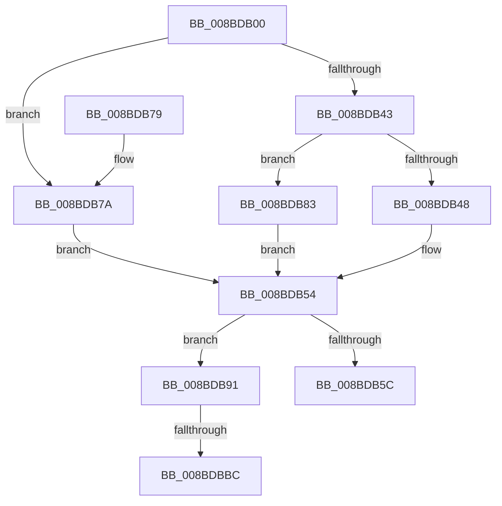

# ExpWnfGetNameStoreRegistryRoot

- RVA: `0x008BDB00`–`0x008BDBC5` (길이 `197` bytes)
- VA: `0x00000001408BDB00`
- 실행 섹션: `PAGE`
- PDB 이름 있음: `예`; PDB Function 태그: `예`
- unwind 정보 RVA: `0x000830E0`
- 디코드: `54`개 명령, `197/197` bytes 표시
- 미해석 바이트: `0` (있으면 어셈블리에 `.byte`로 보존)

> 이 문서는 커널 이미지의 기계어와 PDB 기호를 분석해 생성했습니다. 4번과 5번은 함수 원형과 자료형을 바이너리 사용 방식에서 추정한 C 해석이며 원본 소스 복구 결과는 아닙니다.

## 1. Dependencies

- 직접 호출 지점: **2**; 고유 호출 대상: **1**
- 직접 호출자로 확인된 함수: **5**
- RIP 상대 이미지 참조: **3**

### Outgoing calls
- `0x008BDB48` → [PsGetCurrentServerSiloGlobals](../../text/2F/PsGetCurrentServerSiloGlobals_function_002FE1F0.md) (function, `0x002FE1F0`)
- `0x008BDB83` → [PsGetCurrentServerSiloGlobals](../../text/2F/PsGetCurrentServerSiloGlobals_function_002FE1F0.md) (function, `0x002FE1F0`)

### Direct callers
- [ExpWnfGetPermanentDataStoreHandleByScopeId](../7D/ExpWnfGetPermanentDataStoreHandleByScopeId_function_007D65F8.md) at `0x007D6659`
- [ExpWnfLookupPermanentName](ExpWnfLookupPermanentName_function_008BD914.md) at `0x008BD996`
- [ExpWnfAllocateNextPersistentNameSequence](ExpWnfAllocateNextPersistentNameSequence_function_008BDE84.md) at `0x008BDEFD`
- [ExpWnfAllocateNextPersistentNameSequence](ExpWnfAllocateNextPersistentNameSequence_function_008BDE84.md) at `0x008BDFEC`
- [ExpWnfRegisterPermanentName](ExpWnfRegisterPermanentName_function_008BE17C.md) at `0x008BE1D8`
- [ExpWnfDeletePermanentName](../A9/ExpWnfDeletePermanentName_function_00A99434.md) at `0x00A99484`

### Static image references
- `0x008BDB7A` → RVA `0x00FDA350` (`PAGEDATA`; read)
- `0x008BDB96` → RVA `0x00B4F0D0` (`ExpWnfNameStoreDescriptors`; read)
- `0x008BDB9D` → RVA `0x00EEFB6C` (`.data`; read)

## 2. Other-region calls and transfers

- 다른 실행 섹션으로 향하는 call: **2**
  - `0x008BDB48` → [PsGetCurrentServerSiloGlobals](../../text/2F/PsGetCurrentServerSiloGlobals_function_002FE1F0.md) (`PAGE` → `.text`)
  - `0x008BDB83` → [PsGetCurrentServerSiloGlobals](../../text/2F/PsGetCurrentServerSiloGlobals_function_002FE1F0.md) (`PAGE` → `.text`)
- call이 아닌 외부 분기/꼬리 이동: **2**
  - `0x008BDBB6` → [sub_00B1AC80](../B1/Unknown_function_00B1AC80.md) (`tail-transfer`)
  - `0x008BDBC0` → [sub_00B1AC80](../B1/Unknown_function_00B1AC80.md) (`tail-transfer`)

## 3. Assembly (complete function range)

```asm
008BDB00  48 89 5C 24 10                  mov qword ptr [rsp + 0x10], rbx
008BDB05  48 89 74 24 20                  mov qword ptr [rsp + 0x20], rsi
008BDB0A  55                              push rbp
008BDB0B  57                              push rdi
008BDB0C  41 56                           push r14
008BDB0E  48 8B EC                        mov rbp, rsp
008BDB11  48 83 EC 70                     sub rsp, 0x70
008BDB15  83 65 20 00                     and dword ptr [rbp + 0x20], 0
008BDB19  33 C0                           xor eax, eax
008BDB1B  48 21 45 30                     and qword ptr [rbp + 0x30], rax
008BDB1F  0F 57 C0                        xorps xmm0, xmm0
008BDB22  48 89 45 F0                     mov qword ptr [rbp - 0x10], rax
008BDB26  4C 8B F2                        mov r14, rdx
008BDB29  89 45 F8                        mov dword ptr [rbp - 8], eax
008BDB2C  48 63 C1                        movsxd rax, ecx
008BDB2F  0F 11 45 D0                     movups xmmword ptr [rbp - 0x30], xmm0
008BDB33  0F 11 45 E0                     movups xmmword ptr [rbp - 0x20], xmm0
008BDB37  48 8D 3C 40                     lea rdi, [rax + rax*2]
008BDB3B  48 C1 E7 04                     shl rdi, 4
008BDB3F  85 C9                           test ecx, ecx
008BDB41  74 37                           je 0x1408bdb7a
008BDB43  83 F9 01                        cmp ecx, 1
008BDB46  74 3B                           je 0x1408bdb83
008BDB48  E8 A3 06 A4 FF                  call 0x1402fe1f0
008BDB4D  48 8D 98 80 03 00 00            lea rbx, [rax + 0x380]
008BDB54  48 8B 03                        mov rax, qword ptr [rbx]
008BDB57  48 85 C0                        test rax, rax
008BDB5A  74 35                           je 0x1408bdb91
008BDB5C  48 8B 03                        mov rax, qword ptr [rbx]
008BDB5F  48 89 02                        mov qword ptr [rdx], rax
008BDB62  33 C0                           xor eax, eax
008BDB64  4C 8D 5C 24 70                  lea r11, [rsp + 0x70]
008BDB69  49 8B 5B 28                     mov rbx, qword ptr [r11 + 0x28]
008BDB6D  49 8B 73 38                     mov rsi, qword ptr [r11 + 0x38]
008BDB71  49 8B E3                        mov rsp, r11
008BDB74  41 5E                           pop r14
008BDB76  5F                              pop rdi
008BDB77  5D                              pop rbp
008BDB78  C3                              ret
008BDB79  CC                              int3
008BDB7A  48 8D 1D CF C7 71 00            lea rbx, [rip + 0x71c7cf]
008BDB81  EB D1                           jmp 0x1408bdb54
008BDB83  E8 68 06 A4 FF                  call 0x1402fe1f0
008BDB88  48 8D 98 78 03 00 00            lea rbx, [rax + 0x378]
008BDB8F  EB C3                           jmp 0x1408bdb54
008BDB91  48 83 65 D8 00                  and qword ptr [rbp - 0x28], 0
008BDB96  48 8D 35 33 15 29 00            lea rsi, [rip + 0x291533]
008BDB9D  83 3D C8 1F 63 00 00            cmp dword ptr [rip + 0x631fc8], 0
008BDBA4  48 8D 46 18                     lea rax, [rsi + 0x18]
008BDBA8  C7 45 D0 30 00 00 00            mov dword ptr [rbp - 0x30], 0x30
008BDBAF  C7 45 E8 40 02 00 00            mov dword ptr [rbp - 0x18], 0x240
008BDBB6  0F 85 C4 D0 25 00               jne 0x140b1ac80
008BDBBC  48 8D 46 08                     lea rax, [rsi + 8]
008BDBC0  E9 BB D0 25 00                  jmp 0x140b1ac80
```

## 4. C-style interpretation (structured pseudocode)

```c
__int64 __fastcall ExpWnfGetNameStoreRegistryRoot(int a1, __int64 a2)
{
    __int64 result;
    __int64 v_rdi;
    __int64 v_rsp;
    unsigned __int64 v_stack_m18;
    unsigned int v_stack_m20;
    unsigned __int64 v_stack_m28;
    unsigned int v_stack_m30;
    unsigned __int64 v_stack_m38;
    unsigned __int64 v_stack_m40;
    unsigned __int64 v_stack_m48;
    unsigned __int64 v_stack_p10;
    unsigned __int64 v_stack_p18;
    unsigned __int64 v_stack_p20;
    unsigned int v_stack_p8;

    v_stack_p10 = v_rbx;
    v_stack_p20 = v_rsi;
    v_rsp = (v_rsp) - (112);
    result = 0;
    v_stack_m28 = 0;
    v_stack_m20 = 0;
    v_stack_m48 = v_xmm0;
    v_stack_m38 = v_xmm0;
    v_rdi = ((int)(a1) + (int)(a1) * 2) << (4);
    if (a1 == 0) goto loc_008BDB7A;
    if (a1 == 1) goto loc_008BDB83;
    result = PsGetCurrentServerSiloGlobals(a1, a2, a3, a4);
loc_008BDB54:
    if (*(unsigned __int64 *)(result + 896) == 0) goto loc_008BDB91;
    *(unsigned __int64 *)(a2) = *(unsigned __int64 *)(result + 896);
    result = 0;
    return result;
loc_008BDB7A:
    goto loc_008BDB54;
loc_008BDB83:
    result = PsGetCurrentServerSiloGlobals(a1, a2, a3, a4);
    goto loc_008BDB54;
loc_008BDB91:
    v_stack_m48 = 48;
    v_stack_m30 = 576;
}
```

## 5. (Beta) C Style

```c
int64_t ExpWnfGetNameStoreRegistryRoot(void *Arg1, int64_t Arg2)
{
    uint8_t *arg1 = (uint8_t *)Arg1;

    int64_t result;
    int64_t local_rdi;
    int64_t local_rsp;
    uint64_t v_stack_m18;
    uint32_t v_stack_m20;
    uint64_t v_stack_m28;
    uint32_t v_stack_m30;
    uint64_t v_stack_m38;
    uint64_t v_stack_m40;
    uint64_t v_stack_m48;
    uint64_t v_stack_p10;
    uint64_t v_stack_p18;
    uint64_t v_stack_p20;
    uint32_t v_stack_p8;

    v_stack_p10 = local_rbx;
    v_stack_p20 = local_rsi;
    local_rsp = (local_rsp) - (112);
    result = 0;
    v_stack_m28 = 0;
    v_stack_m20 = 0;
    v_stack_m48 = v_xmm0;
    v_stack_m38 = v_xmm0;
    local_rdi = ((int32_t)(Arg1) + (int32_t)(Arg1) * 2) << (4);
    if (Arg1 == NULL) goto loc_008BDB7A;
    if (Arg1 == 1) goto loc_008BDB83;
    result = PsGetCurrentServerSiloGlobals(Arg1, Arg2, a3, a4);
loc_008BDB54:
    if (*(uint64_t *)(result + 0x380) == 0) goto loc_008BDB91;
    *(uint64_t *)(Arg2) = *(uint64_t *)(result + 0x380);
    result = 0;
    return result;
loc_008BDB7A:
    goto loc_008BDB54;
loc_008BDB83:
    result = PsGetCurrentServerSiloGlobals(Arg1, Arg2, a3, a4);
    goto loc_008BDB54;
loc_008BDB91:
    v_stack_m48 = 48;
    v_stack_m30 = 576;
}
```

### 관측된 메모리 오프셋

구조체 형식이 확인되지 않은 접근은 인자 기준의 오프셋으로만 기록했습니다.

| 기준 인자 | 오프셋 표현 | 폭 (bit) | 접근 |
|---|---:|---:|---|
| `Arg1` | `+ 0x0 + rax*2` | `64` | `R` |

## 6. Execution-region graph

[열기: 2D/3D 그래프와 함수 탐색 컨트롤 패널](../../../control-panel.html?section=page&rva=0x008BDB00&view=graph)

- 2D 그래프는 위에서 아래로 흐르고, 3D 그래프는 빈 공간을 드래그해 회전합니다. Shift+드래그는 이동, 휠은 확대·축소, 함수 노드 선택은 대상 보고서 이동입니다.

### Static fallback


