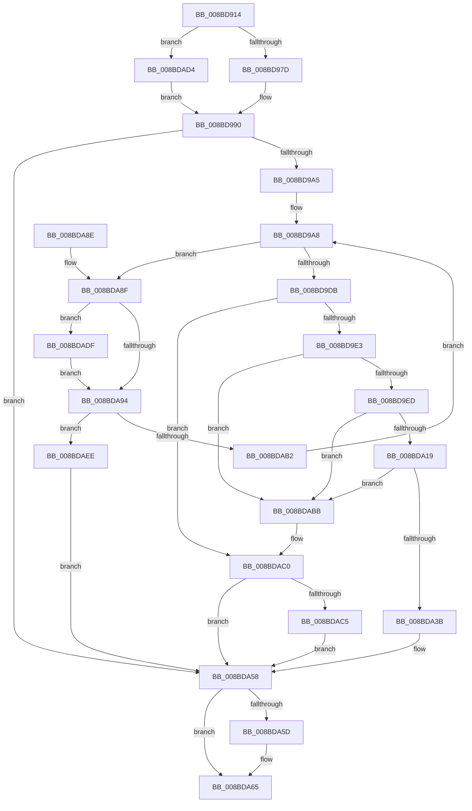

# ExpWnfLookupPermanentName

- RVA: `0x008BD914`–`0x008BDAF8` (길이 `484` bytes)
- VA: `0x00000001408BD914`
- 실행 섹션: `PAGE`
- PDB 이름 있음: `예`; PDB Function 태그: `아니요`
- unwind 정보 RVA: `0x000830BC`
- 디코드: `136`개 명령, `484/484` bytes 표시
- 미해석 바이트: `0` (있으면 어셈블리에 `.byte`로 보존)

> 이 문서는 커널 이미지의 기계어와 PDB 기호를 분석해 생성했습니다. 4번과 5번은 함수 원형과 자료형을 바이너리 사용 방식에서 추정한 C 해석이며 원본 소스 복구 결과는 아닙니다.

## 1. Dependencies

- 직접 호출 지점: **13**; 고유 호출 대상: **12**
- 직접 호출자로 확인된 함수: **7**
- RIP 상대 이미지 참조: **1**

### Outgoing calls
- `0x008BD96B` → [ExpWnfComposeValueName](ExpWnfComposeValueName_function_008BDBCC.md) (function, `0x008BDBCC`)
- `0x008BD97D` → [HalAdjustResourceList](../../text/48/HalAdjustResourceList_function_0048FDC0.md) (function, `0x0048FDC0`)
- `0x008BD985` → [PsAttachSiloToCurrentThread](../../text/44/PsAttachSiloToCurrentThread_function_004428C0.md) (function, `0x004428C0`)
- `0x008BD996` → [ExpWnfGetNameStoreRegistryRoot](ExpWnfGetNameStoreRegistryRoot_function_008BDB00.md) (function, `0x008BDB00`)
- `0x008BD9C9` → [ZwQueryValueKey](../../text/6A/ZwQueryValueKey_function_006AD3B0.md) (function, `0x006AD3B0`)
- `0x008BDA0C` → [RtlValidRelativeSecurityDescriptor](RtlValidRelativeSecurityDescriptor_function_008BDC70.md) (function, `0x008BDC70`)
- `0x008BDA1D` → [ExpWnfSpecializeSecurityDescriptor](ExpWnfSpecializeSecurityDescriptor_function_008BE68C.md) (function, `0x008BE68C`)
- `0x008BDA26` → [RtlLengthSecurityDescriptor](RtlLengthSecurityDescriptor_function_008BC870.md) (function, `0x008BC870`)
- `0x008BDA60` → [PsDetachSiloFromCurrentThread](../../text/44/PsDetachSiloFromCurrentThread_function_00449AC0.md) (function, `0x00449AC0`)
- `0x008BDA6E` → [_security_check_cookie](../../text/6A/_security_check_cookie_function_006AC640.md) (function, `0x006AC640`)
- `0x008BDAA5` → [ExAllocatePool2](../../poolcode/B8/ExAllocatePool2_function_00B820F0.md) (function, `0x00B820F0`)
- `0x008BDACD` → [ExFreePoolWithTag](../../poolcode/B8/ExFreePoolWithTag_function_00B82870.md) (function, `0x00B82870`)
- `0x008BDAE7` → [ExFreePoolWithTag](../../poolcode/B8/ExFreePoolWithTag_function_00B82870.md) (function, `0x00B82870`)

### Direct callers
- [ExpNtDeleteWnfStateData](../7C/ExpNtDeleteWnfStateData_function_007CF1A8.md) at `0x007CF3BB`
- [NtDeleteWnfStateName](../90/NtDeleteWnfStateName_function_00908E60.md) at `0x00909153`
- [NtQueryWnfStateData](../90/NtQueryWnfStateData_function_00909DF0.md) at `0x0090A546`
- [ExpNtUpdateWnfStateData](../90/ExpNtUpdateWnfStateData_function_0090A7A0.md) at `0x0090B0EE`
- [ExpWnfCheckCrossScopeAccess](../90/ExpWnfCheckCrossScopeAccess_function_0090CA94.md) at `0x0090CADA`
- [ExpWnfSubscribeWnfStateChange](../9D/ExpWnfSubscribeWnfStateChange_function_009D4D0C.md) at `0x009D4FE8`
- [NtQueryWnfStateNameInformation](../9E/NtQueryWnfStateNameInformation_function_009EBD20.md) at `0x009EBF40`

### Static image references
- `0x008BD92E` → RVA `0x00E0A740` (`.data`; read)

## 2. Other-region calls and transfers

- 다른 실행 섹션으로 향하는 call: **8**
  - `0x008BD97D` → [HalAdjustResourceList](../../text/48/HalAdjustResourceList_function_0048FDC0.md) (`PAGE` → `.text`)
  - `0x008BD985` → [PsAttachSiloToCurrentThread](../../text/44/PsAttachSiloToCurrentThread_function_004428C0.md) (`PAGE` → `.text`)
  - `0x008BD9C9` → [ZwQueryValueKey](../../text/6A/ZwQueryValueKey_function_006AD3B0.md) (`PAGE` → `.text`)
  - `0x008BDA60` → [PsDetachSiloFromCurrentThread](../../text/44/PsDetachSiloFromCurrentThread_function_00449AC0.md) (`PAGE` → `.text`)
  - `0x008BDA6E` → [_security_check_cookie](../../text/6A/_security_check_cookie_function_006AC640.md) (`PAGE` → `.text`)
  - `0x008BDAA5` → [ExAllocatePool2](../../poolcode/B8/ExAllocatePool2_function_00B820F0.md) (`PAGE` → `POOLCODE`)
  - `0x008BDACD` → [ExFreePoolWithTag](../../poolcode/B8/ExFreePoolWithTag_function_00B82870.md) (`PAGE` → `POOLCODE`)
  - `0x008BDAE7` → [ExFreePoolWithTag](../../poolcode/B8/ExFreePoolWithTag_function_00B82870.md) (`PAGE` → `POOLCODE`)
- 별도 외부 분기/꼬리 이동을 확인하지 못했습니다.

## 3. Assembly (complete function range)

```asm
008BD914  48 89 5C 24 18                  mov qword ptr [rsp + 0x18], rbx
008BD919  55                              push rbp
008BD91A  56                              push rsi
008BD91B  57                              push rdi
008BD91C  41 54                           push r12
008BD91E  41 55                           push r13
008BD920  41 56                           push r14
008BD922  41 57                           push r15
008BD924  48 8B EC                        mov rbp, rsp
008BD927  48 81 EC 80 00 00 00            sub rsp, 0x80
008BD92E  48 8B 05 0B CE 54 00            mov rax, qword ptr [rip + 0x54ce0b]
008BD935  48 33 C4                        xor rax, rsp
008BD938  48 89 45 F8                     mov qword ptr [rbp - 8], rax
008BD93C  45 33 ED                        xor r13d, r13d
008BD93F  0F 57 C0                        xorps xmm0, xmm0
008BD942  0F 11 45 C0                     movups xmmword ptr [rbp - 0x40], xmm0
008BD946  4C 8B E2                        mov r12, rdx
008BD949  4C 89 6D B8                     mov qword ptr [rbp - 0x48], r13
008BD94D  48 8D 55 C0                     lea rdx, [rbp - 0x40]
008BD951  44 89 6D B0                     mov dword ptr [rbp - 0x50], r13d
008BD955  41 8D 45 22                     lea eax, [r13 + 0x22]
008BD959  48 8B D9                        mov rbx, rcx
008BD95C  66 89 45 C2                     mov word ptr [rbp - 0x3e], ax
008BD960  41 8B FD                        mov edi, r13d
008BD963  48 8D 45 D0                     lea rax, [rbp - 0x30]
008BD967  48 89 45 C8                     mov qword ptr [rbp - 0x38], rax
008BD96B  E8 5C 02 00 00                  call 0x1408bdbcc
008BD970  48 C1 EB 04                     shr rbx, 4
008BD974  83 E3 03                        and ebx, 3
008BD977  0F 85 57 01 00 00               jne 0x1408bdad4
008BD97D  E8 3E 24 BD FF                  call 0x14048fdc0
008BD982  48 8B C8                        mov rcx, rax
008BD985  E8 36 4F B8 FF                  call 0x1404428c0
008BD98A  4C 8B F0                        mov r14, rax
008BD98D  41 B7 01                        mov r15b, 1
008BD990  48 8D 55 B8                     lea rdx, [rbp - 0x48]
008BD994  8B CB                           mov ecx, ebx
008BD996  E8 65 01 00 00                  call 0x1408bdb00
008BD99B  8B D8                           mov ebx, eax
008BD99D  85 C0                           test eax, eax
008BD99F  0F 88 B3 00 00 00               js 0x1408bda58
008BD9A5  49 8B F5                        mov rsi, r13
008BD9A8  48 8B 4D B8                     mov rcx, qword ptr [rbp - 0x48]
008BD9AC  48 8D 45 B0                     lea rax, [rbp - 0x50]
008BD9B0  48 89 44 24 28                  mov qword ptr [rsp + 0x28], rax
008BD9B5  48 8D 55 C0                     lea rdx, [rbp - 0x40]
008BD9B9  8B 45 B0                        mov eax, dword ptr [rbp - 0x50]
008BD9BC  4C 8B CE                        mov r9, rsi
008BD9BF  41 B8 02 00 00 00               mov r8d, 2
008BD9C5  89 44 24 20                     mov dword ptr [rsp + 0x20], eax
008BD9C9  E8 E2 F9 DE FF                  call 0x1406ad3b0
008BD9CE  8B D8                           mov ebx, eax
008BD9D0  3D 23 00 00 C0                  cmp eax, 0xc0000023
008BD9D5  0F 84 B4 00 00 00               je 0x1408bda8f
008BD9DB  85 C0                           test eax, eax
008BD9DD  0F 88 DD 00 00 00               js 0x1408bdac0
008BD9E3  83 7E 04 03                     cmp dword ptr [rsi + 4], 3
008BD9E7  0F 85 CE 00 00 00               jne 0x1408bdabb
008BD9ED  48 8D 5E 0C                     lea rbx, [rsi + 0xc]
008BD9F1  0F 57 C0                        xorps xmm0, xmm0
008BD9F4  0F 11 07                        movups xmmword ptr [rdi], xmm0
008BD9F7  33 C0                           xor eax, eax
008BD9F9  45 33 C0                        xor r8d, r8d
008BD9FC  48 89 47 10                     mov qword ptr [rdi + 0x10], rax
008BDA00  48 8B CB                        mov rcx, rbx
008BDA03  8B 76 08                        mov esi, dword ptr [rsi + 8]
008BDA06  8B D6                           mov edx, esi
008BDA08  48 89 5F 10                     mov qword ptr [rdi + 0x10], rbx
008BDA0C  E8 5F 02 00 00                  call 0x1408bdc70
008BDA11  84 C0                           test al, al
008BDA13  0F 84 A2 00 00 00               je 0x1408bdabb
008BDA19  48 8B 4F 10                     mov rcx, qword ptr [rdi + 0x10]
008BDA1D  E8 6A 0C 00 00                  call 0x1408be68c
008BDA22  48 8B 4F 10                     mov rcx, qword ptr [rdi + 0x10]
008BDA26  E8 45 EE FF FF                  call 0x1408bc870
008BDA2B  2B F0                           sub esi, eax
008BDA2D  8B C0                           mov eax, eax
008BDA2F  48 03 D8                        add rbx, rax
008BDA32  83 FE 04                        cmp esi, 4
008BDA35  0F 82 80 00 00 00               jb 0x1408bdabb
008BDA3B  8B 03                           mov eax, dword ptr [rbx]
008BDA3D  48 8D 4B 04                     lea rcx, [rbx + 4]
008BDA41  89 07                           mov dword ptr [rdi], eax
008BDA43  41 8B DD                        mov ebx, r13d
008BDA46  8D 46 FC                        lea eax, [rsi - 4]
008BDA49  83 F8 10                        cmp eax, 0x10
008BDA4C  49 0F 42 CD                     cmovb rcx, r13
008BDA50  48 89 4F 08                     mov qword ptr [rdi + 8], rcx
008BDA54  49 89 3C 24                     mov qword ptr [r12], rdi
008BDA58  45 84 FF                        test r15b, r15b
008BDA5B  74 08                           je 0x1408bda65
008BDA5D  49 8B CE                        mov rcx, r14
008BDA60  E8 5B C0 B8 FF                  call 0x140449ac0
008BDA65  8B C3                           mov eax, ebx
008BDA67  48 8B 4D F8                     mov rcx, qword ptr [rbp - 8]
008BDA6B  48 33 CC                        xor rcx, rsp
008BDA6E  E8 CD EB DE FF                  call 0x1406ac640
008BDA73  48 8B 9C 24 D0 00 00 00         mov rbx, qword ptr [rsp + 0xd0]
008BDA7B  48 81 C4 80 00 00 00            add rsp, 0x80
008BDA82  41 5F                           pop r15
008BDA84  41 5E                           pop r14
008BDA86  41 5D                           pop r13
008BDA88  41 5C                           pop r12
008BDA8A  5F                              pop rdi
008BDA8B  5E                              pop rsi
008BDA8C  5D                              pop rbp
008BDA8D  C3                              ret
008BDA8E  CC                              int3
008BDA8F  48 85 FF                        test rdi, rdi
008BDA92  75 4B                           jne 0x1408bdadf
008BDA94  8B 55 B0                        mov edx, dword ptr [rbp - 0x50]
008BDA97  B9 00 01 00 00                  mov ecx, 0x100
008BDA9C  83 C2 18                        add edx, 0x18
008BDA9F  41 B8 57 6E 66 20               mov r8d, 0x20666e57
008BDAA5  E8 46 46 2C 00                  call 0x140b820f0
008BDAAA  48 8B F8                        mov rdi, rax
008BDAAD  48 85 C0                        test rax, rax
008BDAB0  74 3C                           je 0x1408bdaee
008BDAB2  48 8D 70 18                     lea rsi, [rax + 0x18]
008BDAB6  E9 ED FE FF FF                  jmp 0x1408bd9a8
008BDABB  BB 01 00 00 C0                  mov ebx, 0xc0000001
008BDAC0  48 85 FF                        test rdi, rdi
008BDAC3  74 93                           je 0x1408bda58
008BDAC5  BA 57 6E 66 20                  mov edx, 0x20666e57
008BDACA  48 8B CF                        mov rcx, rdi
008BDACD  E8 9E 4D 2C 00                  call 0x140b82870
008BDAD2  EB 84                           jmp 0x1408bda58
008BDAD4  4D 8B F5                        mov r14, r13
008BDAD7  45 8A FD                        mov r15b, r13b
008BDADA  E9 B1 FE FF FF                  jmp 0x1408bd990
008BDADF  BA 57 6E 66 20                  mov edx, 0x20666e57
008BDAE4  48 8B CF                        mov rcx, rdi
008BDAE7  E8 84 4D 2C 00                  call 0x140b82870
008BDAEC  EB A6                           jmp 0x1408bda94
008BDAEE  BB 9A 00 00 C0                  mov ebx, 0xc000009a
008BDAF3  E9 60 FF FF FF                  jmp 0x1408bda58
```

## 4. C-style interpretation (structured pseudocode)

```c
__int64 __fastcall ExpWnfLookupPermanentName(__int64 a1, __int64 a2)
{
    __int64 result;
    __int64 v_r13;
    __int64 v_rbx;
    __int64 v_rsi;
    __int64 v_rsp;
    unsigned __int64 v_stack_m40;
    unsigned __int64 v_stack_m68;
    unsigned __int64 v_stack_m70;
    unsigned __int16 v_stack_m76;
    unsigned __int64 v_stack_m78;
    unsigned __int64 v_stack_m80;
    unsigned int v_stack_m88;
    unsigned __int64 v_stack_m90;
    unsigned int v_stack_m98;
    unsigned __int64 v_stack_p18;

    v_stack_p18 = v_rbx;
    v_rsp = (v_rsp) - (128);
    result = (*(unsigned __int64 *)(v_rip + 5557771)) ^ (v_rsp);
    v_stack_m40 = result;
    v_r13 = 0;
    v_stack_m78 = v_xmm0;
    v_stack_m80 = 0;
    v_stack_m88 = 0;
    v_stack_m76 = (unsigned __int16)(v_r13 + 34);
    v_stack_m70 = v_stack_m68;
    result = ExpWnfComposeValueName(a1, v_stack_m78, a3, a4);
    v_rbx = (a1) >> (4);
    v_rbx = (unsigned int)((v_rbx) & (3));
    if (condition_is_not_equal) goto loc_008BDAD4;
    result = HalAdjustResourceList(a1, v_stack_m78, a3, a4);
    result = PsAttachSiloToCurrentThread(result, v_stack_m78, a3, a4);
loc_008BD990:
    result = ExpWnfGetNameStoreRegistryRoot((unsigned int)((unsigned int)(v_rbx)), v_stack_m80, a3, a4);
    if (sign_flag) goto loc_008BDA58;
loc_008BD9A8:
    v_stack_m90 = v_stack_m88;
    v_stack_m98 = (unsigned int)((unsigned int)(v_stack_m88));
    result = ZwQueryValueKey(v_stack_m80, v_stack_m78, 2, 0);
    if (((unsigned int)(result)) == 0xC0000023ULL) goto loc_008BDA8F;
    if (sign_flag) goto loc_008BDAC0;
    if ((*(unsigned int *)(0 + 4)) != 3) goto loc_008BDABB;
    *(unsigned __int64 *)(0) = v_xmm0;
    result = 0;
    a3 = 0;
    *(unsigned __int64 *)(0 + 16) = 0;
    *(unsigned __int64 *)(0 + 16) = 0 + 12;
    result = RtlValidRelativeSecurityDescriptor(0 + 12, (unsigned int)((unsigned int)((unsigned int)(*(unsigned int *)(0 + 8)))), a3, 0);
    if ((unsigned __int8)(result) == 0) goto loc_008BDABB;
    result = ExpWnfSpecializeSecurityDescriptor(*(unsigned __int64 *)(0 + 16), (unsigned int)((unsigned int)((unsigned int)(*(unsigned int *)(0 + 8)))), a3, 0);
    result = RtlLengthSecurityDescriptor(*(unsigned __int64 *)(0 + 16), (unsigned int)((unsigned int)((unsigned int)(*(unsigned int *)(0 + 8)))), a3, 0);
    v_rsi = (unsigned int)(((unsigned int)(*(unsigned int *)(0 + 8))) - ((unsigned int)(result)));
    v_rbx = (0 + 12) + ((unsigned int)((unsigned int)(result)));
    if (((unsigned int)(v_rsi)) < 4) goto loc_008BDABB;
    *(unsigned int *)(0) = (unsigned int)((unsigned int)(*(unsigned int *)(v_rbx)));
    a1 = v_rbx + 4;
    if (((unsigned int)(v_rsi - 4)) < 16) { a1 = 0; }
    *(unsigned __int64 *)(0 + 8) = a1;
    *(unsigned __int64 *)(a2) = 0;
loc_008BDA58:
    result = v_rsi - 4;
    if (1 != 0) {
        a1 = result;
        result = PsDetachSiloFromCurrentThread(a1, (unsigned int)((unsigned int)((unsigned int)(*(unsigned int *)(0 + 8)))), a3, 0);
    }
    a1 = (v_stack_m40) ^ (v_rsp);
    result = _security_check_cookie(a1, (unsigned int)((unsigned int)((unsigned int)(*(unsigned int *)(0 + 8)))), a3, 0);
    v_rsp = (v_rsp) + (128);
    return result;
loc_008BDA8F:
    if (0 != 0) goto loc_008BDADF;
loc_008BDA94:
    a2 = (unsigned int)(((unsigned int)(v_stack_m88)) + (24));
    result = ExAllocatePool2(256, a2, (unsigned int)(0x20666E57ULL), 0);
    if (result == 0) goto loc_008BDAEE;
    goto loc_008BD9A8;
loc_008BDABB:
loc_008BDAC0:
    if (result == 0) goto loc_008BDA58;
    result = ExFreePoolWithTag(result, (unsigned int)(0x20666E57ULL), (unsigned int)(0x20666E57ULL), 0);
    goto loc_008BDA58;
loc_008BDAD4:
    goto loc_008BD990;
loc_008BDADF:
    result = ExFreePoolWithTag(result, (unsigned int)(0x20666E57ULL), (unsigned int)(0x20666E57ULL), 0);
    goto loc_008BDA94;
loc_008BDAEE:
    goto loc_008BDA58;
}
```

## 5. (Beta) C Style

```c
int64_t ExpWnfLookupPermanentName(int64_t Arg1, void *Arg2)
{
    uint8_t *arg2 = (uint8_t *)Arg2;

    int64_t result;
    int64_t local_r13;
    int64_t local_rbx;
    int64_t local_rsi;
    int64_t local_rsp;
    uint64_t v_stack_m40;
    uint64_t v_stack_m68;
    uint64_t v_stack_m70;
    uint16_t v_stack_m76;
    uint64_t v_stack_m78;
    uint64_t v_stack_m80;
    uint32_t v_stack_m88;
    uint64_t v_stack_m90;
    uint32_t v_stack_m98;
    uint64_t v_stack_p18;

    v_stack_p18 = local_rbx;
    local_rsp = (local_rsp) - (128);
    result = (*(uint64_t *)(v_rip + 0x54CE0B)) ^ (local_rsp);
    v_stack_m40 = result;
    local_r13 = 0;
    v_stack_m78 = v_xmm0;
    v_stack_m80 = 0;
    v_stack_m88 = 0;
    v_stack_m76 = (uint16_t)(local_r13 + 34);
    v_stack_m70 = v_stack_m68;
    result = ExpWnfComposeValueName(Arg1, v_stack_m78, a3, a4);
    local_rbx = (Arg1) >> (4);
    local_rbx = (uint32_t)((local_rbx) & (3));
    if (condition_is_not_equal) goto loc_008BDAD4;
    result = HalAdjustResourceList(Arg1, v_stack_m78, a3, a4);
    result = PsAttachSiloToCurrentThread(result, v_stack_m78, a3, a4);
loc_008BD990:
    result = ExpWnfGetNameStoreRegistryRoot((uint32_t)((uint32_t)(local_rbx)), v_stack_m80, a3, a4);
    if (sign_flag) goto loc_008BDA58;
loc_008BD9A8:
    v_stack_m90 = v_stack_m88;
    v_stack_m98 = (uint32_t)((uint32_t)(v_stack_m88));
    result = ZwQueryValueKey(v_stack_m80, v_stack_m78, 2, 0);
    if (((uint32_t)(result)) == 0xC0000023ULL) goto loc_008BDA8F;
    if (sign_flag) goto loc_008BDAC0;
    if ((*(uint32_t *)(0 + 0x4)) != 3) goto loc_008BDABB;
    *(uint64_t *)(0) = v_xmm0;
    result = 0;
    a3 = 0;
    *(uint64_t *)(0 + 0x10) = 0;
    *(uint64_t *)(0 + 0x10) = 0 + 12;
    result = RtlValidRelativeSecurityDescriptor(0 + 12, (uint32_t)((uint32_t)((uint32_t)(*(uint32_t *)(0 + 0x8)))), a3, 0);
    if ((uint8_t)(result) == 0) goto loc_008BDABB;
    result = ExpWnfSpecializeSecurityDescriptor(*(uint64_t *)(0 + 0x10), (uint32_t)((uint32_t)((uint32_t)(*(uint32_t *)(0 + 0x8)))), a3, 0);
    result = RtlLengthSecurityDescriptor(*(uint64_t *)(0 + 0x10), (uint32_t)((uint32_t)((uint32_t)(*(uint32_t *)(0 + 0x8)))), a3, 0);
    local_rsi = (uint32_t)(((uint32_t)(*(uint32_t *)(0 + 0x8))) - ((uint32_t)(result)));
    local_rbx = (0 + 12) + ((uint32_t)((uint32_t)(result)));
    if (((uint32_t)(local_rsi)) < 4) goto loc_008BDABB;
    *(uint32_t *)(0) = (uint32_t)((uint32_t)(*(uint32_t *)(local_rbx)));
    Arg1 = local_rbx + 4;
    if (((uint32_t)(local_rsi - 4)) < 16) { Arg1 = 0; }
    *(uint64_t *)(0 + 0x8) = Arg1;
    *(uint64_t *)(arg2) = 0;
loc_008BDA58:
    result = local_rsi - 4;
    if (1 != 0) {
        Arg1 = result;
        result = PsDetachSiloFromCurrentThread(Arg1, (uint32_t)((uint32_t)((uint32_t)(*(uint32_t *)(0 + 0x8)))), a3, 0);
    }
    Arg1 = (v_stack_m40) ^ (local_rsp);
    result = _security_check_cookie(Arg1, (uint32_t)((uint32_t)((uint32_t)(*(uint32_t *)(0 + 0x8)))), a3, 0);
    local_rsp = (local_rsp) + (128);
    return result;
loc_008BDA8F:
    if (0 != 0) goto loc_008BDADF;
loc_008BDA94:
    Arg2 = (uint32_t)(((uint32_t)(v_stack_m88)) + (24));
    result = ExAllocatePool2(256, Arg2, (uint32_t)(0x20666E57ULL), 0);
    if (result == 0) goto loc_008BDAEE;
    goto loc_008BD9A8;
loc_008BDABB:
loc_008BDAC0:
    if (result == 0) goto loc_008BDA58;
    result = ExFreePoolWithTag(result, (uint32_t)(0x20666E57ULL), (uint32_t)(0x20666E57ULL), 0);
    goto loc_008BDA58;
loc_008BDAD4:
    goto loc_008BD990;
loc_008BDADF:
    result = ExFreePoolWithTag(result, (uint32_t)(0x20666E57ULL), (uint32_t)(0x20666E57ULL), 0);
    goto loc_008BDA94;
loc_008BDAEE:
    goto loc_008BDA58;
}
```

### 관측된 메모리 오프셋

구조체 형식이 확인되지 않은 접근은 인자 기준의 오프셋으로만 기록했습니다.

| 기준 인자 | 오프셋 표현 | 폭 (bit) | 접근 |
|---|---:|---:|---|
| `Arg2` | `+ 0x0` | `64` | `W` |

## 6. Execution-region graph

[열기: 2D/3D 그래프와 함수 탐색 컨트롤 패널](../../../control-panel.html?section=page&rva=0x008BD914&view=graph)

- 2D 그래프는 위에서 아래로 흐르고, 3D 그래프는 빈 공간을 드래그해 회전합니다. Shift+드래그는 이동, 휠은 확대·축소, 함수 노드 선택은 대상 보고서 이동입니다.

### Static fallback


