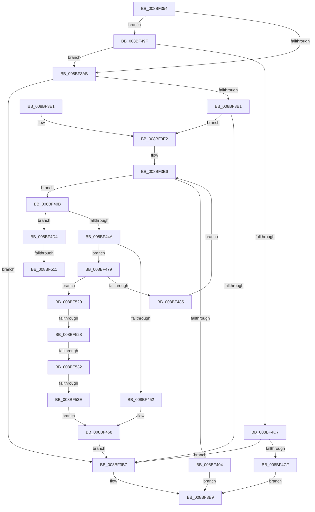

# ExpWnfPopulateStateData

- RVA: `0x008BF354`–`0x008BF549` (길이 `501` bytes)
- VA: `0x00000001408BF354`
- 실행 섹션: `PAGE`
- PDB 이름 있음: `예`; PDB Function 태그: `예`
- unwind 정보 RVA: `0x000832D0`
- 디코드: `129`개 명령, `501/501` bytes 표시
- 미해석 바이트: `0` (있으면 어셈블리에 `.byte`로 보존)

> 이 문서는 커널 이미지의 기계어와 PDB 기호를 분석해 생성했습니다. 4번과 5번은 함수 원형과 자료형을 바이너리 사용 방식에서 추정한 C 해석이며 원본 소스 복구 결과는 아닙니다.

## 1. Dependencies

- 직접 호출 지점: **8**; 고유 호출 대상: **8**
- 직접 호출자로 확인된 함수: **1**
- RIP 상대 이미지 참조: **1**

### Outgoing calls
- `0x008BF3C0` → [_security_check_cookie](../../text/6A/_security_check_cookie_function_006AC640.md) (function, `0x006AC640`)
- `0x008BF3F7` → [ExAllocatePool2](../../poolcode/B8/ExAllocatePool2_function_00B820F0.md) (function, `0x00B820F0`)
- `0x008BF42B` → [ExpWnfComposeValueName](ExpWnfComposeValueName_function_008BDBCC.md) (function, `0x008BDBCC`)
- `0x008BF43B` → [ExpWnfAcquirePermanentDataStoreHandle](../A7/ExpWnfAcquirePermanentDataStoreHandle_function_00A7A210.md) (function, `0x00A7A210`)
- `0x008BF48D` → [ExFreePoolWithTag](../../poolcode/B8/ExFreePoolWithTag_function_00B82870.md) (function, `0x00B82870`)
- `0x008BF4B7` → [ExpCrossVmWnfPull](../7D/ExpCrossVmWnfPull_function_007D55BC.md) (function, `0x007D55BC`)
- `0x008BF4F5` → [ZwQueryValueKey](../../text/6A/ZwQueryValueKey_function_006AD3B0.md) (function, `0x006AD3B0`)
- `0x008BF515` → [ExfReleasePushLockShared](../../text/26/ExfReleasePushLockShared_function_00263440.md) (function, `0x00263440`)

### Direct callers
- [ExpWnfCreateNameInstance](ExpWnfCreateNameInstance_function_008BF590.md) at `0x008BF67A`

### Static image references
- `0x008BF372` → RVA `0x00E0A740` (`.data`; read)

## 2. Other-region calls and transfers

- 다른 실행 섹션으로 향하는 call: **5**
  - `0x008BF3C0` → [_security_check_cookie](../../text/6A/_security_check_cookie_function_006AC640.md) (`PAGE` → `.text`)
  - `0x008BF3F7` → [ExAllocatePool2](../../poolcode/B8/ExAllocatePool2_function_00B820F0.md) (`PAGE` → `POOLCODE`)
  - `0x008BF48D` → [ExFreePoolWithTag](../../poolcode/B8/ExFreePoolWithTag_function_00B82870.md) (`PAGE` → `POOLCODE`)
  - `0x008BF4F5` → [ZwQueryValueKey](../../text/6A/ZwQueryValueKey_function_006AD3B0.md) (`PAGE` → `.text`)
  - `0x008BF515` → [ExfReleasePushLockShared](../../text/26/ExfReleasePushLockShared_function_00263440.md) (`PAGE` → `.text`)
- call이 아닌 외부 분기/꼬리 이동: **5**
  - `0x008BF50B` → [sub_00B1ADAA](../B1/Unknown_function_00B1ADAA.md) (`tail-transfer`)
  - `0x008BF51B` → [sub_00B1ADAA](../B1/Unknown_function_00B1ADAA.md) (`tail-transfer`)
  - `0x008BF522` → [sub_00B1ADAA + 0x14](../B1/Unknown_function_00B1ADAA.md) (`tail-transfer`)
  - `0x008BF52C` → [sub_00B1ADAA + 0xF](../B1/Unknown_function_00B1ADAA.md) (`tail-transfer`)
  - `0x008BF538` → [sub_00B1ADAA + 0xF](../B1/Unknown_function_00B1ADAA.md) (`tail-transfer`)

## 3. Assembly (complete function range)

```asm
008BF354  48 89 5C 24 10                  mov qword ptr [rsp + 0x10], rbx
008BF359  48 89 74 24 18                  mov qword ptr [rsp + 0x18], rsi
008BF35E  55                              push rbp
008BF35F  57                              push rdi
008BF360  41 54                           push r12
008BF362  41 56                           push r14
008BF364  41 57                           push r15
008BF366  48 8D 6C 24 C9                  lea rbp, [rsp - 0x37]
008BF36B  48 81 EC 90 00 00 00            sub rsp, 0x90
008BF372  48 8B 05 C7 B3 54 00            mov rax, qword ptr [rip + 0x54b3c7]
008BF379  48 33 C4                        xor rax, rsp
008BF37C  48 89 45 2F                     mov qword ptr [rbp + 0x2f], rax
008BF380  45 33 E4                        xor r12d, r12d
008BF383  48 8B F1                        mov rsi, rcx
008BF386  48 8B 49 28                     mov rcx, qword ptr [rcx + 0x28]
008BF38A  0F 57 C0                        xorps xmm0, xmm0
008BF38D  48 8B C1                        mov rax, rcx
008BF390  44 89 65 D7                     mov dword ptr [rbp - 0x29], r12d
008BF394  48 C1 E8 06                     shr rax, 6
008BF398  83 E0 0F                        and eax, 0xf
008BF39B  4C 89 65 DF                     mov qword ptr [rbp - 0x21], r12
008BF39F  0F 11 45 E7                     movups xmmword ptr [rbp - 0x19], xmm0
008BF3A3  3C 05                           cmp al, 5
008BF3A5  0F 84 F4 00 00 00               je 0x1408bf49f
008BF3AB  4C 39 66 58                     cmp qword ptr [rsi + 0x58], r12
008BF3AF  75 06                           jne 0x1408bf3b7
008BF3B1  4C 39 66 68                     cmp qword ptr [rsi + 0x68], r12
008BF3B5  75 2B                           jne 0x1408bf3e2
008BF3B7  33 C0                           xor eax, eax
008BF3B9  48 8B 4D 2F                     mov rcx, qword ptr [rbp + 0x2f]
008BF3BD  48 33 CC                        xor rcx, rsp
008BF3C0  E8 7B D2 DE FF                  call 0x1406ac640
008BF3C5  4C 8D 9C 24 90 00 00 00         lea r11, [rsp + 0x90]
008BF3CD  49 8B 5B 38                     mov rbx, qword ptr [r11 + 0x38]
008BF3D1  49 8B 73 40                     mov rsi, qword ptr [r11 + 0x40]
008BF3D5  49 8B E3                        mov rsp, r11
008BF3D8  41 5F                           pop r15
008BF3DA  41 5E                           pop r14
008BF3DC  41 5C                           pop r12
008BF3DE  5F                              pop rdi
008BF3DF  5D                              pop rbp
008BF3E0  C3                              ret
008BF3E1  CC                              int3
008BF3E2  44 8B 76 38                     mov r14d, dword ptr [rsi + 0x38]
008BF3E6  41 8D 7E 10                     lea edi, [r14 + 0x10]
008BF3EA  B9 00 01 00 00                  mov ecx, 0x100
008BF3EF  8B D7                           mov edx, edi
008BF3F1  41 B8 57 6E 66 20               mov r8d, 0x20666e57
008BF3F7  E8 F4 2C 2C 00                  call 0x140b820f0
008BF3FC  48 8B D8                        mov rbx, rax
008BF3FF  48 85 C0                        test rax, rax
008BF402  75 07                           jne 0x1408bf40b
008BF404  B8 9A 00 00 C0                  mov eax, 0xc000009a
008BF409  EB AE                           jmp 0x1408bf3b9
008BF40B  48 8B 4E 28                     mov rcx, qword ptr [rsi + 0x28]
008BF40F  48 8D 55 E7                     lea rdx, [rbp - 0x19]
008BF413  0F 57 C0                        xorps xmm0, xmm0
008BF416  B8 22 00 00 00                  mov eax, 0x22
008BF41B  0F 11 45 E7                     movups xmmword ptr [rbp - 0x19], xmm0
008BF41F  66 89 45 E9                     mov word ptr [rbp - 0x17], ax
008BF423  48 8D 45 07                     lea rax, [rbp + 7]
008BF427  48 89 45 EF                     mov qword ptr [rbp - 0x11], rax
008BF42B  E8 9C E7 FF FF                  call 0x1408bdbcc
008BF430  48 8B 4E 68                     mov rcx, qword ptr [rsi + 0x68]
008BF434  48 8D 55 DF                     lea rdx, [rbp - 0x21]
008BF438  89 7D D7                        mov dword ptr [rbp - 0x29], edi
008BF43B  E8 D0 AD 1B 00                  call 0x140a7a210
008BF440  8B F8                           mov edi, eax
008BF442  85 C0                           test eax, eax
008BF444  0F 89 8A 00 00 00               jns 0x1408bf4d4
008BF44A  81 FF 34 00 00 C0               cmp edi, 0xc0000034
008BF450  75 27                           jne 0x1408bf479
008BF452  0F 57 C0                        xorps xmm0, xmm0
008BF455  0F 11 03                        movups xmmword ptr [rbx], xmm0
008BF458  48 8B C3                        mov rax, rbx
008BF45B  66 C7 03 04 09                  mov word ptr [rbx], 0x904
008BF460  66 C7 43 02 10 00               mov word ptr [rbx + 2], 0x10
008BF466  8B 43 0C                        mov eax, dword ptr [rbx + 0xc]
008BF469  44 89 73 04                     mov dword ptr [rbx + 4], r14d
008BF46D  89 46 60                        mov dword ptr [rsi + 0x60], eax
008BF470  48 89 5E 58                     mov qword ptr [rsi + 0x58], rbx
008BF474  E9 3E FF FF FF                  jmp 0x1408bf3b7
008BF479  81 FF 23 00 00 C0               cmp edi, 0xc0000023
008BF47F  0F 85 9B 00 00 00               jne 0x1408bf520
008BF485  BA 57 6E 66 20                  mov edx, 0x20666e57
008BF48A  48 8B CB                        mov rcx, rbx
008BF48D  E8 DE 33 2C 00                  call 0x140b82870
008BF492  44 8B 75 D7                     mov r14d, dword ptr [rbp - 0x29]
008BF496  41 83 C6 F0                     add r14d, -0x10
008BF49A  E9 47 FF FF FF                  jmp 0x1408bf3e6
008BF49F  48 B8 74 00 BC A3 6D 4E C6 41   movabs rax, 0x41c64e6da3bc0074
008BF4A9  4C 8B C6                        mov r8, rsi
008BF4AC  48 33 C8                        xor rcx, rax
008BF4AF  48 89 4D FF                     mov qword ptr [rbp - 1], rcx
008BF4B3  48 8D 4D FF                     lea rcx, [rbp - 1]
008BF4B7  E8 00 61 F1 FF                  call 0x1407d55bc
008BF4BC  3D 02 00 00 C0                  cmp eax, 0xc0000002
008BF4C1  0F 84 E4 FE FF FF               je 0x1408bf3ab
008BF4C7  85 C0                           test eax, eax
008BF4C9  0F 89 E8 FE FF FF               jns 0x1408bf3b7
008BF4CF  E9 E5 FE FF FF                  jmp 0x1408bf3b9
008BF4D4  48 8B 4D DF                     mov rcx, qword ptr [rbp - 0x21]
008BF4D8  48 8D 45 D7                     lea rax, [rbp - 0x29]
008BF4DC  48 89 44 24 28                  mov qword ptr [rsp + 0x28], rax
008BF4E1  48 8D 55 E7                     lea rdx, [rbp - 0x19]
008BF4E5  8B 45 D7                        mov eax, dword ptr [rbp - 0x29]
008BF4E8  4C 8B CB                        mov r9, rbx
008BF4EB  41 B8 02 00 00 00               mov r8d, 2
008BF4F1  89 44 24 20                     mov dword ptr [rsp + 0x20], eax
008BF4F5  E8 B6 DE DE FF                  call 0x1406ad3b0
008BF4FA  4C 8B 7E 68                     mov r15, qword ptr [rsi + 0x68]
008BF4FE  8B F8                           mov edi, eax
008BF500  B8 11 00 00 00                  mov eax, 0x11
008BF505  F0 4D 0F B1 67 08               lock cmpxchg qword ptr [r15 + 8], r12
008BF50B  0F 84 99 B8 25 00               je 0x140b1adaa
008BF511  49 8D 4F 08                     lea rcx, [r15 + 8]
008BF515  E8 26 3F 9A FF                  call 0x140263440
008BF51A  90                              nop
008BF51B  E9 8A B8 25 00                  jmp 0x140b1adaa
008BF520  85 FF                           test edi, edi
008BF522  0F 88 96 B8 25 00               js 0x140b1adbe
008BF528  83 7B 04 03                     cmp dword ptr [rbx + 4], 3
008BF52C  0F 85 87 B8 25 00               jne 0x140b1adb9
008BF532  8B 43 08                        mov eax, dword ptr [rbx + 8]
008BF535  83 F8 04                        cmp eax, 4
008BF538  0F 82 7B B8 25 00               jb 0x140b1adb9
008BF53E  83 C0 FC                        add eax, -4
008BF541  89 43 08                        mov dword ptr [rbx + 8], eax
008BF544  E9 0F FF FF FF                  jmp 0x1408bf458
```

## 4. C-style interpretation (structured pseudocode)

```c
__int64 __fastcall ExpWnfPopulateStateData(__int64 a1)
{
    __int64 result;
    __int64 v_r12;
    __int64 v_r14;
    __int64 v_rsp;
    unsigned __int64 v_stack_m28;
    unsigned __int64 v_stack_m30;
    unsigned __int64 v_stack_m58;
    unsigned __int64 v_stack_m5F;
    unsigned __int64 v_stack_m60;
    unsigned __int64 v_stack_m68;
    unsigned __int64 v_stack_m70;
    unsigned __int16 v_stack_m76;
    unsigned __int64 v_stack_m78;
    unsigned __int64 v_stack_m80;
    unsigned int v_stack_m88;
    unsigned __int64 v_stack_p10;
    unsigned __int64 v_stack_p18;

    v_stack_p10 = v_rbx;
    v_stack_p18 = v_rsi;
    v_rsp = (v_rsp) - (144);
    result = (*(unsigned __int64 *)(v_rip + 5551047)) ^ (v_rsp);
    v_stack_m30 = result;
    v_r12 = 0;
    v_stack_m88 = 0;
    result = (*(unsigned __int64 *)(a1 + 40)) >> (6);
    result = (unsigned int)((result) & (15));
    v_stack_m80 = 0;
    v_stack_m78 = v_xmm0;
    if (((unsigned __int8)(result)) == 5) goto loc_008BF49F;
loc_008BF3AB:
    if ((*(unsigned __int64 *)(a1 + 88)) != 0) goto loc_008BF3B7;
    if ((*(unsigned __int64 *)(a1 + 104)) != 0) goto loc_008BF3E2;
loc_008BF3B7:
    result = 0;
loc_008BF3B9:
    a1 = (v_stack_m30) ^ (v_rsp);
    result = _security_check_cookie(a1, a2, a3, a4);
    return result;
loc_008BF3E2:
loc_008BF3E6:
    result = ExAllocatePool2(256, (unsigned int)((unsigned int)((unsigned int)(*(unsigned int *)(*(unsigned __int64 *)(v_stack_m28 + 64) + 56)) + 16)), (unsigned int)(0x20666E57ULL), a4);
    if (result != 0) goto loc_008BF40B;
    goto loc_008BF3B9;
loc_008BF40B:
    v_stack_m78 = v_xmm0;
    v_stack_m76 = 34;
    v_stack_m70 = v_stack_m58;
    result = ExpWnfComposeValueName(*(unsigned __int64 *)(*(unsigned __int64 *)(v_stack_m28 + 64) + 40), v_stack_m78, (unsigned int)(0x20666E57ULL), a4);
    v_stack_m88 = (unsigned int)((unsigned int)(*(unsigned int *)(*(unsigned __int64 *)(v_stack_m28 + 64) + 56)) + 16);
    result = ExpWnfAcquirePermanentDataStoreHandle(*(unsigned __int64 *)(*(unsigned __int64 *)(v_stack_m28 + 64) + 104), v_stack_m80, (unsigned int)(0x20666E57ULL), a4);
    if (!sign_flag) goto loc_008BF4D4;
    if (((unsigned int)((unsigned int)((unsigned int)(result)))) != 0xC0000034ULL) goto loc_008BF479;
    *(unsigned __int64 *)(result) = v_xmm0;
loc_008BF458:
    *(unsigned __int16 *)(result) = 0x904ULL;
    *(unsigned __int16 *)(result + 2) = 16;
    *(unsigned int *)(result + 4) = (unsigned int)((unsigned int)(*(unsigned int *)(*(unsigned __int64 *)(v_stack_m28 + 64) + 56)));
    *(unsigned int *)(*(unsigned __int64 *)(v_stack_m28 + 64) + 96) = (unsigned int)((unsigned int)(*(unsigned int *)(result + 12)));
    *(unsigned __int64 *)(*(unsigned __int64 *)(v_stack_m28 + 64) + 88) = result;
    goto loc_008BF3B7;
loc_008BF479:
    if (((unsigned int)((unsigned int)((unsigned int)(result)))) != 0xC0000023ULL) goto loc_008BF520;
    result = ExFreePoolWithTag(result, (unsigned int)(0x20666E57ULL), (unsigned int)(0x20666E57ULL), a4);
    v_r14 = (unsigned int)(((unsigned int)(v_stack_m88)) + (-16));
    goto loc_008BF3E6;
loc_008BF49F:
    a1 = (result) ^ (result);
    v_stack_m60 = a1;
    result = ExpCrossVmWnfPull(v_stack_m60, (unsigned int)(0x20666E57ULL), *(unsigned __int64 *)(v_stack_m28 + 64), a4);
    if (((unsigned int)(result)) == 0xC0000002ULL) goto loc_008BF3AB;
    if (!sign_flag) goto loc_008BF3B7;
    goto loc_008BF3B9;
loc_008BF4D4:
    v_stack_m68 = v_stack_m88;
    v_stack_m70 = (unsigned int)((unsigned int)(v_stack_m88));
    result = ZwQueryValueKey(v_stack_m80, v_stack_m78, 2, result);
    result = ExfReleasePushLockShared(*(unsigned __int64 *)(*(unsigned __int64 *)(v_stack_m28 + 64) + 104) + 8, v_stack_m78, 2, result);
loc_008BF520:
    result = (unsigned int)(((unsigned int)(*(unsigned int *)(result + 8))) + (-4));
    *(unsigned int *)(result + 8) = (unsigned int)(result);
    goto loc_008BF458;
}
```

## 5. (Beta) C Style

```c
int64_t ExpWnfPopulateStateData(void *Arg1)
{
    uint8_t *arg1 = (uint8_t *)Arg1;

    int64_t result;
    int64_t local_r12;
    int64_t local_r14;
    int64_t local_rsp;
    uint64_t v_stack_m28;
    uint64_t v_stack_m30;
    uint64_t v_stack_m58;
    uint64_t v_stack_m5F;
    uint64_t v_stack_m60;
    uint64_t v_stack_m68;
    uint64_t v_stack_m70;
    uint16_t v_stack_m76;
    uint64_t v_stack_m78;
    uint64_t v_stack_m80;
    uint32_t v_stack_m88;
    uint64_t v_stack_p10;
    uint64_t v_stack_p18;

    v_stack_p10 = local_rbx;
    v_stack_p18 = local_rsi;
    local_rsp = (local_rsp) - (144);
    result = (*(uint64_t *)(v_rip + 0x54B3C7)) ^ (local_rsp);
    v_stack_m30 = result;
    local_r12 = 0;
    v_stack_m88 = 0;
    result = (*(uint64_t *)(arg1 + 0x28)) >> (6);
    result = (uint32_t)((result) & (15));
    v_stack_m80 = 0;
    v_stack_m78 = v_xmm0;
    if (((uint8_t)(result)) == 5) goto loc_008BF49F;
loc_008BF3AB:
    if ((*(uint64_t *)(arg1 + 0x58)) != 0) goto loc_008BF3B7;
    if ((*(uint64_t *)(arg1 + 0x68)) != 0) goto loc_008BF3E2;
loc_008BF3B7:
    result = 0;
loc_008BF3B9:
    Arg1 = (v_stack_m30) ^ (local_rsp);
    result = _security_check_cookie(Arg1, a2, a3, a4);
    return result;
loc_008BF3E2:
loc_008BF3E6:
    result = ExAllocatePool2(256, (uint32_t)((uint32_t)((uint32_t)(*(uint32_t *)(*(uint64_t *)(v_stack_m28 + 0x40) + 0x38)) + 16)), (uint32_t)(0x20666E57ULL), a4);
    if (result != 0) goto loc_008BF40B;
    goto loc_008BF3B9;
loc_008BF40B:
    v_stack_m78 = v_xmm0;
    v_stack_m76 = 34;
    v_stack_m70 = v_stack_m58;
    result = ExpWnfComposeValueName(*(uint64_t *)(*(uint64_t *)(v_stack_m28 + 0x40) + 0x28), v_stack_m78, (uint32_t)(0x20666E57ULL), a4);
    v_stack_m88 = (uint32_t)((uint32_t)(*(uint32_t *)(*(uint64_t *)(v_stack_m28 + 0x40) + 0x38)) + 16);
    result = ExpWnfAcquirePermanentDataStoreHandle(*(uint64_t *)(*(uint64_t *)(v_stack_m28 + 0x40) + 0x68), v_stack_m80, (uint32_t)(0x20666E57ULL), a4);
    if (!sign_flag) goto loc_008BF4D4;
    if (((uint32_t)((uint32_t)((uint32_t)(result)))) != 0xC0000034ULL) goto loc_008BF479;
    *(uint64_t *)(result) = v_xmm0;
loc_008BF458:
    *(uint16_t *)(result) = 0x904ULL;
    *(uint16_t *)(result + 0x2) = 16;
    *(uint32_t *)(result + 0x4) = (uint32_t)((uint32_t)(*(uint32_t *)(*(uint64_t *)(v_stack_m28 + 0x40) + 0x38)));
    *(uint32_t *)(*(uint64_t *)(v_stack_m28 + 0x40) + 0x60) = (uint32_t)((uint32_t)(*(uint32_t *)(result + 0xC)));
    *(uint64_t *)(*(uint64_t *)(v_stack_m28 + 0x40) + 0x58) = result;
    goto loc_008BF3B7;
loc_008BF479:
    if (((uint32_t)((uint32_t)((uint32_t)(result)))) != 0xC0000023ULL) goto loc_008BF520;
    result = ExFreePoolWithTag(result, (uint32_t)(0x20666E57ULL), (uint32_t)(0x20666E57ULL), a4);
    local_r14 = (uint32_t)(((uint32_t)(v_stack_m88)) + (-16));
    goto loc_008BF3E6;
loc_008BF49F:
    Arg1 = (result) ^ (result);
    v_stack_m60 = Arg1;
    result = ExpCrossVmWnfPull(v_stack_m60, (uint32_t)(0x20666E57ULL), *(uint64_t *)(v_stack_m28 + 0x40), a4);
    if (((uint32_t)(result)) == 0xC0000002ULL) goto loc_008BF3AB;
    if (!sign_flag) goto loc_008BF3B7;
    goto loc_008BF3B9;
loc_008BF4D4:
    v_stack_m68 = v_stack_m88;
    v_stack_m70 = (uint32_t)((uint32_t)(v_stack_m88));
    result = ZwQueryValueKey(v_stack_m80, v_stack_m78, 2, result);
    result = ExfReleasePushLockShared(*(uint64_t *)(*(uint64_t *)(v_stack_m28 + 0x40) + 0x68) + 8, v_stack_m78, 2, result);
loc_008BF520:
    result = (uint32_t)(((uint32_t)(*(uint32_t *)(result + 0x8))) + (-4));
    *(uint32_t *)(result + 0x8) = (uint32_t)(result);
    goto loc_008BF458;
}
```

### 관측된 메모리 오프셋

구조체 형식이 확인되지 않은 접근은 인자 기준의 오프셋으로만 기록했습니다.

| 기준 인자 | 오프셋 표현 | 폭 (bit) | 접근 |
|---|---:|---:|---|
| `Arg1` | `+ 0x28` | `64` | `R` |
| `Arg1` | `+ 0x38` | `32` | `R` |
| `Arg1` | `+ 0x58` | `64` | `R` |
| `Arg1` | `+ 0x58` | `64` | `W` |
| `Arg1` | `+ 0x60` | `32` | `W` |
| `Arg1` | `+ 0x68` | `64` | `R` |

## 6. Execution-region graph

[열기: 2D/3D 그래프와 함수 탐색 컨트롤 패널](../../../control-panel.html?section=page&rva=0x008BF354&view=graph)

- 2D 그래프는 위에서 아래로 흐르고, 3D 그래프는 빈 공간을 드래그해 회전합니다. Shift+드래그는 이동, 휠은 확대·축소, 함수 노드 선택은 대상 보고서 이동입니다.

### Static fallback


