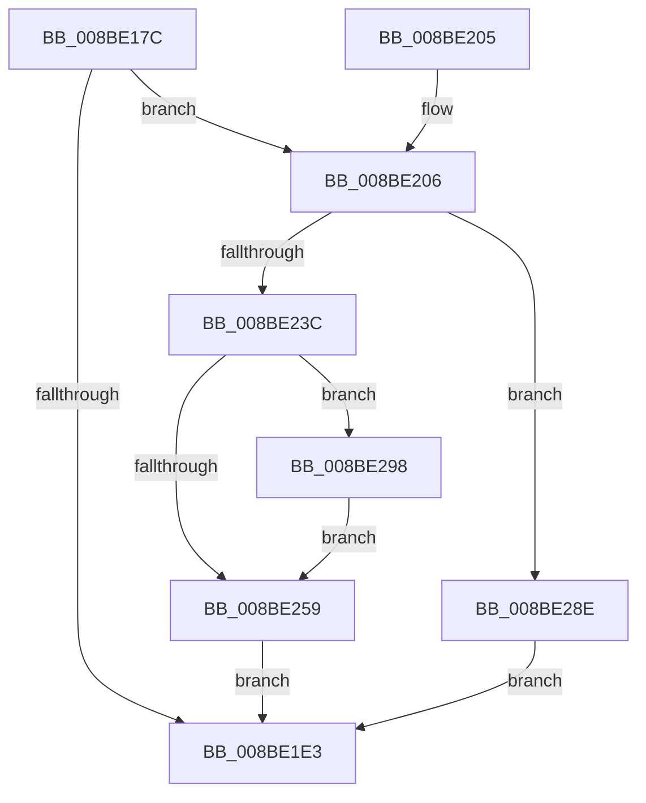

# ExpWnfRegisterPermanentName

- RVA: `0x008BE17C`–`0x008BE2A3` (길이 `295` bytes)
- VA: `0x00000001408BE17C`
- 실행 섹션: `PAGE`
- PDB 이름 있음: `예`; PDB Function 태그: `아니요`
- unwind 정보 RVA: `0x00083168`
- 디코드: `79`개 명령, `295/295` bytes 표시
- 미해석 바이트: `0` (있으면 어셈블리에 `.byte`로 보존)

> 이 문서는 커널 이미지의 기계어와 PDB 기호를 분석해 생성했습니다. 4번과 5번은 함수 원형과 자료형을 바이너리 사용 방식에서 추정한 C 해석이며 원본 소스 복구 결과는 아닙니다.

## 1. Dependencies

- 직접 호출 지점: **8**; 고유 호출 대상: **8**
- 직접 호출자로 확인된 함수: **1**
- RIP 상대 이미지 참조: **1**

### Outgoing calls
- `0x008BE1C5` → [ExpWnfComposeValueName](ExpWnfComposeValueName_function_008BDBCC.md) (function, `0x008BDBCC`)
- `0x008BE1D8` → [ExpWnfGetNameStoreRegistryRoot](ExpWnfGetNameStoreRegistryRoot_function_008BDB00.md) (function, `0x008BDB00`)
- `0x008BE1ED` → [_security_check_cookie](../../text/6A/_security_check_cookie_function_006AC640.md) (function, `0x006AC640`)
- `0x008BE20A` → [RtlLengthSecurityDescriptor](RtlLengthSecurityDescriptor_function_008BC870.md) (function, `0x008BC870`)
- `0x008BE22F` → [ExAllocatePool2](../../poolcode/B8/ExAllocatePool2_function_00B820F0.md) (function, `0x00B820F0`)
- `0x008BE246` → [memcpy](../../text/6C/memcpy_function_006C6840.md) (function, `0x006C6840`)
- `0x008BE275` → [ZwSetValueKey](../../text/6A/ZwSetValueKey_function_006ADCD0.md) (function, `0x006ADCD0`)
- `0x008BE284` → [ExFreePoolWithTag](../../poolcode/B8/ExFreePoolWithTag_function_00B82870.md) (function, `0x00B82870`)

### Direct callers
- [NtCreateWnfStateName](NtCreateWnfStateName_function_008BE2B0.md) at `0x008BE5BE`

### Static image references
- `0x008BE18D` → RVA `0x00E0A740` (`.data`; read)

## 2. Other-region calls and transfers

- 다른 실행 섹션으로 향하는 call: **5**
  - `0x008BE1ED` → [_security_check_cookie](../../text/6A/_security_check_cookie_function_006AC640.md) (`PAGE` → `.text`)
  - `0x008BE22F` → [ExAllocatePool2](../../poolcode/B8/ExAllocatePool2_function_00B820F0.md) (`PAGE` → `POOLCODE`)
  - `0x008BE246` → [memcpy](../../text/6C/memcpy_function_006C6840.md) (`PAGE` → `.text`)
  - `0x008BE275` → [ZwSetValueKey](../../text/6A/ZwSetValueKey_function_006ADCD0.md) (`PAGE` → `.text`)
  - `0x008BE284` → [ExFreePoolWithTag](../../poolcode/B8/ExFreePoolWithTag_function_00B82870.md) (`PAGE` → `POOLCODE`)
- 별도 외부 분기/꼬리 이동을 확인하지 못했습니다.

## 3. Assembly (complete function range)

```asm
008BE17C  4C 8B DC                        mov r11, rsp
008BE17F  49 89 5B 18                     mov qword ptr [r11 + 0x18], rbx
008BE183  55                              push rbp
008BE184  56                              push rsi
008BE185  57                              push rdi
008BE186  48 81 EC 80 00 00 00            sub rsp, 0x80
008BE18D  48 8B 05 AC C5 54 00            mov rax, qword ptr [rip + 0x54c5ac]
008BE194  48 33 C4                        xor rax, rsp
008BE197  48 89 44 24 70                  mov qword ptr [rsp + 0x70], rax
008BE19C  49 83 63 98 00                  and qword ptr [r11 - 0x68], 0
008BE1A1  0F 57 C0                        xorps xmm0, xmm0
008BE1A4  0F 11 44 24 38                  movups xmmword ptr [rsp + 0x38], xmm0
008BE1A9  B8 22 00 00 00                  mov eax, 0x22
008BE1AE  48 8B F2                        mov rsi, rdx
008BE1B1  66 89 44 24 3A                  mov word ptr [rsp + 0x3a], ax
008BE1B6  49 8D 53 A0                     lea rdx, [r11 - 0x60]
008BE1BA  49 8D 43 B0                     lea rax, [r11 - 0x50]
008BE1BE  48 8B D9                        mov rbx, rcx
008BE1C1  49 89 43 A8                     mov qword ptr [r11 - 0x58], rax
008BE1C5  E8 02 FA FF FF                  call 0x1408bdbcc
008BE1CA  48 C1 EB 04                     shr rbx, 4
008BE1CE  48 8D 54 24 30                  lea rdx, [rsp + 0x30]
008BE1D3  83 E3 03                        and ebx, 3
008BE1D6  8B CB                           mov ecx, ebx
008BE1D8  E8 23 F9 FF FF                  call 0x1408bdb00
008BE1DD  8B D8                           mov ebx, eax
008BE1DF  85 C0                           test eax, eax
008BE1E1  79 23                           jns 0x1408be206
008BE1E3  8B C3                           mov eax, ebx
008BE1E5  48 8B 4C 24 70                  mov rcx, qword ptr [rsp + 0x70]
008BE1EA  48 33 CC                        xor rcx, rsp
008BE1ED  E8 4E E4 DE FF                  call 0x1406ac640
008BE1F2  48 8B 9C 24 B0 00 00 00         mov rbx, qword ptr [rsp + 0xb0]
008BE1FA  48 81 C4 80 00 00 00            add rsp, 0x80
008BE201  5F                              pop rdi
008BE202  5E                              pop rsi
008BE203  5D                              pop rbp
008BE204  C3                              ret
008BE205  CC                              int3
008BE206  48 8B 4E 10                     mov rcx, qword ptr [rsi + 0x10]
008BE20A  E8 61 E6 FF FF                  call 0x1408bc870
008BE20F  48 83 7E 08 00                  cmp qword ptr [rsi + 8], 0
008BE214  B9 00 01 00 00                  mov ecx, 0x100
008BE219  8B D8                           mov ebx, eax
008BE21B  44 8D 43 04                     lea r8d, [rbx + 4]
008BE21F  41 8D 50 10                     lea edx, [r8 + 0x10]
008BE223  41 0F 44 D0                     cmove edx, r8d
008BE227  41 B8 57 6E 66 20               mov r8d, 0x20666e57
008BE22D  8B EA                           mov ebp, edx
008BE22F  E8 BC 3E 2C 00                  call 0x140b820f0
008BE234  48 8B F8                        mov rdi, rax
008BE237  48 85 C0                        test rax, rax
008BE23A  74 52                           je 0x1408be28e
008BE23C  48 8B 56 10                     mov rdx, qword ptr [rsi + 0x10]
008BE240  44 8B C3                        mov r8d, ebx
008BE243  48 8B C8                        mov rcx, rax
008BE246  E8 F5 85 E0 FF                  call 0x1406c6840
008BE24B  8B 06                           mov eax, dword ptr [rsi]
008BE24D  89 04 3B                        mov dword ptr [rbx + rdi], eax
008BE250  48 8B 46 08                     mov rax, qword ptr [rsi + 8]
008BE254  48 85 C0                        test rax, rax
008BE257  75 3F                           jne 0x1408be298
008BE259  48 8B 4C 24 30                  mov rcx, qword ptr [rsp + 0x30]
008BE25E  48 8D 54 24 38                  lea rdx, [rsp + 0x38]
008BE263  89 6C 24 28                     mov dword ptr [rsp + 0x28], ebp
008BE267  41 B9 03 00 00 00               mov r9d, 3
008BE26D  45 33 C0                        xor r8d, r8d
008BE270  48 89 7C 24 20                  mov qword ptr [rsp + 0x20], rdi
008BE275  E8 56 FA DE FF                  call 0x1406adcd0
008BE27A  8B D8                           mov ebx, eax
008BE27C  BA 57 6E 66 20                  mov edx, 0x20666e57
008BE281  48 8B CF                        mov rcx, rdi
008BE284  E8 E7 45 2C 00                  call 0x140b82870
008BE289  E9 55 FF FF FF                  jmp 0x1408be1e3
008BE28E  BB 9A 00 00 C0                  mov ebx, 0xc000009a
008BE293  E9 4B FF FF FF                  jmp 0x1408be1e3
008BE298  0F 10 00                        movups xmm0, xmmword ptr [rax]
008BE29B  F3 0F 7F 44 3B 04               movdqu xmmword ptr [rbx + rdi + 4], xmm0
008BE2A1  EB B6                           jmp 0x1408be259
```

## 4. C-style interpretation (structured pseudocode)

```c
__int64 __fastcall ExpWnfRegisterPermanentName(__int64 a1, __int64 a2)
{
    __int64 result;
    __int64 v_rbx;
    __int64 v_rsp;
    unsigned __int64 v_stack_m28;
    unsigned __int16 v_stack_m5E;
    unsigned __int64 v_stack_m60;
    unsigned __int64 v_stack_m68;
    unsigned __int64 v_stack_p18;
    unsigned __int64 v_stack_p20;
    unsigned int v_stack_p28;
    unsigned __int64 v_stack_p30;
    unsigned __int64 v_stack_p38;

    *(unsigned __int64 *)(v_rsp + 24) = v_rbx;
    v_rsp = (v_rsp) - (128);
    result = (*(unsigned __int64 *)(v_rip + 5555628)) ^ (v_rsp);
    v_stack_m28 = result;
    v_stack_m60 = v_xmm0;
    v_stack_m5E = 34;
    *(unsigned __int64 *)(v_rsp - 88) = v_rsp - 80;
    result = ExpWnfComposeValueName(a1, v_rsp - 96, a3, a4);
    v_rbx = (a1) >> (4);
    v_rbx = (unsigned int)((v_rbx) & (3));
    result = ExpWnfGetNameStoreRegistryRoot((unsigned int)((unsigned int)(v_rbx)), v_stack_m68, a3, a4);
    if (!sign_flag) goto loc_008BE206;
loc_008BE1E3:
    a1 = (v_stack_m28) ^ (v_rsp);
    result = _security_check_cookie(a1, v_stack_m68, a3, a4);
    v_rsp = (v_rsp) + (128);
    return result;
loc_008BE206:
    result = RtlLengthSecurityDescriptor(*(unsigned __int64 *)(a2 + 16), v_stack_m68, a3, a4);
    a2 = (unsigned int)((unsigned int)(result)) + 4 + 16;
    if ((*(unsigned __int64 *)(a2 + 8)) == 0) { a2 = (unsigned int)((unsigned int)((unsigned int)(result)) + 4); }
    result = ExAllocatePool2(256, a2, (unsigned int)(0x20666E57ULL), a4);
    if (result == 0) goto loc_008BE28E;
    result = memcpy(result, *(unsigned __int64 *)(a2 + 16), (unsigned int)((unsigned int)((unsigned int)((unsigned int)(result)))), a4);
    *(unsigned int *)((unsigned int)((unsigned int)(result)) + result * 1) = (unsigned int)((unsigned int)(*(unsigned int *)(a2)));
    if (*(unsigned __int64 *)(a2 + 8) != 0) goto loc_008BE298;
loc_008BE259:
    v_stack_p28 = (unsigned int)((unsigned int)((unsigned int)(a2)));
    a3 = 0;
    v_stack_p20 = result;
    result = ZwSetValueKey(v_stack_p30, v_stack_p38, a3, 3);
    result = ExFreePoolWithTag(result, (unsigned int)(0x20666E57ULL), a3, 3);
    goto loc_008BE1E3;
loc_008BE28E:
    goto loc_008BE1E3;
loc_008BE298:
    *(unsigned __int64 *)((unsigned int)(0xC000009AULL) + result * 1 + 4) = v_xmm0;
    goto loc_008BE259;
}
```

## 5. (Beta) C Style

```c
int64_t ExpWnfRegisterPermanentName(int64_t Arg1, void *Arg2)
{
    uint8_t *arg2 = (uint8_t *)Arg2;

    int64_t result;
    int64_t local_rbx;
    int64_t local_rsp;
    uint64_t v_stack_m28;
    uint16_t v_stack_m5E;
    uint64_t v_stack_m60;
    uint64_t v_stack_m68;
    uint64_t v_stack_p18;
    uint64_t v_stack_p20;
    uint32_t v_stack_p28;
    uint64_t v_stack_p30;
    uint64_t v_stack_p38;

    *(uint64_t *)(local_rsp + 0x18) = local_rbx;
    local_rsp = (local_rsp) - (128);
    result = (*(uint64_t *)(v_rip + 0x54C5AC)) ^ (local_rsp);
    v_stack_m28 = result;
    v_stack_m60 = v_xmm0;
    v_stack_m5E = 34;
    *(uint64_t *)(local_rsp - 0x58) = local_rsp - 80;
    result = ExpWnfComposeValueName(Arg1, local_rsp - 96, a3, a4);
    local_rbx = (Arg1) >> (4);
    local_rbx = (uint32_t)((local_rbx) & (3));
    result = ExpWnfGetNameStoreRegistryRoot((uint32_t)((uint32_t)(local_rbx)), v_stack_m68, a3, a4);
    if (!sign_flag) goto loc_008BE206;
loc_008BE1E3:
    Arg1 = (v_stack_m28) ^ (local_rsp);
    result = _security_check_cookie(Arg1, v_stack_m68, a3, a4);
    local_rsp = (local_rsp) + (128);
    return result;
loc_008BE206:
    result = RtlLengthSecurityDescriptor(*(uint64_t *)(arg2 + 0x10), v_stack_m68, a3, a4);
    Arg2 = (uint32_t)((uint32_t)(result)) + 4 + 16;
    if ((*(uint64_t *)(arg2 + 0x8)) == 0) { Arg2 = (uint32_t)((uint32_t)((uint32_t)(result)) + 4); }
    result = ExAllocatePool2(256, Arg2, (uint32_t)(0x20666E57ULL), a4);
    if (result == 0) goto loc_008BE28E;
    result = memcpy(result, *(uint64_t *)(arg2 + 0x10), (uint32_t)((uint32_t)((uint32_t)((uint32_t)(result)))), a4);
    *(uint32_t *)((uint32_t)((uint32_t)(result)) + result * 1) = (uint32_t)((uint32_t)(*(uint32_t *)(arg2)));
    if (*(uint64_t *)(arg2 + 0x8) != 0) goto loc_008BE298;
loc_008BE259:
    v_stack_p28 = (uint32_t)((uint32_t)((uint32_t)(Arg2)));
    a3 = 0;
    v_stack_p20 = result;
    result = ZwSetValueKey(v_stack_p30, v_stack_p38, a3, 3);
    result = ExFreePoolWithTag(result, (uint32_t)(0x20666E57ULL), a3, 3);
    goto loc_008BE1E3;
loc_008BE28E:
    goto loc_008BE1E3;
loc_008BE298:
    *(uint64_t *)((uint32_t)(0xC000009AULL) + result * 1 + 0x4) = v_xmm0;
    goto loc_008BE259;
}
```

### 관측된 메모리 오프셋

구조체 형식이 확인되지 않은 접근은 인자 기준의 오프셋으로만 기록했습니다.

| 기준 인자 | 오프셋 표현 | 폭 (bit) | 접근 |
|---|---:|---:|---|
| `Arg2` | `+ 0x0` | `32` | `R` |
| `Arg2` | `+ 0x8` | `64` | `R` |
| `Arg2` | `+ 0x10` | `64` | `R` |

## 6. Execution-region graph

[열기: 2D/3D 그래프와 함수 탐색 컨트롤 패널](../../../control-panel.html?section=page&rva=0x008BE17C&view=graph)

- 2D 그래프는 위에서 아래로 흐르고, 3D 그래프는 빈 공간을 드래그해 회전합니다. Shift+드래그는 이동, 휠은 확대·축소, 함수 노드 선택은 대상 보고서 이동입니다.

### Static fallback


