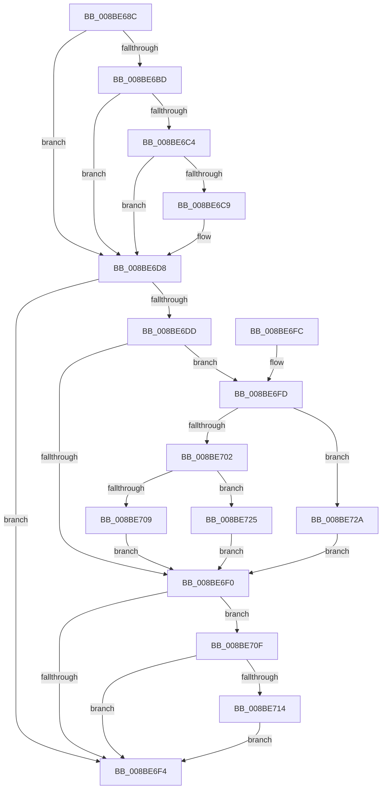

# ExpWnfSpecializeSecurityDescriptor

- RVA: `0x008BE68C`–`0x008BE730` (길이 `164` bytes)
- VA: `0x00000001408BE68C`
- 실행 섹션: `PAGE`
- PDB 이름 있음: `예`; PDB Function 태그: `아니요`
- unwind 정보 RVA: `0x000831E4`
- 디코드: `55`개 명령, `164/164` bytes 표시
- 미해석 바이트: `0` (있으면 어셈블리에 `.byte`로 보존)

> 이 문서는 커널 이미지의 기계어와 PDB 기호를 분석해 생성했습니다. 4번과 5번은 함수 원형과 자료형을 바이너리 사용 방식에서 추정한 C 해석이며 원본 소스 복구 결과는 아닙니다.

## 1. Dependencies

- 직접 호출 지점: **3**; 고유 호출 대상: **2**
- 직접 호출자로 확인된 함수: **2**
- RIP 상대 이미지 참조: **1**

### Outgoing calls
- `0x008BE6AF` → [RtlGetDaclSecurityDescriptor](../../text/45/RtlGetDaclSecurityDescriptor_function_00459570.md) (function, `0x00459570`)
- `0x008BE6D3` → [RtlpApplyAclToObject](../9A/RtlpApplyAclToObject_function_009A9AA0.md) (function, `0x009A9AA0`)
- `0x008BE71E` → [RtlpApplyAclToObject](../9A/RtlpApplyAclToObject_function_009A9AA0.md) (function, `0x009A9AA0`)

### Direct callers
- [ExpWnfLookupPermanentName](ExpWnfLookupPermanentName_function_008BD914.md) at `0x008BDA1D`
- [NtCreateWnfStateName](NtCreateWnfStateName_function_008BE2B0.md) at `0x008BE388`

### Static image references
- `0x008BE6C9` → RVA `0x00B4B070` (`ExpWnfNotificationMapping`; read)

## 2. Other-region calls and transfers

- 다른 실행 섹션으로 향하는 call: **1**
  - `0x008BE6AF` → [RtlGetDaclSecurityDescriptor](../../text/45/RtlGetDaclSecurityDescriptor_function_00459570.md) (`PAGE` → `.text`)
- 별도 외부 분기/꼬리 이동을 확인하지 못했습니다.

## 3. Assembly (complete function range)

```asm
008BE68C  48 8B C4                        mov rax, rsp
008BE68F  53                              push rbx
008BE690  56                              push rsi
008BE691  57                              push rdi
008BE692  48 83 EC 20                     sub rsp, 0x20
008BE696  33 F6                           xor esi, esi
008BE698  4C 8D 48 10                     lea r9, [rax + 0x10]
008BE69C  4C 8D 40 18                     lea r8, [rax + 0x18]
008BE6A0  40 88 70 08                     mov byte ptr [rax + 8], sil
008BE6A4  48 8D 50 08                     lea rdx, [rax + 8]
008BE6A8  48 89 70 18                     mov qword ptr [rax + 0x18], rsi
008BE6AC  48 8B F9                        mov rdi, rcx
008BE6AF  E8 BC AE B9 FF                  call 0x140459570
008BE6B4  48 8B 5C 24 50                  mov rbx, qword ptr [rsp + 0x50]
008BE6B9  85 C0                           test eax, eax
008BE6BB  78 1B                           js 0x1408be6d8
008BE6BD  40 38 74 24 40                  cmp byte ptr [rsp + 0x40], sil
008BE6C2  74 14                           je 0x1408be6d8
008BE6C4  48 85 DB                        test rbx, rbx
008BE6C7  74 0F                           je 0x1408be6d8
008BE6C9  48 8D 15 A0 C9 28 00            lea rdx, [rip + 0x28c9a0]
008BE6D0  48 8B CB                        mov rcx, rbx
008BE6D3  E8 C8 B3 0E 00                  call 0x1409a9aa0
008BE6D8  80 3F 01                        cmp byte ptr [rdi], 1
008BE6DB  75 17                           jne 0x1408be6f4
008BE6DD  0F B7 4F 02                     movzx ecx, word ptr [rdi + 2]
008BE6E1  66 0F BA E1 04                  bt cx, 4
008BE6E6  0F 92 C2                        setb dl
008BE6E9  66 0F BA E1 04                  bt cx, 4
008BE6EE  72 0D                           jb 0x1408be6fd
008BE6F0  84 D2                           test dl, dl
008BE6F2  75 1B                           jne 0x1408be70f
008BE6F4  48 83 C4 20                     add rsp, 0x20
008BE6F8  5F                              pop rdi
008BE6F9  5E                              pop rsi
008BE6FA  5B                              pop rbx
008BE6FB  C3                              ret
008BE6FC  CC                              int3
008BE6FD  66 85 C9                        test cx, cx
008BE700  79 28                           jns 0x1408be72a
008BE702  8B 47 0C                        mov eax, dword ptr [rdi + 0xc]
008BE705  85 C0                           test eax, eax
008BE707  74 1C                           je 0x1408be725
008BE709  48 8D 1C 07                     lea rbx, [rdi + rax]
008BE70D  EB E1                           jmp 0x1408be6f0
008BE70F  48 85 DB                        test rbx, rbx
008BE712  74 E0                           je 0x1408be6f4
008BE714  48 8D 15 55 C9 28 00            lea rdx, [rip + 0x28c955]
008BE71B  48 8B CB                        mov rcx, rbx
008BE71E  E8 7D B3 0E 00                  call 0x1409a9aa0
008BE723  EB CF                           jmp 0x1408be6f4
008BE725  48 8B DE                        mov rbx, rsi
008BE728  EB C6                           jmp 0x1408be6f0
008BE72A  48 8B 5F 18                     mov rbx, qword ptr [rdi + 0x18]
008BE72E  EB C0                           jmp 0x1408be6f0
```

## 4. C-style interpretation (structured pseudocode)

```c
__int64 __fastcall ExpWnfSpecializeSecurityDescriptor(__int64 a1)
{
    __int64 result;
    __int64 v_rsi;
    __int64 v_rsp;
    unsigned __int64 v_stack_p18;
    unsigned __int8 v_stack_p8;

    v_rsp = (v_rsp) - (32);
    v_rsi = 0;
    *(unsigned __int8 *)(v_rsp + 8) = 0;
    *(unsigned __int64 *)(v_rsp + 24) = 0;
    result = RtlGetDaclSecurityDescriptor(a1, v_rsp + 8, v_rsp + 24, v_rsp + 16);
    if (sign_flag) goto loc_008BE6D8;
    if (v_stack_p8 == 0) goto loc_008BE6D8;
    if (v_stack_p18 != 0) {
        a2 = v_rip + 2673056;
        a1 = v_stack_p18;
        result = RtlpApplyAclToObject(a1, a2, v_rsp + 24, v_rsp + 16);
    }
    if ((*(unsigned __int8 *)(a1)) != 1) goto loc_008BE6F4;
    a2 = ((*(unsigned __int8 *)(a1)) < 1) ? 1 : 0;
    if ((*(unsigned __int8 *)(a1)) < 1) goto loc_008BE6FD;
loc_008BE6F0:
    if ((unsigned __int8)(a2) != 0) goto loc_008BE70F;
loc_008BE6F4:
    v_rsp = (v_rsp) + (32);
    return result;
loc_008BE6FD:
    if (!sign_flag) goto loc_008BE72A;
    if ((unsigned int)((unsigned int)(*(unsigned int *)(a1 + 12))) == 0) goto loc_008BE725;
    goto loc_008BE6F0;
loc_008BE70F:
    if (a1 + (unsigned int)(*(unsigned int *)(a1 + 12)) * 1 == 0) goto loc_008BE6F4;
    result = RtlpApplyAclToObject(a1 + (unsigned int)(*(unsigned int *)(a1 + 12)) * 1, v_rip + 2672981, v_rsp + 24, v_rsp + 16);
    goto loc_008BE6F4;
loc_008BE725:
    goto loc_008BE6F0;
loc_008BE72A:
    goto loc_008BE6F0;
}
```

## 5. (Beta) C Style

```c
int64_t ExpWnfSpecializeSecurityDescriptor(void *Arg1)
{
    uint8_t *arg1 = (uint8_t *)Arg1;

    int64_t result;
    int64_t local_rsi;
    int64_t local_rsp;
    uint64_t v_stack_p18;
    uint8_t v_stack_p8;

    local_rsp = (local_rsp) - (32);
    local_rsi = 0;
    *(uint8_t *)(local_rsp + 0x8) = 0;
    *(uint64_t *)(local_rsp + 0x18) = 0;
    result = RtlGetDaclSecurityDescriptor(Arg1, local_rsp + 8, local_rsp + 24, local_rsp + 16);
    if (sign_flag) goto loc_008BE6D8;
    if (v_stack_p8 == 0) goto loc_008BE6D8;
    if (v_stack_p18 != 0) {
        a2 = v_rip + 2673056;
        Arg1 = v_stack_p18;
        result = RtlpApplyAclToObject(Arg1, a2, local_rsp + 24, local_rsp + 16);
    }
    if ((*(uint8_t *)(arg1)) != 1) goto loc_008BE6F4;
    a2 = ((*(uint8_t *)(arg1)) < 1) ? 1 : 0;
    if ((*(uint8_t *)(arg1)) < 1) goto loc_008BE6FD;
loc_008BE6F0:
    if ((uint8_t)(a2) != 0) goto loc_008BE70F;
loc_008BE6F4:
    local_rsp = (local_rsp) + (32);
    return result;
loc_008BE6FD:
    if (!sign_flag) goto loc_008BE72A;
    if ((uint32_t)((uint32_t)(*(uint32_t *)(arg1 + 0xC))) == 0) goto loc_008BE725;
    goto loc_008BE6F0;
loc_008BE70F:
    if (Arg1 + (uint32_t)(*(uint32_t *)(arg1 + 0xC)) * 1 == 0) goto loc_008BE6F4;
    result = RtlpApplyAclToObject(Arg1 + (uint32_t)(*(uint32_t *)(arg1 + 0xC)) * 1, v_rip + 2672981, local_rsp + 24, local_rsp + 16);
    goto loc_008BE6F4;
loc_008BE725:
    goto loc_008BE6F0;
loc_008BE72A:
    goto loc_008BE6F0;
}
```

### 관측된 메모리 오프셋

구조체 형식이 확인되지 않은 접근은 인자 기준의 오프셋으로만 기록했습니다.

| 기준 인자 | 오프셋 표현 | 폭 (bit) | 접근 |
|---|---:|---:|---|
| `Arg1` | `+ 0x0` | `8` | `R` |
| `Arg1` | `+ 0x0 + rax*1` | `64` | `R` |
| `Arg1` | `+ 0x2` | `16` | `R` |
| `Arg1` | `+ 0xC` | `32` | `R` |
| `Arg1` | `+ 0x18` | `64` | `R` |

## 6. Execution-region graph

[열기: 2D/3D 그래프와 함수 탐색 컨트롤 패널](../../../control-panel.html?section=page&rva=0x008BE68C&view=graph)

- 2D 그래프는 위에서 아래로 흐르고, 3D 그래프는 빈 공간을 드래그해 회전합니다. Shift+드래그는 이동, 휠은 확대·축소, 함수 노드 선택은 대상 보고서 이동입니다.

### Static fallback


