# NtCreateWnfStateName

- RVA: `0x008BE2B0`–`0x008BE685` (길이 `981` bytes)
- VA: `0x00000001408BE2B0`
- 실행 섹션: `PAGE`
- PDB 이름 있음: `예`; PDB Function 태그: `아니요`
- unwind 정보 RVA: `0x00083184`
- 디코드: `243`개 명령, `981/981` bytes 표시
- 미해석 바이트: `0` (있으면 어셈블리에 `.byte`로 보존)

> 이 문서는 커널 이미지의 기계어와 PDB 기호를 분석해 생성했습니다. 4번과 5번은 함수 원형과 자료형을 바이너리 사용 방식에서 추정한 C 해석이며 원본 소스 복구 결과는 아닙니다.

## 1. Dependencies

- 직접 호출 지점: **14**; 고유 호출 대상: **12**
- 직접 호출자로 확인된 함수: **0**
- RIP 상대 이미지 참조: **3**

### Outgoing calls
- `0x008BE374` → [SeCaptureSecurityDescriptor](../92/SeCaptureSecurityDescriptor_function_00929F40.md) (function, `0x00929F40`)
- `0x008BE388` → [ExpWnfSpecializeSecurityDescriptor](ExpWnfSpecializeSecurityDescriptor_function_008BE68C.md) (function, `0x008BE68C`)
- `0x008BE434` → [ExpWnfGenerateStateName](ExpWnfGenerateStateName_function_008BE738.md) (function, `0x008BE738`)
- `0x008BE4CE` → [ExpWnfResolveScopeInstance](../90/ExpWnfResolveScopeInstance_function_0090B280.md) (function, `0x0090B280`)
- `0x008BE4F7` → [ExpWnfCreateNameInstance](ExpWnfCreateNameInstance_function_008BF590.md) (function, `0x008BF590`)
- `0x008BE50F` → [ExReleaseRundownProtection](../../text/34/ExReleaseRundownProtection_function_00349E80.md) (function, `0x00349E80`)
- `0x008BE55A` → [SeCaptureSecurityDescriptor](../92/SeCaptureSecurityDescriptor_function_00929F40.md) (function, `0x00929F40`)
- `0x008BE58B` → [RtlCopyVolatileMemory](../../text/6B/RtlCopyVolatileMemory_function_006BC9D0.md) (function, `0x006BC9D0`)
- `0x008BE5BE` → [ExpWnfRegisterPermanentName](ExpWnfRegisterPermanentName_function_008BE17C.md) (function, `0x008BE17C`)
- `0x008BE5D3` → [ExReleaseRundownProtection](../../text/34/ExReleaseRundownProtection_function_00349E80.md) (function, `0x00349E80`)
- `0x008BE5EF` → [ExFreePoolWithTag](../../poolcode/B8/ExFreePoolWithTag_function_00B82870.md) (function, `0x00B82870`)
- `0x008BE5F4` → [KeLeaveCriticalRegion](../../text/25/KeLeaveCriticalRegion_function_0025D8B0.md) (function, `0x0025D8B0`)
- `0x008BE606` → [_security_check_cookie](../../text/6A/_security_check_cookie_function_006AC640.md) (function, `0x006AC640`)
- `0x008BE645` → [SeSinglePrivilegeCheck](../87/SeSinglePrivilegeCheck_function_00871E20.md) (function, `0x00871E20`)

### Direct callers
- 이 함수 시작 RVA로 연결되는 직접 call은 확인되지 않았습니다. 간접 호출은 완전히 역산할 수 없습니다.

### Static image references
- `0x008BE2C3` → RVA `0x00E0A740` (`.data`; read)
- `0x008BE61F` → RVA `0x00FC6AB0` (`ALMOSTRO`; read)
- `0x008BE63E` → RVA `0x00FD9BD0` (`PAGEDATA`; read)

## 2. Other-region calls and transfers

- 다른 실행 섹션으로 향하는 call: **6**
  - `0x008BE50F` → [ExReleaseRundownProtection](../../text/34/ExReleaseRundownProtection_function_00349E80.md) (`PAGE` → `.text`)
  - `0x008BE58B` → [RtlCopyVolatileMemory](../../text/6B/RtlCopyVolatileMemory_function_006BC9D0.md) (`PAGE` → `.text`)
  - `0x008BE5D3` → [ExReleaseRundownProtection](../../text/34/ExReleaseRundownProtection_function_00349E80.md) (`PAGE` → `.text`)
  - `0x008BE5EF` → [ExFreePoolWithTag](../../poolcode/B8/ExFreePoolWithTag_function_00B82870.md) (`PAGE` → `POOLCODE`)
  - `0x008BE5F4` → [KeLeaveCriticalRegion](../../text/25/KeLeaveCriticalRegion_function_0025D8B0.md) (`PAGE` → `.text`)
  - `0x008BE606` → [_security_check_cookie](../../text/6A/_security_check_cookie_function_006AC640.md) (`PAGE` → `.text`)
- 별도 외부 분기/꼬리 이동을 확인하지 못했습니다.

## 3. Assembly (complete function range)

```asm
008BE2B0  40 53                           push rbx
008BE2B2  56                              push rsi
008BE2B3  57                              push rdi
008BE2B4  41 54                           push r12
008BE2B6  41 55                           push r13
008BE2B8  41 56                           push r14
008BE2BA  41 57                           push r15
008BE2BC  48 81 EC B0 00 00 00            sub rsp, 0xb0
008BE2C3  48 8B 05 76 C4 54 00            mov rax, qword ptr [rip + 0x54c476]
008BE2CA  48 33 C4                        xor rax, rsp
008BE2CD  48 89 84 24 A8 00 00 00         mov qword ptr [rsp + 0xa8], rax
008BE2D5  41 8A D9                        mov bl, r9b
008BE2D8  45 8B F0                        mov r14d, r8d
008BE2DB  8B F2                           mov esi, edx
008BE2DD  4C 8B C9                        mov r9, rcx
008BE2E0  48 89 8C 24 88 00 00 00         mov qword ptr [rsp + 0x88], rcx
008BE2E8  4C 8B 84 24 10 01 00 00         mov r8, qword ptr [rsp + 0x110]
008BE2F0  4C 8B A4 24 20 01 00 00         mov r12, qword ptr [rsp + 0x120]
008BE2F8  4C 89 64 24 60                  mov qword ptr [rsp + 0x60], r12
008BE2FD  0F 57 C0                        xorps xmm0, xmm0
008BE300  0F 11 84 24 98 00 00 00         movups xmmword ptr [rsp + 0x98], xmm0
008BE308  48 83 64 24 40 00               and qword ptr [rsp + 0x40], 0
008BE30E  48 83 64 24 58 00               and qword ptr [rsp + 0x58], 0
008BE314  33 C0                           xor eax, eax
008BE316  89 44 24 6C                     mov dword ptr [rsp + 0x6c], eax
008BE31A  21 44 24 6C                     and dword ptr [rsp + 0x6c], eax
008BE31E  65 48 8B 04 25 88 01 00 00      mov rax, qword ptr gs:[0x188]
008BE327  66 FF 88 E4 01 00 00            dec word ptr [rax + 0x1e4]
008BE32E  90                              nop
008BE32F  65 48 8B 04 25 88 01 00 00      mov rax, qword ptr gs:[0x188]
008BE338  44 8A B8 32 02 00 00            mov r15b, byte ptr [rax + 0x232]
008BE33F  44 88 7C 24 30                  mov byte ptr [rsp + 0x30], r15b
008BE344  48 83 64 24 48 00               and qword ptr [rsp + 0x48], 0
008BE34A  48 83 64 24 38 00               and qword ptr [rsp + 0x38], 0
008BE350  4C 89 44 24 50                  mov qword ptr [rsp + 0x50], r8
008BE355  45 84 FF                        test r15b, r15b
008BE358  0F 85 BB 01 00 00               jne 0x1408be519
008BE35E  48 8D 44 24 38                  lea rax, [rsp + 0x38]
008BE363  48 89 44 24 20                  mov qword ptr [rsp + 0x20], rax
008BE368  41 B1 01                        mov r9b, 1
008BE36B  33 D2                           xor edx, edx
008BE36D  44 8D 42 01                     lea r8d, [rdx + 1]
008BE371  49 8B CC                        mov rcx, r12
008BE374  E8 C7 BB 06 00                  call 0x140929f40
008BE379  8B F8                           mov edi, eax
008BE37B  85 C0                           test eax, eax
008BE37D  0F 88 42 02 00 00               js 0x1408be5c5
008BE383  48 8B 4C 24 38                  mov rcx, qword ptr [rsp + 0x38]
008BE388  E8 FF 02 00 00                  call 0x1408be68c
008BE38D  8B CE                           mov ecx, esi
008BE38F  85 F6                           test esi, esi
008BE391  74 13                           je 0x1408be3a6
008BE393  83 E9 01                        sub ecx, 1
008BE396  74 0E                           je 0x1408be3a6
008BE398  83 E9 01                        sub ecx, 1
008BE39B  74 09                           je 0x1408be3a6
008BE39D  83 F9 01                        cmp ecx, 1
008BE3A0  0F 85 B6 02 00 00               jne 0x1408be65c
008BE3A6  B8 01 00 00 00                  mov eax, 1
008BE3AB  85 C0                           test eax, eax
008BE3AD  0F 84 81 02 00 00               je 0x1408be634
008BE3B3  85 F6                           test esi, esi
008BE3B5  0F 84 79 02 00 00               je 0x1408be634
008BE3BB  41 8B CE                        mov ecx, r14d
008BE3BE  45 85 F6                        test r14d, r14d
008BE3C1  74 1D                           je 0x1408be3e0
008BE3C3  83 E9 01                        sub ecx, 1
008BE3C6  74 18                           je 0x1408be3e0
008BE3C8  83 E9 01                        sub ecx, 1
008BE3CB  74 13                           je 0x1408be3e0
008BE3CD  83 E9 01                        sub ecx, 1
008BE3D0  74 0E                           je 0x1408be3e0
008BE3D2  83 E9 01                        sub ecx, 1
008BE3D5  74 09                           je 0x1408be3e0
008BE3D7  83 F9 01                        cmp ecx, 1
008BE3DA  0F 85 83 02 00 00               jne 0x1408be663
008BE3E0  B8 01 00 00 00                  mov eax, 1
008BE3E5  85 C0                           test eax, eax
008BE3E7  0F 84 47 02 00 00               je 0x1408be634
008BE3ED  84 DB                           test bl, bl
008BE3EF  0F 85 75 02 00 00               jne 0x1408be66a
008BE3F5  44 8B AC 24 18 01 00 00         mov r13d, dword ptr [rsp + 0x118]
008BE3FD  41 81 FD 00 10 00 00            cmp r13d, 0x1000
008BE404  0F 87 2A 02 00 00               ja 0x1408be634
008BE40A  41 83 FE 03                     cmp r14d, 3
008BE40E  0F 84 17 02 00 00               je 0x1408be62b
008BE414  41 83 FE 05                     cmp r14d, 5
008BE418  0F 84 16 02 00 00               je 0x1408be634
008BE41E  83 FE 03                        cmp esi, 3
008BE421  0F 85 14 02 00 00               jne 0x1408be63b
008BE427  44 8A CB                        mov r9b, bl
008BE42A  45 8B C6                        mov r8d, r14d
008BE42D  8B D6                           mov edx, esi
008BE42F  48 8D 4C 24 40                  lea rcx, [rsp + 0x40]
008BE434  E8 FF 02 00 00                  call 0x1408be738
008BE439  8B F8                           mov edi, eax
008BE43B  89 44 24 34                     mov dword ptr [rsp + 0x34], eax
008BE43F  85 C0                           test eax, eax
008BE441  0F 88 7E 01 00 00               js 0x1408be5c5
008BE447  48 B9 74 00 BC A3 6D 4E C6 41   movabs rcx, 0x41c64e6da3bc0074
008BE451  48 8B 5C 24 40                  mov rbx, qword ptr [rsp + 0x40]
008BE456  48 8B C3                        mov rax, rbx
008BE459  48 33 C1                        xor rax, rcx
008BE45C  48 8B 8C 24 88 00 00 00         mov rcx, qword ptr [rsp + 0x88]
008BE464  48 89 01                        mov qword ptr [rcx], rax
008BE467  EB 11                           jmp 0x1408be47a
008BE469  8B F8                           mov edi, eax
008BE46B  44 8A 7C 24 30                  mov r15b, byte ptr [rsp + 0x30]
008BE470  4C 8B 64 24 60                  mov r12, qword ptr [rsp + 0x60]
008BE475  E9 4B 01 00 00                  jmp 0x1408be5c5
008BE47A  44 89 6C 24 68                  mov dword ptr [rsp + 0x68], r13d
008BE47F  48 8B 44 24 50                  mov rax, qword ptr [rsp + 0x50]
008BE484  48 89 44 24 70                  mov qword ptr [rsp + 0x70], rax
008BE489  48 8B 44 24 38                  mov rax, qword ptr [rsp + 0x38]
008BE48E  48 89 44 24 78                  mov qword ptr [rsp + 0x78], rax
008BE493  83 FE 03                        cmp esi, 3
008BE496  0F 85 1A 01 00 00               jne 0x1408be5b6
008BE49C  45 84 FF                        test r15b, r15b
008BE49F  0F 84 7A 01 00 00               je 0x1408be61f
008BE4A5  65 48 8B 04 25 88 01 00 00      mov rax, qword ptr gs:[0x188]
008BE4AE  48 8B B0 B8 00 00 00            mov rsi, qword ptr [rax + 0xb8]
008BE4B5  48 8B 5C 24 40                  mov rbx, qword ptr [rsp + 0x40]
008BE4BA  48 83 64 24 20 00               and qword ptr [rsp + 0x20], 0
008BE4C0  45 8B CE                        mov r9d, r14d
008BE4C3  45 33 C0                        xor r8d, r8d
008BE4C6  48 8B D6                        mov rdx, rsi
008BE4C9  48 8D 4C 24 48                  lea rcx, [rsp + 0x48]
008BE4CE  E8 AD CD 04 00                  call 0x14090b280
008BE4D3  8B F8                           mov edi, eax
008BE4D5  85 C0                           test eax, eax
008BE4D7  0F 88 E8 00 00 00               js 0x1408be5c5
008BE4DD  48 8D 44 24 58                  lea rax, [rsp + 0x58]
008BE4E2  48 89 44 24 20                  mov qword ptr [rsp + 0x20], rax
008BE4E7  4C 8B CE                        mov r9, rsi
008BE4EA  4C 8D 44 24 68                  lea r8, [rsp + 0x68]
008BE4EF  48 8B D3                        mov rdx, rbx
008BE4F2  48 8B 4C 24 48                  mov rcx, qword ptr [rsp + 0x48]
008BE4F7  E8 94 10 00 00                  call 0x1408bf590
008BE4FC  8B F8                           mov edi, eax
008BE4FE  85 C0                           test eax, eax
008BE500  0F 88 BF 00 00 00               js 0x1408be5c5
008BE506  48 8B 4C 24 58                  mov rcx, qword ptr [rsp + 0x58]
008BE50B  48 83 C1 08                     add rcx, 8
008BE50F  E8 6C B9 A8 FF                  call 0x140349e80
008BE514  E9 AC 00 00 00                  jmp 0x1408be5c5
008BE519  48 BA 00 00 FF FF FF 7F 00 00   movabs rdx, 0x7fffffff0000
008BE523  48 8B CA                        mov rcx, rdx
008BE526  4C 3B CA                        cmp r9, rdx
008BE529  49 0F 42 C9                     cmovb rcx, r9
008BE52D  8A 01                           mov al, byte ptr [rcx]
008BE52F  88 01                           mov byte ptr [rcx], al
008BE531  8A 41 07                        mov al, byte ptr [rcx + 7]
008BE534  88 41 07                        mov byte ptr [rcx + 7], al
008BE537  4D 85 C0                        test r8, r8
008BE53A  75 3A                           jne 0x1408be576
008BE53C  4D 85 E4                        test r12, r12
008BE53F  74 2A                           je 0x1408be56b
008BE541  48 8D 44 24 38                  lea rax, [rsp + 0x38]
008BE546  48 89 44 24 20                  mov qword ptr [rsp + 0x20], rax
008BE54B  41 B1 01                        mov r9b, 1
008BE54E  41 B8 01 00 00 00               mov r8d, 1
008BE554  41 8A D7                        mov dl, r15b
008BE557  49 8B CC                        mov rcx, r12
008BE55A  E8 E1 B9 06 00                  call 0x140929f40
008BE55F  8B F8                           mov edi, eax
008BE561  89 44 24 34                     mov dword ptr [rsp + 0x34], eax
008BE565  85 C0                           test eax, eax
008BE567  79 36                           jns 0x1408be59f
008BE569  EB 5A                           jmp 0x1408be5c5
008BE56B  BF 05 00 00 C0                  mov edi, 0xc0000005
008BE570  89 7C 24 34                     mov dword ptr [rsp + 0x34], edi
008BE574  EB 4F                           jmp 0x1408be5c5
008BE576  4C 3B C2                        cmp r8, rdx
008BE579  49 0F 42 D0                     cmovb rdx, r8
008BE57D  41 B8 10 00 00 00               mov r8d, 0x10
008BE583  48 8D 8C 24 98 00 00 00         lea rcx, [rsp + 0x98]
008BE58B  E8 40 E4 DF FF                  call 0x1406bc9d0
008BE590  48 8D 84 24 98 00 00 00         lea rax, [rsp + 0x98]
008BE598  48 89 44 24 50                  mov qword ptr [rsp + 0x50], rax
008BE59D  EB 9D                           jmp 0x1408be53c
008BE59F  E9 DF FD FF FF                  jmp 0x1408be383
008BE5A4  8B F8                           mov edi, eax
008BE5A6  89 44 24 34                     mov dword ptr [rsp + 0x34], eax
008BE5AA  44 8A 7C 24 30                  mov r15b, byte ptr [rsp + 0x30]
008BE5AF  4C 8B 64 24 60                  mov r12, qword ptr [rsp + 0x60]
008BE5B4  EB 0F                           jmp 0x1408be5c5
008BE5B6  48 8D 54 24 68                  lea rdx, [rsp + 0x68]
008BE5BB  48 8B CB                        mov rcx, rbx
008BE5BE  E8 B9 FB FF FF                  call 0x1408be17c
008BE5C3  8B F8                           mov edi, eax
008BE5C5  48 8B 4C 24 48                  mov rcx, qword ptr [rsp + 0x48]
008BE5CA  48 85 C9                        test rcx, rcx
008BE5CD  74 09                           je 0x1408be5d8
008BE5CF  48 83 C1 08                     add rcx, 8
008BE5D3  E8 A8 B8 A8 FF                  call 0x140349e80
008BE5D8  48 8B 4C 24 38                  mov rcx, qword ptr [rsp + 0x38]
008BE5DD  48 85 C9                        test rcx, rcx
008BE5E0  74 12                           je 0x1408be5f4
008BE5E2  41 80 FF 01                     cmp r15b, 1
008BE5E6  77 0C                           ja 0x1408be5f4
008BE5E8  49 3B CC                        cmp rcx, r12
008BE5EB  74 07                           je 0x1408be5f4
008BE5ED  33 D2                           xor edx, edx
008BE5EF  E8 7C 42 2C 00                  call 0x140b82870
008BE5F4  E8 B7 F2 99 FF                  call 0x14025d8b0
008BE5F9  8B C7                           mov eax, edi
008BE5FB  48 8B 8C 24 A8 00 00 00         mov rcx, qword ptr [rsp + 0xa8]
008BE603  48 33 CC                        xor rcx, rsp
008BE606  E8 35 E0 DE FF                  call 0x1406ac640
008BE60B  48 81 C4 B0 00 00 00            add rsp, 0xb0
008BE612  41 5F                           pop r15
008BE614  41 5E                           pop r14
008BE616  41 5D                           pop r13
008BE618  41 5C                           pop r12
008BE61A  5F                              pop rdi
008BE61B  5E                              pop rsi
008BE61C  5B                              pop rbx
008BE61D  C3                              ret
008BE61E  CC                              int3
008BE61F  48 8B 35 8A 84 70 00            mov rsi, qword ptr [rip + 0x70848a]
008BE626  E9 8F FE FF FF                  jmp 0x1408be4ba
008BE62B  83 FE 03                        cmp esi, 3
008BE62E  0F 85 E0 FD FF FF               jne 0x1408be414
008BE634  BF 0D 00 00 C0                  mov edi, 0xc000000d
008BE639  EB 8A                           jmp 0x1408be5c5
008BE63B  41 8A D7                        mov dl, r15b
008BE63E  48 8B 0D 8B B5 71 00            mov rcx, qword ptr [rip + 0x71b58b]
008BE645  E8 D6 37 FB FF                  call 0x140871e20
008BE64A  84 C0                           test al, al
008BE64C  0F 85 D5 FD FF FF               jne 0x1408be427
008BE652  BF 61 00 00 C0                  mov edi, 0xc0000061
008BE657  E9 69 FF FF FF                  jmp 0x1408be5c5
008BE65C  33 C0                           xor eax, eax
008BE65E  E9 48 FD FF FF                  jmp 0x1408be3ab
008BE663  33 C0                           xor eax, eax
008BE665  E9 7B FD FF FF                  jmp 0x1408be3e5
008BE66A  41 F7 C6 FB FF FF FF            test r14d, 0xfffffffb
008BE671  75 C1                           jne 0x1408be634
008BE673  84 DB                           test bl, bl
008BE675  0F 84 7A FD FF FF               je 0x1408be3f5
008BE67B  83 FE 01                        cmp esi, 1
008BE67E  75 B4                           jne 0x1408be634
008BE680  E9 70 FD FF FF                  jmp 0x1408be3f5
```

## 4. C-style interpretation (structured pseudocode)

```c
__int64 __fastcall NtCreateWnfStateName(__int64 a1, int a2, int a3, unsigned __int8 a4, __int64 a5, unsigned int a6, __int64 a7)
{
    __int64 result;
    __int64 v_rsp;
    unsigned __int64 v_stack_m40;
    unsigned __int64 v_stack_m50;
    unsigned __int64 v_stack_m60;
    unsigned __int64 v_stack_m70;
    unsigned __int64 v_stack_m78;
    unsigned int v_stack_m7C;
    unsigned int v_stack_m80;
    unsigned __int64 v_stack_m88;
    unsigned __int64 v_stack_m90;
    unsigned __int64 v_stack_m98;
    unsigned __int64 v_stack_mA0;
    unsigned __int64 v_stack_mA8;
    unsigned __int64 v_stack_mB0;
    unsigned int v_stack_mB4;
    unsigned __int8 v_stack_mB8;
    unsigned __int64 v_stack_mC8;

    v_rsp = (v_rsp) - (176);
    result = (*(unsigned __int64 *)(v_rip + 5555318)) ^ (v_rsp);
    v_stack_m40 = result;
    v_stack_m60 = a1;
    v_stack_m88 = a7;
    v_stack_m50 = v_xmm0;
    result = 0;
    v_stack_m7C = 0;
    v_stack_mB8 = (unsigned __int8)(*(unsigned __int8 *)(*(unsigned __int64 *)(gs_base + (0 + 392)) + 562));
    v_stack_m98 = a5;
    if ((unsigned __int8)(*(unsigned __int8 *)(*(unsigned __int64 *)(gs_base + (0 + 392)) + 562)) != 0) goto loc_008BE519;
    v_stack_mC8 = v_stack_mB0;
    a2 = 0;
    result = SeCaptureSecurityDescriptor(a7, a2, a2 + 1, 1);
    if (sign_flag) goto loc_008BE5C5;
loc_008BE383:
    result = ExpWnfSpecializeSecurityDescriptor(v_stack_mB0, a2, a2 + 1, 1);
    if ((unsigned int)((unsigned int)(a2)) == 0) goto loc_008BE3A6;
    a1 = (unsigned int)(((unsigned int)((unsigned int)((unsigned int)(a2)))) - (1));
    if (condition_is_equal) goto loc_008BE3A6;
    a1 = (unsigned int)((a1) - (1));
    if (condition_is_equal) goto loc_008BE3A6;
    if (((unsigned int)(a1)) != 1) goto loc_008BE65C;
loc_008BE3A6:
loc_008BE3AB:
    if (1 == 0) goto loc_008BE634;
    if ((unsigned int)((unsigned int)(a2)) == 0) goto loc_008BE634;
    if ((unsigned int)((unsigned int)(a3)) == 0) goto loc_008BE3E0;
    a1 = (unsigned int)(((unsigned int)((unsigned int)((unsigned int)(a3)))) - (1));
    if (condition_is_equal) goto loc_008BE3E0;
    a1 = (unsigned int)((a1) - (1));
    if (condition_is_equal) goto loc_008BE3E0;
    a1 = (unsigned int)((a1) - (1));
    if (condition_is_equal) goto loc_008BE3E0;
    a1 = (unsigned int)((a1) - (1));
    if (condition_is_equal) goto loc_008BE3E0;
    if (((unsigned int)(a1)) != 1) goto loc_008BE663;
loc_008BE3E0:
loc_008BE3E5:
    if (1 == 0) goto loc_008BE634;
    if (a4 != 0) goto loc_008BE66A;
loc_008BE3F5:
    if (((unsigned int)((unsigned int)(a6))) > 0x1000ULL) goto loc_008BE634;
    if (((unsigned int)((unsigned int)(a3))) == 3) goto loc_008BE62B;
loc_008BE414:
    if (((unsigned int)((unsigned int)(a3))) == 5) goto loc_008BE634;
    if (((unsigned int)((unsigned int)(a2))) != 3) goto loc_008BE63B;
loc_008BE427:
    result = ExpWnfGenerateStateName(v_stack_mA8, (unsigned int)((unsigned int)((unsigned int)(a2))), (unsigned int)((unsigned int)((unsigned int)(a3))), a4);
    v_stack_mB4 = (unsigned int)(result);
    if (sign_flag) goto loc_008BE5C5;
    result = (v_stack_mA8) ^ (v_stack_mA8);
    *(unsigned __int64 *)(v_stack_m60) = result;
    goto loc_008BE47A;
loc_008BE47A:
    v_stack_m80 = (unsigned int)((unsigned int)(a6));
    v_stack_m78 = v_stack_m98;
    v_stack_m70 = v_stack_mB0;
    if (((unsigned int)((unsigned int)(a2))) != 3) goto loc_008BE5B6;
    if ((unsigned __int8)(*(unsigned __int8 *)(*(unsigned __int64 *)(gs_base + (0 + 392)) + 562)) == 0) goto loc_008BE61F;
loc_008BE4BA:
    a3 = 0;
    result = ExpWnfResolveScopeInstance(v_stack_mA0, *(unsigned __int64 *)(*(unsigned __int64 *)(gs_base + (0 + 392)) + 184), a3, (unsigned int)((unsigned int)((unsigned int)(a3))));
    if (sign_flag) goto loc_008BE5C5;
    v_stack_mC8 = v_stack_m90;
    result = ExpWnfCreateNameInstance(v_stack_mA0, v_stack_mA8, v_stack_m80, *(unsigned __int64 *)(*(unsigned __int64 *)(gs_base + (0 + 392)) + 184));
    if (sign_flag) goto loc_008BE5C5;
    a1 = (v_stack_m90) + (8);
    result = ExReleaseRundownProtection(a1, v_stack_mA8, v_stack_m80, *(unsigned __int64 *)(*(unsigned __int64 *)(gs_base + (0 + 392)) + 184));
    goto loc_008BE5C5;
loc_008BE519:
    a1 = v_stack_mA8;
    if ((*(unsigned __int64 *)(*(unsigned __int64 *)(gs_base + (0 + 392)) + 184)) < v_stack_mA8) { a1 = *(unsigned __int64 *)(*(unsigned __int64 *)(gs_base + (0 + 392)) + 184); }
    *(unsigned __int8 *)(a1) = (unsigned __int8)(*(unsigned __int8 *)(a1));
    *(unsigned __int8 *)(a1 + 7) = (unsigned __int8)(*(unsigned __int8 *)(a1 + 7));
    if (v_stack_m80 != 0) goto loc_008BE576;
loc_008BE53C:
    if (a7 == 0) goto loc_008BE56B;
    v_stack_mC8 = v_stack_mB0;
    result = SeCaptureSecurityDescriptor(a7, (unsigned __int8)(*(unsigned __int8 *)(*(unsigned __int64 *)(gs_base + (0 + 392)) + 562)), 1, 1);
    v_stack_mB4 = (unsigned int)(result);
    if (!sign_flag) goto loc_008BE59F;
    goto loc_008BE5C5;
loc_008BE56B:
    v_stack_mB4 = (unsigned int)((unsigned int)(0xC0000005ULL));
    goto loc_008BE5C5;
loc_008BE576:
    a2 = (unsigned __int8)(*(unsigned __int8 *)(*(unsigned __int64 *)(gs_base + (0 + 392)) + 562));
    if (1 < ((unsigned __int8)(*(unsigned __int8 *)(*(unsigned __int64 *)(gs_base + (0 + 392)) + 562)))) { a2 = 1; }
    result = RtlCopyVolatileMemory(v_stack_m50, a2, 16, 1);
    v_stack_m98 = v_stack_m50;
    goto loc_008BE53C;
loc_008BE59F:
    goto loc_008BE383;
loc_008BE5B6:
    result = ExpWnfRegisterPermanentName(v_stack_mA8, v_stack_m80, 16, 1);
loc_008BE5C5:
    if (v_stack_mA0 != 0) {
        a1 = (v_stack_mA0) + (8);
        result = ExReleaseRundownProtection(a1, v_stack_m80, 16, 1);
    }
    if (v_stack_mB0 == 0) goto loc_008BE5F4;
    if (((unsigned __int8)(*(unsigned __int8 *)(*(unsigned __int64 *)(gs_base + (0 + 392)) + 562))) > 1) goto loc_008BE5F4;
    if (v_stack_mB0 != a7) {
        a2 = 0;
        result = ExFreePoolWithTag(v_stack_mB0, a2, 16, 1);
    }
    result = KeLeaveCriticalRegion(v_stack_mB0, a2, 16, 1);
    a1 = (v_stack_m40) ^ (v_rsp);
    result = _security_check_cookie(a1, a2, 16, 1);
    v_rsp = (v_rsp) + (176);
    return result;
loc_008BE61F:
    goto loc_008BE4BA;
loc_008BE62B:
    if (((unsigned int)(*(unsigned __int64 *)(v_rip + 7373962))) != 3) goto loc_008BE414;
loc_008BE634:
    goto loc_008BE5C5;
loc_008BE63B:
    result = SeSinglePrivilegeCheck(*(unsigned __int64 *)(v_rip + 7452043), (unsigned __int8)(*(unsigned __int8 *)(*(unsigned __int64 *)(gs_base + (0 + 392)) + 562)), 16, 1);
    if ((unsigned __int8)(result) != 0) goto loc_008BE427;
    goto loc_008BE5C5;
loc_008BE65C:
    result = 0;
    goto loc_008BE3AB;
loc_008BE663:
    result = 0;
    goto loc_008BE3E5;
loc_008BE66A:
    if ((((unsigned int)((unsigned int)(a3))) & (0xFFFFFFFBULL)) != 0) goto loc_008BE634;
    if ((unsigned __int8)(v_stack_mA8) == 0) goto loc_008BE3F5;
    if (((unsigned int)(*(unsigned __int64 *)(v_rip + 7373962))) != 1) goto loc_008BE634;
    goto loc_008BE3F5;
}
```

## 5. (Beta) C Style

```c
int64_t NtCreateWnfStateName(int64_t Arg1, int32_t Arg2, int32_t Arg3, uint8_t Arg4, int64_t Arg5, uint32_t Arg6, int64_t Arg7)
{
    int64_t result;
    int64_t local_rsp;
    uint64_t v_stack_m40;
    uint64_t v_stack_m50;
    uint64_t v_stack_m60;
    uint64_t v_stack_m70;
    uint64_t v_stack_m78;
    uint32_t v_stack_m7C;
    uint32_t v_stack_m80;
    uint64_t v_stack_m88;
    uint64_t v_stack_m90;
    uint64_t v_stack_m98;
    uint64_t v_stack_mA0;
    uint64_t v_stack_mA8;
    uint64_t v_stack_mB0;
    uint32_t v_stack_mB4;
    uint8_t v_stack_mB8;
    uint64_t v_stack_mC8;

    local_rsp = (local_rsp) - (176);
    result = (*(uint64_t *)(v_rip + 0x54C476)) ^ (local_rsp);
    v_stack_m40 = result;
    v_stack_m60 = Arg1;
    v_stack_m88 = Arg7;
    v_stack_m50 = v_xmm0;
    result = 0;
    v_stack_m7C = 0;
    v_stack_mB8 = (uint8_t)(*(uint8_t *)(*(uint64_t *)(gs_base + (0 + 0x188)) + 0x232));
    v_stack_m98 = Arg5;
    if ((uint8_t)(*(uint8_t *)(*(uint64_t *)(gs_base + (0 + 0x188)) + 0x232)) != 0) goto loc_008BE519;
    v_stack_mC8 = v_stack_mB0;
    Arg2 = 0;
    result = SeCaptureSecurityDescriptor(Arg7, Arg2, Arg2 + 1, 1);
    if (sign_flag) goto loc_008BE5C5;
loc_008BE383:
    result = ExpWnfSpecializeSecurityDescriptor(v_stack_mB0, Arg2, Arg2 + 1, 1);
    if ((uint32_t)((uint32_t)(Arg2)) == 0) goto loc_008BE3A6;
    Arg1 = (uint32_t)(((uint32_t)((uint32_t)((uint32_t)(Arg2)))) - (1));
    if (condition_is_equal) goto loc_008BE3A6;
    Arg1 = (uint32_t)((Arg1) - (1));
    if (condition_is_equal) goto loc_008BE3A6;
    if (((uint32_t)(Arg1)) != 1) goto loc_008BE65C;
loc_008BE3A6:
loc_008BE3AB:
    if (1 == 0) goto loc_008BE634;
    if ((uint32_t)((uint32_t)(Arg2)) == 0) goto loc_008BE634;
    if ((uint32_t)((uint32_t)(Arg3)) == 0) goto loc_008BE3E0;
    Arg1 = (uint32_t)(((uint32_t)((uint32_t)((uint32_t)(Arg3)))) - (1));
    if (condition_is_equal) goto loc_008BE3E0;
    Arg1 = (uint32_t)((Arg1) - (1));
    if (condition_is_equal) goto loc_008BE3E0;
    Arg1 = (uint32_t)((Arg1) - (1));
    if (condition_is_equal) goto loc_008BE3E0;
    Arg1 = (uint32_t)((Arg1) - (1));
    if (condition_is_equal) goto loc_008BE3E0;
    if (((uint32_t)(Arg1)) != 1) goto loc_008BE663;
loc_008BE3E0:
loc_008BE3E5:
    if (1 == 0) goto loc_008BE634;
    if (Arg4 != 0) goto loc_008BE66A;
loc_008BE3F5:
    if (((uint32_t)((uint32_t)(Arg6))) > 0x1000ULL) goto loc_008BE634;
    if (((uint32_t)((uint32_t)(Arg3))) == 3) goto loc_008BE62B;
loc_008BE414:
    if (((uint32_t)((uint32_t)(Arg3))) == 5) goto loc_008BE634;
    if (((uint32_t)((uint32_t)(Arg2))) != 3) goto loc_008BE63B;
loc_008BE427:
    result = ExpWnfGenerateStateName(v_stack_mA8, (uint32_t)((uint32_t)((uint32_t)(Arg2))), (uint32_t)((uint32_t)((uint32_t)(Arg3))), Arg4);
    v_stack_mB4 = (uint32_t)(result);
    if (sign_flag) goto loc_008BE5C5;
    result = (v_stack_mA8) ^ (v_stack_mA8);
    *(uint64_t *)(v_stack_m60) = result;
    goto loc_008BE47A;
loc_008BE47A:
    v_stack_m80 = (uint32_t)((uint32_t)(Arg6));
    v_stack_m78 = v_stack_m98;
    v_stack_m70 = v_stack_mB0;
    if (((uint32_t)((uint32_t)(Arg2))) != 3) goto loc_008BE5B6;
    if ((uint8_t)(*(uint8_t *)(*(uint64_t *)(gs_base + (0 + 0x188)) + 0x232)) == 0) goto loc_008BE61F;
loc_008BE4BA:
    Arg3 = 0;
    result = ExpWnfResolveScopeInstance(v_stack_mA0, *(uint64_t *)(*(uint64_t *)(gs_base + (0 + 0x188)) + 0xB8), Arg3, (uint32_t)((uint32_t)((uint32_t)(Arg3))));
    if (sign_flag) goto loc_008BE5C5;
    v_stack_mC8 = v_stack_m90;
    result = ExpWnfCreateNameInstance(v_stack_mA0, v_stack_mA8, v_stack_m80, *(uint64_t *)(*(uint64_t *)(gs_base + (0 + 0x188)) + 0xB8));
    if (sign_flag) goto loc_008BE5C5;
    Arg1 = (v_stack_m90) + (8);
    result = ExReleaseRundownProtection(Arg1, v_stack_mA8, v_stack_m80, *(uint64_t *)(*(uint64_t *)(gs_base + (0 + 0x188)) + 0xB8));
    goto loc_008BE5C5;
loc_008BE519:
    Arg1 = v_stack_mA8;
    if ((*(uint64_t *)(*(uint64_t *)(gs_base + (0 + 0x188)) + 0xB8)) < v_stack_mA8) { Arg1 = *(uint64_t *)(*(uint64_t *)(gs_base + (0 + 0x188)) + 0xB8); }
    *(uint8_t *)(Arg1) = (uint8_t)(*(uint8_t *)(Arg1));
    *(uint8_t *)(Arg1 + 0x7) = (uint8_t)(*(uint8_t *)(Arg1 + 0x7));
    if (v_stack_m80 != 0) goto loc_008BE576;
loc_008BE53C:
    if (Arg7 == 0) goto loc_008BE56B;
    v_stack_mC8 = v_stack_mB0;
    result = SeCaptureSecurityDescriptor(Arg7, (uint8_t)(*(uint8_t *)(*(uint64_t *)(gs_base + (0 + 0x188)) + 0x232)), 1, 1);
    v_stack_mB4 = (uint32_t)(result);
    if (!sign_flag) goto loc_008BE59F;
    goto loc_008BE5C5;
loc_008BE56B:
    v_stack_mB4 = (uint32_t)((uint32_t)(0xC0000005ULL));
    goto loc_008BE5C5;
loc_008BE576:
    Arg2 = (uint8_t)(*(uint8_t *)(*(uint64_t *)(gs_base + (0 + 0x188)) + 0x232));
    if (1 < ((uint8_t)(*(uint8_t *)(*(uint64_t *)(gs_base + (0 + 0x188)) + 0x232)))) { Arg2 = 1; }
    result = RtlCopyVolatileMemory(v_stack_m50, Arg2, 16, 1);
    v_stack_m98 = v_stack_m50;
    goto loc_008BE53C;
loc_008BE59F:
    goto loc_008BE383;
loc_008BE5B6:
    result = ExpWnfRegisterPermanentName(v_stack_mA8, v_stack_m80, 16, 1);
loc_008BE5C5:
    if (v_stack_mA0 != 0) {
        Arg1 = (v_stack_mA0) + (8);
        result = ExReleaseRundownProtection(Arg1, v_stack_m80, 16, 1);
    }
    if (v_stack_mB0 == 0) goto loc_008BE5F4;
    if (((uint8_t)(*(uint8_t *)(*(uint64_t *)(gs_base + (0 + 0x188)) + 0x232))) > 1) goto loc_008BE5F4;
    if (v_stack_mB0 != Arg7) {
        Arg2 = 0;
        result = ExFreePoolWithTag(v_stack_mB0, Arg2, 16, 1);
    }
    result = KeLeaveCriticalRegion(v_stack_mB0, Arg2, 16, 1);
    Arg1 = (v_stack_m40) ^ (local_rsp);
    result = _security_check_cookie(Arg1, Arg2, 16, 1);
    local_rsp = (local_rsp) + (176);
    return result;
loc_008BE61F:
    goto loc_008BE4BA;
loc_008BE62B:
    if (((uint32_t)(*(uint64_t *)(v_rip + 0x70848A))) != 3) goto loc_008BE414;
loc_008BE634:
    goto loc_008BE5C5;
loc_008BE63B:
    result = SeSinglePrivilegeCheck(*(uint64_t *)(v_rip + 0x71B58B), (uint8_t)(*(uint8_t *)(*(uint64_t *)(gs_base + (0 + 0x188)) + 0x232)), 16, 1);
    if ((uint8_t)(result) != 0) goto loc_008BE427;
    goto loc_008BE5C5;
loc_008BE65C:
    result = 0;
    goto loc_008BE3AB;
loc_008BE663:
    result = 0;
    goto loc_008BE3E5;
loc_008BE66A:
    if ((((uint32_t)((uint32_t)(Arg3))) & (0xFFFFFFFBULL)) != 0) goto loc_008BE634;
    if ((uint8_t)(v_stack_mA8) == 0) goto loc_008BE3F5;
    if (((uint32_t)(*(uint64_t *)(v_rip + 0x70848A))) != 1) goto loc_008BE634;
    goto loc_008BE3F5;
}
```

## 6. Execution-region graph

[열기: 2D/3D 그래프와 함수 탐색 컨트롤 패널](../../../control-panel.html?section=page&rva=0x008BE2B0&view=graph)

- 2D 그래프는 위에서 아래로 흐르고, 3D 그래프는 빈 공간을 드래그해 회전합니다. Shift+드래그는 이동, 휠은 확대·축소, 함수 노드 선택은 대상 보고서 이동입니다.

### Static fallback

```mermaid
flowchart TD
  bb_008BE2B0[BB_008BE2B0]
  bb_008BE35E[BB_008BE35E]
  bb_008BE383[BB_008BE383]
  bb_008BE393[BB_008BE393]
  bb_008BE398[BB_008BE398]
  bb_008BE39D[BB_008BE39D]
  bb_008BE3A6[BB_008BE3A6]
  bb_008BE3AB[BB_008BE3AB]
  bb_008BE3B3[BB_008BE3B3]
  bb_008BE3BB[BB_008BE3BB]
  bb_008BE3C3[BB_008BE3C3]
  bb_008BE3C8[BB_008BE3C8]
  bb_008BE3CD[BB_008BE3CD]
  bb_008BE3D2[BB_008BE3D2]
  bb_008BE3D7[BB_008BE3D7]
  bb_008BE3E0[BB_008BE3E0]
  bb_008BE3E5[BB_008BE3E5]
  bb_008BE3ED[BB_008BE3ED]
  bb_008BE3F5[BB_008BE3F5]
  bb_008BE40A[BB_008BE40A]
  bb_008BE414[BB_008BE414]
  bb_008BE41E[BB_008BE41E]
  bb_008BE427[BB_008BE427]
  bb_008BE447[BB_008BE447]
  bb_008BE469[BB_008BE469]
  bb_008BE47A[BB_008BE47A]
  bb_008BE49C[BB_008BE49C]
  bb_008BE4A5[BB_008BE4A5]
  bb_008BE4BA[BB_008BE4BA]
  bb_008BE4DD[BB_008BE4DD]
  bb_008BE506[BB_008BE506]
  bb_008BE519[BB_008BE519]
  bb_008BE53C[BB_008BE53C]
  bb_008BE541[BB_008BE541]
  bb_008BE569[BB_008BE569]
  bb_008BE56B[BB_008BE56B]
  bb_008BE576[BB_008BE576]
  bb_008BE59F[BB_008BE59F]
  bb_008BE5A4[BB_008BE5A4]
  bb_008BE5B6[BB_008BE5B6]
  bb_008BE5C5[BB_008BE5C5]
  bb_008BE5CF[BB_008BE5CF]
  bb_008BE5D8[BB_008BE5D8]
  bb_008BE5E2[BB_008BE5E2]
  bb_008BE5E8[BB_008BE5E8]
  bb_008BE5ED[BB_008BE5ED]
  bb_008BE5F4[BB_008BE5F4]
  bb_008BE61E[BB_008BE61E]
  bb_008BE61F[BB_008BE61F]
  bb_008BE62B[BB_008BE62B]
  bb_008BE634[BB_008BE634]
  bb_008BE63B[BB_008BE63B]
  bb_008BE652[BB_008BE652]
  bb_008BE65C[BB_008BE65C]
  bb_008BE663[BB_008BE663]
  bb_008BE66A[BB_008BE66A]
  bb_008BE673[BB_008BE673]
  bb_008BE67B[BB_008BE67B]
  bb_008BE680[BB_008BE680]
  bb_008BE2B0 -->|branch| bb_008BE519
  bb_008BE2B0 -->|fallthrough| bb_008BE35E
  bb_008BE35E -->|branch| bb_008BE5C5
  bb_008BE35E -->|fallthrough| bb_008BE383
  bb_008BE383 -->|branch| bb_008BE3A6
  bb_008BE383 -->|fallthrough| bb_008BE393
  bb_008BE393 -->|branch| bb_008BE3A6
  bb_008BE393 -->|fallthrough| bb_008BE398
  bb_008BE398 -->|branch| bb_008BE3A6
  bb_008BE398 -->|fallthrough| bb_008BE39D
  bb_008BE39D -->|branch| bb_008BE65C
  bb_008BE39D -->|fallthrough| bb_008BE3A6
  bb_008BE3A6 -->|flow| bb_008BE3AB
  bb_008BE3AB -->|branch| bb_008BE634
  bb_008BE3AB -->|fallthrough| bb_008BE3B3
  bb_008BE3B3 -->|branch| bb_008BE634
  bb_008BE3B3 -->|fallthrough| bb_008BE3BB
  bb_008BE3BB -->|branch| bb_008BE3E0
  bb_008BE3BB -->|fallthrough| bb_008BE3C3
  bb_008BE3C3 -->|branch| bb_008BE3E0
  bb_008BE3C3 -->|fallthrough| bb_008BE3C8
  bb_008BE3C8 -->|branch| bb_008BE3E0
  bb_008BE3C8 -->|fallthrough| bb_008BE3CD
  bb_008BE3CD -->|branch| bb_008BE3E0
  bb_008BE3CD -->|fallthrough| bb_008BE3D2
  bb_008BE3D2 -->|branch| bb_008BE3E0
  bb_008BE3D2 -->|fallthrough| bb_008BE3D7
  bb_008BE3D7 -->|branch| bb_008BE663
  bb_008BE3D7 -->|fallthrough| bb_008BE3E0
  bb_008BE3E0 -->|flow| bb_008BE3E5
  bb_008BE3E5 -->|branch| bb_008BE634
  bb_008BE3E5 -->|fallthrough| bb_008BE3ED
  bb_008BE3ED -->|branch| bb_008BE66A
  bb_008BE3ED -->|fallthrough| bb_008BE3F5
  bb_008BE3F5 -->|branch| bb_008BE634
  bb_008BE3F5 -->|fallthrough| bb_008BE40A
  bb_008BE40A -->|branch| bb_008BE62B
  bb_008BE40A -->|fallthrough| bb_008BE414
  bb_008BE414 -->|branch| bb_008BE634
  bb_008BE414 -->|fallthrough| bb_008BE41E
  bb_008BE41E -->|branch| bb_008BE63B
  bb_008BE41E -->|fallthrough| bb_008BE427
  bb_008BE427 -->|branch| bb_008BE5C5
  bb_008BE427 -->|fallthrough| bb_008BE447
  bb_008BE447 -->|branch| bb_008BE47A
  bb_008BE469 -->|branch| bb_008BE5C5
  bb_008BE47A -->|branch| bb_008BE5B6
  bb_008BE47A -->|fallthrough| bb_008BE49C
  bb_008BE49C -->|branch| bb_008BE61F
  bb_008BE49C -->|fallthrough| bb_008BE4A5
  bb_008BE4A5 -->|flow| bb_008BE4BA
  bb_008BE4BA -->|branch| bb_008BE5C5
  bb_008BE4BA -->|fallthrough| bb_008BE4DD
  bb_008BE4DD -->|branch| bb_008BE5C5
  bb_008BE4DD -->|fallthrough| bb_008BE506
  bb_008BE506 -->|branch| bb_008BE5C5
  bb_008BE519 -->|branch| bb_008BE576
  bb_008BE519 -->|fallthrough| bb_008BE53C
  bb_008BE53C -->|branch| bb_008BE56B
  bb_008BE53C -->|fallthrough| bb_008BE541
  bb_008BE541 -->|branch| bb_008BE59F
  bb_008BE541 -->|fallthrough| bb_008BE569
  bb_008BE569 -->|branch| bb_008BE5C5
  bb_008BE56B -->|branch| bb_008BE5C5
  bb_008BE576 -->|branch| bb_008BE53C
  bb_008BE59F -->|branch| bb_008BE383
  bb_008BE5A4 -->|branch| bb_008BE5C5
  bb_008BE5B6 -->|flow| bb_008BE5C5
  bb_008BE5C5 -->|branch| bb_008BE5D8
  bb_008BE5C5 -->|fallthrough| bb_008BE5CF
  bb_008BE5CF -->|flow| bb_008BE5D8
  bb_008BE5D8 -->|branch| bb_008BE5F4
  bb_008BE5D8 -->|fallthrough| bb_008BE5E2
  bb_008BE5E2 -->|branch| bb_008BE5F4
  bb_008BE5E2 -->|fallthrough| bb_008BE5E8
  bb_008BE5E8 -->|branch| bb_008BE5F4
  bb_008BE5E8 -->|fallthrough| bb_008BE5ED
  bb_008BE5ED -->|flow| bb_008BE5F4
  bb_008BE61E -->|flow| bb_008BE61F
  bb_008BE61F -->|branch| bb_008BE4BA
  bb_008BE62B -->|branch| bb_008BE414
  bb_008BE62B -->|fallthrough| bb_008BE634
  bb_008BE634 -->|branch| bb_008BE5C5
  bb_008BE63B -->|branch| bb_008BE427
  bb_008BE63B -->|fallthrough| bb_008BE652
  bb_008BE652 -->|branch| bb_008BE5C5
  bb_008BE65C -->|branch| bb_008BE3AB
  bb_008BE663 -->|branch| bb_008BE3E5
  bb_008BE66A -->|branch| bb_008BE634
  bb_008BE66A -->|fallthrough| bb_008BE673
  bb_008BE673 -->|branch| bb_008BE3F5
  bb_008BE673 -->|fallthrough| bb_008BE67B
  bb_008BE67B -->|branch| bb_008BE634
  bb_008BE67B -->|fallthrough| bb_008BE680
  bb_008BE680 -->|branch| bb_008BE3F5
```


