# NtDuplicateToken

- RVA: `0x008B6DF0`–`0x008B71B1` (길이 `961` bytes)
- VA: `0x00000001408B6DF0`
- 실행 섹션: `PAGE`
- PDB 이름 있음: `예`; PDB Function 태그: `아니요`
- unwind 정보 RVA: `0x00082A94`
- 디코드: `227`개 명령, `961/961` bytes 표시
- 미해석 바이트: `0` (있으면 어셈블리에 `.byte`로 보존)

> 이 문서는 커널 이미지의 기계어와 PDB 기호를 분석해 생성했습니다. 4번과 5번은 함수 원형과 자료형을 바이너리 사용 방식에서 추정한 C 해석이며 원본 소스 복구 결과는 아닙니다.

## 1. Dependencies

- 직접 호출 지점: **18**; 고유 호출 대상: **16**
- 직접 호출자로 확인된 함수: **0**
- RIP 상대 이미지 참조: **2**

### Outgoing calls
- `0x008B6E89` → [SeCaptureSecurityQos](SeCaptureSecurityQos_function_008B71B8.md) (function, `0x008B71B8`)
- `0x008B6EA2` → [SeCaptureObjectAttributeSecurityDescriptorPresent](../../text/45/SeCaptureObjectAttributeSecurityDescriptorPresent_function_0045F834.md) (function, `0x0045F834`)
- `0x008B6EDB` → [ObReferenceObjectByHandle](../86/ObReferenceObjectByHandle_function_00868DB0.md) (function, `0x00868DB0`)
- `0x008B6EF5` → [SeCaptureSubjectContext](../86/SeCaptureSubjectContext_function_0086B820.md) (function, `0x0086B820`)
- `0x008B6F2C` → [SeQueryInformationToken](SeQueryInformationToken_function_008B5090.md) (function, `0x008B5090`)
- `0x008B6F61` → [SeReleaseSubjectContext](../86/SeReleaseSubjectContext_function_0086B710.md) (function, `0x0086B710`)
- `0x008B6FB9` → [SepDuplicateToken](SepDuplicateToken_function_008B87EC.md) (function, `0x008B87EC`)
- `0x008B6FE8` → [ObInsertObjectEx](ObInsertObjectEx_function_008B97A0.md) (function, `0x008B97A0`)
- `0x008B700E` → [SepAppendAceToTokenObjectAcl](SepAppendAceToTokenObjectAcl_function_008B6430.md) (function, `0x008B6430`)
- `0x008B7020` → [ObfDereferenceObject](../../text/2F/ObfDereferenceObject_function_002F9350.md) (function, `0x002F9350`)
- `0x008B7028` → [ObfDereferenceObject](../../text/2F/ObfDereferenceObject_function_002F9350.md) (function, `0x002F9350`)
- `0x008B70B6` → [RtlIsSandboxedToken](RtlIsSandboxedToken_function_008B3AB0.md) (function, `0x008B3AB0`)
- `0x008B70E2` → [ExAcquireResourceSharedLite](../../text/21/ExAcquireResourceSharedLite_function_00211BC0.md) (function, `0x00211BC0`)
- `0x008B70F4` → [SepNewTokenAsRestrictedAsProcessToken](../A2/SepNewTokenAsRestrictedAsProcessToken_function_00A20A98.md) (function, `0x00A20A98`)
- `0x008B710D` → [ExReleaseResourceLite](../../text/25/ExReleaseResourceLite_function_0025FA10.md) (function, `0x0025FA10`)
- `0x008B711B` → [KeLeaveCriticalRegionThread](../../text/25/KeLeaveCriticalRegionThread_function_0025EFF0.md) (function, `0x0025EFF0`)
- `0x008B7128` → [SepSetProcessTrustLabelAceForToken](../../text/40/SepSetProcessTrustLabelAceForToken_function_004007A0.md) (function, `0x004007A0`)
- `0x008B7156` → [ObfDereferenceObject](../../text/2F/ObfDereferenceObject_function_002F9350.md) (function, `0x002F9350`)

### Direct callers
- 이 함수 시작 RVA로 연결되는 직접 call은 확인되지 않았습니다. 간접 호출은 완전히 역산할 수 없습니다.

### Static image references
- `0x008B6EAF` → RVA `0x00FD8020` (`PAGEDATA`; read)
- `0x008B6FFF` → RVA `0x00FD9A68` (`PAGEDATA`; read)

## 2. Other-region calls and transfers

- 다른 실행 섹션으로 향하는 call: **8**
  - `0x008B6EA2` → [SeCaptureObjectAttributeSecurityDescriptorPresent](../../text/45/SeCaptureObjectAttributeSecurityDescriptorPresent_function_0045F834.md) (`PAGE` → `.text`)
  - `0x008B7020` → [ObfDereferenceObject](../../text/2F/ObfDereferenceObject_function_002F9350.md) (`PAGE` → `.text`)
  - `0x008B7028` → [ObfDereferenceObject](../../text/2F/ObfDereferenceObject_function_002F9350.md) (`PAGE` → `.text`)
  - `0x008B70E2` → [ExAcquireResourceSharedLite](../../text/21/ExAcquireResourceSharedLite_function_00211BC0.md) (`PAGE` → `.text`)
  - `0x008B710D` → [ExReleaseResourceLite](../../text/25/ExReleaseResourceLite_function_0025FA10.md) (`PAGE` → `.text`)
  - `0x008B711B` → [KeLeaveCriticalRegionThread](../../text/25/KeLeaveCriticalRegionThread_function_0025EFF0.md) (`PAGE` → `.text`)
  - `0x008B7128` → [SepSetProcessTrustLabelAceForToken](../../text/40/SepSetProcessTrustLabelAceForToken_function_004007A0.md) (`PAGE` → `.text`)
  - `0x008B7156` → [ObfDereferenceObject](../../text/2F/ObfDereferenceObject_function_002F9350.md) (`PAGE` → `.text`)
- 별도 외부 분기/꼬리 이동을 확인하지 못했습니다.

## 3. Assembly (complete function range)

```asm
008B6DF0  4C 8B DC                        mov r11, rsp
008B6DF3  49 89 5B 08                     mov qword ptr [r11 + 8], rbx
008B6DF7  49 89 73 10                     mov qword ptr [r11 + 0x10], rsi
008B6DFB  49 89 7B 18                     mov qword ptr [r11 + 0x18], rdi
008B6DFF  4D 89 63 20                     mov qword ptr [r11 + 0x20], r12
008B6E03  41 55                           push r13
008B6E05  41 56                           push r14
008B6E07  41 57                           push r15
008B6E09  48 81 EC C0 00 00 00            sub rsp, 0xc0
008B6E10  45 0F B6 E9                     movzx r13d, r9b
008B6E14  4D 8B F0                        mov r14, r8
008B6E17  8B FA                           mov edi, edx
008B6E19  48 8B D9                        mov rbx, rcx
008B6E1C  33 C0                           xor eax, eax
008B6E1E  49 89 43 90                     mov qword ptr [r11 - 0x70], rax
008B6E22  89 44 24 70                     mov dword ptr [rsp + 0x70], eax
008B6E26  88 44 24 42                     mov byte ptr [rsp + 0x42], al
008B6E2A  88 44 24 43                     mov byte ptr [rsp + 0x43], al
008B6E2E  45 33 E4                        xor r12d, r12d
008B6E31  4D 89 63 88                     mov qword ptr [r11 - 0x78], r12
008B6E35  4C 89 64 24 48                  mov qword ptr [rsp + 0x48], r12
008B6E3A  0F 57 C0                        xorps xmm0, xmm0
008B6E3D  0F 11 44 24 78                  movups xmmword ptr [rsp + 0x78], xmm0
008B6E42  41 0F 11 43 B0                  movups xmmword ptr [r11 - 0x50], xmm0
008B6E47  88 44 24 41                     mov byte ptr [rsp + 0x41], al
008B6E4B  4D 89 63 C0                     mov qword ptr [r11 - 0x40], r12
008B6E4F  4D 89 63 C8                     mov qword ptr [r11 - 0x38], r12
008B6E53  4D 89 63 D8                     mov qword ptr [r11 - 0x28], r12
008B6E57  65 48 8B 04 25 88 01 00 00      mov rax, qword ptr gs:[0x188]
008B6E60  0F B6 B0 32 02 00 00            movzx esi, byte ptr [rax + 0x232]
008B6E67  40 84 F6                        test sil, sil
008B6E6A  0F 85 FA 01 00 00               jne 0x1408b706a
008B6E70  44 8B BC 24 00 01 00 00         mov r15d, dword ptr [rsp + 0x100]
008B6E78  4C 8D 4C 24 68                  lea r9, [rsp + 0x68]
008B6E7D  4C 8D 44 24 42                  lea r8, [rsp + 0x42]
008B6E82  40 0F B6 D6                     movzx edx, sil
008B6E86  49 8B CE                        mov rcx, r14
008B6E89  E8 2A 03 00 00                  call 0x1408b71b8
008B6E8E  85 C0                           test eax, eax
008B6E90  0F 88 B1 01 00 00               js 0x1408b7047
008B6E96  4C 8D 44 24 43                  lea r8, [rsp + 0x43]
008B6E9B  40 0F B6 D6                     movzx edx, sil
008B6E9F  49 8B CE                        mov rcx, r14
008B6EA2  E8 8D 89 BA FF                  call 0x14045f834
008B6EA7  85 C0                           test eax, eax
008B6EA9  0F 88 98 01 00 00               js 0x1408b7047
008B6EAF  4C 8B 05 6A 11 72 00            mov r8, qword ptr [rip + 0x72116a]
008B6EB6  4C 89 64 24 50                  mov qword ptr [rsp + 0x50], r12
008B6EBB  48 8D 44 24 48                  lea rax, [rsp + 0x48]
008B6EC0  48 89 44 24 28                  mov qword ptr [rsp + 0x28], rax
008B6EC5  48 8D 44 24 50                  lea rax, [rsp + 0x50]
008B6ECA  48 89 44 24 20                  mov qword ptr [rsp + 0x20], rax
008B6ECF  44 0F B6 CE                     movzx r9d, sil
008B6ED3  BA 02 00 00 00                  mov edx, 2
008B6ED8  48 8B CB                        mov rcx, rbx
008B6EDB  E8 D0 1E FB FF                  call 0x140868db0
008B6EE0  85 C0                           test eax, eax
008B6EE2  0F 88 5F 01 00 00               js 0x1408b7047
008B6EE8  85 FF                           test edi, edi
008B6EEA  0F 84 42 02 00 00               je 0x1408b7132
008B6EF0  48 8D 4C 24 78                  lea rcx, [rsp + 0x78]
008B6EF5  E8 26 49 FB FF                  call 0x14086b820
008B6EFA  48 8B 84 24 88 00 00 00         mov rax, qword ptr [rsp + 0x88]
008B6F02  48 89 84 24 A8 00 00 00         mov qword ptr [rsp + 0xa8], rax
008B6F0A  32 DB                           xor bl, bl
008B6F0C  88 5C 24 40                     mov byte ptr [rsp + 0x40], bl
008B6F10  40 84 F6                        test sil, sil
008B6F13  74 3D                           je 0x1408b6f52
008B6F15  48 8B 4C 24 78                  mov rcx, qword ptr [rsp + 0x78]
008B6F1A  48 85 C9                        test rcx, rcx
008B6F1D  75 03                           jne 0x1408b6f22
008B6F1F  48 8B C8                        mov rcx, rax
008B6F22  4C 8D 44 24 40                  lea r8, [rsp + 0x40]
008B6F27  BA 2F 00 00 00                  mov edx, 0x2f
008B6F2C  E8 5F E1 FF FF                  call 0x1408b5090
008B6F31  41 BC 01 00 00 00               mov r12d, 1
008B6F37  85 C0                           test eax, eax
008B6F39  78 0C                           js 0x1408b6f47
008B6F3B  0F B6 DB                        movzx ebx, bl
008B6F3E  80 7C 24 40 00                  cmp byte ptr [rsp + 0x40], 0
008B6F43  41 0F 44 DC                     cmove ebx, r12d
008B6F47  80 FB 01                        cmp bl, 1
008B6F4A  0F 85 5A 01 00 00               jne 0x1408b70aa
008B6F50  EB 06                           jmp 0x1408b6f58
008B6F52  41 BC 01 00 00 00               mov r12d, 1
008B6F58  89 7C 24 48                     mov dword ptr [rsp + 0x48], edi
008B6F5C  48 8D 4C 24 78                  lea rcx, [rsp + 0x78]
008B6F61  E8 AA 47 FB FF                  call 0x14086b710
008B6F66  48 8B 7C 24 50                  mov rdi, qword ptr [rsp + 0x50]
008B6F6B  80 7C 24 42 00                  cmp byte ptr [rsp + 0x42], 0
008B6F70  0F 85 EF 01 00 00               jne 0x1408b7165
008B6F76  8B 8F C4 00 00 00               mov ecx, dword ptr [rdi + 0xc4]
008B6F7C  8B 87 C0 00 00 00               mov eax, dword ptr [rdi + 0xc0]
008B6F82  83 F8 02                        cmp eax, 2
008B6F85  0F 84 BA 01 00 00               je 0x1408b7145
008B6F8B  48 C7 44 24 58 00 00 00 00      mov qword ptr [rsp + 0x58], 0
008B6F94  48 8D 44 24 58                  lea rax, [rsp + 0x58]
008B6F99  48 89 44 24 38                  mov qword ptr [rsp + 0x38], rax
008B6F9E  C6 44 24 30 00                  mov byte ptr [rsp + 0x30], 0
008B6FA3  40 88 74 24 28                  mov byte ptr [rsp + 0x28], sil
008B6FA8  89 4C 24 20                     mov dword ptr [rsp + 0x20], ecx
008B6FAC  45 8B CF                        mov r9d, r15d
008B6FAF  45 0F B6 C5                     movzx r8d, r13b
008B6FB3  49 8B D6                        mov rdx, r14
008B6FB6  48 8B CF                        mov rcx, rdi
008B6FB9  E8 2E 18 00 00                  call 0x1408b87ec
008B6FBE  8B D8                           mov ebx, eax
008B6FC0  85 C0                           test eax, eax
008B6FC2  78 61                           js 0x1408b7025
008B6FC4  48 8D 44 24 60                  lea rax, [rsp + 0x60]
008B6FC9  48 89 44 24 30                  mov qword ptr [rsp + 0x30], rax
008B6FCE  33 C0                           xor eax, eax
008B6FD0  48 89 44 24 28                  mov qword ptr [rsp + 0x28], rax
008B6FD5  89 44 24 20                     mov dword ptr [rsp + 0x20], eax
008B6FD9  45 8B CC                        mov r9d, r12d
008B6FDC  44 8B 44 24 48                  mov r8d, dword ptr [rsp + 0x48]
008B6FE1  33 D2                           xor edx, edx
008B6FE3  48 8B 4C 24 58                  mov rcx, qword ptr [rsp + 0x58]
008B6FE8  E8 B3 27 00 00                  call 0x1408b97a0
008B6FED  8B D8                           mov ebx, eax
008B6FEF  85 C0                           test eax, eax
008B6FF1  78 32                           js 0x1408b7025
008B6FF3  80 7C 24 43 00                  cmp byte ptr [rsp + 0x43], 0
008B6FF8  75 21                           jne 0x1408b701b
008B6FFA  48 8B 74 24 58                  mov rsi, qword ptr [rsp + 0x58]
008B6FFF  4C 8B 05 62 2A 72 00            mov r8, qword ptr [rip + 0x722a62]
008B7006  BA 08 00 00 00                  mov edx, 8
008B700B  48 8B CE                        mov rcx, rsi
008B700E  E8 1D F4 FF FF                  call 0x1408b6430
008B7013  85 C0                           test eax, eax
008B7015  0F 89 0A 01 00 00               jns 0x1408b7125
008B701B  48 8B 4C 24 58                  mov rcx, qword ptr [rsp + 0x58]
008B7020  E8 2B 23 A4 FF                  call 0x1402f9350
008B7025  48 8B CF                        mov rcx, rdi
008B7028  E8 23 23 A4 FF                  call 0x1402f9350
008B702D  85 DB                           test ebx, ebx
008B702F  78 14                           js 0x1408b7045
008B7031  48 8B 44 24 60                  mov rax, qword ptr [rsp + 0x60]
008B7036  48 8B 8C 24 08 01 00 00         mov rcx, qword ptr [rsp + 0x108]
008B703E  48 89 01                        mov qword ptr [rcx], rax
008B7041  EB 02                           jmp 0x1408b7045
008B7043  EB 02                           jmp 0x1408b7047
008B7045  8B C3                           mov eax, ebx
008B7047  4C 8D 9C 24 C0 00 00 00         lea r11, [rsp + 0xc0]
008B704F  49 8B 5B 20                     mov rbx, qword ptr [r11 + 0x20]
008B7053  49 8B 73 28                     mov rsi, qword ptr [r11 + 0x28]
008B7057  49 8B 7B 30                     mov rdi, qword ptr [r11 + 0x30]
008B705B  4D 8B 63 38                     mov r12, qword ptr [r11 + 0x38]
008B705F  49 8B E3                        mov rsp, r11
008B7062  41 5F                           pop r15
008B7064  41 5E                           pop r14
008B7066  41 5D                           pop r13
008B7068  C3                              ret
008B7069  CC                              int3
008B706A  44 8B BC 24 00 01 00 00         mov r15d, dword ptr [rsp + 0x100]
008B7072  41 8D 47 FF                     lea eax, [r15 - 1]
008B7076  83 F8 01                        cmp eax, 1
008B7079  77 26                           ja 0x1408b70a1
008B707B  48 B9 00 00 FF FF FF 7F 00 00   movabs rcx, 0x7fffffff0000
008B7085  48 39 8C 24 08 01 00 00         cmp qword ptr [rsp + 0x108], rcx
008B708D  48 0F 42 8C 24 08 01 00 00      cmovb rcx, qword ptr [rsp + 0x108]
008B7096  48 8B 01                        mov rax, qword ptr [rcx]
008B7099  48 89 01                        mov qword ptr [rcx], rax
008B709C  E9 D7 FD FF FF                  jmp 0x1408b6e78
008B70A1  B8 0D 00 00 C0                  mov eax, 0xc000000d
008B70A6  EB 9F                           jmp 0x1408b7047
008B70A8  EB 9D                           jmp 0x1408b7047
008B70AA  40 0F B6 D6                     movzx edx, sil
008B70AE  48 8D 8C 24 98 00 00 00         lea rcx, [rsp + 0x98]
008B70B6  E8 F5 C9 FF FF                  call 0x1408b3ab0
008B70BB  84 C0                           test al, al
008B70BD  0F 84 95 FE FF FF               je 0x1408b6f58
008B70C3  65 48 8B 04 25 88 01 00 00      mov rax, qword ptr gs:[0x188]
008B70CC  66 FF 88 E4 01 00 00            dec word ptr [rax + 0x1e4]
008B70D3  90                              nop
008B70D4  B2 01                           mov dl, 1
008B70D6  48 8B 9C 24 88 00 00 00         mov rbx, qword ptr [rsp + 0x88]
008B70DE  48 8B 4B 30                     mov rcx, qword ptr [rbx + 0x30]
008B70E2  E8 D9 AA 95 FF                  call 0x140211bc0
008B70E7  4C 8D 44 24 41                  lea r8, [rsp + 0x41]
008B70EC  48 8B D3                        mov rdx, rbx
008B70EF  48 8B 4C 24 50                  mov rcx, qword ptr [rsp + 0x50]
008B70F4  E8 9F 99 16 00                  call 0x140a20a98
008B70F9  8B C8                           mov ecx, eax
008B70FB  48 8B C3                        mov rax, rbx
008B70FE  48 39 5C 24 50                  cmp qword ptr [rsp + 0x50], rbx
008B7103  75 69                           jne 0x1408b716e
008B7105  89 7C 24 48                     mov dword ptr [rsp + 0x48], edi
008B7109  48 8B 48 30                     mov rcx, qword ptr [rax + 0x30]
008B710D  E8 FE 88 9A FF                  call 0x14025fa10
008B7112  65 48 8B 0C 25 88 01 00 00      mov rcx, qword ptr gs:[0x188]
008B711B  E8 D0 7E 9A FF                  call 0x14025eff0
008B7120  E9 37 FE FF FF                  jmp 0x1408b6f5c
008B7125  48 8B CE                        mov rcx, rsi
008B7128  E8 73 96 B4 FF                  call 0x1404007a0
008B712D  E9 E9 FE FF FF                  jmp 0x1408b701b
008B7132  8B 44 24 4C                     mov eax, dword ptr [rsp + 0x4c]
008B7136  89 44 24 48                     mov dword ptr [rsp + 0x48], eax
008B713A  41 BC 01 00 00 00               mov r12d, 1
008B7140  E9 21 FE FF FF                  jmp 0x1408b6f66
008B7145  41 83 FF 02                     cmp r15d, 2
008B7149  75 39                           jne 0x1408b7184
008B714B  3B 8F C4 00 00 00               cmp ecx, dword ptr [rdi + 0xc4]
008B7151  7E 31                           jle 0x1408b7184
008B7153  48 8B CF                        mov rcx, rdi
008B7156  E8 F5 21 A4 FF                  call 0x1402f9350
008B715B  B8 A5 00 00 C0                  mov eax, 0xc00000a5
008B7160  E9 E2 FE FF FF                  jmp 0x1408b7047
008B7165  8B 4C 24 6C                     mov ecx, dword ptr [rsp + 0x6c]
008B7169  E9 0E FE FF FF                  jmp 0x1408b6f7c
008B716E  85 C9                           test ecx, ecx
008B7170  79 32                           jns 0x1408b71a4
008B7172  8B 4C 24 4C                     mov ecx, dword ptr [rsp + 0x4c]
008B7176  81 C9 1F 00 02 00               or ecx, 0x2001f
008B717C  23 CF                           and ecx, edi
008B717E  89 4C 24 48                     mov dword ptr [rsp + 0x48], ecx
008B7182  EB 85                           jmp 0x1408b7109
008B7184  41 83 FF 01                     cmp r15d, 1
008B7188  0F 85 FD FD FF FF               jne 0x1408b6f8b
008B718E  83 F8 02                        cmp eax, 2
008B7191  0F 85 F4 FD FF FF               jne 0x1408b6f8b
008B7197  39 87 C4 00 00 00               cmp dword ptr [rdi + 0xc4], eax
008B719D  7C B4                           jl 0x1408b7153
008B719F  E9 E7 FD FF FF                  jmp 0x1408b6f8b
008B71A4  80 7C 24 41 00                  cmp byte ptr [rsp + 0x41], 0
008B71A9  0F 85 56 FF FF FF               jne 0x1408b7105
008B71AF  EB C1                           jmp 0x1408b7172
```

## 4. C-style interpretation (structured pseudocode)

```c
__int64 __fastcall NtDuplicateToken(__int64 a1, int a2, __int64 a3, unsigned __int8 a4, unsigned int a5, __int64 a6)
{
    __int64 result;
    __int64 v_r12;
    __int64 v_rbx;
    __int64 v_rsp;
    unsigned __int64 v_stack_m18;
    unsigned __int64 v_stack_m28;
    unsigned __int64 v_stack_m30;
    unsigned __int64 v_stack_m38;
    unsigned __int64 v_stack_m50;
    unsigned int v_stack_m54;
    unsigned __int64 v_stack_m60;
    unsigned int v_stack_m68;
    unsigned __int64 v_stack_m70;
    unsigned int v_stack_m74;
    unsigned __int64 v_stack_m78;
    unsigned __int64 v_stack_m7F;
    unsigned __int64 v_stack_m80;
    unsigned __int64 v_stack_m88;
    unsigned __int64 v_stack_m90;
    unsigned __int8 v_stack_m95;
    unsigned __int8 v_stack_m96;
    unsigned __int8 v_stack_m97;
    unsigned __int8 v_stack_m98;
    unsigned __int64 v_stack_mA0;
    unsigned __int8 v_stack_mA8;
    unsigned __int64 v_stack_mB0;
    unsigned __int64 v_stack_mB8;

    *(unsigned __int64 *)(v_rsp + 8) = v_rbx;
    *(unsigned __int64 *)(v_rsp + 16) = v_rsi;
    *(unsigned __int64 *)(v_rsp + 24) = v_rdi;
    *(unsigned __int64 *)(v_rsp + 32) = v_r12;
    v_rsp = (v_rsp) - (192);
    result = 0;
    *(unsigned __int64 *)(v_rsp - 112) = 0;
    v_stack_m68 = 0;
    v_stack_m96 = 0;
    v_stack_m95 = 0;
    v_r12 = 0;
    *(unsigned __int64 *)(v_rsp - 120) = 0;
    v_stack_m90 = 0;
    v_stack_m60 = v_xmm0;
    *(unsigned __int64 *)(v_rsp - 80) = v_xmm0;
    v_stack_m97 = 0;
    *(unsigned __int64 *)(v_rsp - 64) = 0;
    *(unsigned __int64 *)(v_rsp - 56) = 0;
    *(unsigned __int64 *)(v_rsp - 40) = 0;
    if ((unsigned __int8)(*(unsigned __int8 *)(*(unsigned __int64 *)(gs_base + (0 + 392)) + 562)) != 0) goto loc_008B706A;
loc_008B6E78:
    result = SeCaptureSecurityQos(a3, (unsigned __int8)(*(unsigned __int8 *)(*(unsigned __int64 *)(gs_base + (0 + 392)) + 562)), v_stack_m96, v_stack_m70);
    if (sign_flag) goto loc_008B7047;
    result = SeCaptureObjectAttributeSecurityDescriptorPresent(a3, (unsigned __int8)(*(unsigned __int8 *)(*(unsigned __int64 *)(gs_base + (0 + 392)) + 562)), v_stack_m95, v_stack_m70);
    if (sign_flag) goto loc_008B7047;
    v_stack_m88 = 0;
    v_stack_mB0 = v_stack_m90;
    v_stack_mB8 = v_stack_m88;
    result = ObReferenceObjectByHandle(a1, 2, *(unsigned __int64 *)(v_rip + 7475562), (unsigned __int8)(*(unsigned __int8 *)(*(unsigned __int64 *)(gs_base + (0 + 392)) + 562)));
    if (sign_flag) goto loc_008B7047;
    if ((unsigned int)((unsigned int)(a2)) == 0) goto loc_008B7132;
    result = SeCaptureSubjectContext(v_stack_m60, 2, *(unsigned __int64 *)(v_rip + 7475562), (unsigned __int8)(*(unsigned __int8 *)(*(unsigned __int64 *)(gs_base + (0 + 392)) + 562)));
    v_stack_m30 = v_stack_m50;
    v_rbx = 0;
    v_stack_m98 = 0;
    if ((unsigned __int8)(*(unsigned __int8 *)(*(unsigned __int64 *)(gs_base + (0 + 392)) + 562)) == 0) goto loc_008B6F52;
    if (v_stack_m60 == 0) {
        a1 = v_stack_m50;
    }
    result = SeQueryInformationToken(a1, 47, v_stack_m98, (unsigned __int8)(*(unsigned __int8 *)(*(unsigned __int64 *)(gs_base + (0 + 392)) + 562)));
    if (!(sign_flag)) {
        v_rbx = 0;
        if (v_stack_m98 == 0) { v_rbx = 1; }
    }
    if (((unsigned __int8)(v_rbx)) != 1) goto loc_008B70AA;
    goto loc_008B6F58;
loc_008B6F52:
loc_008B6F58:
    v_stack_m90 = (unsigned int)((unsigned int)(a2));
loc_008B6F5C:
    result = SeReleaseSubjectContext(v_stack_m60, 47, v_stack_m98, (unsigned __int8)(*(unsigned __int8 *)(*(unsigned __int64 *)(gs_base + (0 + 392)) + 562)));
loc_008B6F66:
    if (v_stack_m96 != 0) goto loc_008B7165;
loc_008B6F7C:
    if (((unsigned int)((unsigned int)(*(unsigned int *)(v_stack_m88 + 192)))) == 2) goto loc_008B7145;
loc_008B6F8B:
    v_stack_m80 = 0;
    v_stack_mA0 = v_stack_m80;
    v_stack_mA8 = 0;
    v_stack_mB0 = (unsigned __int8)(*(unsigned __int8 *)(*(unsigned __int64 *)(gs_base + (0 + 392)) + 562));
    v_stack_mB8 = (unsigned int)((unsigned int)(*(unsigned int *)(v_stack_m88 + 196)));
    result = SepDuplicateToken(v_stack_m88, a3, a4, (unsigned int)((unsigned int)((unsigned int)(a5))));
    if (sign_flag) goto loc_008B7025;
    v_stack_mA8 = v_stack_m78;
    result = 0;
    v_stack_mB0 = 0;
    v_stack_mB8 = 0;
    a2 = 0;
    result = ObInsertObjectEx(v_stack_m80, a2, (unsigned int)(v_stack_m90), 1);
    if (sign_flag) goto loc_008B7025;
    if (v_stack_m95 != 0) goto loc_008B701B;
    result = SepAppendAceToTokenObjectAcl(v_stack_m80, 8, *(unsigned __int64 *)(v_rip + 7481954), 1);
    if (!sign_flag) goto loc_008B7125;
loc_008B701B:
    result = ObfDereferenceObject(v_stack_m80, 8, *(unsigned __int64 *)(v_rip + 7481954), 1);
loc_008B7025:
    result = ObfDereferenceObject(v_stack_m88, 8, *(unsigned __int64 *)(v_rip + 7481954), 1);
    if (sign_flag) goto loc_008B7045;
    *(unsigned __int64 *)(a6) = v_stack_m78;
    goto loc_008B7045;
loc_008B7045:
loc_008B7047:
    return (unsigned int)((unsigned int)((unsigned int)((unsigned int)(result))));
loc_008B706A:
    if (((unsigned int)((unsigned int)(a5) - 1)) > 1) goto loc_008B70A1;
    if (a6 < a6) { a6 = a6; }
    *(unsigned __int64 *)(a6) = *(unsigned __int64 *)(a6);
    goto loc_008B6E78;
loc_008B70A1:
    goto loc_008B7047;
loc_008B70AA:
    result = RtlIsSandboxedToken(v_stack_m28, (unsigned __int8)(*(unsigned __int64 *)(v_stack_m18 + 40)), *(unsigned __int64 *)(v_rip + 7481954), 1);
    if ((unsigned __int8)(result) == 0) goto loc_008B6F58;
    result = ExAcquireResourceSharedLite(*(unsigned __int64 *)(v_stack_m38 + 48), 1, *(unsigned __int64 *)(v_rip + 7481954), 1);
    result = SepNewTokenAsRestrictedAsProcessToken(v_stack_m70, v_stack_m38, v_stack_m7F, 1);
    if (v_stack_m70 != v_stack_m38) goto loc_008B716E;
loc_008B7105:
    v_stack_m78 = (unsigned int)(*(unsigned __int64 *)(v_stack_m18 + 48));
loc_008B7109:
    result = ExReleaseResourceLite(*(unsigned __int64 *)(v_stack_m38 + 48), v_stack_m38, v_stack_m7F, 1);
    result = KeLeaveCriticalRegionThread(*(unsigned __int64 *)(gs_base + (0 + 392)), v_stack_m38, v_stack_m7F, 1);
    goto loc_008B6F5C;
loc_008B7125:
    result = SepSetProcessTrustLabelAceForToken(*(unsigned __int64 *)(v_stack_m18 + 40), v_stack_m38, v_stack_m7F, 1);
    goto loc_008B701B;
loc_008B7132:
    v_stack_m78 = (unsigned int)((unsigned int)(v_stack_m74));
    goto loc_008B6F66;
loc_008B7145:
    if (((unsigned int)((unsigned int)(a5))) != 2) goto loc_008B7184;
    if (((unsigned int)(*(unsigned __int64 *)(v_stack_m18 + 40))) <= (*(unsigned int *)(*(unsigned __int64 *)(v_stack_m18 + 48) + 196))) goto loc_008B7184;
loc_008B7153:
    result = ObfDereferenceObject(*(unsigned __int64 *)(v_stack_m18 + 48), v_stack_m38, v_stack_m7F, 1);
    goto loc_008B7047;
loc_008B7165:
    goto loc_008B6F7C;
loc_008B716E:
    if (!sign_flag) goto loc_008B71A4;
loc_008B7172:
    a1 = (unsigned int)(((unsigned int)(v_stack_m74)) | (0x2001FULL));
    a1 = (unsigned int)((a1) & ((unsigned int)(*(unsigned __int64 *)(v_stack_m18 + 48))));
    v_stack_m78 = (unsigned int)(a1);
    goto loc_008B7109;
loc_008B7184:
    if (((unsigned int)((unsigned int)(a5))) != 1) goto loc_008B6F8B;
    if (((unsigned int)((unsigned int)(0xC00000A5ULL))) != 2) goto loc_008B6F8B;
    if ((*(unsigned int *)(*(unsigned __int64 *)(v_stack_m18 + 48) + 196)) < ((unsigned int)((unsigned int)(0xC00000A5ULL)))) goto loc_008B7153;
    goto loc_008B6F8B;
loc_008B71A4:
    if (v_stack_m7F != 0) goto loc_008B7105;
    goto loc_008B7172;
}
```

## 5. (Beta) C Style

```c
int64_t NtDuplicateToken(int64_t Arg1, int32_t Arg2, int64_t Arg3, uint8_t Arg4, void *Arg5, void *Arg6)
{
    uint8_t *arg5 = (uint8_t *)Arg5;
    uint8_t *arg6 = (uint8_t *)Arg6;

    int64_t result;
    int64_t local_r12;
    int64_t local_rbx;
    int64_t local_rsp;
    uint64_t v_stack_m18;
    uint64_t v_stack_m28;
    uint64_t v_stack_m30;
    uint64_t v_stack_m38;
    uint64_t v_stack_m50;
    uint32_t v_stack_m54;
    uint64_t v_stack_m60;
    uint32_t v_stack_m68;
    uint64_t v_stack_m70;
    uint32_t v_stack_m74;
    uint64_t v_stack_m78;
    uint64_t v_stack_m7F;
    uint64_t v_stack_m80;
    uint64_t v_stack_m88;
    uint64_t v_stack_m90;
    uint8_t v_stack_m95;
    uint8_t v_stack_m96;
    uint8_t v_stack_m97;
    uint8_t v_stack_m98;
    uint64_t v_stack_mA0;
    uint8_t v_stack_mA8;
    uint64_t v_stack_mB0;
    uint64_t v_stack_mB8;

    *(uint64_t *)(local_rsp + 0x8) = local_rbx;
    *(uint64_t *)(local_rsp + 0x10) = local_rsi;
    *(uint64_t *)(local_rsp + 0x18) = local_rdi;
    *(uint64_t *)(local_rsp + 0x20) = local_r12;
    local_rsp = (local_rsp) - (192);
    result = 0;
    *(uint64_t *)(local_rsp - 0x70) = 0;
    v_stack_m68 = 0;
    v_stack_m96 = 0;
    v_stack_m95 = 0;
    local_r12 = 0;
    *(uint64_t *)(local_rsp - 0x78) = 0;
    v_stack_m90 = 0;
    v_stack_m60 = v_xmm0;
    *(uint64_t *)(local_rsp - 0x50) = v_xmm0;
    v_stack_m97 = 0;
    *(uint64_t *)(local_rsp - 0x40) = 0;
    *(uint64_t *)(local_rsp - 0x38) = 0;
    *(uint64_t *)(local_rsp - 0x28) = 0;
    if ((uint8_t)(*(uint8_t *)(*(uint64_t *)(gs_base + (0 + 0x188)) + 0x232)) != 0) goto loc_008B706A;
loc_008B6E78:
    result = SeCaptureSecurityQos(Arg3, (uint8_t)(*(uint8_t *)(*(uint64_t *)(gs_base + (0 + 0x188)) + 0x232)), v_stack_m96, v_stack_m70);
    if (sign_flag) goto loc_008B7047;
    result = SeCaptureObjectAttributeSecurityDescriptorPresent(Arg3, (uint8_t)(*(uint8_t *)(*(uint64_t *)(gs_base + (0 + 0x188)) + 0x232)), v_stack_m95, v_stack_m70);
    if (sign_flag) goto loc_008B7047;
    v_stack_m88 = 0;
    v_stack_mB0 = v_stack_m90;
    v_stack_mB8 = v_stack_m88;
    result = ObReferenceObjectByHandle(Arg1, 2, *(uint64_t *)(v_rip + 0x72116A), (uint8_t)(*(uint8_t *)(*(uint64_t *)(gs_base + (0 + 0x188)) + 0x232)));
    if (sign_flag) goto loc_008B7047;
    if ((uint32_t)((uint32_t)(Arg2)) == 0) goto loc_008B7132;
    result = SeCaptureSubjectContext(v_stack_m60, 2, *(uint64_t *)(v_rip + 0x72116A), (uint8_t)(*(uint8_t *)(*(uint64_t *)(gs_base + (0 + 0x188)) + 0x232)));
    v_stack_m30 = v_stack_m50;
    local_rbx = 0;
    v_stack_m98 = 0;
    if ((uint8_t)(*(uint8_t *)(*(uint64_t *)(gs_base + (0 + 0x188)) + 0x232)) == 0) goto loc_008B6F52;
    if (v_stack_m60 == 0) {
        Arg1 = v_stack_m50;
    }
    result = SeQueryInformationToken(Arg1, 47, v_stack_m98, (uint8_t)(*(uint8_t *)(*(uint64_t *)(gs_base + (0 + 0x188)) + 0x232)));
    if (!(sign_flag)) {
        local_rbx = 0;
        if (v_stack_m98 == 0) { local_rbx = 1; }
    }
    if (((uint8_t)(local_rbx)) != 1) goto loc_008B70AA;
    goto loc_008B6F58;
loc_008B6F52:
loc_008B6F58:
    v_stack_m90 = (uint32_t)((uint32_t)(Arg2));
loc_008B6F5C:
    result = SeReleaseSubjectContext(v_stack_m60, 47, v_stack_m98, (uint8_t)(*(uint8_t *)(*(uint64_t *)(gs_base + (0 + 0x188)) + 0x232)));
loc_008B6F66:
    if (v_stack_m96 != 0) goto loc_008B7165;
loc_008B6F7C:
    if (((uint32_t)((uint32_t)(*(uint32_t *)(v_stack_m88 + 0xC0)))) == 2) goto loc_008B7145;
loc_008B6F8B:
    v_stack_m80 = 0;
    v_stack_mA0 = v_stack_m80;
    v_stack_mA8 = 0;
    v_stack_mB0 = (uint8_t)(*(uint8_t *)(*(uint64_t *)(gs_base + (0 + 0x188)) + 0x232));
    v_stack_mB8 = (uint32_t)((uint32_t)(*(uint32_t *)(v_stack_m88 + 0xC4)));
    result = SepDuplicateToken(v_stack_m88, Arg3, Arg4, (uint32_t)((uint32_t)((uint32_t)(Arg5))));
    if (sign_flag) goto loc_008B7025;
    v_stack_mA8 = v_stack_m78;
    result = 0;
    v_stack_mB0 = 0;
    v_stack_mB8 = 0;
    Arg2 = 0;
    result = ObInsertObjectEx(v_stack_m80, Arg2, (uint32_t)(v_stack_m90), 1);
    if (sign_flag) goto loc_008B7025;
    if (v_stack_m95 != 0) goto loc_008B701B;
    result = SepAppendAceToTokenObjectAcl(v_stack_m80, 8, *(uint64_t *)(v_rip + 0x722A62), 1);
    if (!sign_flag) goto loc_008B7125;
loc_008B701B:
    result = ObfDereferenceObject(v_stack_m80, 8, *(uint64_t *)(v_rip + 0x722A62), 1);
loc_008B7025:
    result = ObfDereferenceObject(v_stack_m88, 8, *(uint64_t *)(v_rip + 0x722A62), 1);
    if (sign_flag) goto loc_008B7045;
    *(uint64_t *)(arg6) = v_stack_m78;
    goto loc_008B7045;
loc_008B7045:
loc_008B7047:
    return (uint32_t)((uint32_t)((uint32_t)((uint32_t)(result))));
loc_008B706A:
    if (((uint32_t)((uint32_t)(Arg5) - 1)) > 1) goto loc_008B70A1;
    if (Arg6 < Arg6) { Arg6 = Arg6; }
    *(uint64_t *)(arg6) = *(uint64_t *)(arg6);
    goto loc_008B6E78;
loc_008B70A1:
    goto loc_008B7047;
loc_008B70AA:
    result = RtlIsSandboxedToken(v_stack_m28, (uint8_t)(*(uint64_t *)(v_stack_m18 + 0x28)), *(uint64_t *)(v_rip + 0x722A62), 1);
    if ((uint8_t)(result) == 0) goto loc_008B6F58;
    result = ExAcquireResourceSharedLite(*(uint64_t *)(v_stack_m38 + 0x30), 1, *(uint64_t *)(v_rip + 0x722A62), 1);
    result = SepNewTokenAsRestrictedAsProcessToken(v_stack_m70, v_stack_m38, v_stack_m7F, 1);
    if (v_stack_m70 != v_stack_m38) goto loc_008B716E;
loc_008B7105:
    v_stack_m78 = (uint32_t)(*(uint64_t *)(v_stack_m18 + 0x30));
loc_008B7109:
    result = ExReleaseResourceLite(*(uint64_t *)(v_stack_m38 + 0x30), v_stack_m38, v_stack_m7F, 1);
    result = KeLeaveCriticalRegionThread(*(uint64_t *)(gs_base + (0 + 0x188)), v_stack_m38, v_stack_m7F, 1);
    goto loc_008B6F5C;
loc_008B7125:
    result = SepSetProcessTrustLabelAceForToken(*(uint64_t *)(v_stack_m18 + 0x28), v_stack_m38, v_stack_m7F, 1);
    goto loc_008B701B;
loc_008B7132:
    v_stack_m78 = (uint32_t)((uint32_t)(v_stack_m74));
    goto loc_008B6F66;
loc_008B7145:
    if (((uint32_t)((uint32_t)(Arg5))) != 2) goto loc_008B7184;
    if (((uint32_t)(*(uint64_t *)(v_stack_m18 + 0x28))) <= (*(uint32_t *)(*(uint64_t *)(v_stack_m18 + 0x30) + 0xC4))) goto loc_008B7184;
loc_008B7153:
    result = ObfDereferenceObject(*(uint64_t *)(v_stack_m18 + 0x30), v_stack_m38, v_stack_m7F, 1);
    goto loc_008B7047;
loc_008B7165:
    goto loc_008B6F7C;
loc_008B716E:
    if (!sign_flag) goto loc_008B71A4;
loc_008B7172:
    Arg1 = (uint32_t)(((uint32_t)(v_stack_m74)) | (0x2001FULL));
    Arg1 = (uint32_t)((Arg1) & ((uint32_t)(*(uint64_t *)(v_stack_m18 + 0x30))));
    v_stack_m78 = (uint32_t)(Arg1);
    goto loc_008B7109;
loc_008B7184:
    if (((uint32_t)((uint32_t)(Arg5))) != 1) goto loc_008B6F8B;
    if (((uint32_t)((uint32_t)(0xC00000A5ULL))) != 2) goto loc_008B6F8B;
    if ((*(uint32_t *)(*(uint64_t *)(v_stack_m18 + 0x30) + 0xC4)) < ((uint32_t)((uint32_t)(0xC00000A5ULL)))) goto loc_008B7153;
    goto loc_008B6F8B;
loc_008B71A4:
    if (v_stack_m7F != 0) goto loc_008B7105;
    goto loc_008B7172;
}
```

### 관측된 메모리 오프셋

구조체 형식이 확인되지 않은 접근은 인자 기준의 오프셋으로만 기록했습니다.

| 기준 인자 | 오프셋 표현 | 폭 (bit) | 접근 |
|---|---:|---:|---|
| `Arg5` | `- 0x1` | `32` | `R` |
| `Arg6` | `+ 0x0` | `64` | `W` |

## 6. Execution-region graph

[열기: 2D/3D 그래프와 함수 탐색 컨트롤 패널](../../../control-panel.html?section=page&rva=0x008B6DF0&view=graph)

- 2D 그래프는 위에서 아래로 흐르고, 3D 그래프는 빈 공간을 드래그해 회전합니다. Shift+드래그는 이동, 휠은 확대·축소, 함수 노드 선택은 대상 보고서 이동입니다.

### Static fallback

```mermaid
flowchart TD
  bb_008B6DF0[BB_008B6DF0]
  bb_008B6E70[BB_008B6E70]
  bb_008B6E78[BB_008B6E78]
  bb_008B6E96[BB_008B6E96]
  bb_008B6EAF[BB_008B6EAF]
  bb_008B6EE8[BB_008B6EE8]
  bb_008B6EF0[BB_008B6EF0]
  bb_008B6F15[BB_008B6F15]
  bb_008B6F1F[BB_008B6F1F]
  bb_008B6F22[BB_008B6F22]
  bb_008B6F3B[BB_008B6F3B]
  bb_008B6F47[BB_008B6F47]
  bb_008B6F50[BB_008B6F50]
  bb_008B6F52[BB_008B6F52]
  bb_008B6F58[BB_008B6F58]
  bb_008B6F5C[BB_008B6F5C]
  bb_008B6F66[BB_008B6F66]
  bb_008B6F76[BB_008B6F76]
  bb_008B6F7C[BB_008B6F7C]
  bb_008B6F8B[BB_008B6F8B]
  bb_008B6FC4[BB_008B6FC4]
  bb_008B6FF3[BB_008B6FF3]
  bb_008B6FFA[BB_008B6FFA]
  bb_008B701B[BB_008B701B]
  bb_008B7025[BB_008B7025]
  bb_008B7031[BB_008B7031]
  bb_008B7043[BB_008B7043]
  bb_008B7045[BB_008B7045]
  bb_008B7047[BB_008B7047]
  bb_008B7069[BB_008B7069]
  bb_008B706A[BB_008B706A]
  bb_008B707B[BB_008B707B]
  bb_008B70A1[BB_008B70A1]
  bb_008B70A8[BB_008B70A8]
  bb_008B70AA[BB_008B70AA]
  bb_008B70C3[BB_008B70C3]
  bb_008B7105[BB_008B7105]
  bb_008B7109[BB_008B7109]
  bb_008B7125[BB_008B7125]
  bb_008B7132[BB_008B7132]
  bb_008B7145[BB_008B7145]
  bb_008B714B[BB_008B714B]
  bb_008B7153[BB_008B7153]
  bb_008B7165[BB_008B7165]
  bb_008B716E[BB_008B716E]
  bb_008B7172[BB_008B7172]
  bb_008B7184[BB_008B7184]
  bb_008B718E[BB_008B718E]
  bb_008B7197[BB_008B7197]
  bb_008B719F[BB_008B719F]
  bb_008B71A4[BB_008B71A4]
  bb_008B71AF[BB_008B71AF]
  bb_008B6DF0 -->|branch| bb_008B706A
  bb_008B6DF0 -->|fallthrough| bb_008B6E70
  bb_008B6E70 -->|flow| bb_008B6E78
  bb_008B6E78 -->|branch| bb_008B7047
  bb_008B6E78 -->|fallthrough| bb_008B6E96
  bb_008B6E96 -->|branch| bb_008B7047
  bb_008B6E96 -->|fallthrough| bb_008B6EAF
  bb_008B6EAF -->|branch| bb_008B7047
  bb_008B6EAF -->|fallthrough| bb_008B6EE8
  bb_008B6EE8 -->|branch| bb_008B7132
  bb_008B6EE8 -->|fallthrough| bb_008B6EF0
  bb_008B6EF0 -->|branch| bb_008B6F52
  bb_008B6EF0 -->|fallthrough| bb_008B6F15
  bb_008B6F15 -->|branch| bb_008B6F22
  bb_008B6F15 -->|fallthrough| bb_008B6F1F
  bb_008B6F1F -->|flow| bb_008B6F22
  bb_008B6F22 -->|branch| bb_008B6F47
  bb_008B6F22 -->|fallthrough| bb_008B6F3B
  bb_008B6F3B -->|flow| bb_008B6F47
  bb_008B6F47 -->|branch| bb_008B70AA
  bb_008B6F47 -->|fallthrough| bb_008B6F50
  bb_008B6F50 -->|branch| bb_008B6F58
  bb_008B6F52 -->|flow| bb_008B6F58
  bb_008B6F58 -->|flow| bb_008B6F5C
  bb_008B6F5C -->|flow| bb_008B6F66
  bb_008B6F66 -->|branch| bb_008B7165
  bb_008B6F66 -->|fallthrough| bb_008B6F76
  bb_008B6F76 -->|flow| bb_008B6F7C
  bb_008B6F7C -->|branch| bb_008B7145
  bb_008B6F7C -->|fallthrough| bb_008B6F8B
  bb_008B6F8B -->|branch| bb_008B7025
  bb_008B6F8B -->|fallthrough| bb_008B6FC4
  bb_008B6FC4 -->|branch| bb_008B7025
  bb_008B6FC4 -->|fallthrough| bb_008B6FF3
  bb_008B6FF3 -->|branch| bb_008B701B
  bb_008B6FF3 -->|fallthrough| bb_008B6FFA
  bb_008B6FFA -->|branch| bb_008B7125
  bb_008B6FFA -->|fallthrough| bb_008B701B
  bb_008B701B -->|flow| bb_008B7025
  bb_008B7025 -->|branch| bb_008B7045
  bb_008B7025 -->|fallthrough| bb_008B7031
  bb_008B7031 -->|branch| bb_008B7045
  bb_008B7043 -->|branch| bb_008B7047
  bb_008B7045 -->|flow| bb_008B7047
  bb_008B7069 -->|flow| bb_008B706A
  bb_008B706A -->|branch| bb_008B70A1
  bb_008B706A -->|fallthrough| bb_008B707B
  bb_008B707B -->|branch| bb_008B6E78
  bb_008B70A1 -->|branch| bb_008B7047
  bb_008B70A8 -->|branch| bb_008B7047
  bb_008B70AA -->|branch| bb_008B6F58
  bb_008B70AA -->|fallthrough| bb_008B70C3
  bb_008B70C3 -->|branch| bb_008B716E
  bb_008B70C3 -->|fallthrough| bb_008B7105
  bb_008B7105 -->|flow| bb_008B7109
  bb_008B7109 -->|branch| bb_008B6F5C
  bb_008B7125 -->|branch| bb_008B701B
  bb_008B7132 -->|branch| bb_008B6F66
  bb_008B7145 -->|branch| bb_008B7184
  bb_008B7145 -->|fallthrough| bb_008B714B
  bb_008B714B -->|branch| bb_008B7184
  bb_008B714B -->|fallthrough| bb_008B7153
  bb_008B7153 -->|branch| bb_008B7047
  bb_008B7165 -->|branch| bb_008B6F7C
  bb_008B716E -->|branch| bb_008B71A4
  bb_008B716E -->|fallthrough| bb_008B7172
  bb_008B7172 -->|branch| bb_008B7109
  bb_008B7184 -->|branch| bb_008B6F8B
  bb_008B7184 -->|fallthrough| bb_008B718E
  bb_008B718E -->|branch| bb_008B6F8B
  bb_008B718E -->|fallthrough| bb_008B7197
  bb_008B7197 -->|branch| bb_008B7153
  bb_008B7197 -->|fallthrough| bb_008B719F
  bb_008B719F -->|branch| bb_008B6F8B
  bb_008B71A4 -->|branch| bb_008B7105
  bb_008B71A4 -->|fallthrough| bb_008B71AF
  bb_008B71AF -->|branch| bb_008B7172
```


