# NtEnumerateKey

- RVA: `0x008B1F70`–`0x008B2514` (길이 `1,444` bytes)
- VA: `0x00000001408B1F70`
- 실행 섹션: `PAGE`
- PDB 이름 있음: `예`; PDB Function 태그: `예`
- unwind 정보 RVA: `0x0008258C`
- 디코드: `290`개 명령, `1,444/1,444` bytes 표시
- 미해석 바이트: `0` (있으면 어셈블리에 `.byte`로 보존)

> 이 문서는 커널 이미지의 기계어와 PDB 기호를 분석해 생성했습니다. 4번과 5번은 함수 원형과 자료형을 바이너리 사용 방식에서 추정한 C 해석이며 원본 소스 복구 결과는 아닙니다.

## 1. Dependencies

- 직접 호출 지점: **23**; 고유 호출 대상: **19**
- 직접 호출자로 확인된 함수: **3**
- RIP 상대 이미지 참조: **4**

### Outgoing calls
- `0x008B1FE5` → [memset](../../text/6C/memset_function_006C6C40.md) (function, `0x006C6C40`)
- `0x008B2033` → [memset](../../text/6C/memset_function_006C6C40.md) (function, `0x006C6C40`)
- `0x008B206A` → [CmpInitializeThreadInfo](../../text/3F/CmpInitializeThreadInfo_function_003FBE70.md) (function, `0x003FBE70`)
- `0x008B2099` → [CmpAcquireShutdownRundown](../../pagecmrc/BC/CmpAcquireShutdownRundown_function_00BC9400.md) (function, `0x00BC9400`)
- `0x008B20E2` → [CmObReferenceObjectByHandle](../../pagecmrc/BC/CmObReferenceObjectByHandle_function_00BC9350.md) (function, `0x00BC9350`)
- `0x008B214D` → [CmKeyBodyRemapToVirtualForEnum](CmKeyBodyRemapToVirtualForEnum_function_008B46C0.md) (function, `0x008B46C0`)
- `0x008B2174` → [CmpBounceContextStart](CmpBounceContextStart_function_008B27F0.md) (function, `0x008B27F0`)
- `0x008B21EC` → [KeExpandKernelStackAndCallout](../../text/46/KeExpandKernelStackAndCallout_function_004675F0.md) (function, `0x004675F0`)
- `0x008B223A` → [memcpy](../../text/6C/memcpy_function_006C6840.md) (function, `0x006C6840`)
- `0x008B227B` → [CmpIsRegistryLockAcquired](../../text/45/CmpIsRegistryLockAcquired_function_00456A7C.md) (function, `0x00456A7C`)
- `0x008B231A` → [CmpCallCallBacksEx](../86/CmpCallCallBacksEx_function_00865F40.md) (function, `0x00865F40`)
- `0x008B232D` → [KeLeaveCriticalRegion](../../text/25/KeLeaveCriticalRegion_function_0025D8B0.md) (function, `0x0025D8B0`)
- `0x008B233C` → [ObfDereferenceObject](../../text/2F/ObfDereferenceObject_function_002F9350.md) (function, `0x002F9350`)
- `0x008B2349` → [CmpBounceContextCleanup](CmpBounceContextCleanup_function_008B2520.md) (function, `0x008B2520`)
- `0x008B2363` → [CmpReleaseShutdownRundown](../../pagecmrc/BC/CmpReleaseShutdownRundown_function_00BC9880.md) (function, `0x00BC9880`)
- `0x008B2370` → [CmCleanupThreadInfo](../../text/41/CmCleanupThreadInfo_function_0041FD50.md) (function, `0x0041FD50`)
- `0x008B2382` → [_security_check_cookie](../../text/6A/_security_check_cookie_function_006AC640.md) (function, `0x006AC640`)
- `0x008B23A7` → [EtwGetKernelTraceTimestamp](../../text/39/EtwGetKernelTraceTimestamp_function_0039FC50.md) (function, `0x0039FC50`)
- `0x008B23B1` → [CmpIsRegistryLockAcquired](../../text/45/CmpIsRegistryLockAcquired_function_00456A7C.md) (function, `0x00456A7C`)
- `0x008B2429` → [CmpCallCallBacksEx](../86/CmpCallCallBacksEx_function_00865F40.md) (function, `0x00865F40`)
- `0x008B245A` → [ProbeForWrite](../8E/ProbeForWrite_function_008E91C0.md) (function, `0x008E91C0`)
- `0x008B24EA` → [guard_dispatch_icall](../../text/6B/guard_dispatch_icall_function_006BAAD0.md) (function, `0x006BAAD0`)
- `0x008B250A` → [ObfDereferenceObject](../../text/2F/ObfDereferenceObject_function_002F9350.md) (function, `0x002F9350`)

### Direct callers
- [ExpWatchLicenseInfoWork](../7C/ExpWatchLicenseInfoWork_function_007C6DB0.md) at `0x007C700B`
- [AdtpObjsInitialize](../82/AdtpObjsInitialize_function_00822B30.md) at `0x00822CD5`
- [AdtpObjsInitialize](../82/AdtpObjsInitialize_function_00822B30.md) at `0x00822D23`
- [ExpWatchProductTypeInitialization](../../init/C5/ExpWatchProductTypeInitialization_function_00C52170.md) at `0x00C528FF`

### Static image references
- `0x008B1F82` → RVA `0x00E0A740` (`.data`; read)
- `0x008B200E` → RVA `0x00FD8008` (`PAGEDATA`; read)
- `0x008B212D` → RVA `0x00EEFB88` (`.data`; read)
- `0x008B21E5` → RVA `0x0084C560` (`CmEnumerateKeyCallout`; read)

## 2. Other-region calls and transfers

- 다른 실행 섹션으로 향하는 call: **17**
  - `0x008B1FE5` → [memset](../../text/6C/memset_function_006C6C40.md) (`PAGE` → `.text`)
  - `0x008B2033` → [memset](../../text/6C/memset_function_006C6C40.md) (`PAGE` → `.text`)
  - `0x008B206A` → [CmpInitializeThreadInfo](../../text/3F/CmpInitializeThreadInfo_function_003FBE70.md) (`PAGE` → `.text`)
  - `0x008B2099` → [CmpAcquireShutdownRundown](../../pagecmrc/BC/CmpAcquireShutdownRundown_function_00BC9400.md) (`PAGE` → `PAGECMRC`)
  - `0x008B20E2` → [CmObReferenceObjectByHandle](../../pagecmrc/BC/CmObReferenceObjectByHandle_function_00BC9350.md) (`PAGE` → `PAGECMRC`)
  - `0x008B21EC` → [KeExpandKernelStackAndCallout](../../text/46/KeExpandKernelStackAndCallout_function_004675F0.md) (`PAGE` → `.text`)
  - `0x008B223A` → [memcpy](../../text/6C/memcpy_function_006C6840.md) (`PAGE` → `.text`)
  - `0x008B227B` → [CmpIsRegistryLockAcquired](../../text/45/CmpIsRegistryLockAcquired_function_00456A7C.md) (`PAGE` → `.text`)
  - `0x008B232D` → [KeLeaveCriticalRegion](../../text/25/KeLeaveCriticalRegion_function_0025D8B0.md) (`PAGE` → `.text`)
  - `0x008B233C` → [ObfDereferenceObject](../../text/2F/ObfDereferenceObject_function_002F9350.md) (`PAGE` → `.text`)
  - `0x008B2363` → [CmpReleaseShutdownRundown](../../pagecmrc/BC/CmpReleaseShutdownRundown_function_00BC9880.md) (`PAGE` → `PAGECMRC`)
  - `0x008B2370` → [CmCleanupThreadInfo](../../text/41/CmCleanupThreadInfo_function_0041FD50.md) (`PAGE` → `.text`)
  - `0x008B2382` → [_security_check_cookie](../../text/6A/_security_check_cookie_function_006AC640.md) (`PAGE` → `.text`)
  - `0x008B23A7` → [EtwGetKernelTraceTimestamp](../../text/39/EtwGetKernelTraceTimestamp_function_0039FC50.md) (`PAGE` → `.text`)
  - `0x008B23B1` → [CmpIsRegistryLockAcquired](../../text/45/CmpIsRegistryLockAcquired_function_00456A7C.md) (`PAGE` → `.text`)
  - `0x008B24EA` → [guard_dispatch_icall](../../text/6B/guard_dispatch_icall_function_006BAAD0.md) (`PAGE` → `.text`)
  - `0x008B250A` → [ObfDereferenceObject](../../text/2F/ObfDereferenceObject_function_002F9350.md) (`PAGE` → `.text`)
- call이 아닌 외부 분기/꼬리 이동: **1**
  - `0x008B20B1` → [sub_00B1A6E0](../B1/Unknown_function_00B1A6E0.md) (`tail-transfer`)

## 3. Assembly (complete function range)

```asm
008B1F70  40 56                           push rsi
008B1F72  57                              push rdi
008B1F73  41 54                           push r12
008B1F75  41 55                           push r13
008B1F77  41 56                           push r14
008B1F79  41 57                           push r15
008B1F7B  48 81 EC F8 01 00 00            sub rsp, 0x1f8
008B1F82  48 8B 05 B7 87 55 00            mov rax, qword ptr [rip + 0x5587b7]
008B1F89  48 33 C4                        xor rax, rsp
008B1F8C  48 89 84 24 E0 01 00 00         mov qword ptr [rsp + 0x1e0], rax
008B1F94  4C 89 4C 24 68                  mov qword ptr [rsp + 0x68], r9
008B1F99  45 8B F8                        mov r15d, r8d
008B1F9C  44 89 44 24 58                  mov dword ptr [rsp + 0x58], r8d
008B1FA1  8B F2                           mov esi, edx
008B1FA3  89 54 24 44                     mov dword ptr [rsp + 0x44], edx
008B1FA7  48 8B F9                        mov rdi, rcx
008B1FAA  48 8B 84 24 58 02 00 00         mov rax, qword ptr [rsp + 0x258]
008B1FB2  48 89 44 24 50                  mov qword ptr [rsp + 0x50], rax
008B1FB7  89 54 24 60                     mov dword ptr [rsp + 0x60], edx
008B1FBB  0F 57 C0                        xorps xmm0, xmm0
008B1FBE  33 C0                           xor eax, eax
008B1FC0  0F 11 84 24 08 01 00 00         movups xmmword ptr [rsp + 0x108], xmm0
008B1FC8  48 89 84 24 18 01 00 00         mov qword ptr [rsp + 0x118], rax
008B1FD0  21 84 24 90 00 00 00            and dword ptr [rsp + 0x90], eax
008B1FD7  33 D2                           xor edx, edx
008B1FD9  44 8D 40 58                     lea r8d, [rax + 0x58]
008B1FDD  48 8D 8C 24 80 01 00 00         lea rcx, [rsp + 0x180]
008B1FE5  E8 56 4C E1 FF                  call 0x1406c6c40
008B1FEA  33 C0                           xor eax, eax
008B1FEC  89 84 24 9C 00 00 00            mov dword ptr [rsp + 0x9c], eax
008B1FF3  0F 57 C0                        xorps xmm0, xmm0
008B1FF6  0F 11 84 24 60 01 00 00         movups xmmword ptr [rsp + 0x160], xmm0
008B1FFE  0F 11 84 24 70 01 00 00         movups xmmword ptr [rsp + 0x170], xmm0
008B2006  45 33 F6                        xor r14d, r14d
008B2009  4C 89 74 24 70                  mov qword ptr [rsp + 0x70], r14
008B200E  48 39 05 F3 5F 72 00            cmp qword ptr [rip + 0x725ff3], rax
008B2015  0F 85 7F 03 00 00               jne 0x1408b239a
008B201B  44 88 74 24 41                  mov byte ptr [rsp + 0x41], r14b
008B2020  44 88 74 24 42                  mov byte ptr [rsp + 0x42], r14b
008B2025  33 D2                           xor edx, edx
008B2027  44 8D 42 40                     lea r8d, [rdx + 0x40]
008B202B  48 8D 8C 24 20 01 00 00         lea rcx, [rsp + 0x120]
008B2033  E8 08 4C E1 FF                  call 0x1406c6c40
008B2038  4C 21 74 24 48                  and qword ptr [rsp + 0x48], r14
008B203D  44 21 74 24 5C                  and dword ptr [rsp + 0x5c], r14d
008B2042  48 8D 84 24 80 00 00 00         lea rax, [rsp + 0x80]
008B204A  48 89 84 24 88 00 00 00         mov qword ptr [rsp + 0x88], rax
008B2052  48 8D 84 24 80 00 00 00         lea rax, [rsp + 0x80]
008B205A  48 89 84 24 80 00 00 00         mov qword ptr [rsp + 0x80], rax
008B2062  48 8D 8C 24 08 01 00 00         lea rcx, [rsp + 0x108]
008B206A  E8 01 9E B4 FF                  call 0x1403fbe70
008B206F  4C 21 74 24 78                  and qword ptr [rsp + 0x78], r14
008B2074  0F 57 D2                        xorps xmm2, xmm2
008B2077  33 C0                           xor eax, eax
008B2079  0F 11 94 24 98 00 00 00         movups xmmword ptr [rsp + 0x98], xmm2
008B2081  0F 11 94 24 A8 00 00 00         movups xmmword ptr [rsp + 0xa8], xmm2
008B2089  0F 11 94 24 B8 00 00 00         movups xmmword ptr [rsp + 0xb8], xmm2
008B2091  48 89 84 24 C8 00 00 00         mov qword ptr [rsp + 0xc8], rax
008B2099  E8 62 73 31 00                  call 0x140bc9400
008B209E  44 8A E8                        mov r13b, al
008B20A1  88 44 24 40                     mov byte ptr [rsp + 0x40], al
008B20A5  84 C0                           test al, al
008B20A7  0F 84 47 04 00 00               je 0x1408b24f4
008B20AD  41 83 FF 02                     cmp r15d, 2
008B20B1  0F 87 29 86 26 00               ja 0x140b1a6e0
008B20B7  65 48 8B 04 25 88 01 00 00      mov rax, qword ptr gs:[0x188]
008B20C0  44 0F BE B8 32 02 00 00         movsx r15d, byte ptr [rax + 0x232]
008B20C8  4C 21 74 24 28                  and qword ptr [rsp + 0x28], r14
008B20CD  48 8D 44 24 48                  lea rax, [rsp + 0x48]
008B20D2  48 89 44 24 20                  mov qword ptr [rsp + 0x20], rax
008B20D7  45 8A CF                        mov r9b, r15b
008B20DA  BA 08 00 00 00                  mov edx, 8
008B20DF  48 8B CF                        mov rcx, rdi
008B20E2  E8 69 72 31 00                  call 0x140bc9350
008B20E7  8B F8                           mov edi, eax
008B20E9  85 C0                           test eax, eax
008B20EB  0F 88 64 01 00 00               js 0x1408b2255
008B20F1  4C 39 35 10 5F 72 00            cmp qword ptr [rip + 0x725f10], r14
008B20F8  0F 85 B5 03 00 00               jne 0x1408b24b3
008B20FE  41 80 FF 01                     cmp r15b, 1
008B2102  0F 84 38 03 00 00               je 0x1408b2440
008B2108  8B B4 24 50 02 00 00            mov esi, dword ptr [rsp + 0x250]
008B210F  44 8B E6                        mov r12d, esi
008B2112  48 8B 7C 24 68                  mov rdi, qword ptr [rsp + 0x68]
008B2117  65 48 8B 04 25 88 01 00 00      mov rax, qword ptr gs:[0x188]
008B2120  66 FF 88 E4 01 00 00            dec word ptr [rax + 0x1e4]
008B2127  90                              nop
008B2128  C6 44 24 42 01                  mov byte ptr [rsp + 0x42], 1
008B212D  83 3D 54 DA 63 00 00            cmp dword ptr [rip + 0x63da54], 0
008B2134  0F 85 77 02 00 00               jne 0x1408b23b1
008B213A  4C 8D 4C 24 78                  lea r9, [rsp + 0x78]
008B213F  41 B8 08 00 00 00               mov r8d, 8
008B2145  41 8A D7                        mov dl, r15b
008B2148  48 8D 4C 24 48                  lea rcx, [rsp + 0x48]
008B214D  E8 6E 25 00 00                  call 0x1408b46c0
008B2152  8B F8                           mov edi, eax
008B2154  85 C0                           test eax, eax
008B2156  0F 88 4E 03 00 00               js 0x1408b24aa
008B215C  45 8B CF                        mov r9d, r15d
008B215F  83 64 24 20 00                  and dword ptr [rsp + 0x20], 0
008B2164  4D 8B C4                        mov r8, r12
008B2167  48 8B 54 24 68                  mov rdx, qword ptr [rsp + 0x68]
008B216C  48 8D 8C 24 80 01 00 00         lea rcx, [rsp + 0x180]
008B2174  E8 77 06 00 00                  call 0x1408b27f0
008B2179  8B F8                           mov edi, eax
008B217B  85 C0                           test eax, eax
008B217D  0F 88 27 03 00 00               js 0x1408b24aa
008B2183  48 8B 44 24 48                  mov rax, qword ptr [rsp + 0x48]
008B2188  48 89 84 24 A0 00 00 00         mov qword ptr [rsp + 0xa0], rax
008B2190  48 8B 44 24 78                  mov rax, qword ptr [rsp + 0x78]
008B2195  48 89 84 24 A8 00 00 00         mov qword ptr [rsp + 0xa8], rax
008B219D  8B 44 24 44                     mov eax, dword ptr [rsp + 0x44]
008B21A1  89 84 24 B0 00 00 00            mov dword ptr [rsp + 0xb0], eax
008B21A8  8B 44 24 58                     mov eax, dword ptr [rsp + 0x58]
008B21AC  89 84 24 B4 00 00 00            mov dword ptr [rsp + 0xb4], eax
008B21B3  48 8B 84 24 88 01 00 00         mov rax, qword ptr [rsp + 0x188]
008B21BB  48 89 84 24 B8 00 00 00         mov qword ptr [rsp + 0xb8], rax
008B21C3  89 B4 24 C0 00 00 00            mov dword ptr [rsp + 0xc0], esi
008B21CA  48 8D 44 24 5C                  lea rax, [rsp + 0x5c]
008B21CF  48 89 84 24 C8 00 00 00         mov qword ptr [rsp + 0xc8], rax
008B21D7  41 B8 00 48 00 00               mov r8d, 0x4800
008B21DD  48 8D 94 24 98 00 00 00         lea rdx, [rsp + 0x98]
008B21E5  48 8D 0D 74 A3 F9 FF            lea rcx, [rip - 0x65c8c]
008B21EC  E8 FF 53 BB FF                  call 0x1404675f0
008B21F1  8B F8                           mov edi, eax
008B21F3  85 C0                           test eax, eax
008B21F5  0F 88 AF 02 00 00               js 0x1408b24aa
008B21FB  8B BC 24 98 00 00 00            mov edi, dword ptr [rsp + 0x98]
008B2202  85 FF                           test edi, edi
008B2204  0F 88 88 02 00 00               js 0x1408b2492
008B220A  8B 44 24 5C                     mov eax, dword ptr [rsp + 0x5c]
008B220E  48 8B 4C 24 50                  mov rcx, qword ptr [rsp + 0x50]
008B2213  89 01                           mov dword ptr [rcx], eax
008B2215  81 FF 23 00 00 C0               cmp edi, 0xc0000023
008B221B  74 22                           je 0x1408b223f
008B221D  3B F0                           cmp esi, eax
008B221F  0F 42 C6                        cmovb eax, esi
008B2222  48 8B 8C 24 80 01 00 00         mov rcx, qword ptr [rsp + 0x180]
008B222A  48 8B 94 24 88 01 00 00         mov rdx, qword ptr [rsp + 0x188]
008B2232  48 3B CA                        cmp rcx, rdx
008B2235  74 08                           je 0x1408b223f
008B2237  44 8B C0                        mov r8d, eax
008B223A  E8 01 46 E1 FF                  call 0x1406c6840
008B223F  8B 74 24 44                     mov esi, dword ptr [rsp + 0x44]
008B2243  EB 10                           jmp 0x1408b2255
008B2245  8B F8                           mov edi, eax
008B2247  44 8A 6C 24 40                  mov r13b, byte ptr [rsp + 0x40]
008B224C  4C 8B 74 24 70                  mov r14, qword ptr [rsp + 0x70]
008B2251  8B 74 24 60                     mov esi, dword ptr [rsp + 0x60]
008B2255  48 8B 4C 24 78                  mov rcx, qword ptr [rsp + 0x78]
008B225A  48 85 C9                        test rcx, rcx
008B225D  0F 85 A7 02 00 00               jne 0x1408b250a
008B2263  80 7C 24 41 00                  cmp byte ptr [rsp + 0x41], 0
008B2268  0F 84 B8 00 00 00               je 0x1408b2326
008B226E  83 3D 13 D9 63 00 00            cmp dword ptr [rip + 0x63d913], 0
008B2275  0F 84 AB 00 00 00               je 0x1408b2326
008B227B  E8 FC 47 BA FF                  call 0x140456a7c
008B2280  85 C0                           test eax, eax
008B2282  0F 85 9E 00 00 00               jne 0x1408b2326
008B2288  48 8D 84 24 80 00 00 00         lea rax, [rsp + 0x80]
008B2290  48 39 84 24 80 00 00 00         cmp qword ptr [rsp + 0x80], rax
008B2298  0F 84 88 00 00 00               je 0x1408b2326
008B229E  0F 57 C0                        xorps xmm0, xmm0
008B22A1  33 C0                           xor eax, eax
008B22A3  0F 11 84 24 D0 00 00 00         movups xmmword ptr [rsp + 0xd0], xmm0
008B22AB  0F 11 84 24 E0 00 00 00         movups xmmword ptr [rsp + 0xe0], xmm0
008B22B3  0F 11 84 24 F0 00 00 00         movups xmmword ptr [rsp + 0xf0], xmm0
008B22BB  48 89 84 24 00 01 00 00         mov qword ptr [rsp + 0x100], rax
008B22C3  48 8B 4C 24 48                  mov rcx, qword ptr [rsp + 0x48]
008B22C8  48 89 8C 24 D0 00 00 00         mov qword ptr [rsp + 0xd0], rcx
008B22D0  89 BC 24 D8 00 00 00            mov dword ptr [rsp + 0xd8], edi
008B22D7  89 BC 24 E8 00 00 00            mov dword ptr [rsp + 0xe8], edi
008B22DE  48 8D 84 24 20 01 00 00         lea rax, [rsp + 0x120]
008B22E6  48 89 84 24 E0 00 00 00         mov qword ptr [rsp + 0xe0], rax
008B22EE  48 8D 84 24 80 00 00 00         lea rax, [rsp + 0x80]
008B22F6  48 89 44 24 30                  mov qword ptr [rsp + 0x30], rax
008B22FB  48 89 4C 24 28                  mov qword ptr [rsp + 0x28], rcx
008B2300  C7 44 24 20 14 00 00 00         mov dword ptr [rsp + 0x20], 0x14
008B2308  45 33 C9                        xor r9d, r9d
008B230B  45 33 C0                        xor r8d, r8d
008B230E  48 8D 94 24 D0 00 00 00         lea rdx, [rsp + 0xd0]
008B2316  41 8D 49 14                     lea ecx, [r9 + 0x14]
008B231A  E8 21 3C FB FF                  call 0x140865f40
008B231F  8B BC 24 E8 00 00 00            mov edi, dword ptr [rsp + 0xe8]
008B2326  80 7C 24 42 00                  cmp byte ptr [rsp + 0x42], 0
008B232B  74 05                           je 0x1408b2332
008B232D  E8 7E B5 9A FF                  call 0x14025d8b0
008B2332  48 8B 4C 24 48                  mov rcx, qword ptr [rsp + 0x48]
008B2337  48 85 C9                        test rcx, rcx
008B233A  74 05                           je 0x1408b2341
008B233C  E8 0F 70 A4 FF                  call 0x1402f9350
008B2341  48 8D 8C 24 80 01 00 00         lea rcx, [rsp + 0x180]
008B2349  E8 D2 01 00 00                  call 0x1408b2520
008B234E  48 8B 05 B3 5C 72 00            mov rax, qword ptr [rip + 0x725cb3]
008B2355  48 85 C0                        test rax, rax
008B2358  0F 85 71 01 00 00               jne 0x1408b24cf
008B235E  45 84 ED                        test r13b, r13b
008B2361  74 05                           je 0x1408b2368
008B2363  E8 18 75 31 00                  call 0x140bc9880
008B2368  48 8D 8C 24 08 01 00 00         lea rcx, [rsp + 0x108]
008B2370  E8 DB D9 B6 FF                  call 0x14041fd50
008B2375  8B C7                           mov eax, edi
008B2377  48 8B 8C 24 E0 01 00 00         mov rcx, qword ptr [rsp + 0x1e0]
008B237F  48 33 CC                        xor rcx, rsp
008B2382  E8 B9 A2 DF FF                  call 0x1406ac640
008B2387  48 81 C4 F8 01 00 00            add rsp, 0x1f8
008B238E  41 5F                           pop r15
008B2390  41 5E                           pop r14
008B2392  41 5D                           pop r13
008B2394  41 5C                           pop r12
008B2396  5F                              pop rdi
008B2397  5E                              pop rsi
008B2398  C3                              ret
008B2399  CC                              int3
008B239A  BA 00 00 02 00                  mov edx, 0x20000
008B239F  48 8D 8C 24 60 01 00 00         lea rcx, [rsp + 0x160]
008B23A7  E8 A4 D8 AE FF                  call 0x14039fc50
008B23AC  E9 6A FC FF FF                  jmp 0x1408b201b
008B23B1  E8 C6 46 BA FF                  call 0x140456a7c
008B23B6  85 C0                           test eax, eax
008B23B8  0F 85 7C FD FF FF               jne 0x1408b213a
008B23BE  48 8B 4C 24 48                  mov rcx, qword ptr [rsp + 0x48]
008B23C3  48 89 8C 24 20 01 00 00         mov qword ptr [rsp + 0x120], rcx
008B23CB  8B 44 24 44                     mov eax, dword ptr [rsp + 0x44]
008B23CF  89 84 24 28 01 00 00            mov dword ptr [rsp + 0x128], eax
008B23D6  8B 44 24 58                     mov eax, dword ptr [rsp + 0x58]
008B23DA  89 84 24 2C 01 00 00            mov dword ptr [rsp + 0x12c], eax
008B23E1  48 89 BC 24 30 01 00 00         mov qword ptr [rsp + 0x130], rdi
008B23E9  89 B4 24 38 01 00 00            mov dword ptr [rsp + 0x138], esi
008B23F0  48 8B 44 24 50                  mov rax, qword ptr [rsp + 0x50]
008B23F5  48 89 84 24 40 01 00 00         mov qword ptr [rsp + 0x140], rax
008B23FD  48 8D 84 24 80 00 00 00         lea rax, [rsp + 0x80]
008B2405  48 89 44 24 30                  mov qword ptr [rsp + 0x30], rax
008B240A  48 89 4C 24 28                  mov qword ptr [rsp + 0x28], rcx
008B240F  C7 44 24 20 14 00 00 00         mov dword ptr [rsp + 0x20], 0x14
008B2417  41 B1 01                        mov r9b, 1
008B241A  45 33 C0                        xor r8d, r8d
008B241D  48 8D 94 24 20 01 00 00         lea rdx, [rsp + 0x120]
008B2425  41 8D 48 05                     lea ecx, [r8 + 5]
008B2429  E8 12 3B FB FF                  call 0x140865f40
008B242E  85 C0                           test eax, eax
008B2430  0F 88 C8 00 00 00               js 0x1408b24fe
008B2436  C6 44 24 41 01                  mov byte ptr [rsp + 0x41], 1
008B243B  E9 FA FC FF FF                  jmp 0x1408b213a
008B2440  8B B4 24 50 02 00 00            mov esi, dword ptr [rsp + 0x250]
008B2447  44 8B E6                        mov r12d, esi
008B244A  41 B8 04 00 00 00               mov r8d, 4
008B2450  8B D6                           mov edx, esi
008B2452  48 8B 7C 24 68                  mov rdi, qword ptr [rsp + 0x68]
008B2457  48 8B CF                        mov rcx, rdi
008B245A  E8 61 6D 03 00                  call 0x1408e91c0
008B245F  48 B9 00 00 FF FF FF 7F 00 00   movabs rcx, 0x7fffffff0000
008B2469  48 39 4C 24 50                  cmp qword ptr [rsp + 0x50], rcx
008B246E  48 0F 42 4C 24 50               cmovb rcx, qword ptr [rsp + 0x50]
008B2474  8B 01                           mov eax, dword ptr [rcx]
008B2476  89 01                           mov dword ptr [rcx], eax
008B2478  E9 9A FC FF FF                  jmp 0x1408b2117
008B247D  8B F8                           mov edi, eax
008B247F  44 8A 6C 24 40                  mov r13b, byte ptr [rsp + 0x40]
008B2484  4C 8B 74 24 70                  mov r14, qword ptr [rsp + 0x70]
008B2489  8B 74 24 60                     mov esi, dword ptr [rsp + 0x60]
008B248D  E9 C3 FD FF FF                  jmp 0x1408b2255
008B2492  81 FF 05 00 00 80               cmp edi, 0x80000005
008B2498  0F 84 6C FD FF FF               je 0x1408b220a
008B249E  81 FF 23 00 00 C0               cmp edi, 0xc0000023
008B24A4  0F 84 60 FD FF FF               je 0x1408b220a
008B24AA  8B 74 24 44                     mov esi, dword ptr [rsp + 0x44]
008B24AE  E9 A2 FD FF FF                  jmp 0x1408b2255
008B24B3  48 8B 44 24 48                  mov rax, qword ptr [rsp + 0x48]
008B24B8  48 85 C0                        test rax, rax
008B24BB  0F 84 3D FC FF FF               je 0x1408b20fe
008B24C1  4C 8B 70 08                     mov r14, qword ptr [rax + 8]
008B24C5  4C 89 74 24 70                  mov qword ptr [rsp + 0x70], r14
008B24CA  E9 2F FC FF FF                  jmp 0x1408b20fe
008B24CF  48 83 64 24 28 00               and qword ptr [rsp + 0x28], 0
008B24D5  4C 89 74 24 20                  mov qword ptr [rsp + 0x20], r14
008B24DA  44 8B CE                        mov r9d, esi
008B24DD  44 8B C7                        mov r8d, edi
008B24E0  48 8D 94 24 60 01 00 00         lea rdx, [rsp + 0x160]
008B24E8  B1 11                           mov cl, 0x11
008B24EA  E8 E1 85 E0 FF                  call 0x1406baad0
008B24EF  E9 6A FE FF FF                  jmp 0x1408b235e
008B24F4  BF 89 01 00 C0                  mov edi, 0xc0000189
008B24F9  E9 57 FD FF FF                  jmp 0x1408b2255
008B24FE  33 FF                           xor edi, edi
008B2500  3D 03 05 00 C0                  cmp eax, 0xc0000503
008B2505  0F 45 F8                        cmovne edi, eax
008B2508  EB A0                           jmp 0x1408b24aa
008B250A  E8 41 6E A4 FF                  call 0x1402f9350
008B250F  E9 4F FD FF FF                  jmp 0x1408b2263
```

## 4. C-style interpretation (structured pseudocode)

```c
__int64 __fastcall NtEnumerateKey(__int64 a1, int a2, int a3, __int64 a4, unsigned int a5, __int64 a6)
{
    __int64 result;
    __int64 v_r14;
    __int64 v_rdi;
    __int64 v_rsp;
    unsigned __int64 v_stack_m108;
    unsigned __int64 v_stack_m110;
    unsigned __int64 v_stack_m120;
    unsigned __int64 v_stack_m128;
    unsigned __int64 v_stack_m138;
    unsigned int v_stack_m140;
    unsigned __int64 v_stack_m148;
    unsigned int v_stack_m150;
    unsigned __int64 v_stack_m158;
    unsigned __int64 v_stack_m160;
    unsigned int v_stack_m168;
    unsigned __int64 v_stack_m170;
    unsigned int v_stack_m174;
    unsigned int v_stack_m178;
    unsigned __int64 v_stack_m180;
    unsigned __int64 v_stack_m188;
    unsigned int v_stack_m18C;
    unsigned __int64 v_stack_m190;
    unsigned int v_stack_m198;
    unsigned __int64 v_stack_m1A0;
    unsigned __int64 v_stack_m1A8;
    unsigned __int64 v_stack_m1B0;
    unsigned __int64 v_stack_m1B8;
    unsigned __int64 v_stack_m1C0;
    unsigned int v_stack_m1C8;
    unsigned int v_stack_m1CC;
    unsigned int v_stack_m1D0;
    unsigned __int64 v_stack_m1D8;
    unsigned __int64 v_stack_m1E0;
    unsigned int v_stack_m1E4;
    unsigned __int8 v_stack_m1E6;
    unsigned __int8 v_stack_m1E7;
    unsigned __int8 v_stack_m1E8;
    unsigned __int64 v_stack_m1F8;
    unsigned __int64 v_stack_m200;
    unsigned __int64 v_stack_m208;
    unsigned __int64 v_stack_m48;
    unsigned __int64 v_stack_mA0;
    unsigned __int64 v_stack_mA8;
    unsigned __int64 v_stack_mB8;
    unsigned __int64 v_stack_mC8;
    unsigned __int64 v_stack_p120;
    unsigned int v_stack_p128;
    unsigned int v_stack_p12C;
    unsigned __int64 v_stack_p130;
    unsigned int v_stack_p138;
    unsigned __int64 v_stack_p140;
    unsigned __int64 v_stack_p160;
    unsigned int v_stack_p20;
    unsigned __int64 v_stack_p28;
    unsigned __int64 v_stack_p30;
    unsigned __int8 v_stack_p40;
    unsigned __int8 v_stack_p41;
    unsigned int v_stack_p44;
    unsigned __int64 v_stack_p48;
    unsigned __int64 v_stack_p50;
    unsigned int v_stack_p58;
    unsigned int v_stack_p60;
    unsigned __int64 v_stack_p68;
    unsigned __int64 v_stack_p70;
    unsigned __int64 v_stack_p80;

    v_rsp = (v_rsp) - (504);
    result = (*(unsigned __int64 *)(v_rip + 5605303)) ^ (v_rsp);
    v_stack_m48 = result;
    v_stack_m1C0 = a4;
    v_stack_m1D0 = a3;
    v_stack_m1E4 = a2;
    v_stack_m1D8 = a6;
    v_stack_m1C8 = a2;
    result = 0;
    v_stack_m120 = v_xmm0;
    v_stack_m110 = 0;
    a2 = 0;
    result = memset(v_stack_mA8, a2, result + 88, a4);
    result = 0;
    v_stack_m18C = 0;
    v_stack_mC8 = v_xmm0;
    v_stack_mB8 = v_xmm0;
    v_r14 = 0;
    v_stack_m1B8 = 0;
    if ((*(unsigned __int64 *)(v_rip + 7495667)) != 0) goto loc_008B239A;
loc_008B201B:
    v_stack_m1E7 = 0;
    v_stack_m1E6 = 0;
    a2 = 0;
    result = memset(v_stack_m108, a2, a2 + 64, a4);
    v_stack_m1A0 = v_stack_m1A8;
    v_stack_m1A8 = v_stack_m1A8;
    result = CmpInitializeThreadInfo(v_stack_m120, a2, a2 + 64, a4);
    result = 0;
    v_stack_m190 = v_xmm2;
    v_stack_m180 = v_xmm2;
    v_stack_m170 = v_xmm2;
    v_stack_m160 = 0;
    result = CmpAcquireShutdownRundown(v_stack_m120, a2, a2 + 64, a4);
    v_stack_m1E8 = (unsigned __int8)(result);
    if ((unsigned __int8)(result) == 0) goto loc_008B24F4;
    v_stack_m208 = v_stack_m1E0;
    result = CmObReferenceObjectByHandle(a1, 8, a2 + 64, (unsigned __int8)((__int8)(*(unsigned __int8 *)(*(unsigned __int64 *)(gs_base + (0 + 392)) + 562))));
    if (sign_flag) goto loc_008B2255;
    if ((*(unsigned __int64 *)(v_rip + 7495440)) != 0) goto loc_008B24B3;
loc_008B20FE:
    if (((unsigned __int8)((__int8)(*(unsigned __int8 *)(*(unsigned __int64 *)(gs_base + (0 + 392)) + 562)))) == 1) goto loc_008B2440;
loc_008B2117:
    v_stack_m1E6 = 1;
    if ((*(unsigned int *)(v_rip + 6543956)) != 0) goto loc_008B23B1;
loc_008B213A:
    result = CmKeyBodyRemapToVirtualForEnum(v_stack_m1E0, (unsigned __int8)((__int8)(*(unsigned __int8 *)(*(unsigned __int64 *)(gs_base + (0 + 392)) + 562))), 8, v_stack_m1B0);
    if (sign_flag) goto loc_008B24AA;
    result = CmpBounceContextStart(v_stack_mA8, v_stack_m1C0, (unsigned int)((unsigned int)((unsigned int)(a5))), (unsigned int)((unsigned int)((__int8)(*(unsigned __int8 *)(*(unsigned __int64 *)(gs_base + (0 + 392)) + 562)))));
    if (sign_flag) goto loc_008B24AA;
    v_stack_m188 = v_stack_m1E0;
    v_stack_m180 = v_stack_m1B0;
    v_stack_m178 = (unsigned int)((unsigned int)(v_stack_m1E4));
    v_stack_m174 = (unsigned int)((unsigned int)(v_stack_m1D0));
    v_stack_m170 = v_stack_mA0;
    v_stack_m168 = (unsigned int)((unsigned int)(a5));
    v_stack_m160 = v_stack_m1CC;
    result = KeExpandKernelStackAndCallout(v_rip - 416908, v_stack_m190, (unsigned int)(0x4800ULL), (unsigned int)((unsigned int)((__int8)(*(unsigned __int8 *)(*(unsigned __int64 *)(gs_base + (0 + 392)) + 562)))));
    if (sign_flag) goto loc_008B24AA;
    if (sign_flag) goto loc_008B2492;
loc_008B220A:
    *(unsigned int *)(v_stack_m1D8) = (unsigned int)((unsigned int)(v_stack_m1CC));
    if (((unsigned int)((unsigned int)(v_stack_m190))) == 0xC0000023ULL) goto loc_008B223F;
    result = (unsigned int)(v_stack_m1CC);
    if (((unsigned int)((unsigned int)(a5))) < ((unsigned int)((unsigned int)(v_stack_m1CC)))) { result = (unsigned int)((unsigned int)(a5)); }
    if (v_stack_mA8 != v_stack_mA0) {
        a3 = (unsigned int)(result);
        result = memcpy(v_stack_mA8, v_stack_mA0, a3, (unsigned int)((unsigned int)((__int8)(*(unsigned __int8 *)(*(unsigned __int64 *)(gs_base + (0 + 392)) + 562)))));
    }
    goto loc_008B2255;
loc_008B2255:
    if (v_stack_m1B0 != 0) goto loc_008B250A;
loc_008B2263:
    if (v_stack_m1E7 == 0) goto loc_008B2326;
    if ((*(unsigned int *)(v_rip + 6543635)) == 0) goto loc_008B2326;
    result = CmpIsRegistryLockAcquired(v_stack_m1B0, v_stack_mA0, a3, (unsigned int)((unsigned int)((__int8)(*(unsigned __int8 *)(*(unsigned __int64 *)(gs_base + (0 + 392)) + 562)))));
    if ((unsigned int)(result) != 0) goto loc_008B2326;
    result = v_stack_m1A8;
    v_rdi = (unsigned int)(v_stack_m190);
    if (v_stack_m1A8 != v_stack_m1A8) {
        result = 0;
        v_stack_m158 = v_xmm0;
        v_stack_m148 = v_xmm0;
        v_stack_m138 = v_xmm0;
        v_stack_m128 = 0;
        a1 = v_stack_m1E0;
        v_stack_m158 = a1;
        v_stack_m150 = (unsigned int)((unsigned int)(v_stack_m190));
        v_stack_m140 = (unsigned int)((unsigned int)(v_stack_m190));
        result = v_stack_m108;
        v_stack_m148 = result;
        result = v_stack_m1A8;
        v_stack_m1F8 = result;
        v_stack_m200 = a1;
        v_stack_m208 = 20;
        a4 = 0;
        a3 = 0;
        a2 = v_stack_m158;
        a1 = a4 + 20;
        result = CmpCallCallBacksEx(a1, a2, a3, a4);
        v_rdi = v_stack_m140;
    }
    if (v_stack_m1E6 != 0) {
        result = KeLeaveCriticalRegion(a1, a2, a3, a4);
    }
    if (v_stack_m1E0 != 0) {
        result = ObfDereferenceObject(v_stack_m1E0, a2, a3, a4);
    }
    result = CmpBounceContextCleanup(v_stack_mA8, a2, a3, a4);
    if (*(unsigned __int64 *)(v_rip + 7494835) != 0) goto loc_008B24CF;
loc_008B235E:
    result = *(unsigned __int64 *)(v_rip + 7494835);
    if ((unsigned __int8)((unsigned __int8)(result)) != 0) {
        result = CmpReleaseShutdownRundown(v_stack_mA8, a2, a3, a4);
    }
    result = CmCleanupThreadInfo(v_stack_m120, a2, a3, a4);
    a1 = (v_stack_m48) ^ (v_rsp);
    result = _security_check_cookie(a1, a2, a3, a4);
    v_rsp = (v_rsp) + (504);
    return result;
loc_008B239A:
    result = EtwGetKernelTraceTimestamp(v_stack_p160, (unsigned int)(0x20000ULL), a3, a4);
    goto loc_008B201B;
loc_008B23B1:
    result = CmpIsRegistryLockAcquired(v_stack_p160, (unsigned int)(0x20000ULL), a3, a4);
    if ((unsigned int)(result) != 0) goto loc_008B213A;
    v_stack_p120 = v_stack_p48;
    v_stack_p128 = (unsigned int)((unsigned int)(v_stack_p44));
    v_stack_p12C = (unsigned int)((unsigned int)(v_stack_p58));
    v_stack_p130 = v_rdi;
    v_stack_p138 = (unsigned int)((unsigned int)(v_stack_m1E4));
    v_stack_p140 = v_stack_p50;
    v_stack_p30 = v_stack_p80;
    v_stack_p28 = v_stack_p48;
    v_stack_p20 = 20;
    a3 = 0;
    result = CmpCallCallBacksEx(a3 + 5, v_stack_p120, a3, 1);
    if (sign_flag) goto loc_008B24FE;
    v_stack_p41 = 1;
    goto loc_008B213A;
loc_008B2440:
    result = ProbeForWrite(v_stack_p68, (unsigned int)((unsigned int)((unsigned int)(a5))), 4, 1);
    a1 = v_stack_p68;
    if (v_stack_p50 < v_stack_p68) { a1 = v_stack_p50; }
    *(unsigned int *)(a1) = (unsigned int)((unsigned int)(*(unsigned int *)(a1)));
    goto loc_008B2117;
loc_008B2492:
    if (((unsigned int)(v_stack_p68)) == 0x80000005ULL) goto loc_008B220A;
    if (((unsigned int)(v_stack_p68)) == 0xC0000023ULL) goto loc_008B220A;
loc_008B24AA:
    goto loc_008B2255;
loc_008B24B3:
    if (v_stack_p48 == 0) goto loc_008B20FE;
    v_stack_p70 = *(unsigned __int64 *)(v_stack_p48 + 8);
    goto loc_008B20FE;
loc_008B24CF:
    v_stack_p20 = *(unsigned __int64 *)(v_stack_p48 + 8);
    result = guard_dispatch_icall(17, v_stack_p160, (unsigned int)((unsigned int)(v_stack_p68)), (unsigned int)((unsigned int)((unsigned int)(v_stack_p44))));
    goto loc_008B235E;
loc_008B24F4:
    goto loc_008B2255;
loc_008B24FE:
    v_rdi = 0;
    if (((unsigned int)(result)) != 0xC0000503ULL) { v_rdi = (unsigned int)(result); }
    goto loc_008B24AA;
loc_008B250A:
    result = ObfDereferenceObject(17, v_stack_p160, (unsigned int)((unsigned int)(v_stack_p68)), (unsigned int)((unsigned int)((unsigned int)(v_stack_p44))));
    goto loc_008B2263;
}
```

## 5. (Beta) C Style

```c
int64_t NtEnumerateKey(int64_t Arg1, int32_t Arg2, int32_t Arg3, int64_t Arg4, uint32_t Arg5, int64_t Arg6)
{
    int64_t result;
    int64_t local_r14;
    int64_t local_rdi;
    int64_t local_rsp;
    uint64_t v_stack_m108;
    uint64_t v_stack_m110;
    uint64_t v_stack_m120;
    uint64_t v_stack_m128;
    uint64_t v_stack_m138;
    uint32_t v_stack_m140;
    uint64_t v_stack_m148;
    uint32_t v_stack_m150;
    uint64_t v_stack_m158;
    uint64_t v_stack_m160;
    uint32_t v_stack_m168;
    uint64_t v_stack_m170;
    uint32_t v_stack_m174;
    uint32_t v_stack_m178;
    uint64_t v_stack_m180;
    uint64_t v_stack_m188;
    uint32_t v_stack_m18C;
    uint64_t v_stack_m190;
    uint32_t v_stack_m198;
    uint64_t v_stack_m1A0;
    uint64_t v_stack_m1A8;
    uint64_t v_stack_m1B0;
    uint64_t v_stack_m1B8;
    uint64_t v_stack_m1C0;
    uint32_t v_stack_m1C8;
    uint32_t v_stack_m1CC;
    uint32_t v_stack_m1D0;
    uint64_t v_stack_m1D8;
    uint64_t v_stack_m1E0;
    uint32_t v_stack_m1E4;
    uint8_t v_stack_m1E6;
    uint8_t v_stack_m1E7;
    uint8_t v_stack_m1E8;
    uint64_t v_stack_m1F8;
    uint64_t v_stack_m200;
    uint64_t v_stack_m208;
    uint64_t v_stack_m48;
    uint64_t v_stack_mA0;
    uint64_t v_stack_mA8;
    uint64_t v_stack_mB8;
    uint64_t v_stack_mC8;
    uint64_t v_stack_p120;
    uint32_t v_stack_p128;
    uint32_t v_stack_p12C;
    uint64_t v_stack_p130;
    uint32_t v_stack_p138;
    uint64_t v_stack_p140;
    uint64_t v_stack_p160;
    uint32_t v_stack_p20;
    uint64_t v_stack_p28;
    uint64_t v_stack_p30;
    uint8_t v_stack_p40;
    uint8_t v_stack_p41;
    uint32_t v_stack_p44;
    uint64_t v_stack_p48;
    uint64_t v_stack_p50;
    uint32_t v_stack_p58;
    uint32_t v_stack_p60;
    uint64_t v_stack_p68;
    uint64_t v_stack_p70;
    uint64_t v_stack_p80;

    local_rsp = (local_rsp) - (504);
    result = (*(uint64_t *)(v_rip + 0x5587B7)) ^ (local_rsp);
    v_stack_m48 = result;
    v_stack_m1C0 = Arg4;
    v_stack_m1D0 = Arg3;
    v_stack_m1E4 = Arg2;
    v_stack_m1D8 = Arg6;
    v_stack_m1C8 = Arg2;
    result = 0;
    v_stack_m120 = v_xmm0;
    v_stack_m110 = 0;
    Arg2 = 0;
    result = memset(v_stack_mA8, Arg2, result + 88, Arg4);
    result = 0;
    v_stack_m18C = 0;
    v_stack_mC8 = v_xmm0;
    v_stack_mB8 = v_xmm0;
    local_r14 = 0;
    v_stack_m1B8 = 0;
    if ((*(uint64_t *)(v_rip + 0x725FF3)) != 0) goto loc_008B239A;
loc_008B201B:
    v_stack_m1E7 = 0;
    v_stack_m1E6 = 0;
    Arg2 = 0;
    result = memset(v_stack_m108, Arg2, Arg2 + 64, Arg4);
    v_stack_m1A0 = v_stack_m1A8;
    v_stack_m1A8 = v_stack_m1A8;
    result = CmpInitializeThreadInfo(v_stack_m120, Arg2, Arg2 + 64, Arg4);
    result = 0;
    v_stack_m190 = v_xmm2;
    v_stack_m180 = v_xmm2;
    v_stack_m170 = v_xmm2;
    v_stack_m160 = 0;
    result = CmpAcquireShutdownRundown(v_stack_m120, Arg2, Arg2 + 64, Arg4);
    v_stack_m1E8 = (uint8_t)(result);
    if ((uint8_t)(result) == 0) goto loc_008B24F4;
    v_stack_m208 = v_stack_m1E0;
    result = CmObReferenceObjectByHandle(Arg1, 8, Arg2 + 64, (uint8_t)((int8_t)(*(uint8_t *)(*(uint64_t *)(gs_base + (0 + 0x188)) + 0x232))));
    if (sign_flag) goto loc_008B2255;
    if ((*(uint64_t *)(v_rip + 0x725F10)) != 0) goto loc_008B24B3;
loc_008B20FE:
    if (((uint8_t)((int8_t)(*(uint8_t *)(*(uint64_t *)(gs_base + (0 + 0x188)) + 0x232)))) == 1) goto loc_008B2440;
loc_008B2117:
    v_stack_m1E6 = 1;
    if ((*(uint32_t *)(v_rip + 0x63DA54)) != 0) goto loc_008B23B1;
loc_008B213A:
    result = CmKeyBodyRemapToVirtualForEnum(v_stack_m1E0, (uint8_t)((int8_t)(*(uint8_t *)(*(uint64_t *)(gs_base + (0 + 0x188)) + 0x232))), 8, v_stack_m1B0);
    if (sign_flag) goto loc_008B24AA;
    result = CmpBounceContextStart(v_stack_mA8, v_stack_m1C0, (uint32_t)((uint32_t)((uint32_t)(Arg5))), (uint32_t)((uint32_t)((int8_t)(*(uint8_t *)(*(uint64_t *)(gs_base + (0 + 0x188)) + 0x232)))));
    if (sign_flag) goto loc_008B24AA;
    v_stack_m188 = v_stack_m1E0;
    v_stack_m180 = v_stack_m1B0;
    v_stack_m178 = (uint32_t)((uint32_t)(v_stack_m1E4));
    v_stack_m174 = (uint32_t)((uint32_t)(v_stack_m1D0));
    v_stack_m170 = v_stack_mA0;
    v_stack_m168 = (uint32_t)((uint32_t)(Arg5));
    v_stack_m160 = v_stack_m1CC;
    result = KeExpandKernelStackAndCallout(v_rip - 416908, v_stack_m190, (uint32_t)(0x4800ULL), (uint32_t)((uint32_t)((int8_t)(*(uint8_t *)(*(uint64_t *)(gs_base + (0 + 0x188)) + 0x232)))));
    if (sign_flag) goto loc_008B24AA;
    if (sign_flag) goto loc_008B2492;
loc_008B220A:
    *(uint32_t *)(v_stack_m1D8) = (uint32_t)((uint32_t)(v_stack_m1CC));
    if (((uint32_t)((uint32_t)(v_stack_m190))) == 0xC0000023ULL) goto loc_008B223F;
    result = (uint32_t)(v_stack_m1CC);
    if (((uint32_t)((uint32_t)(Arg5))) < ((uint32_t)((uint32_t)(v_stack_m1CC)))) { result = (uint32_t)((uint32_t)(Arg5)); }
    if (v_stack_mA8 != v_stack_mA0) {
        Arg3 = (uint32_t)(result);
        result = memcpy(v_stack_mA8, v_stack_mA0, Arg3, (uint32_t)((uint32_t)((int8_t)(*(uint8_t *)(*(uint64_t *)(gs_base + (0 + 0x188)) + 0x232)))));
    }
    goto loc_008B2255;
loc_008B2255:
    if (v_stack_m1B0 != 0) goto loc_008B250A;
loc_008B2263:
    if (v_stack_m1E7 == 0) goto loc_008B2326;
    if ((*(uint32_t *)(v_rip + 0x63D913)) == 0) goto loc_008B2326;
    result = CmpIsRegistryLockAcquired(v_stack_m1B0, v_stack_mA0, Arg3, (uint32_t)((uint32_t)((int8_t)(*(uint8_t *)(*(uint64_t *)(gs_base + (0 + 0x188)) + 0x232)))));
    if ((uint32_t)(result) != 0) goto loc_008B2326;
    result = v_stack_m1A8;
    local_rdi = (uint32_t)(v_stack_m190);
    if (v_stack_m1A8 != v_stack_m1A8) {
        result = 0;
        v_stack_m158 = v_xmm0;
        v_stack_m148 = v_xmm0;
        v_stack_m138 = v_xmm0;
        v_stack_m128 = 0;
        Arg1 = v_stack_m1E0;
        v_stack_m158 = Arg1;
        v_stack_m150 = (uint32_t)((uint32_t)(v_stack_m190));
        v_stack_m140 = (uint32_t)((uint32_t)(v_stack_m190));
        result = v_stack_m108;
        v_stack_m148 = result;
        result = v_stack_m1A8;
        v_stack_m1F8 = result;
        v_stack_m200 = Arg1;
        v_stack_m208 = 20;
        Arg4 = 0;
        Arg3 = 0;
        Arg2 = v_stack_m158;
        Arg1 = Arg4 + 20;
        result = CmpCallCallBacksEx(Arg1, Arg2, Arg3, Arg4);
        local_rdi = v_stack_m140;
    }
    if (v_stack_m1E6 != 0) {
        result = KeLeaveCriticalRegion(Arg1, Arg2, Arg3, Arg4);
    }
    if (v_stack_m1E0 != 0) {
        result = ObfDereferenceObject(v_stack_m1E0, Arg2, Arg3, Arg4);
    }
    result = CmpBounceContextCleanup(v_stack_mA8, Arg2, Arg3, Arg4);
    if (*(uint64_t *)(v_rip + 0x725CB3) != 0) goto loc_008B24CF;
loc_008B235E:
    result = *(uint64_t *)(v_rip + 0x725CB3);
    if ((uint8_t)((uint8_t)(result)) != 0) {
        result = CmpReleaseShutdownRundown(v_stack_mA8, Arg2, Arg3, Arg4);
    }
    result = CmCleanupThreadInfo(v_stack_m120, Arg2, Arg3, Arg4);
    Arg1 = (v_stack_m48) ^ (local_rsp);
    result = _security_check_cookie(Arg1, Arg2, Arg3, Arg4);
    local_rsp = (local_rsp) + (504);
    return result;
loc_008B239A:
    result = EtwGetKernelTraceTimestamp(v_stack_p160, (uint32_t)(0x20000ULL), Arg3, Arg4);
    goto loc_008B201B;
loc_008B23B1:
    result = CmpIsRegistryLockAcquired(v_stack_p160, (uint32_t)(0x20000ULL), Arg3, Arg4);
    if ((uint32_t)(result) != 0) goto loc_008B213A;
    v_stack_p120 = v_stack_p48;
    v_stack_p128 = (uint32_t)((uint32_t)(v_stack_p44));
    v_stack_p12C = (uint32_t)((uint32_t)(v_stack_p58));
    v_stack_p130 = local_rdi;
    v_stack_p138 = (uint32_t)((uint32_t)(v_stack_m1E4));
    v_stack_p140 = v_stack_p50;
    v_stack_p30 = v_stack_p80;
    v_stack_p28 = v_stack_p48;
    v_stack_p20 = 20;
    Arg3 = 0;
    result = CmpCallCallBacksEx(Arg3 + 5, v_stack_p120, Arg3, 1);
    if (sign_flag) goto loc_008B24FE;
    v_stack_p41 = 1;
    goto loc_008B213A;
loc_008B2440:
    result = ProbeForWrite(v_stack_p68, (uint32_t)((uint32_t)((uint32_t)(Arg5))), 4, 1);
    Arg1 = v_stack_p68;
    if (v_stack_p50 < v_stack_p68) { Arg1 = v_stack_p50; }
    *(uint32_t *)(Arg1) = (uint32_t)((uint32_t)(*(uint32_t *)(Arg1)));
    goto loc_008B2117;
loc_008B2492:
    if (((uint32_t)(v_stack_p68)) == 0x80000005ULL) goto loc_008B220A;
    if (((uint32_t)(v_stack_p68)) == 0xC0000023ULL) goto loc_008B220A;
loc_008B24AA:
    goto loc_008B2255;
loc_008B24B3:
    if (v_stack_p48 == 0) goto loc_008B20FE;
    v_stack_p70 = *(uint64_t *)(v_stack_p48 + 0x8);
    goto loc_008B20FE;
loc_008B24CF:
    v_stack_p20 = *(uint64_t *)(v_stack_p48 + 0x8);
    result = guard_dispatch_icall(17, v_stack_p160, (uint32_t)((uint32_t)(v_stack_p68)), (uint32_t)((uint32_t)((uint32_t)(v_stack_p44))));
    goto loc_008B235E;
loc_008B24F4:
    goto loc_008B2255;
loc_008B24FE:
    local_rdi = 0;
    if (((uint32_t)(result)) != 0xC0000503ULL) { local_rdi = (uint32_t)(result); }
    goto loc_008B24AA;
loc_008B250A:
    result = ObfDereferenceObject(17, v_stack_p160, (uint32_t)((uint32_t)(v_stack_p68)), (uint32_t)((uint32_t)((uint32_t)(v_stack_p44))));
    goto loc_008B2263;
}
```

## 6. Execution-region graph

[열기: 2D/3D 그래프와 함수 탐색 컨트롤 패널](../../../control-panel.html?section=page&rva=0x008B1F70&view=graph)

- 2D 그래프는 위에서 아래로 흐르고, 3D 그래프는 빈 공간을 드래그해 회전합니다. Shift+드래그는 이동, 휠은 확대·축소, 함수 노드 선택은 대상 보고서 이동입니다.

### Static fallback

```mermaid
flowchart TD
  bb_008B1F70[BB_008B1F70]
  bb_008B201B[BB_008B201B]
  bb_008B20AD[BB_008B20AD]
  bb_008B20B7[BB_008B20B7]
  bb_008B20F1[BB_008B20F1]
  bb_008B20FE[BB_008B20FE]
  bb_008B2108[BB_008B2108]
  bb_008B2117[BB_008B2117]
  bb_008B213A[BB_008B213A]
  bb_008B215C[BB_008B215C]
  bb_008B2183[BB_008B2183]
  bb_008B21FB[BB_008B21FB]
  bb_008B220A[BB_008B220A]
  bb_008B221D[BB_008B221D]
  bb_008B2237[BB_008B2237]
  bb_008B223F[BB_008B223F]
  bb_008B2245[BB_008B2245]
  bb_008B2255[BB_008B2255]
  bb_008B2263[BB_008B2263]
  bb_008B226E[BB_008B226E]
  bb_008B227B[BB_008B227B]
  bb_008B2288[BB_008B2288]
  bb_008B229E[BB_008B229E]
  bb_008B2326[BB_008B2326]
  bb_008B232D[BB_008B232D]
  bb_008B2332[BB_008B2332]
  bb_008B233C[BB_008B233C]
  bb_008B2341[BB_008B2341]
  bb_008B235E[BB_008B235E]
  bb_008B2363[BB_008B2363]
  bb_008B2368[BB_008B2368]
  bb_008B2399[BB_008B2399]
  bb_008B239A[BB_008B239A]
  bb_008B23B1[BB_008B23B1]
  bb_008B23BE[BB_008B23BE]
  bb_008B2436[BB_008B2436]
  bb_008B2440[BB_008B2440]
  bb_008B247D[BB_008B247D]
  bb_008B2492[BB_008B2492]
  bb_008B249E[BB_008B249E]
  bb_008B24AA[BB_008B24AA]
  bb_008B24B3[BB_008B24B3]
  bb_008B24C1[BB_008B24C1]
  bb_008B24CF[BB_008B24CF]
  bb_008B24F4[BB_008B24F4]
  bb_008B24FE[BB_008B24FE]
  bb_008B250A[BB_008B250A]
  bb_008B1F70 -->|branch| bb_008B239A
  bb_008B1F70 -->|fallthrough| bb_008B201B
  bb_008B201B -->|branch| bb_008B24F4
  bb_008B201B -->|fallthrough| bb_008B20AD
  bb_008B20AD -->|fallthrough| bb_008B20B7
  bb_008B20B7 -->|branch| bb_008B2255
  bb_008B20B7 -->|fallthrough| bb_008B20F1
  bb_008B20F1 -->|branch| bb_008B24B3
  bb_008B20F1 -->|fallthrough| bb_008B20FE
  bb_008B20FE -->|branch| bb_008B2440
  bb_008B20FE -->|fallthrough| bb_008B2108
  bb_008B2108 -->|flow| bb_008B2117
  bb_008B2117 -->|branch| bb_008B23B1
  bb_008B2117 -->|fallthrough| bb_008B213A
  bb_008B213A -->|branch| bb_008B24AA
  bb_008B213A -->|fallthrough| bb_008B215C
  bb_008B215C -->|branch| bb_008B24AA
  bb_008B215C -->|fallthrough| bb_008B2183
  bb_008B2183 -->|branch| bb_008B24AA
  bb_008B2183 -->|fallthrough| bb_008B21FB
  bb_008B21FB -->|branch| bb_008B2492
  bb_008B21FB -->|fallthrough| bb_008B220A
  bb_008B220A -->|branch| bb_008B223F
  bb_008B220A -->|fallthrough| bb_008B221D
  bb_008B221D -->|branch| bb_008B223F
  bb_008B221D -->|fallthrough| bb_008B2237
  bb_008B2237 -->|flow| bb_008B223F
  bb_008B223F -->|branch| bb_008B2255
  bb_008B2245 -->|flow| bb_008B2255
  bb_008B2255 -->|branch| bb_008B250A
  bb_008B2255 -->|fallthrough| bb_008B2263
  bb_008B2263 -->|branch| bb_008B2326
  bb_008B2263 -->|fallthrough| bb_008B226E
  bb_008B226E -->|branch| bb_008B2326
  bb_008B226E -->|fallthrough| bb_008B227B
  bb_008B227B -->|branch| bb_008B2326
  bb_008B227B -->|fallthrough| bb_008B2288
  bb_008B2288 -->|branch| bb_008B2326
  bb_008B2288 -->|fallthrough| bb_008B229E
  bb_008B229E -->|flow| bb_008B2326
  bb_008B2326 -->|branch| bb_008B2332
  bb_008B2326 -->|fallthrough| bb_008B232D
  bb_008B232D -->|flow| bb_008B2332
  bb_008B2332 -->|branch| bb_008B2341
  bb_008B2332 -->|fallthrough| bb_008B233C
  bb_008B233C -->|flow| bb_008B2341
  bb_008B2341 -->|branch| bb_008B24CF
  bb_008B2341 -->|fallthrough| bb_008B235E
  bb_008B235E -->|branch| bb_008B2368
  bb_008B235E -->|fallthrough| bb_008B2363
  bb_008B2363 -->|flow| bb_008B2368
  bb_008B2399 -->|flow| bb_008B239A
  bb_008B239A -->|branch| bb_008B201B
  bb_008B23B1 -->|branch| bb_008B213A
  bb_008B23B1 -->|fallthrough| bb_008B23BE
  bb_008B23BE -->|branch| bb_008B24FE
  bb_008B23BE -->|fallthrough| bb_008B2436
  bb_008B2436 -->|branch| bb_008B213A
  bb_008B2440 -->|branch| bb_008B2117
  bb_008B247D -->|branch| bb_008B2255
  bb_008B2492 -->|branch| bb_008B220A
  bb_008B2492 -->|fallthrough| bb_008B249E
  bb_008B249E -->|branch| bb_008B220A
  bb_008B249E -->|fallthrough| bb_008B24AA
  bb_008B24AA -->|branch| bb_008B2255
  bb_008B24B3 -->|branch| bb_008B20FE
  bb_008B24B3 -->|fallthrough| bb_008B24C1
  bb_008B24C1 -->|branch| bb_008B20FE
  bb_008B24CF -->|branch| bb_008B235E
  bb_008B24F4 -->|branch| bb_008B2255
  bb_008B24FE -->|branch| bb_008B24AA
  bb_008B250A -->|branch| bb_008B2263
```


