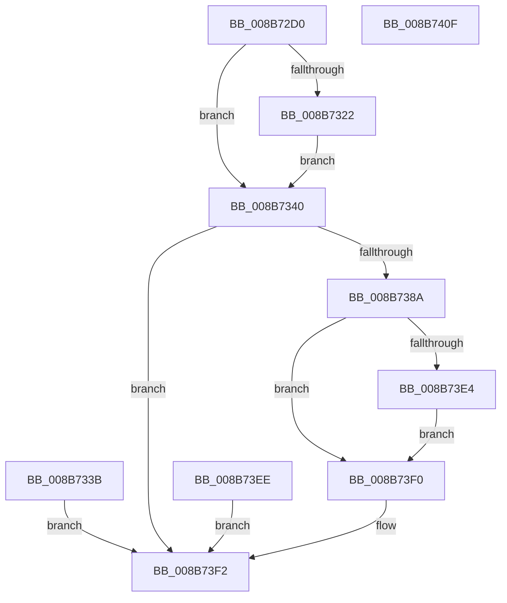

# NtOpenProcessTokenEx

- RVA: `0x008B72D0`–`0x008B7410` (길이 `320` bytes)
- VA: `0x00000001408B72D0`
- 실행 섹션: `PAGE`
- PDB 이름 있음: `예`; PDB Function 태그: `아니요`
- unwind 정보 RVA: `0x00082B04`
- 디코드: `78`개 명령, `320/320` bytes 표시
- 미해석 바이트: `0` (있으면 어셈블리에 `.byte`로 보존)

> 이 문서는 커널 이미지의 기계어와 PDB 기호를 분석해 생성했습니다. 4번과 5번은 함수 원형과 자료형을 바이너리 사용 방식에서 추정한 C 해석이며 원본 소스 복구 결과는 아닙니다.

## 1. Dependencies

- 직접 호출 지점: **5**; 고유 호출 대상: **5**
- 직접 호출자로 확인된 함수: **2**
- RIP 상대 이미지 참조: **2**

### Outgoing calls
- `0x008B7381` → [ObpReferenceObjectByHandleWithTag](../86/ObpReferenceObjectByHandleWithTag_function_00869650.md) (function, `0x00869650`)
- `0x008B7394` → [PsReferencePrimaryTokenWithTag](../../text/20/PsReferencePrimaryTokenWithTag_function_0020FF80.md) (function, `0x0020FF80`)
- `0x008B73A6` → [ObfDereferenceObjectWithTag](../../text/2F/ObfDereferenceObjectWithTag_function_002F78E0.md) (function, `0x002F78E0`)
- `0x008B73D1` → [ObOpenObjectByPointer](ObOpenObjectByPointer_function_008B7420.md) (function, `0x008B7420`)
- `0x008B73DB` → [ObfDereferenceObject](../../text/2F/ObfDereferenceObject_function_002F9350.md) (function, `0x002F9350`)

### Direct callers
- [RtlpSysVolTakeOwnership](../79/RtlpSysVolTakeOwnership_function_007917C8.md) at `0x00791829`
- [NtOpenProcessToken](NtOpenProcessToken_function_008B72B0.md) at `0x008B72BA`

### Static image references
- `0x008B7356` → RVA `0x00FC6A98` (`ALMOSTRO`; read)
- `0x008B73BA` → RVA `0x00FD8020` (`PAGEDATA`; read)

## 2. Other-region calls and transfers

- 다른 실행 섹션으로 향하는 call: **3**
  - `0x008B7394` → [PsReferencePrimaryTokenWithTag](../../text/20/PsReferencePrimaryTokenWithTag_function_0020FF80.md) (`PAGE` → `.text`)
  - `0x008B73A6` → [ObfDereferenceObjectWithTag](../../text/2F/ObfDereferenceObjectWithTag_function_002F78E0.md) (`PAGE` → `.text`)
  - `0x008B73DB` → [ObfDereferenceObject](../../text/2F/ObfDereferenceObject_function_002F9350.md) (`PAGE` → `.text`)
- 별도 외부 분기/꼬리 이동을 확인하지 못했습니다.

## 3. Assembly (complete function range)

```asm
008B72D0  48 89 5C 24 08                  mov qword ptr [rsp + 8], rbx
008B72D5  48 89 74 24 10                  mov qword ptr [rsp + 0x10], rsi
008B72DA  48 89 7C 24 18                  mov qword ptr [rsp + 0x18], rdi
008B72DF  41 54                           push r12
008B72E1  41 56                           push r14
008B72E3  41 57                           push r15
008B72E5  48 83 EC 50                     sub rsp, 0x50
008B72E9  4D 8B F9                        mov r15, r9
008B72EC  44 8B E2                        mov r12d, edx
008B72EF  4C 8B D1                        mov r10, rcx
008B72F2  33 D2                           xor edx, edx
008B72F4  48 89 54 24 48                  mov qword ptr [rsp + 0x48], rdx
008B72F9  65 48 8B 04 25 88 01 00 00      mov rax, qword ptr gs:[0x188]
008B7302  44 0F B6 B0 32 02 00 00         movzx r14d, byte ptr [rax + 0x232]
008B730A  BB F2 1F 01 00                  mov ebx, 0x11ff2
008B730F  B8 F2 1D 00 00                  mov eax, 0x1df2
008B7314  45 84 F6                        test r14b, r14b
008B7317  0F 45 D8                        cmovne ebx, eax
008B731A  41 23 D8                        and ebx, r8d
008B731D  45 84 F6                        test r14b, r14b
008B7320  74 1E                           je 0x1408b7340
008B7322  48 B9 00 00 FF FF FF 7F 00 00   movabs rcx, 0x7fffffff0000
008B732C  4C 3B C9                        cmp r9, rcx
008B732F  49 0F 42 C9                     cmovb rcx, r9
008B7333  48 8B 01                        mov rax, qword ptr [rcx]
008B7336  48 89 01                        mov qword ptr [rcx], rax
008B7339  EB 05                           jmp 0x1408b7340
008B733B  E9 B2 00 00 00                  jmp 0x1408b73f2
008B7340  48 89 54 24 40                  mov qword ptr [rsp + 0x40], rdx
008B7345  65 48 8B 04 25 88 01 00 00      mov rax, qword ptr gs:[0x188]
008B734E  44 0F B6 88 32 02 00 00         movzx r9d, byte ptr [rax + 0x232]
008B7356  4C 8B 05 3B F7 70 00            mov r8, qword ptr [rip + 0x70f73b]
008B735D  48 89 54 24 38                  mov qword ptr [rsp + 0x38], rdx
008B7362  48 89 54 24 30                  mov qword ptr [rsp + 0x30], rdx
008B7367  48 8D 44 24 40                  lea rax, [rsp + 0x40]
008B736C  48 89 44 24 28                  mov qword ptr [rsp + 0x28], rax
008B7371  C7 44 24 20 50 73 53 65         mov dword ptr [rsp + 0x20], 0x65537350
008B7379  BA 00 10 00 00                  mov edx, 0x1000
008B737E  49 8B CA                        mov rcx, r10
008B7381  E8 CA 22 FB FF                  call 0x140869650
008B7386  85 C0                           test eax, eax
008B7388  78 68                           js 0x1408b73f2
008B738A  BA 44 66 6C 74                  mov edx, 0x746c6644
008B738F  48 8B 4C 24 40                  mov rcx, qword ptr [rsp + 0x40]
008B7394  E8 E7 8B 95 FF                  call 0x14020ff80
008B7399  48 8B F0                        mov rsi, rax
008B739C  BA 50 73 53 65                  mov edx, 0x65537350
008B73A1  48 8B 4C 24 40                  mov rcx, qword ptr [rsp + 0x40]
008B73A6  E8 35 05 A4 FF                  call 0x1402f78e0
008B73AB  48 8D 44 24 48                  lea rax, [rsp + 0x48]
008B73B0  48 89 44 24 30                  mov qword ptr [rsp + 0x30], rax
008B73B5  44 88 74 24 28                  mov byte ptr [rsp + 0x28], r14b
008B73BA  48 8B 0D 5F 0C 72 00            mov rcx, qword ptr [rip + 0x720c5f]
008B73C1  48 89 4C 24 20                  mov qword ptr [rsp + 0x20], rcx
008B73C6  45 8B CC                        mov r9d, r12d
008B73C9  45 33 C0                        xor r8d, r8d
008B73CC  8B D3                           mov edx, ebx
008B73CE  48 8B CE                        mov rcx, rsi
008B73D1  E8 4A 00 00 00                  call 0x1408b7420
008B73D6  8B D8                           mov ebx, eax
008B73D8  48 8B CE                        mov rcx, rsi
008B73DB  E8 70 1F A4 FF                  call 0x1402f9350
008B73E0  85 DB                           test ebx, ebx
008B73E2  78 0C                           js 0x1408b73f0
008B73E4  48 8B 4C 24 48                  mov rcx, qword ptr [rsp + 0x48]
008B73E9  49 89 0F                        mov qword ptr [r15], rcx
008B73EC  EB 02                           jmp 0x1408b73f0
008B73EE  EB 02                           jmp 0x1408b73f2
008B73F0  8B C3                           mov eax, ebx
008B73F2  48 8B 5C 24 70                  mov rbx, qword ptr [rsp + 0x70]
008B73F7  48 8B 74 24 78                  mov rsi, qword ptr [rsp + 0x78]
008B73FC  48 8B BC 24 80 00 00 00         mov rdi, qword ptr [rsp + 0x80]
008B7404  48 83 C4 50                     add rsp, 0x50
008B7408  41 5F                           pop r15
008B740A  41 5E                           pop r14
008B740C  41 5C                           pop r12
008B740E  C3                              ret
008B740F  CC                              int3
```

## 4. C-style interpretation (structured pseudocode)

```c
__int64 __fastcall NtOpenProcessTokenEx(__int64 a1, int a2, int a3, __int64 a4)
{
    __int64 result;
    __int64 v_rbx;
    __int64 v_rsp;
    unsigned __int64 v_stack_m20;
    unsigned __int64 v_stack_m28;
    unsigned __int64 v_stack_m30;
    unsigned __int64 v_stack_m38;
    unsigned __int64 v_stack_m40;
    unsigned int v_stack_m48;
    unsigned __int64 v_stack_p10;
    unsigned __int64 v_stack_p18;
    unsigned __int64 v_stack_p8;

    v_stack_p8 = v_rbx;
    v_stack_p10 = v_rsi;
    v_stack_p18 = v_rdi;
    v_rsp = (v_rsp) - (80);
    a2 = 0;
    v_stack_m20 = 0;
    v_rbx = (unsigned int)(0x11FF2ULL);
    if ((unsigned __int8)(*(unsigned __int8 *)(*(unsigned __int64 *)(gs_base + (0 + 392)) + 562)) != 0) { v_rbx = (unsigned int)((unsigned int)(0x1DF2ULL)); }
    v_rbx = (unsigned int)((v_rbx) & (a3));
    if ((unsigned __int8)(*(unsigned __int8 *)(*(unsigned __int64 *)(gs_base + (0 + 392)) + 562)) == 0) goto loc_008B7340;
    if (a4 < a1) { a1 = a4; }
    *(unsigned __int64 *)(a1) = *(unsigned __int64 *)(a1);
    goto loc_008B7340;
loc_008B7340:
    v_stack_m28 = 0;
    v_stack_m30 = 0;
    v_stack_m38 = 0;
    v_stack_m40 = v_stack_m28;
    v_stack_m48 = 0x65537350ULL;
    result = ObpReferenceObjectByHandleWithTag(a1, (unsigned int)(0x1000ULL), *(unsigned __int64 *)(v_rip + 7403323), *(unsigned __int8 *)(*(unsigned __int64 *)(gs_base + (0 + 392)) + 562));
    if (sign_flag) goto loc_008B73F2;
    result = PsReferencePrimaryTokenWithTag(v_stack_m28, (unsigned int)(0x746C6644ULL), *(unsigned __int64 *)(v_rip + 7403323), *(unsigned __int8 *)(*(unsigned __int64 *)(gs_base + (0 + 392)) + 562));
    result = ObfDereferenceObjectWithTag(v_stack_m28, (unsigned int)(0x65537350ULL), *(unsigned __int64 *)(v_rip + 7403323), *(unsigned __int8 *)(*(unsigned __int64 *)(gs_base + (0 + 392)) + 562));
    v_stack_m38 = v_stack_m20;
    v_stack_m40 = (unsigned __int8)(*(unsigned __int8 *)(*(unsigned __int64 *)(gs_base + (0 + 392)) + 562));
    v_stack_m48 = *(unsigned __int64 *)(v_rip + 7474271);
    a3 = 0;
    result = ObOpenObjectByPointer(result, (unsigned int)((unsigned int)(v_rbx)), a3, (unsigned int)((unsigned int)((unsigned int)(a2))));
    result = ObfDereferenceObject(result, (unsigned int)((unsigned int)(v_rbx)), a3, (unsigned int)((unsigned int)((unsigned int)(a2))));
    if (sign_flag) goto loc_008B73F0;
    *(unsigned __int64 *)(a4) = v_stack_m20;
    goto loc_008B73F0;
loc_008B73F0:
loc_008B73F2:
    v_rsp = (v_rsp) + (80);
    return (unsigned int)((unsigned int)((unsigned int)((unsigned int)(result))));
}
```

## 5. (Beta) C Style

```c
int64_t NtOpenProcessTokenEx(int64_t Arg1, int32_t Arg2, int32_t Arg3, void *Arg4)
{
    uint8_t *arg4 = (uint8_t *)Arg4;

    int64_t result;
    int64_t local_rbx;
    int64_t local_rsp;
    uint64_t v_stack_m20;
    uint64_t v_stack_m28;
    uint64_t v_stack_m30;
    uint64_t v_stack_m38;
    uint64_t v_stack_m40;
    uint32_t v_stack_m48;
    uint64_t v_stack_p10;
    uint64_t v_stack_p18;
    uint64_t v_stack_p8;

    v_stack_p8 = local_rbx;
    v_stack_p10 = local_rsi;
    v_stack_p18 = local_rdi;
    local_rsp = (local_rsp) - (80);
    Arg2 = 0;
    v_stack_m20 = 0;
    local_rbx = (uint32_t)(0x11FF2ULL);
    if ((uint8_t)(*(uint8_t *)(*(uint64_t *)(gs_base + (0 + 0x188)) + 0x232)) != 0) { local_rbx = (uint32_t)((uint32_t)(0x1DF2ULL)); }
    local_rbx = (uint32_t)((local_rbx) & (Arg3));
    if ((uint8_t)(*(uint8_t *)(*(uint64_t *)(gs_base + (0 + 0x188)) + 0x232)) == 0) goto loc_008B7340;
    if (Arg4 < Arg1) { Arg1 = Arg4; }
    *(uint64_t *)(Arg1) = *(uint64_t *)(Arg1);
    goto loc_008B7340;
loc_008B7340:
    v_stack_m28 = 0;
    v_stack_m30 = 0;
    v_stack_m38 = 0;
    v_stack_m40 = v_stack_m28;
    v_stack_m48 = 0x65537350ULL;
    result = ObpReferenceObjectByHandleWithTag(Arg1, (uint32_t)(0x1000ULL), *(uint64_t *)(v_rip + 0x70F73B), *(uint8_t *)(*(uint64_t *)(gs_base + (0 + 0x188)) + 0x232));
    if (sign_flag) goto loc_008B73F2;
    result = PsReferencePrimaryTokenWithTag(v_stack_m28, (uint32_t)(0x746C6644ULL), *(uint64_t *)(v_rip + 0x70F73B), *(uint8_t *)(*(uint64_t *)(gs_base + (0 + 0x188)) + 0x232));
    result = ObfDereferenceObjectWithTag(v_stack_m28, (uint32_t)(0x65537350ULL), *(uint64_t *)(v_rip + 0x70F73B), *(uint8_t *)(*(uint64_t *)(gs_base + (0 + 0x188)) + 0x232));
    v_stack_m38 = v_stack_m20;
    v_stack_m40 = (uint8_t)(*(uint8_t *)(*(uint64_t *)(gs_base + (0 + 0x188)) + 0x232));
    v_stack_m48 = *(uint64_t *)(v_rip + 0x720C5F);
    Arg3 = 0;
    result = ObOpenObjectByPointer(result, (uint32_t)((uint32_t)(local_rbx)), Arg3, (uint32_t)((uint32_t)((uint32_t)(Arg2))));
    result = ObfDereferenceObject(result, (uint32_t)((uint32_t)(local_rbx)), Arg3, (uint32_t)((uint32_t)((uint32_t)(Arg2))));
    if (sign_flag) goto loc_008B73F0;
    *(uint64_t *)(arg4) = v_stack_m20;
    goto loc_008B73F0;
loc_008B73F0:
loc_008B73F2:
    local_rsp = (local_rsp) + (80);
    return (uint32_t)((uint32_t)((uint32_t)((uint32_t)(result))));
}
```

### 관측된 메모리 오프셋

구조체 형식이 확인되지 않은 접근은 인자 기준의 오프셋으로만 기록했습니다.

| 기준 인자 | 오프셋 표현 | 폭 (bit) | 접근 |
|---|---:|---:|---|
| `Arg4` | `+ 0x0` | `64` | `W` |

## 6. Execution-region graph

[열기: 2D/3D 그래프와 함수 탐색 컨트롤 패널](../../../control-panel.html?section=page&rva=0x008B72D0&view=graph)

- 2D 그래프는 위에서 아래로 흐르고, 3D 그래프는 빈 공간을 드래그해 회전합니다. Shift+드래그는 이동, 휠은 확대·축소, 함수 노드 선택은 대상 보고서 이동입니다.

### Static fallback


