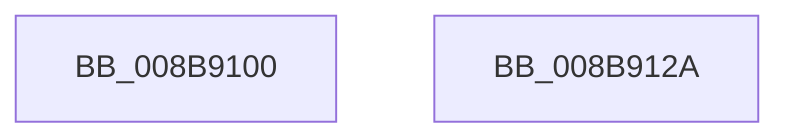

# ObInsertObject

- RVA: `0x008B9100`–`0x008B912B` (길이 `43` bytes)
- VA: `0x00000001408B9100`
- 실행 섹션: `PAGE`
- PDB 이름 있음: `예`; PDB Function 태그: `아니요`
- unwind 정보 RVA: `0x00063458`
- 디코드: `10`개 명령, `43/43` bytes 표시
- 미해석 바이트: `0` (있으면 어셈블리에 `.byte`로 보존)

> 이 문서는 커널 이미지의 기계어와 PDB 기호를 분석해 생성했습니다. 4번과 5번은 함수 원형과 자료형을 바이너리 사용 방식에서 추정한 C 해석이며 원본 소스 복구 결과는 아닙니다.

## 1. Dependencies

- 직접 호출 지점: **1**; 고유 호출 대상: **1**
- 직접 호출자로 확인된 함수: **9**
- RIP 상대 이미지 참조: **0**

### Outgoing calls
- `0x008B9120` → [ObInsertObjectEx](ObInsertObjectEx_function_008B97A0.md) (function, `0x008B97A0`)

### Direct callers
- [PopPowerRequestCreateUserModeRequest](../../text/22/PopPowerRequestCreateUserModeRequest_function_0022F91C.md) at `0x0022F9A4`
- [FsRtlCreateSectionForDataScan](../../text/45/FsRtlCreateSectionForDataScan_function_00453330.md) at `0x004534D5`
- [SepCreateTokenEx](../../text/4E/SepCreateTokenEx_function_004E9CD0.md) at `0x004EA8A7`
- [SepCreateTokenEx](../../text/4E/SepCreateTokenEx_function_004E9CD0.md) at `0x004EA90A`
- [SepCreateAppContainerToken](../../text/4F/SepCreateAppContainerToken_function_004F43AC.md) at `0x004F4C50`
- [PspInitPhase1](../../init/C4/PspInitPhase1_function_00C453B8.md) at `0x00C453E0`
- [PspInitializeCpuPartitionsPhase1](../../init/C4/PspInitializeCpuPartitionsPhase1_function_00C45AF4.md) at `0x00C45B94`
- [CmpCreateRegistryRoot](../../init/C5/CmpCreateRegistryRoot_function_00C57880.md) at `0x00C57A06`
- [MiSectionInitialization](../../init/C6/MiSectionInitialization_function_00C644A4.md) at `0x00C646E6`
- [IopInitializeBuiltinDriver](../../init/C7/IopInitializeBuiltinDriver_function_00C7625C.md) at `0x00C76389`

### Static image references
- 디코드된 RIP-relative 메모리 참조가 없습니다.

## 2. Other-region calls and transfers

- 다른 실행 섹션으로 향하는 call: **0**
- 별도 외부 분기/꼬리 이동을 확인하지 못했습니다.

## 3. Assembly (complete function range)

```asm
008B9100  48 83 EC 48                     sub rsp, 0x48
008B9104  48 8B 44 24 78                  mov rax, qword ptr [rsp + 0x78]
008B9109  48 89 44 24 30                  mov qword ptr [rsp + 0x30], rax
008B910E  48 8B 44 24 70                  mov rax, qword ptr [rsp + 0x70]
008B9113  48 89 44 24 28                  mov qword ptr [rsp + 0x28], rax
008B9118  C7 44 24 20 00 00 00 00         mov dword ptr [rsp + 0x20], 0
008B9120  E8 7B 06 00 00                  call 0x1408b97a0
008B9125  48 83 C4 48                     add rsp, 0x48
008B9129  C3                              ret
008B912A  CC                              int3
```

## 4. C-style interpretation (structured pseudocode)

```c
__int64 __fastcall ObInsertObject(__int64 a1, __int64 a2, __int64 a3, __int64 a4, __int64 a5, __int64 a6)
{
    __int64 result;
    __int64 v_rsp;
    unsigned __int64 v_stack_m18;
    unsigned __int64 v_stack_m20;
    unsigned int v_stack_m28;

    v_rsp = (v_rsp) - (72);
    v_stack_m18 = a6;
    v_stack_m20 = a5;
    v_stack_m28 = 0;
    result = ObInsertObjectEx(a1, a2, a3, a4);
    v_rsp = (v_rsp) + (72);
    return result;
}
```

## 5. (Beta) C Style

```c
int64_t ObInsertObject(int64_t Arg1, int64_t Arg2, int64_t Arg3, int64_t Arg4, int64_t Arg5, int64_t Arg6)
{
    int64_t result;
    int64_t local_rsp;
    uint64_t v_stack_m18;
    uint64_t v_stack_m20;
    uint32_t v_stack_m28;

    local_rsp = (local_rsp) - (72);
    v_stack_m18 = Arg6;
    v_stack_m20 = Arg5;
    v_stack_m28 = 0;
    result = ObInsertObjectEx(Arg1, Arg2, Arg3, Arg4);
    local_rsp = (local_rsp) + (72);
    return result;
}
```

## 6. Execution-region graph

[열기: 2D/3D 그래프와 함수 탐색 컨트롤 패널](../../../control-panel.html?section=page&rva=0x008B9100&view=graph)

- 2D 그래프는 위에서 아래로 흐르고, 3D 그래프는 빈 공간을 드래그해 회전합니다. Shift+드래그는 이동, 휠은 확대·축소, 함수 노드 선택은 대상 보고서 이동입니다.

### Static fallback


