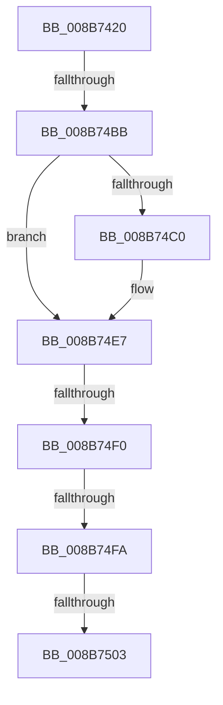

# ObOpenObjectByPointer

- RVA: `0x008B7420`–`0x008B750F` (길이 `239` bytes)
- VA: `0x00000001408B7420`
- 실행 섹션: `PAGE`
- PDB 이름 있음: `예`; PDB Function 태그: `아니요`
- unwind 정보 RVA: `0x00082B48`
- 디코드: `55`개 명령, `239/239` bytes 표시
- 미해석 바이트: `0` (있으면 어셈블리에 `.byte`로 보존)

> 이 문서는 커널 이미지의 기계어와 PDB 기호를 분석해 생성했습니다. 4번과 5번은 함수 원형과 자료형을 바이너리 사용 방식에서 추정한 C 해석이며 원본 소스 복구 결과는 아닙니다.

## 1. Dependencies

- 직접 호출 지점: **3**; 고유 호출 대상: **2**
- 직접 호출자로 확인된 함수: **41**
- RIP 상대 이미지 참조: **3**

### Outgoing calls
- `0x008B7469` → [memset](../../text/6C/memset_function_006C6C40.md) (function, `0x006C6C40`)
- `0x008B747E` → [memset](../../text/6C/memset_function_006C6C40.md) (function, `0x006C6C40`)
- `0x008B74AE` → [ObReferenceObjectByPointerWithTag](../../text/41/ObReferenceObjectByPointerWithTag_function_00419870.md) (function, `0x00419870`)

### Direct callers
- [DbgkUserReportWorkRoutine](../71/DbgkUserReportWorkRoutine_function_00710D10.md) at `0x00710DC9`
- [ObInitServerSilo](../74/ObInitServerSilo_function_0074D8FC.md) at `0x0074D9B7`
- [PfTStart](../75/PfTStart_function_007517AC.md) at `0x007519D3`
- [TtmiOpenDefaultTerminal](../77/TtmiOpenDefaultTerminal_function_0077CC20.md) at `0x0077CCA4`
- [NtCreateCpuPartition](../78/NtCreateCpuPartition_function_00782E30.md) at `0x00782FF2`
- [SmGetRegistrationInfo](../7A/SmGetRegistrationInfo_function_007A5AC4.md) at `0x007A5BB6`
- [CmpInitializeRegistryProcess](../7E/CmpInitializeRegistryProcess_function_007E8180.md) at `0x007E823E`
- [MiOpenSpecialPurposeMemory](../80/MiOpenSpecialPurposeMemory_function_0080FA28.md) at `0x0080FB8A`
- [CmLoadDifferencingKey](../87/CmLoadDifferencingKey_function_00875670.md) at `0x00875E20`
- [CmConvertHandleToKernelHandle](../87/CmConvertHandleToKernelHandle_function_00876DDC.md) at `0x00876E67`
- [PsOpenProcess](../89/PsOpenProcess_function_00894A30.md) at `0x00894D5A`
- [PspCombineSecurityDomains](../8A/PspCombineSecurityDomains_function_008A18C0.md) at `0x008A1A19`
- [PspCombineSecurityDomains](../8A/PspCombineSecurityDomains_function_008A18C0.md) at `0x008A1B0D`
- [PspOneDirectionSecurityDomainCombine](../8A/PspOneDirectionSecurityDomainCombine_function_008A23BC.md) at `0x008A24F6`
- [NtOpenProcessTokenEx](NtOpenProcessTokenEx_function_008B72D0.md) at `0x008B73D1`
- [NtOpenThreadTokenEx](NtOpenThreadTokenEx_function_008B7840.md) at `0x008B7F57`
- [NtGetNextThread](../8C/NtGetNextThread_function_008C7D40.md) at `0x008C7F8B`
- [MmManagePartitionGetMemoryEvents](../90/MmManagePartitionGetMemoryEvents_function_00901AB4.md) at `0x00901B4D`
- [MmManagePartitionGetMemoryEvents](../90/MmManagePartitionGetMemoryEvents_function_00901AB4.md) at `0x00901B7F`
- [MmManagePartitionGetMemoryEvents](../90/MmManagePartitionGetMemoryEvents_function_00901AB4.md) at `0x00901BB1`
- [ExGetNextProcess](../91/ExGetNextProcess_function_0091CAD0.md) at `0x0091CC70`
- [NtGetNextProcess](../91/NtGetNextProcess_function_0091DF50.md) at `0x0091E150`
- [VrpPostEnumerateKey](../93/VrpPostEnumerateKey_function_00933EA8.md) at `0x00934485`
- [PiCMOpenObjectKey](../96/PiCMOpenObjectKey_function_00961E08.md) at `0x00961F60`
- [PiCMDuplicateRegistryHandle](../96/PiCMDuplicateRegistryHandle_function_009624C4.md) at `0x00962531`
- [EtwpCapturePreviousRegistryData](../99/EtwpCapturePreviousRegistryData_function_0099D3EC.md) at `0x0099D444`
- [IopInvalidateVolumesForDevice](../9A/IopInvalidateVolumesForDevice_function_009A5E74.md) at `0x009A5F55`
- [NtCreateWorkerFactory](../9A/NtCreateWorkerFactory_function_009A7E10.md) at `0x009A7F79`
- [NtQueryInformationProcess](../9A/NtQueryInformationProcess_function_009AA250.md) at `0x009AE3C9`
- [PsOpenThread](../9C/PsOpenThread_function_009C5CC0.md) at `0x009C5FF6`
- [NtOpenPrivateNamespace](../9C/NtOpenPrivateNamespace_function_009C94E0.md) at `0x009C96F0`
- [WmipIoControl](../9D/WmipIoControl_function_009DEBD0.md) at `0x009DEE64`
- [sub_00A0BA74](../A0/Unknown_function_00A0BA74.md) at `0x00A0BDC8`
- [PspCreateObjectHandle](../A1/PspCreateObjectHandle_function_00A1E51C.md) at `0x00A1E554`
- [CmFcManagerQueryFeatureConfigurationSectionInformation](../A3/CmFcManagerQueryFeatureConfigurationSectionInformation_function_00A30240.md) at `0x00A303AF`
- [DbgkpOpenHandles](../A4/DbgkpOpenHandles_function_00A4681C.md) at `0x00A468D5`
- [DbgkpOpenHandles](../A4/DbgkpOpenHandles_function_00A4681C.md) at `0x00A4691A`
- [EtwpOpenConsumer](../A6/EtwpOpenConsumer_function_00A66204.md) at `0x00A6623F`
- [ObOpenObjectByPointerWithTag](../A8/ObOpenObjectByPointerWithTag_function_00A87920.md) at `0x00A87943`
- [ObpSetDeviceMap](../A9/ObpSetDeviceMap_function_00A925D0.md) at `0x00A92691`
- [PopEtEnergyTrackerQueryDxgProcessEnergyValues](../A9/PopEtEnergyTrackerQueryDxgProcessEnergyValues_function_00A9FBD4.md) at `0x00A9FC7A`
- [SmKmFileInfoDuplicate](../AC/SmKmFileInfoDuplicate_function_00AC98FC.md) at `0x00AC994F`
- [sub_00B3B188](../B3/Unknown_function_00B3B188.md) at `0x00B3B1B0`
- [sub_00B439C4](../B4/Unknown_function_00B439C4.md) at `0x00B43A30`
- [sub_00B4588A](../B4/Unknown_function_00B4588A.md) at `0x00B45C67`
- [sub_00B4588A](../B4/Unknown_function_00B4588A.md) at `0x00B45CA5`
- [sub_00B4588A](../B4/Unknown_function_00B4588A.md) at `0x00B45CEB`
- [sub_00B4588A](../B4/Unknown_function_00B4588A.md) at `0x00B45D2F`
- [sub_00B4588A](../B4/Unknown_function_00B4588A.md) at `0x00B45EF3`

### Static image references
- `0x008B7432` → RVA `0x00E0A740` (`.data`; read)
- `0x008B74C8` → RVA `0x00FC7800` (`ALMOSTRO`; read)
- `0x008B74D9` → RVA `0x00FC6E4C` (`ALMOSTRO`; read)

## 2. Other-region calls and transfers

- 다른 실행 섹션으로 향하는 call: **3**
  - `0x008B7469` → [memset](../../text/6C/memset_function_006C6C40.md) (`PAGE` → `.text`)
  - `0x008B747E` → [memset](../../text/6C/memset_function_006C6C40.md) (`PAGE` → `.text`)
  - `0x008B74AE` → [ObReferenceObjectByPointerWithTag](../../text/41/ObReferenceObjectByPointerWithTag_function_00419870.md) (`PAGE` → `.text`)
- call이 아닌 외부 분기/꼬리 이동: **4**
  - `0x008B74B5` → [sub_008B756E + 0x120](Unknown_function_008B756E.md) (`tail-transfer`)
  - `0x008B74EA` → [sub_008B7711 + 0x19](Unknown_function_008B7711.md) (`tail-transfer`)
  - `0x008B74F4` → [sub_008B7711 + 0xF](Unknown_function_008B7711.md) (`tail-transfer`)
  - `0x008B74FD` → [sub_008B756E + 0x3D](Unknown_function_008B756E.md) (`tail-transfer`)

## 3. Assembly (complete function range)

```asm
008B7420  40 53                           push rbx
008B7422  55                              push rbp
008B7423  56                              push rsi
008B7424  57                              push rdi
008B7425  41 55                           push r13
008B7427  41 56                           push r14
008B7429  41 57                           push r15
008B742B  48 81 EC 20 02 00 00            sub rsp, 0x220
008B7432  48 8B 05 07 33 55 00            mov rax, qword ptr [rip + 0x553307]
008B7439  48 33 C4                        xor rax, rsp
008B743C  48 89 84 24 10 02 00 00         mov qword ptr [rsp + 0x210], rax
008B7444  4C 8B B4 24 90 02 00 00         mov r14, qword ptr [rsp + 0x290]
008B744C  49 8B D8                        mov rbx, r8
008B744F  8B EA                           mov ebp, edx
008B7451  44 89 4C 24 60                  mov dword ptr [rsp + 0x60], r9d
008B7456  48 8B F1                        mov rsi, rcx
008B7459  33 D2                           xor edx, edx
008B745B  41 B8 E0 00 00 00               mov r8d, 0xe0
008B7461  48 8D 8C 24 30 01 00 00         lea rcx, [rsp + 0x130]
008B7469  E8 D2 F7 E0 FF                  call 0x1406c6c40
008B746E  33 D2                           xor edx, edx
008B7470  48 8D 8C 24 90 00 00 00         lea rcx, [rsp + 0x90]
008B7478  41 B8 A0 00 00 00               mov r8d, 0xa0
008B747E  E8 BD F7 E0 FF                  call 0x1406c6c40
008B7483  44 0F B6 BC 24 88 02 00 00      movzx r15d, byte ptr [rsp + 0x288]
008B748C  45 33 ED                        xor r13d, r13d
008B748F  48 8B BC 24 80 02 00 00         mov rdi, qword ptr [rsp + 0x280]
008B7497  45 0F B6 CF                     movzx r9d, r15b
008B749B  4C 8B C7                        mov r8, rdi
008B749E  4D 89 2E                        mov qword ptr [r14], r13
008B74A1  33 D2                           xor edx, edx
008B74A3  C7 44 24 20 4F 62 48 6E         mov dword ptr [rsp + 0x20], 0x6e48624f
008B74AB  48 8B CE                        mov rcx, rsi
008B74AE  E8 BD 23 B6 FF                  call 0x140419870
008B74B3  85 C0                           test eax, eax
008B74B5  0F 88 D3 01 00 00               js 0x1408b768e
008B74BB  48 85 FF                        test rdi, rdi
008B74BE  75 27                           jne 0x1408b74e7
008B74C0  48 8D 46 D0                     lea rax, [rsi - 0x30]
008B74C4  48 C1 E8 08                     shr rax, 8
008B74C8  48 8D 3D 31 03 71 00            lea rdi, [rip + 0x710331]
008B74CF  0F B6 C8                        movzx ecx, al
008B74D2  0F B6 46 E8                     movzx eax, byte ptr [rsi - 0x18]
008B74D6  48 33 C8                        xor rcx, rax
008B74D9  0F B6 05 6C F9 70 00            movzx eax, byte ptr [rip + 0x70f96c]
008B74E0  48 33 C8                        xor rcx, rax
008B74E3  48 8B 3C CF                     mov rdi, qword ptr [rdi + rcx*8]
008B74E7  85 6F 48                        test dword ptr [rdi + 0x48], ebp
008B74EA  0F 85 3A 02 00 00               jne 0x1408b772a
008B74F0  F6 46 EB 01                     test byte ptr [rsi - 0x15], 1
008B74F4  0F 85 26 02 00 00               jne 0x1408b7720
008B74FA  48 85 DB                        test rbx, rbx
008B74FD  0F 85 A8 00 00 00               jne 0x1408b75ab
008B7503  65 48 8B 1C 25 88 01 00 00      mov rbx, qword ptr gs:[0x188]
008B750C  0F 57 C0                        xorps xmm0, xmm0
```

## 4. C-style interpretation (structured pseudocode)

```c
__int64 __fastcall ObOpenObjectByPointer(__int64 a1, int a2, __int64 a3, int a4, __int64 a5, unsigned __int8 a6, __int64 a7)
{
    __int64 result;
    __int64 v_r13;
    __int64 v_rdi;
    __int64 v_rsp;
    unsigned __int64 v_stack_m128;
    unsigned __int64 v_stack_m1C8;
    unsigned int v_stack_m1F8;
    unsigned int v_stack_m238;
    unsigned __int64 v_stack_m48;

    v_rsp = (v_rsp) - (544);
    result = (*(unsigned __int64 *)(v_rip + 5583623)) ^ (v_rsp);
    v_stack_m48 = result;
    v_stack_m1F8 = a4;
    a2 = 0;
    result = memset(v_stack_m128, a2, 224, a4);
    a2 = 0;
    result = memset(v_stack_m1C8, a2, 160, a4);
    v_r13 = 0;
    *(unsigned __int64 *)(a7) = 0;
    a2 = 0;
    v_stack_m238 = 0x6E48624FULL;
    result = ObReferenceObjectByPointerWithTag(a1, a2, a5, a6);
    v_rdi = a5;
    if (a5 == 0) {
        result = a1 - 48;
        result = (result) >> (8);
        v_rdi = v_rip + 7406385;
        a1 = (unsigned __int8)(result);
        result = *(unsigned __int8 *)(a1 - 24);
        a1 = (a1) ^ (result);
        result = *(unsigned __int8 *)(v_rip + 7403884);
        a1 = (a1) ^ (result);
        v_rdi = *(unsigned __int64 *)(v_rdi + a1 * 8);
    }
    return result;
}
```

## 5. (Beta) C Style

```c
int64_t ObOpenObjectByPointer(void *Arg1, int32_t Arg2, int64_t Arg3, int32_t Arg4, int64_t Arg5, uint8_t Arg6, void *Arg7)
{
    uint8_t *arg1 = (uint8_t *)Arg1;
    uint8_t *arg7 = (uint8_t *)Arg7;

    int64_t result;
    int64_t local_r13;
    int64_t local_rdi;
    int64_t local_rsp;
    uint64_t v_stack_m128;
    uint64_t v_stack_m1C8;
    uint32_t v_stack_m1F8;
    uint32_t v_stack_m238;
    uint64_t v_stack_m48;

    local_rsp = (local_rsp) - (544);
    result = (*(uint64_t *)(v_rip + 0x553307)) ^ (local_rsp);
    v_stack_m48 = result;
    v_stack_m1F8 = Arg4;
    Arg2 = 0;
    result = memset(v_stack_m128, Arg2, 224, Arg4);
    Arg2 = 0;
    result = memset(v_stack_m1C8, Arg2, 160, Arg4);
    local_r13 = 0;
    *(uint64_t *)(arg7) = 0;
    Arg2 = 0;
    v_stack_m238 = 0x6E48624FULL;
    result = ObReferenceObjectByPointerWithTag(Arg1, Arg2, Arg5, Arg6);
    local_rdi = Arg5;
    if (Arg5 == 0) {
        result = Arg1 - 48;
        result = (result) >> (8);
        local_rdi = v_rip + 7406385;
        Arg1 = (uint8_t)(result);
        result = *(uint8_t *)(arg1 - 0x18);
        Arg1 = (Arg1) ^ (result);
        result = *(uint8_t *)(v_rip + 0x70F96C);
        Arg1 = (Arg1) ^ (result);
        local_rdi = *(uint64_t *)(local_rdi + arg1 * 8);
    }
    return result;
}
```

### 관측된 메모리 오프셋

구조체 형식이 확인되지 않은 접근은 인자 기준의 오프셋으로만 기록했습니다.

| 기준 인자 | 오프셋 표현 | 폭 (bit) | 접근 |
|---|---:|---:|---|
| `Arg1` | `- 0x30` | `64` | `R` |
| `Arg1` | `- 0x18` | `8` | `R` |
| `Arg1` | `- 0x15` | `8` | `R` |
| `Arg7` | `+ 0x0` | `64` | `W` |

## 6. Execution-region graph

[열기: 2D/3D 그래프와 함수 탐색 컨트롤 패널](../../../control-panel.html?section=page&rva=0x008B7420&view=graph)

- 2D 그래프는 위에서 아래로 흐르고, 3D 그래프는 빈 공간을 드래그해 회전합니다. Shift+드래그는 이동, 휠은 확대·축소, 함수 노드 선택은 대상 보고서 이동입니다.

### Static fallback


