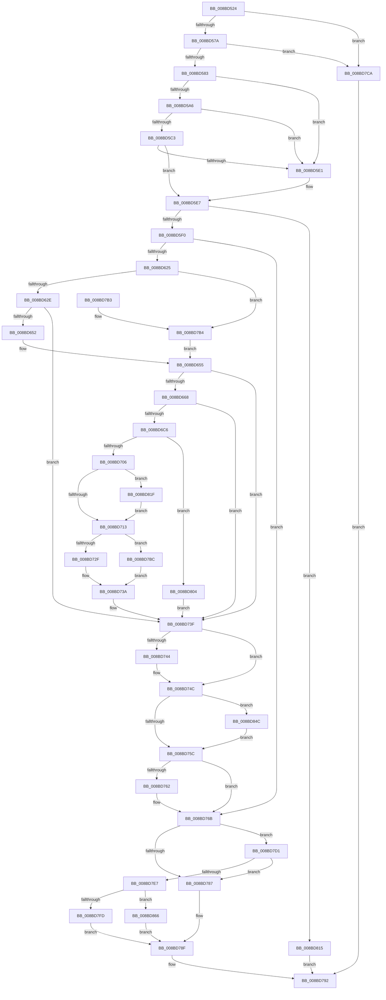

# ObReferenceObjectByNameEx

- RVA: `0x008BD524`–`0x008BD873` (길이 `847` bytes)
- VA: `0x00000001408BD524`
- 실행 섹션: `PAGE`
- PDB 이름 있음: `예`; PDB Function 태그: `아니요`
- unwind 정보 RVA: `0x00083098`
- 디코드: `210`개 명령, `847/847` bytes 표시
- 미해석 바이트: `0` (있으면 어셈블리에 `.byte`로 보존)

> 이 문서는 커널 이미지의 기계어와 PDB 기호를 분석해 생성했습니다. 4번과 5번은 함수 원형과 자료형을 바이너리 사용 방식에서 추정한 C 해석이며 원본 소스 복구 결과는 아닙니다.

## 1. Dependencies

- 직접 호출 지점: **20**; 고유 호출 대상: **17**
- 직접 호출자로 확인된 함수: **7**
- RIP 상대 이미지 참조: **4**

### Outgoing calls
- `0x008BD599` → [ExpInterlockedPopEntrySList](../../text/6B/ExpInterlockedPopEntrySList_function_006BA570.md) (function, `0x006BA570`)
- `0x008BD5B6` → [ExpInterlockedPopEntrySList](../../text/6B/ExpInterlockedPopEntrySList_function_006BA570.md) (function, `0x006BA570`)
- `0x008BD5D4` → [guard_dispatch_icall](../../text/6B/guard_dispatch_icall_function_006BAAD0.md) (function, `0x006BAAD0`)
- `0x008BD615` → [ObpCaptureObjectCreateInformation](../89/ObpCaptureObjectCreateInformation_function_0089B930.md) (function, `0x0089B930`)
- `0x008BD63F` → [SeCreateAccessState](../8C/SeCreateAccessState_function_008C6AC0.md) (function, `0x008C6AC0`)
- `0x008BD658` → [ObpAdjustAccessMask](ObpAdjustAccessMask_function_008BD380.md) (function, `0x008BD380`)
- `0x008BD66F` → [PsGetCurrentSilo](../../text/40/PsGetCurrentSilo_function_004094A0.md) (function, `0x004094A0`)
- `0x008BD6BA` → [ObpLookupObjectName](../89/ObpLookupObjectName_function_0089BE90.md) (function, `0x0089BE90`)
- `0x008BD6C9` → [ObpReleaseLookupContext](../../text/26/ObpReleaseLookupContext_function_00263D30.md) (function, `0x00263D30`)
- `0x008BD722` → [ObpCheckObjectReference](../8C/ObpCheckObjectReference_function_008C6084.md) (function, `0x008C6084`)
- `0x008BD73A` → [SeClearLearningModeObjectInformation](../../text/40/SeClearLearningModeObjectInformation_function_0040D470.md) (function, `0x0040D470`)
- `0x008BD747` → [SeDeleteAccessState](../8C/SeDeleteAccessState_function_008C5F70.md) (function, `0x008C5F70`)
- `0x008BD766` → [ObpFreeObjectNameBuffer](../8C/ObpFreeObjectNameBuffer_function_008C4250.md) (function, `0x008C4250`)
- `0x008BD78A` → [ExpInterlockedPushEntrySList](../../text/6B/ExpInterlockedPushEntrySList_function_006BA5B0.md) (function, `0x006BA5B0`)
- `0x008BD7C0` → [HalPutDmaAdapter](../../text/48/HalPutDmaAdapter_function_0048E530.md) (function, `0x0048E530`)
- `0x008BD7FD` → [ExFreePool](../../poolcode/B8/ExFreePool_function_00B82850.md) (function, `0x00B82850`)
- `0x008BD804` → [HalPutDmaAdapter](../../text/48/HalPutDmaAdapter_function_0048E530.md) (function, `0x0048E530`)
- `0x008BD83E` → [SeSetLearningModeObjectInformation](../../text/4C/SeSetLearningModeObjectInformation_function_004C7098.md) (function, `0x004C7098`)
- `0x008BD855` → [SeReleaseSecurityDescriptor](../97/SeReleaseSecurityDescriptor_function_00975190.md) (function, `0x00975190`)
- `0x008BD869` → [guard_dispatch_icall](../../text/6B/guard_dispatch_icall_function_006BAAD0.md) (function, `0x006BAAD0`)

### Direct callers
- [ObInitServerSilo](../74/ObInitServerSilo_function_0074D8FC.md) at `0x0074DA11`
- [NtQueryOpenSubKeys](../7D/NtQueryOpenSubKeys_function_007DFF80.md) at `0x007E0084`
- [NtQueryOpenSubKeysEx](../7E/NtQueryOpenSubKeysEx_function_007E0190.md) at `0x007E02FB`
- [AlpcpCreateClientPort](../92/AlpcpCreateClientPort_function_009270AC.md) at `0x009274EA`
- [CmUnloadKey](../9A/CmUnloadKey_function_009AF2FC.md) at `0x009AF5F2`
- [CmpResolveHiveLoadConflict](../A9/CmpResolveHiveLoadConflict_function_00A9E78C.md) at `0x00A9E841`
- [CmObReferenceObjectByName](../../pagecmrc/BC/CmObReferenceObjectByName_function_00BC9E94.md) at `0x00BC9EC5`

### Static image references
- `0x008BD6D2` → RVA `0x00FC7800` (`ALMOSTRO`; read)
- `0x008BD6EC` → RVA `0x00FC6E4C` (`ALMOSTRO`; read)
- `0x008BD706` → RVA `0x00FD9AD8` (`PAGEDATA`; read)
- `0x008BD7EA` → RVA `0x00B82850` (`ExFreePool`; read)

## 2. Other-region calls and transfers

- 다른 실행 섹션으로 향하는 call: **12**
  - `0x008BD599` → [ExpInterlockedPopEntrySList](../../text/6B/ExpInterlockedPopEntrySList_function_006BA570.md) (`PAGE` → `.text`)
  - `0x008BD5B6` → [ExpInterlockedPopEntrySList](../../text/6B/ExpInterlockedPopEntrySList_function_006BA570.md) (`PAGE` → `.text`)
  - `0x008BD5D4` → [guard_dispatch_icall](../../text/6B/guard_dispatch_icall_function_006BAAD0.md) (`PAGE` → `.text`)
  - `0x008BD66F` → [PsGetCurrentSilo](../../text/40/PsGetCurrentSilo_function_004094A0.md) (`PAGE` → `.text`)
  - `0x008BD6C9` → [ObpReleaseLookupContext](../../text/26/ObpReleaseLookupContext_function_00263D30.md) (`PAGE` → `.text`)
  - `0x008BD73A` → [SeClearLearningModeObjectInformation](../../text/40/SeClearLearningModeObjectInformation_function_0040D470.md) (`PAGE` → `.text`)
  - `0x008BD78A` → [ExpInterlockedPushEntrySList](../../text/6B/ExpInterlockedPushEntrySList_function_006BA5B0.md) (`PAGE` → `.text`)
  - `0x008BD7C0` → [HalPutDmaAdapter](../../text/48/HalPutDmaAdapter_function_0048E530.md) (`PAGE` → `.text`)
  - `0x008BD7FD` → [ExFreePool](../../poolcode/B8/ExFreePool_function_00B82850.md) (`PAGE` → `POOLCODE`)
  - `0x008BD804` → [HalPutDmaAdapter](../../text/48/HalPutDmaAdapter_function_0048E530.md) (`PAGE` → `.text`)
  - `0x008BD83E` → [SeSetLearningModeObjectInformation](../../text/4C/SeSetLearningModeObjectInformation_function_004C7098.md) (`PAGE` → `.text`)
  - `0x008BD869` → [guard_dispatch_icall](../../text/6B/guard_dispatch_icall_function_006BAAD0.md) (`PAGE` → `.text`)
- 별도 외부 분기/꼬리 이동을 확인하지 못했습니다.

## 3. Assembly (complete function range)

```asm
008BD524  48 8B C4                        mov rax, rsp
008BD527  48 89 58 10                     mov qword ptr [rax + 0x10], rbx
008BD52B  48 89 70 18                     mov qword ptr [rax + 0x18], rsi
008BD52F  48 89 78 20                     mov qword ptr [rax + 0x20], rdi
008BD533  55                              push rbp
008BD534  41 54                           push r12
008BD536  41 55                           push r13
008BD538  41 56                           push r14
008BD53A  41 57                           push r15
008BD53C  48 8D 68 B9                     lea rbp, [rax - 0x47]
008BD540  48 81 EC C0 00 00 00            sub rsp, 0xc0
008BD547  48 83 65 CF 00                  and qword ptr [rbp - 0x31], 0
008BD54C  0F 57 C0                        xorps xmm0, xmm0
008BD54F  33 C0                           xor eax, eax
008BD551  4D 8B F9                        mov r15, r9
008BD554  48 89 45 17                     mov qword ptr [rbp + 0x17], rax
008BD558  45 8B E8                        mov r13d, r8d
008BD55B  48 8B FA                        mov rdi, rdx
008BD55E  4C 8B E1                        mov r12, rcx
008BD561  0F 11 45 D7                     movups xmmword ptr [rbp - 0x29], xmm0
008BD565  0F 11 45 E7                     movups xmmword ptr [rbp - 0x19], xmm0
008BD569  0F 11 45 F7                     movups xmmword ptr [rbp - 9], xmm0
008BD56D  0F 11 45 07                     movups xmmword ptr [rbp + 7], xmm0
008BD571  48 85 C9                        test rcx, rcx
008BD574  0F 84 50 02 00 00               je 0x1408bd7ca
008BD57A  4D 85 C9                        test r9, r9
008BD57D  0F 84 47 02 00 00               je 0x1408bd7ca
008BD583  65 4C 8B 34 25 20 00 00 00      mov r14, qword ptr gs:[0x20]
008BD58C  49 8B B6 80 08 00 00            mov rsi, qword ptr [r14 + 0x880]
008BD593  48 8B CE                        mov rcx, rsi
008BD596  FF 46 14                        inc dword ptr [rsi + 0x14]
008BD599  E8 D2 CF DF FF                  call 0x1406ba570
008BD59E  48 8B D8                        mov rbx, rax
008BD5A1  48 85 C0                        test rax, rax
008BD5A4  75 3B                           jne 0x1408bd5e1
008BD5A6  FF 46 18                        inc dword ptr [rsi + 0x18]
008BD5A9  49 8B B6 88 08 00 00            mov rsi, qword ptr [r14 + 0x888]
008BD5B0  48 8B CE                        mov rcx, rsi
008BD5B3  FF 46 14                        inc dword ptr [rsi + 0x14]
008BD5B6  E8 B5 CF DF FF                  call 0x1406ba570
008BD5BB  48 8B D8                        mov rbx, rax
008BD5BE  48 85 C0                        test rax, rax
008BD5C1  75 1E                           jne 0x1408bd5e1
008BD5C3  8B 56 2C                        mov edx, dword ptr [rsi + 0x2c]
008BD5C6  48 8B 46 30                     mov rax, qword ptr [rsi + 0x30]
008BD5CA  44 8B 46 28                     mov r8d, dword ptr [rsi + 0x28]
008BD5CE  8B 4E 24                        mov ecx, dword ptr [rsi + 0x24]
008BD5D1  FF 46 18                        inc dword ptr [rsi + 0x18]
008BD5D4  E8 F7 D4 DF FF                  call 0x1406baad0
008BD5D9  48 8B D8                        mov rbx, rax
008BD5DC  48 85 C0                        test rax, rax
008BD5DF  74 06                           je 0x1408bd5e7
008BD5E1  41 8B 46 24                     mov eax, dword ptr [r14 + 0x24]
008BD5E5  89 03                           mov dword ptr [rbx], eax
008BD5E7  48 85 DB                        test rbx, rbx
008BD5EA  0F 84 25 02 00 00               je 0x1408bd815
008BD5F0  40 8A 75 6F                     mov sil, byte ptr [rbp + 0x6f]
008BD5F4  4C 8D B3 A0 00 00 00            lea r14, [rbx + 0xa0]
008BD5FB  40 8A D6                        mov dl, sil
008BD5FE  C7 44 24 28 01 00 00 00         mov dword ptr [rsp + 0x28], 1
008BD606  40 8A CE                        mov cl, sil
008BD609  4C 89 74 24 20                  mov qword ptr [rsp + 0x20], r14
008BD60E  4C 8D 4D D7                     lea r9, [rbp - 0x29]
008BD612  4D 8B C4                        mov r8, r12
008BD615  E8 16 E3 FD FF                  call 0x14089b930
008BD61A  89 45 4F                        mov dword ptr [rbp + 0x4f], eax
008BD61D  85 C0                           test eax, eax
008BD61F  0F 88 46 01 00 00               js 0x1408bd76b
008BD625  48 85 FF                        test rdi, rdi
008BD628  0F 85 86 01 00 00               jne 0x1408bd7b4
008BD62E  4D 8D 4F 4C                     lea r9, [r15 + 0x4c]
008BD632  45 8B C5                        mov r8d, r13d
008BD635  48 8D 93 E0 00 00 00            lea rdx, [rbx + 0xe0]
008BD63C  48 8B CB                        mov rcx, rbx
008BD63F  E8 7C 94 00 00                  call 0x1408c6ac0
008BD644  45 33 ED                        xor r13d, r13d
008BD647  89 45 4F                        mov dword ptr [rbp + 0x4f], eax
008BD64A  85 C0                           test eax, eax
008BD64C  0F 88 ED 00 00 00               js 0x1408bd73f
008BD652  48 8B FB                        mov rdi, rbx
008BD655  48 8B CF                        mov rcx, rdi
008BD658  E8 23 FD FF FF                  call 0x1408bd380
008BD65D  89 45 4F                        mov dword ptr [rbp + 0x4f], eax
008BD660  85 C0                           test eax, eax
008BD662  0F 88 D7 00 00 00               js 0x1408bd73f
008BD668  4C 8D A3 C0 01 00 00            lea r12, [rbx + 0x1c0]
008BD66F  E8 2C BE B4 FF                  call 0x1404094a0
008BD674  45 8B 06                        mov r8d, dword ptr [r14]
008BD677  48 8D 4D CF                     lea rcx, [rbp - 0x31]
008BD67B  48 89 4C 24 60                  mov qword ptr [rsp + 0x60], rcx
008BD680  48 8D 55 D7                     lea rdx, [rbp - 0x29]
008BD684  48 8B 8B A8 00 00 00            mov rcx, qword ptr [rbx + 0xa8]
008BD68B  4D 8B CF                        mov r9, r15
008BD68E  4C 89 6C 24 58                  mov qword ptr [rsp + 0x58], r13
008BD693  4C 89 64 24 50                  mov qword ptr [rsp + 0x50], r12
008BD698  48 89 7C 24 48                  mov qword ptr [rsp + 0x48], rdi
008BD69D  48 89 44 24 40                  mov qword ptr [rsp + 0x40], rax
008BD6A2  48 8B 45 77                     mov rax, qword ptr [rbp + 0x77]
008BD6A6  4C 89 6C 24 38                  mov qword ptr [rsp + 0x38], r13
008BD6AB  4C 89 6C 24 30                  mov qword ptr [rsp + 0x30], r13
008BD6B0  48 89 44 24 28                  mov qword ptr [rsp + 0x28], rax
008BD6B5  40 88 74 24 20                  mov byte ptr [rsp + 0x20], sil
008BD6BA  E8 D1 E7 FD FF                  call 0x14089be90
008BD6BF  89 45 4F                        mov dword ptr [rbp + 0x4f], eax
008BD6C2  85 C0                           test eax, eax
008BD6C4  78 79                           js 0x1408bd73f
008BD6C6  49 8B CC                        mov rcx, r12
008BD6C9  E8 62 66 9A FF                  call 0x140263d30
008BD6CE  48 8B 4D CF                     mov rcx, qword ptr [rbp - 0x31]
008BD6D2  48 8D 15 27 A1 70 00            lea rdx, [rip + 0x70a127]
008BD6D9  48 8D 41 D0                     lea rax, [rcx - 0x30]
008BD6DD  48 C1 E8 08                     shr rax, 8
008BD6E1  44 0F B6 C0                     movzx r8d, al
008BD6E5  0F B6 41 E8                     movzx eax, byte ptr [rcx - 0x18]
008BD6E9  4C 33 C0                        xor r8, rax
008BD6EC  0F B6 05 59 97 70 00            movzx eax, byte ptr [rip + 0x709759]
008BD6F3  4C 33 C0                        xor r8, rax
008BD6F6  4A 8B 14 C2                     mov rdx, qword ptr [rdx + r8*8]
008BD6FA  8B 42 48                        mov eax, dword ptr [rdx + 0x48]
008BD6FD  41 85 06                        test dword ptr [r14], eax
008BD700  0F 85 FE 00 00 00               jne 0x1408bd804
008BD706  44 39 2D CB C3 71 00            cmp dword ptr [rip + 0x71c3cb], r13d
008BD70D  0F 85 0C 01 00 00               jne 0x1408bd81f
008BD713  48 8D 45 4F                     lea rax, [rbp + 0x4f]
008BD717  44 8A CE                        mov r9b, sil
008BD71A  48 8B D7                        mov rdx, rdi
008BD71D  48 89 44 24 20                  mov qword ptr [rsp + 0x20], rax
008BD722  E8 5D 89 00 00                  call 0x1408c6084
008BD727  84 C0                           test al, al
008BD729  0F 84 8D 00 00 00               je 0x1408bd7bc
008BD72F  48 8B 4D 7F                     mov rcx, qword ptr [rbp + 0x7f]
008BD733  48 8B 45 CF                     mov rax, qword ptr [rbp - 0x31]
008BD737  48 89 01                        mov qword ptr [rcx], rax
008BD73A  E8 31 FD B4 FF                  call 0x14040d470
008BD73F  48 3B FB                        cmp rdi, rbx
008BD742  75 08                           jne 0x1408bd74c
008BD744  48 8B CF                        mov rcx, rdi
008BD747  E8 24 88 00 00                  call 0x1408c5f70
008BD74C  48 8B 8B C0 00 00 00            mov rcx, qword ptr [rbx + 0xc0]
008BD753  48 85 C9                        test rcx, rcx
008BD756  0F 85 F0 00 00 00               jne 0x1408bd84c
008BD75C  4C 39 6D DF                     cmp qword ptr [rbp - 0x21], r13
008BD760  74 09                           je 0x1408bd76b
008BD762  48 8D 4D D7                     lea rcx, [rbp - 0x29]
008BD766  E8 E5 6A 00 00                  call 0x1408c4250
008BD76B  65 48 8B 14 25 20 00 00 00      mov rdx, qword ptr gs:[0x20]
008BD774  48 8B 8A 80 08 00 00            mov rcx, qword ptr [rdx + 0x880]
008BD77B  FF 41 1C                        inc dword ptr [rcx + 0x1c]
008BD77E  0F B7 41 10                     movzx eax, word ptr [rcx + 0x10]
008BD782  66 39 01                        cmp word ptr [rcx], ax
008BD785  73 4A                           jae 0x1408bd7d1
008BD787  48 8B D3                        mov rdx, rbx
008BD78A  E8 21 CE DF FF                  call 0x1406ba5b0
008BD78F  8B 45 4F                        mov eax, dword ptr [rbp + 0x4f]
008BD792  4C 8D 9C 24 C0 00 00 00         lea r11, [rsp + 0xc0]
008BD79A  49 8B 5B 38                     mov rbx, qword ptr [r11 + 0x38]
008BD79E  49 8B 73 40                     mov rsi, qword ptr [r11 + 0x40]
008BD7A2  49 8B 7B 48                     mov rdi, qword ptr [r11 + 0x48]
008BD7A6  49 8B E3                        mov rsp, r11
008BD7A9  41 5F                           pop r15
008BD7AB  41 5E                           pop r14
008BD7AD  41 5D                           pop r13
008BD7AF  41 5C                           pop r12
008BD7B1  5D                              pop rbp
008BD7B2  C3                              ret
008BD7B3  CC                              int3
008BD7B4  45 33 ED                        xor r13d, r13d
008BD7B7  E9 99 FE FF FF                  jmp 0x1408bd655
008BD7BC  48 8B 4D CF                     mov rcx, qword ptr [rbp - 0x31]
008BD7C0  E8 6B 0D BD FF                  call 0x14048e530
008BD7C5  E9 70 FF FF FF                  jmp 0x1408bd73a
008BD7CA  B8 0D 00 00 C0                  mov eax, 0xc000000d
008BD7CF  EB C1                           jmp 0x1408bd792
008BD7D1  FF 41 20                        inc dword ptr [rcx + 0x20]
008BD7D4  48 8B 8A 88 08 00 00            mov rcx, qword ptr [rdx + 0x888]
008BD7DB  FF 41 1C                        inc dword ptr [rcx + 0x1c]
008BD7DE  0F B7 41 10                     movzx eax, word ptr [rcx + 0x10]
008BD7E2  66 39 01                        cmp word ptr [rcx], ax
008BD7E5  72 A0                           jb 0x1408bd787
008BD7E7  FF 41 20                        inc dword ptr [rcx + 0x20]
008BD7EA  48 8D 05 5F 50 2C 00            lea rax, [rip + 0x2c505f]
008BD7F1  48 8B 51 38                     mov rdx, qword ptr [rcx + 0x38]
008BD7F5  48 8B CB                        mov rcx, rbx
008BD7F8  48 3B D0                        cmp rdx, rax
008BD7FB  75 69                           jne 0x1408bd866
008BD7FD  E8 4E 50 2C 00                  call 0x140b82850
008BD802  EB 8B                           jmp 0x1408bd78f
008BD804  E8 27 0D BD FF                  call 0x14048e530
008BD809  C7 45 4F 0D 00 00 C0            mov dword ptr [rbp + 0x4f], 0xc000000d
008BD810  E9 2A FF FF FF                  jmp 0x1408bd73f
008BD815  B8 9A 00 00 C0                  mov eax, 0xc000009a
008BD81A  E9 73 FF FF FF                  jmp 0x1408bd792
008BD81F  48 8D 42 10                     lea rax, [rdx + 0x10]
008BD823  48 89 45 F7                     mov qword ptr [rbp - 9], rax
008BD827  48 8D 4D E7                     lea rcx, [rbp - 0x19]
008BD82B  48 8D 45 D7                     lea rax, [rbp - 0x29]
008BD82F  48 89 45 FF                     mov qword ptr [rbp - 1], rax
008BD833  48 8B 83 A8 00 00 00            mov rax, qword ptr [rbx + 0xa8]
008BD83A  48 89 45 07                     mov qword ptr [rbp + 7], rax
008BD83E  E8 55 98 C0 FF                  call 0x1404c7098
008BD843  48 8B 4D CF                     mov rcx, qword ptr [rbp - 0x31]
008BD847  E9 C7 FE FF FF                  jmp 0x1408bd713
008BD84C  8A 93 B0 00 00 00               mov dl, byte ptr [rbx + 0xb0]
008BD852  41 B0 01                        mov r8b, 1
008BD855  E8 36 79 0B 00                  call 0x140975190
008BD85A  4C 89 AB C0 00 00 00            mov qword ptr [rbx + 0xc0], r13
008BD861  E9 F6 FE FF FF                  jmp 0x1408bd75c
008BD866  48 8B C2                        mov rax, rdx
008BD869  E8 62 D2 DF FF                  call 0x1406baad0
008BD86E  E9 1C FF FF FF                  jmp 0x1408bd78f
```

## 4. C-style interpretation (structured pseudocode)

```c
__int64 __fastcall ObReferenceObjectByNameEx(__int64 a1, __int64 a2, int a3, __int64 a4)
{
    __int64 result;
    __int64 v_r13;
    __int64 v_rsp;
    unsigned __int64 v_stack_m28;
    unsigned __int64 v_stack_m88;
    unsigned __int64 v_stack_m90;
    unsigned __int64 v_stack_m98;
    unsigned __int64 v_stack_mA0;
    unsigned __int64 v_stack_mA8;
    unsigned __int64 v_stack_mB0;
    unsigned __int64 v_stack_mB8;
    unsigned int v_stack_mC0;
    unsigned __int64 v_stack_mC8;

    *(unsigned __int64 *)(v_rsp + 16) = v_rbx;
    *(unsigned __int64 *)(v_rsp + 24) = v_rsi;
    *(unsigned __int64 *)(v_rsp + 32) = v_rdi;
    v_rsp = (v_rsp) - (192);
    result = 0;
    *(unsigned __int64 *)(v_rsp - 71 + 23) = 0;
    *(unsigned __int64 *)(v_rsp - 71 - 41) = v_xmm0;
    *(unsigned __int64 *)(v_rsp - 71 - 25) = v_xmm0;
    *(unsigned __int64 *)(v_rsp - 71 - 9) = v_xmm0;
    *(unsigned __int64 *)(v_rsp - 71 + 7) = v_xmm0;
    if (a1 == 0) goto loc_008BD7CA;
    if (a4 == 0) goto loc_008BD7CA;
    result = ExpInterlockedPopEntrySList(*(unsigned __int64 *)(*(unsigned __int64 *)(gs_base + (0 + 32)) + 2176), a2, a3, a4);
    if (result != 0) goto loc_008BD5E1;
    result = ExpInterlockedPopEntrySList(*(unsigned __int64 *)(*(unsigned __int64 *)(gs_base + (0 + 32)) + 2184), a2, a3, a4);
    if (result != 0) goto loc_008BD5E1;
    result = guard_dispatch_icall((unsigned int)(*(unsigned int *)(*(unsigned __int64 *)(*(unsigned __int64 *)(gs_base + (0 + 32)) + 2184) + 36)), (unsigned int)(*(unsigned int *)(*(unsigned __int64 *)(*(unsigned __int64 *)(gs_base + (0 + 32)) + 2184) + 44)), (unsigned int)(*(unsigned int *)(*(unsigned __int64 *)(*(unsigned __int64 *)(gs_base + (0 + 32)) + 2184) + 40)), a4);
    if (result != 0) {
        result = *(unsigned int *)(*(unsigned __int64 *)(gs_base + (0 + 32)) + 36);
        *(unsigned int *)(result) = (unsigned int)(result);
    }
    if (result == 0) goto loc_008BD815;
    v_stack_mC0 = 1;
    v_stack_mC8 = result + 160;
    result = ObpCaptureObjectCreateInformation((unsigned __int8)(*(unsigned __int8 *)(v_rsp - 71 + 111)), (unsigned __int8)(*(unsigned __int8 *)(v_rsp - 71 + 111)), a1, v_rsp - 71 - 41);
    *(unsigned int *)(v_rsp - 71 + 79) = (unsigned int)(result);
    if (sign_flag) goto loc_008BD76B;
    if (a2 != 0) goto loc_008BD7B4;
    result = SeCreateAccessState(result, result + 224, (unsigned int)((unsigned int)((unsigned int)(a3))), a4 + 76);
    v_r13 = 0;
    *(unsigned int *)(v_rsp - 71 + 79) = (unsigned int)(result);
    if (sign_flag) goto loc_008BD73F;
loc_008BD655:
    result = ObpAdjustAccessMask(result, result + 224, (unsigned int)((unsigned int)((unsigned int)(a3))), a4 + 76);
    *(unsigned int *)(v_rsp - 71 + 79) = (unsigned int)(result);
    if (sign_flag) goto loc_008BD73F;
    result = PsGetCurrentSilo(result, result + 224, (unsigned int)((unsigned int)((unsigned int)(a3))), a4 + 76);
    v_stack_m88 = v_rsp - 71 - 49;
    v_stack_m90 = 0;
    v_stack_m98 = result + 448;
    v_stack_mA0 = result;
    v_stack_mA8 = result;
    v_stack_mB0 = 0;
    v_stack_mB8 = 0;
    v_stack_mC0 = *(unsigned __int64 *)(v_rsp - 71 + 119);
    v_stack_mC8 = (unsigned __int8)(*(unsigned __int8 *)(v_rsp - 71 + 111));
    result = ObpLookupObjectName(*(unsigned __int64 *)(result + 168), v_rsp - 71 - 41, (unsigned int)(*(unsigned int *)(result + 160)), a4);
    *(unsigned int *)(v_rsp - 71 + 79) = (unsigned int)(result);
    if (sign_flag) goto loc_008BD73F;
    result = ObpReleaseLookupContext(result + 448, v_rsp - 71 - 41, (unsigned int)(*(unsigned int *)(result + 160)), a4);
    result = (*(unsigned __int64 *)(v_rsp - 71 - 49) - 48) >> (8);
    a3 = ((unsigned __int8)(result)) ^ (*(unsigned __int8 *)(*(unsigned __int64 *)(v_rsp - 71 - 49) - 24));
    a3 = (a3) ^ (*(unsigned __int8 *)(v_rip + 7378777));
    if (((*(unsigned int *)(result + 160)) & ((unsigned int)((unsigned int)(*(unsigned int *)(*(unsigned __int64 *)(v_rip + 7381287 + a3 * 8) + 72))))) != 0) goto loc_008BD804;
    if ((*(unsigned int *)(v_rip + 7455691)) != 0) goto loc_008BD81F;
loc_008BD713:
    v_stack_mC8 = v_rsp - 71 + 79;
    result = ObpCheckObjectReference(*(unsigned __int64 *)(v_rsp - 71 - 49), result, a3, (unsigned __int8)(*(unsigned __int8 *)(v_rsp - 71 + 111)));
    if ((unsigned __int8)(result) == 0) goto loc_008BD7BC;
    *(unsigned __int64 *)(*(unsigned __int64 *)(v_rsp - 71 + 127)) = *(unsigned __int64 *)(v_rsp - 71 - 49);
loc_008BD73A:
    result = SeClearLearningModeObjectInformation(*(unsigned __int64 *)(v_rsp - 71 + 127), result, a3, (unsigned __int8)(*(unsigned __int8 *)(v_rsp - 71 + 111)));
loc_008BD73F:
    if (result == result) {
        a1 = result;
        result = SeDeleteAccessState(a1, result, a3, (unsigned __int8)(*(unsigned __int8 *)(v_rsp - 71 + 111)));
    }
    if (*(unsigned __int64 *)(result + 192) != 0) goto loc_008BD84C;
loc_008BD75C:
    if ((*(unsigned __int64 *)(v_rsp - 71 - 33)) != 0) {
        a1 = v_rsp - 71 - 41;
        result = ObpFreeObjectNameBuffer(a1, result, a3, (unsigned __int8)(*(unsigned __int8 *)(v_rsp - 71 + 111)));
    }
    if ((*(unsigned __int16 *)(*(unsigned __int64 *)(*(unsigned __int64 *)(gs_base + (0 + 32)) + 2176))) >= ((unsigned __int16)(*(unsigned __int16 *)(*(unsigned __int64 *)(*(unsigned __int64 *)(gs_base + (0 + 32)) + 2176) + 16)))) goto loc_008BD7D1;
loc_008BD787:
    result = ExpInterlockedPushEntrySList(*(unsigned __int64 *)(*(unsigned __int64 *)(gs_base + (0 + 32)) + 2176), result, a3, (unsigned __int8)(*(unsigned __int8 *)(v_rsp - 71 + 111)));
loc_008BD78F:
loc_008BD792:
    return (unsigned int)(*(unsigned int *)(v_rsp - 71 + 79));
loc_008BD7B4:
    v_r13 = 0;
    goto loc_008BD655;
loc_008BD7BC:
    result = HalPutDmaAdapter(*(unsigned __int64 *)(v_rsp - 71 - 49), result, a3, (unsigned __int8)(*(unsigned __int8 *)(v_rsp - 71 + 111)));
    goto loc_008BD73A;
loc_008BD7CA:
    goto loc_008BD792;
loc_008BD7D1:
    if ((*(unsigned __int16 *)(*(unsigned __int64 *)(result + 2184))) < ((unsigned __int16)(*(unsigned __int16 *)(*(unsigned __int64 *)(result + 2184) + 16)))) goto loc_008BD787;
    if ((*(unsigned __int64 *)(*(unsigned __int64 *)(result + 2184) + 56)) != (v_rip + 2904159)) goto loc_008BD866;
    result = ExFreePool(*(unsigned __int64 *)(v_stack_m28 + 56), *(unsigned __int64 *)(*(unsigned __int64 *)(result + 2184) + 56), a3, (unsigned __int8)(*(unsigned __int8 *)(v_rsp - 71 + 111)));
    goto loc_008BD78F;
loc_008BD804:
    result = HalPutDmaAdapter(*(unsigned __int64 *)(v_stack_m28 + 56), *(unsigned __int64 *)(*(unsigned __int64 *)(result + 2184) + 56), a3, (unsigned __int8)(*(unsigned __int8 *)(v_rsp - 71 + 111)));
    *(unsigned int *)(v_rsp - 71 + 79) = 0xC000000DULL;
    goto loc_008BD73F;
loc_008BD815:
    goto loc_008BD792;
loc_008BD81F:
    *(unsigned __int64 *)(v_rsp - 71 - 9) = *(unsigned __int64 *)(*(unsigned __int64 *)(result + 2184) + 56) + 16;
    *(unsigned __int64 *)(v_rsp - 71 - 1) = v_rsp - 71 - 41;
    *(unsigned __int64 *)(v_rsp - 71 + 7) = *(unsigned __int64 *)(*(unsigned __int64 *)(v_stack_m28 + 56) + 168);
    result = SeSetLearningModeObjectInformation(v_rsp - 71 - 25, *(unsigned __int64 *)(*(unsigned __int64 *)(result + 2184) + 56), a3, (unsigned __int8)(*(unsigned __int8 *)(v_rsp - 71 + 111)));
    goto loc_008BD713;
loc_008BD84C:
    result = SeReleaseSecurityDescriptor(*(unsigned __int64 *)(v_rsp - 71 - 49), *(unsigned __int8 *)(*(unsigned __int64 *)(v_stack_m28 + 56) + 176), 1, (unsigned __int8)(*(unsigned __int8 *)(v_rsp - 71 + 111)));
    *(unsigned __int64 *)(*(unsigned __int64 *)(v_stack_m28 + 56) + 192) = 0;
    goto loc_008BD75C;
loc_008BD866:
    result = guard_dispatch_icall(*(unsigned __int64 *)(v_rsp - 71 - 49), *(unsigned __int8 *)(*(unsigned __int64 *)(v_stack_m28 + 56) + 176), 1, (unsigned __int8)(*(unsigned __int8 *)(v_rsp - 71 + 111)));
    goto loc_008BD78F;
}
```

## 5. (Beta) C Style

```c
int64_t ObReferenceObjectByNameEx(int64_t Arg1, int64_t Arg2, int32_t Arg3, void *Arg4)
{
    uint8_t *arg4 = (uint8_t *)Arg4;

    int64_t result;
    int64_t local_r13;
    int64_t local_rsp;
    uint64_t v_stack_m28;
    uint64_t v_stack_m88;
    uint64_t v_stack_m90;
    uint64_t v_stack_m98;
    uint64_t v_stack_mA0;
    uint64_t v_stack_mA8;
    uint64_t v_stack_mB0;
    uint64_t v_stack_mB8;
    uint32_t v_stack_mC0;
    uint64_t v_stack_mC8;

    *(uint64_t *)(local_rsp + 0x10) = local_rbx;
    *(uint64_t *)(local_rsp + 0x18) = local_rsi;
    *(uint64_t *)(local_rsp + 0x20) = local_rdi;
    local_rsp = (local_rsp) - (192);
    result = 0;
    *(uint64_t *)(local_rsp - 0x47 + 0x17) = 0;
    *(uint64_t *)(local_rsp - 0x47 - 0x29) = v_xmm0;
    *(uint64_t *)(local_rsp - 0x47 - 0x19) = v_xmm0;
    *(uint64_t *)(local_rsp - 0x47 - 0x9) = v_xmm0;
    *(uint64_t *)(local_rsp - 0x47 + 0x7) = v_xmm0;
    if (Arg1 == 0) goto loc_008BD7CA;
    if (Arg4 == NULL) goto loc_008BD7CA;
    result = ExpInterlockedPopEntrySList(*(uint64_t *)(*(uint64_t *)(gs_base + (0 + 0x20)) + 0x880), Arg2, Arg3, Arg4);
    if (result != 0) goto loc_008BD5E1;
    result = ExpInterlockedPopEntrySList(*(uint64_t *)(*(uint64_t *)(gs_base + (0 + 0x20)) + 0x888), Arg2, Arg3, Arg4);
    if (result != 0) goto loc_008BD5E1;
    result = guard_dispatch_icall((uint32_t)(*(uint32_t *)(*(uint64_t *)(*(uint64_t *)(gs_base + (0 + 0x20)) + 0x888) + 0x24)), (uint32_t)(*(uint32_t *)(*(uint64_t *)(*(uint64_t *)(gs_base + (0 + 0x20)) + 0x888) + 0x2C)), (uint32_t)(*(uint32_t *)(*(uint64_t *)(*(uint64_t *)(gs_base + (0 + 0x20)) + 0x888) + 0x28)), Arg4);
    if (result != 0) {
        result = *(uint32_t *)(*(uint64_t *)(gs_base + (0 + 0x20)) + 0x24);
        *(uint32_t *)(result) = (uint32_t)(result);
    }
    if (result == 0) goto loc_008BD815;
    v_stack_mC0 = 1;
    v_stack_mC8 = result + 160;
    result = ObpCaptureObjectCreateInformation((uint8_t)(*(uint8_t *)(local_rsp - 0x47 + 0x6F)), (uint8_t)(*(uint8_t *)(local_rsp - 0x47 + 0x6F)), Arg1, local_rsp - 71 - 41);
    *(uint32_t *)(local_rsp - 0x47 + 0x4F) = (uint32_t)(result);
    if (sign_flag) goto loc_008BD76B;
    if (Arg2 != 0) goto loc_008BD7B4;
    result = SeCreateAccessState(result, result + 224, (uint32_t)((uint32_t)((uint32_t)(Arg3))), Arg4 + 76);
    local_r13 = 0;
    *(uint32_t *)(local_rsp - 0x47 + 0x4F) = (uint32_t)(result);
    if (sign_flag) goto loc_008BD73F;
loc_008BD655:
    result = ObpAdjustAccessMask(result, result + 224, (uint32_t)((uint32_t)((uint32_t)(Arg3))), Arg4 + 76);
    *(uint32_t *)(local_rsp - 0x47 + 0x4F) = (uint32_t)(result);
    if (sign_flag) goto loc_008BD73F;
    result = PsGetCurrentSilo(result, result + 224, (uint32_t)((uint32_t)((uint32_t)(Arg3))), Arg4 + 76);
    v_stack_m88 = local_rsp - 71 - 49;
    v_stack_m90 = 0;
    v_stack_m98 = result + 448;
    v_stack_mA0 = result;
    v_stack_mA8 = result;
    v_stack_mB0 = 0;
    v_stack_mB8 = 0;
    v_stack_mC0 = *(uint64_t *)(local_rsp - 0x47 + 0x77);
    v_stack_mC8 = (uint8_t)(*(uint8_t *)(local_rsp - 0x47 + 0x6F));
    result = ObpLookupObjectName(*(uint64_t *)(result + 0xA8), local_rsp - 71 - 41, (uint32_t)(*(uint32_t *)(result + 0xA0)), Arg4);
    *(uint32_t *)(local_rsp - 0x47 + 0x4F) = (uint32_t)(result);
    if (sign_flag) goto loc_008BD73F;
    result = ObpReleaseLookupContext(result + 448, local_rsp - 71 - 41, (uint32_t)(*(uint32_t *)(result + 0xA0)), Arg4);
    result = (*(uint64_t *)(local_rsp - 0x47 - 0x31) - 48) >> (8);
    Arg3 = ((uint8_t)(result)) ^ (*(uint8_t *)(*(uint64_t *)(local_rsp - 0x47 - 0x31) - 0x18));
    Arg3 = (Arg3) ^ (*(uint8_t *)(v_rip + 0x709759));
    if (((*(uint32_t *)(result + 0xA0)) & ((uint32_t)((uint32_t)(*(uint32_t *)(*(uint64_t *)(v_rip + 0x70A127 + Arg3 * 8) + 0x48))))) != 0) goto loc_008BD804;
    if ((*(uint32_t *)(v_rip + 0x71C3CB)) != 0) goto loc_008BD81F;
loc_008BD713:
    v_stack_mC8 = local_rsp - 71 + 79;
    result = ObpCheckObjectReference(*(uint64_t *)(local_rsp - 0x47 - 0x31), result, Arg3, (uint8_t)(*(uint8_t *)(local_rsp - 0x47 + 0x6F)));
    if ((uint8_t)(result) == 0) goto loc_008BD7BC;
    *(uint64_t *)(*(uint64_t *)(local_rsp - 0x47 + 0x7F)) = *(uint64_t *)(local_rsp - 0x47 - 0x31);
loc_008BD73A:
    result = SeClearLearningModeObjectInformation(*(uint64_t *)(local_rsp - 0x47 + 0x7F), result, Arg3, (uint8_t)(*(uint8_t *)(local_rsp - 0x47 + 0x6F)));
loc_008BD73F:
    if (result == result) {
        Arg1 = result;
        result = SeDeleteAccessState(Arg1, result, Arg3, (uint8_t)(*(uint8_t *)(local_rsp - 0x47 + 0x6F)));
    }
    if (*(uint64_t *)(result + 0xC0) != 0) goto loc_008BD84C;
loc_008BD75C:
    if ((*(uint64_t *)(local_rsp - 0x47 - 0x21)) != 0) {
        Arg1 = local_rsp - 71 - 41;
        result = ObpFreeObjectNameBuffer(Arg1, result, Arg3, (uint8_t)(*(uint8_t *)(local_rsp - 0x47 + 0x6F)));
    }
    if ((*(uint16_t *)(*(uint64_t *)(*(uint64_t *)(gs_base + (0 + 0x20)) + 0x880))) >= ((uint16_t)(*(uint16_t *)(*(uint64_t *)(*(uint64_t *)(gs_base + (0 + 0x20)) + 0x880) + 0x10)))) goto loc_008BD7D1;
loc_008BD787:
    result = ExpInterlockedPushEntrySList(*(uint64_t *)(*(uint64_t *)(gs_base + (0 + 0x20)) + 0x880), result, Arg3, (uint8_t)(*(uint8_t *)(local_rsp - 0x47 + 0x6F)));
loc_008BD78F:
loc_008BD792:
    return (uint32_t)(*(uint32_t *)(local_rsp - 0x47 + 0x4F));
loc_008BD7B4:
    local_r13 = 0;
    goto loc_008BD655;
loc_008BD7BC:
    result = HalPutDmaAdapter(*(uint64_t *)(local_rsp - 0x47 - 0x31), result, Arg3, (uint8_t)(*(uint8_t *)(local_rsp - 0x47 + 0x6F)));
    goto loc_008BD73A;
loc_008BD7CA:
    goto loc_008BD792;
loc_008BD7D1:
    if ((*(uint16_t *)(*(uint64_t *)(result + 0x888))) < ((uint16_t)(*(uint16_t *)(*(uint64_t *)(result + 0x888) + 0x10)))) goto loc_008BD787;
    if ((*(uint64_t *)(*(uint64_t *)(result + 0x888) + 0x38)) != (v_rip + 2904159)) goto loc_008BD866;
    result = ExFreePool(*(uint64_t *)(v_stack_m28 + 0x38), *(uint64_t *)(*(uint64_t *)(result + 0x888) + 0x38), Arg3, (uint8_t)(*(uint8_t *)(local_rsp - 0x47 + 0x6F)));
    goto loc_008BD78F;
loc_008BD804:
    result = HalPutDmaAdapter(*(uint64_t *)(v_stack_m28 + 0x38), *(uint64_t *)(*(uint64_t *)(result + 0x888) + 0x38), Arg3, (uint8_t)(*(uint8_t *)(local_rsp - 0x47 + 0x6F)));
    *(uint32_t *)(local_rsp - 0x47 + 0x4F) = 0xC000000DULL;
    goto loc_008BD73F;
loc_008BD815:
    goto loc_008BD792;
loc_008BD81F:
    *(uint64_t *)(local_rsp - 0x47 - 0x9) = *(uint64_t *)(*(uint64_t *)(result + 0x888) + 0x38) + 16;
    *(uint64_t *)(local_rsp - 0x47 - 0x1) = local_rsp - 71 - 41;
    *(uint64_t *)(local_rsp - 0x47 + 0x7) = *(uint64_t *)(*(uint64_t *)(v_stack_m28 + 0x38) + 0xA8);
    result = SeSetLearningModeObjectInformation(local_rsp - 71 - 25, *(uint64_t *)(*(uint64_t *)(result + 0x888) + 0x38), Arg3, (uint8_t)(*(uint8_t *)(local_rsp - 0x47 + 0x6F)));
    goto loc_008BD713;
loc_008BD84C:
    result = SeReleaseSecurityDescriptor(*(uint64_t *)(local_rsp - 0x47 - 0x31), *(uint8_t *)(*(uint64_t *)(v_stack_m28 + 0x38) + 0xB0), 1, (uint8_t)(*(uint8_t *)(local_rsp - 0x47 + 0x6F)));
    *(uint64_t *)(*(uint64_t *)(v_stack_m28 + 0x38) + 0xC0) = 0;
    goto loc_008BD75C;
loc_008BD866:
    result = guard_dispatch_icall(*(uint64_t *)(local_rsp - 0x47 - 0x31), *(uint8_t *)(*(uint64_t *)(v_stack_m28 + 0x38) + 0xB0), 1, (uint8_t)(*(uint8_t *)(local_rsp - 0x47 + 0x6F)));
    goto loc_008BD78F;
}
```

### 관측된 메모리 오프셋

구조체 형식이 확인되지 않은 접근은 인자 기준의 오프셋으로만 기록했습니다.

| 기준 인자 | 오프셋 표현 | 폭 (bit) | 접근 |
|---|---:|---:|---|
| `Arg4` | `+ 0x4C` | `64` | `R` |

## 6. Execution-region graph

[열기: 2D/3D 그래프와 함수 탐색 컨트롤 패널](../../../control-panel.html?section=page&rva=0x008BD524&view=graph)

- 2D 그래프는 위에서 아래로 흐르고, 3D 그래프는 빈 공간을 드래그해 회전합니다. Shift+드래그는 이동, 휠은 확대·축소, 함수 노드 선택은 대상 보고서 이동입니다.

### Static fallback


