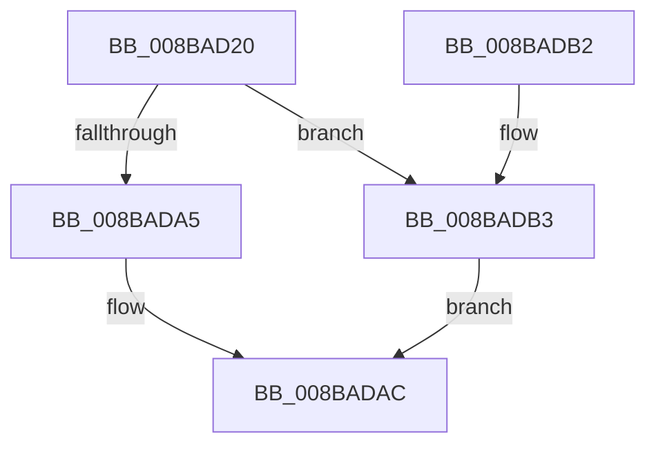

# ObSetSecurityObjectByPointer

- RVA: `0x008BAD20`–`0x008BADBF` (길이 `159` bytes)
- VA: `0x00000001408BAD20`
- 실행 섹션: `PAGE`
- PDB 이름 있음: `예`; PDB Function 태그: `아니요`
- unwind 정보 RVA: `0x00082E04`
- 디코드: `39`개 명령, `159/159` bytes 표시
- 미해석 바이트: `0` (있으면 어셈블리에 `.byte`로 보존)

> 이 문서는 커널 이미지의 기계어와 PDB 기호를 분석해 생성했습니다. 4번과 5번은 함수 원형과 자료형을 바이너리 사용 방식에서 추정한 C 해석이며 원본 소스 복구 결과는 아닙니다.

## 1. Dependencies

- 직접 호출 지점: **2**; 고유 호출 대상: **2**
- 직접 호출자로 확인된 함수: **6**
- RIP 상대 이미지 참조: **3**

### Outgoing calls
- `0x008BADA7` → [SeDefaultObjectMethod](SeDefaultObjectMethod_function_008BA2B0.md) (function, `0x008BA2B0`)
- `0x008BADB8` → [guard_dispatch_icall](../../text/6B/guard_dispatch_icall_function_006BAAD0.md) (function, `0x006BAAD0`)

### Direct callers
- [sub_00400840](../../text/40/Unknown_function_00400840.md) at `0x00400936`
- [VRegSetup](../83/VRegSetup_function_0083AE90.md) at `0x0083AF70`
- [PipChangeDeviceObjectFromRegistryProperties](../99/PipChangeDeviceObjectFromRegistryProperties_function_00994FD0.md) at `0x009952AA`
- [IoCreateDeviceSecure](../9A/IoCreateDeviceSecure_function_009A31E0.md) at `0x009A3395`
- [PiSwGetChildPdo](../AC/PiSwGetChildPdo_function_00AC3544.md) at `0x00AC3775`
- [NtSetSecurityObject](../AD/NtSetSecurityObject_function_00ADE2B0.md) at `0x00ADE5BE`

### Static image references
- `0x008BAD43` → RVA `0x00FC6E4C` (`ALMOSTRO`; read)
- `0x008BAD4D` → RVA `0x00FC7800` (`ALMOSTRO`; read)
- `0x008BAD77` → RVA `0x008BA2B0` (`SeDefaultObjectMethod`; read)

## 2. Other-region calls and transfers

- 다른 실행 섹션으로 향하는 call: **1**
  - `0x008BADB8` → [guard_dispatch_icall](../../text/6B/guard_dispatch_icall_function_006BAAD0.md) (`PAGE` → `.text`)
- 별도 외부 분기/꼬리 이동을 확인하지 못했습니다.

## 3. Assembly (complete function range)

```asm
008BAD20  89 54 24 10                     mov dword ptr [rsp + 0x10], edx
008BAD24  53                              push rbx
008BAD25  48 83 EC 50                     sub rsp, 0x50
008BAD29  4C 8D 49 D0                     lea r9, [rcx - 0x30]
008BAD2D  49 8B C1                        mov rax, r9
008BAD30  48 C1 E8 08                     shr rax, 8
008BAD34  0F B6 D0                        movzx edx, al
008BAD37  41 0F B6 41 18                  movzx eax, byte ptr [r9 + 0x18]
008BAD3C  49 83 C1 28                     add r9, 0x28
008BAD40  48 33 D0                        xor rdx, rax
008BAD43  0F B6 05 02 C1 70 00            movzx eax, byte ptr [rip + 0x70c102]
008BAD4A  48 33 D0                        xor rdx, rax
008BAD4D  48 8D 05 AC CA 70 00            lea rax, [rip + 0x70caac]
008BAD54  48 8B 14 D0                     mov rdx, qword ptr [rax + rdx*8]
008BAD58  65 48 8B 04 25 88 01 00 00      mov rax, qword ptr gs:[0x188]
008BAD61  44 8B 5A 64                     mov r11d, dword ptr [rdx + 0x64]
008BAD65  44 8A 90 32 02 00 00            mov r10b, byte ptr [rax + 0x232]
008BAD6C  48 8D 42 4C                     lea rax, [rdx + 0x4c]
008BAD70  48 8B 9A 98 00 00 00            mov rbx, qword ptr [rdx + 0x98]
008BAD77  48 8D 15 32 F5 FF FF            lea rdx, [rip - 0xace]
008BAD7E  44 88 54 24 40                  mov byte ptr [rsp + 0x40], r10b
008BAD83  48 89 44 24 38                  mov qword ptr [rsp + 0x38], rax
008BAD88  44 89 5C 24 30                  mov dword ptr [rsp + 0x30], r11d
008BAD8D  4C 89 4C 24 28                  mov qword ptr [rsp + 0x28], r9
008BAD92  4D 8B C8                        mov r9, r8
008BAD95  48 83 64 24 20 00               and qword ptr [rsp + 0x20], 0
008BAD9B  4C 8D 44 24 68                  lea r8, [rsp + 0x68]
008BADA0  48 3B DA                        cmp rbx, rdx
008BADA3  75 0E                           jne 0x1408badb3
008BADA5  33 D2                           xor edx, edx
008BADA7  E8 04 F5 FF FF                  call 0x1408ba2b0
008BADAC  48 83 C4 50                     add rsp, 0x50
008BADB0  5B                              pop rbx
008BADB1  C3                              ret
008BADB2  CC                              int3
008BADB3  33 D2                           xor edx, edx
008BADB5  48 8B C3                        mov rax, rbx
008BADB8  E8 13 FD DF FF                  call 0x1406baad0
008BADBD  EB ED                           jmp 0x1408badac
```

## 4. C-style interpretation (structured pseudocode)

```c
__int64 __fastcall ObSetSecurityObjectByPointer(__int64 a1, int a2, __int64 a3)
{
    __int64 result;
    __int64 v_rsp;
    unsigned __int8 v_stack_m18;
    unsigned __int64 v_stack_m20;
    unsigned int v_stack_m28;
    unsigned __int64 v_stack_m30;
    unsigned __int64 v_stack_m38;
    unsigned int v_stack_p10;

    v_stack_p10 = a2;
    v_rsp = (v_rsp) - (80);
    result = (a1 - 48) >> (8);
    a4 = (a1 - 48) + (40);
    a2 = ((unsigned __int8)(result)) ^ (*(unsigned __int8 *)(a1 - 48 + 24));
    a2 = (a2) ^ (*(unsigned __int8 *)(v_rip + 7389442));
    v_stack_m18 = (unsigned __int8)(*(unsigned __int8 *)(*(unsigned __int64 *)(gs_base + (0 + 392)) + 562));
    v_stack_m20 = *(unsigned __int64 *)(v_rip + 7391916 + a2 * 8) + 76;
    v_stack_m28 = (unsigned int)((unsigned int)(*(unsigned int *)(*(unsigned __int64 *)(v_rip + 7391916 + a2 * 8) + 100)));
    v_stack_m30 = a4;
    if ((*(unsigned __int64 *)(*(unsigned __int64 *)(v_rip + 7391916 + a2 * 8) + 152)) != (v_rip - 2766)) goto loc_008BADB3;
    a2 = 0;
    result = SeDefaultObjectMethod(a1, a2, v_stack_p10, a3);
loc_008BADAC:
    v_rsp = (v_rsp) + (80);
    return result;
loc_008BADB3:
    a2 = 0;
    result = guard_dispatch_icall(a1, a2, v_stack_p10, a3);
    goto loc_008BADAC;
}
```

## 5. (Beta) C Style

```c
int64_t ObSetSecurityObjectByPointer(void *Arg1, int32_t Arg2, int64_t Arg3)
{
    uint8_t *arg1 = (uint8_t *)Arg1;

    int64_t result;
    int64_t local_rsp;
    uint8_t v_stack_m18;
    uint64_t v_stack_m20;
    uint32_t v_stack_m28;
    uint64_t v_stack_m30;
    uint64_t v_stack_m38;
    uint32_t v_stack_p10;

    v_stack_p10 = Arg2;
    local_rsp = (local_rsp) - (80);
    result = (Arg1 - 48) >> (8);
    a4 = (Arg1 - 48) + (40);
    Arg2 = ((uint8_t)(result)) ^ (*(uint8_t *)(arg1 - 0x30 + 0x18));
    Arg2 = (Arg2) ^ (*(uint8_t *)(v_rip + 0x70C102));
    v_stack_m18 = (uint8_t)(*(uint8_t *)(*(uint64_t *)(gs_base + (0 + 0x188)) + 0x232));
    v_stack_m20 = *(uint64_t *)(v_rip + 0x70CAAC + Arg2 * 8) + 76;
    v_stack_m28 = (uint32_t)((uint32_t)(*(uint32_t *)(*(uint64_t *)(v_rip + 0x70CAAC + Arg2 * 8) + 0x64)));
    v_stack_m30 = a4;
    if ((*(uint64_t *)(*(uint64_t *)(v_rip + 0x70CAAC + Arg2 * 8) + 0x98)) != (v_rip - 2766)) goto loc_008BADB3;
    Arg2 = 0;
    result = SeDefaultObjectMethod(Arg1, Arg2, v_stack_p10, Arg3);
loc_008BADAC:
    local_rsp = (local_rsp) + (80);
    return result;
loc_008BADB3:
    Arg2 = 0;
    result = guard_dispatch_icall(Arg1, Arg2, v_stack_p10, Arg3);
    goto loc_008BADAC;
}
```

### 관측된 메모리 오프셋

구조체 형식이 확인되지 않은 접근은 인자 기준의 오프셋으로만 기록했습니다.

| 기준 인자 | 오프셋 표현 | 폭 (bit) | 접근 |
|---|---:|---:|---|
| `Arg1` | `- 0x30` | `64` | `R` |
| `Arg1` | `+ 0x18` | `8` | `R` |

## 6. Execution-region graph

[열기: 2D/3D 그래프와 함수 탐색 컨트롤 패널](../../../control-panel.html?section=page&rva=0x008BAD20&view=graph)

- 2D 그래프는 위에서 아래로 흐르고, 3D 그래프는 빈 공간을 드래그해 회전합니다. Shift+드래그는 이동, 휠은 확대·축소, 함수 노드 선택은 대상 보고서 이동입니다.

### Static fallback


