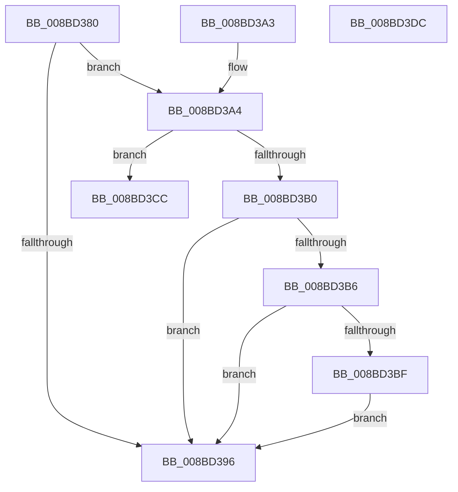

# ObpAdjustAccessMask

- RVA: `0x008BD380`–`0x008BD3DD` (길이 `93` bytes)
- VA: `0x00000001408BD380`
- 실행 섹션: `PAGE`
- PDB 이름 있음: `예`; PDB Function 태그: `아니요`
- unwind 정보 RVA: `0x0008306C`
- 디코드: `31`개 명령, `93/93` bytes 표시
- 미해석 바이트: `0` (있으면 어셈블리에 `.byte`로 보존)

> 이 문서는 커널 이미지의 기계어와 PDB 기호를 분석해 생성했습니다. 4번과 5번은 함수 원형과 자료형을 바이너리 사용 방식에서 추정한 C 해석이며 원본 소스 복구 결과는 아닙니다.

## 1. Dependencies

- 직접 호출 지점: **2**; 고유 호출 대상: **2**
- 직접 호출자로 확인된 함수: **1**
- RIP 상대 이미지 참조: **0**

### Outgoing calls
- `0x008BD3A7` → [RtlValidSecurityDescriptor](RtlValidSecurityDescriptor_function_008BD3F0.md) (function, `0x008BD3F0`)
- `0x008BD3C2` → [SeObjectCreateSaclAccessBits](SeObjectCreateSaclAccessBits_function_008BD8AC.md) (function, `0x008BD8AC`)

### Direct callers
- [ObReferenceObjectByNameEx](ObReferenceObjectByNameEx_function_008BD524.md) at `0x008BD658`

### Static image references
- 디코드된 RIP-relative 메모리 참조가 없습니다.

## 2. Other-region calls and transfers

- 다른 실행 섹션으로 향하는 call: **0**
- 별도 외부 분기/꼬리 이동을 확인하지 못했습니다.

## 3. Assembly (complete function range)

```asm
008BD380  48 89 5C 24 08                  mov qword ptr [rsp + 8], rbx
008BD385  57                              push rdi
008BD386  48 83 EC 20                     sub rsp, 0x20
008BD38A  48 8B 59 40                     mov rbx, qword ptr [rcx + 0x40]
008BD38E  48 8B F9                        mov rdi, rcx
008BD391  48 85 DB                        test rbx, rbx
008BD394  75 0E                           jne 0x1408bd3a4
008BD396  33 C0                           xor eax, eax
008BD398  48 8B 5C 24 30                  mov rbx, qword ptr [rsp + 0x30]
008BD39D  48 83 C4 20                     add rsp, 0x20
008BD3A1  5F                              pop rdi
008BD3A2  C3                              ret
008BD3A3  CC                              int3
008BD3A4  48 8B CB                        mov rcx, rbx
008BD3A7  E8 44 00 00 00                  call 0x1408bd3f0
008BD3AC  84 C0                           test al, al
008BD3AE  74 1C                           je 0x1408bd3cc
008BD3B0  F6 43 02 10                     test byte ptr [rbx + 2], 0x10
008BD3B4  74 E0                           je 0x1408bd396
008BD3B6  F7 47 14 00 00 00 01            test dword ptr [rdi + 0x14], 0x1000000
008BD3BD  75 D7                           jne 0x1408bd396
008BD3BF  48 8B CB                        mov rcx, rbx
008BD3C2  E8 E5 04 00 00                  call 0x1408bd8ac
008BD3C7  09 47 10                        or dword ptr [rdi + 0x10], eax
008BD3CA  EB CA                           jmp 0x1408bd396
008BD3CC  48 8B 5C 24 30                  mov rbx, qword ptr [rsp + 0x30]
008BD3D1  B8 79 00 00 C0                  mov eax, 0xc0000079
008BD3D6  48 83 C4 20                     add rsp, 0x20
008BD3DA  5F                              pop rdi
008BD3DB  C3                              ret
008BD3DC  CC                              int3
```

## 4. C-style interpretation (structured pseudocode)

```c
__int64 __fastcall ObpAdjustAccessMask(__int64 a1)
{
    __int64 result;
    __int64 v_rsp;
    unsigned __int64 v_stack_p30;
    unsigned __int64 v_stack_p8;

    v_stack_p8 = v_rbx;
    v_rsp = (v_rsp) - (32);
    if (*(unsigned __int64 *)(a1 + 64) != 0) goto loc_008BD3A4;
loc_008BD396:
    result = 0;
    v_rsp = (v_rsp) + (32);
    return result;
loc_008BD3A4:
    result = RtlValidSecurityDescriptor(v_stack_p8, a2, a3, a4);
    if ((unsigned __int8)(result) == 0) goto loc_008BD3CC;
    if (((*(unsigned __int8 *)(v_stack_p8 + 2)) & (16)) == 0) goto loc_008BD396;
    if (((*(unsigned int *)(a1 + 20)) & (0x1000000ULL)) != 0) goto loc_008BD396;
    result = SeObjectCreateSaclAccessBits(v_stack_p8, a2, a3, a4);
    goto loc_008BD396;
loc_008BD3CC:
    v_rsp = (v_rsp) + (32);
    return (unsigned int)(0xC0000079ULL);
}
```

## 5. (Beta) C Style

```c
int64_t ObpAdjustAccessMask(void *Arg1)
{
    uint8_t *arg1 = (uint8_t *)Arg1;

    int64_t result;
    int64_t local_rsp;
    uint64_t v_stack_p30;
    uint64_t v_stack_p8;

    v_stack_p8 = local_rbx;
    local_rsp = (local_rsp) - (32);
    if (*(uint64_t *)(arg1 + 0x40) != 0) goto loc_008BD3A4;
loc_008BD396:
    result = 0;
    local_rsp = (local_rsp) + (32);
    return result;
loc_008BD3A4:
    result = RtlValidSecurityDescriptor(v_stack_p8, a2, a3, a4);
    if ((uint8_t)(result) == 0) goto loc_008BD3CC;
    if (((*(uint8_t *)(v_stack_p8 + 0x2)) & (16)) == 0) goto loc_008BD396;
    if (((*(uint32_t *)(arg1 + 0x14)) & (0x1000000ULL)) != 0) goto loc_008BD396;
    result = SeObjectCreateSaclAccessBits(v_stack_p8, a2, a3, a4);
    goto loc_008BD396;
loc_008BD3CC:
    local_rsp = (local_rsp) + (32);
    return (uint32_t)(0xC0000079ULL);
}
```

### 관측된 메모리 오프셋

구조체 형식이 확인되지 않은 접근은 인자 기준의 오프셋으로만 기록했습니다.

| 기준 인자 | 오프셋 표현 | 폭 (bit) | 접근 |
|---|---:|---:|---|
| `Arg1` | `+ 0x10` | `32` | `R/W` |
| `Arg1` | `+ 0x14` | `32` | `R` |
| `Arg1` | `+ 0x40` | `64` | `R` |

## 6. Execution-region graph

[열기: 2D/3D 그래프와 함수 탐색 컨트롤 패널](../../../control-panel.html?section=page&rva=0x008BD380&view=graph)

- 2D 그래프는 위에서 아래로 흐르고, 3D 그래프는 빈 공간을 드래그해 회전합니다. Shift+드래그는 이동, 휠은 확대·축소, 함수 노드 선택은 대상 보고서 이동입니다.

### Static fallback


