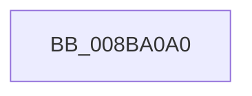

# ObpAssignSecurity

- RVA: `0x008BA0A0`–`0x008BA0FD` (길이 `93` bytes)
- VA: `0x00000001408BA0A0`
- 실행 섹션: `PAGE`
- PDB 이름 있음: `예`; PDB Function 태그: `아니요`
- unwind 정보 RVA: `0x00082CC8`
- 디코드: `26`개 명령, `93/93` bytes 표시
- 미해석 바이트: `0` (있으면 어셈블리에 `.byte`로 보존)

> 이 문서는 커널 이미지의 기계어와 PDB 기호를 분석해 생성했습니다. 4번과 5번은 함수 원형과 자료형을 바이너리 사용 방식에서 추정한 C 해석이며 원본 소스 복구 결과는 아닙니다.

## 1. Dependencies

- 직접 호출 지점: **1**; 고유 호출 대상: **1**
- 직접 호출자로 확인된 함수: **2**
- RIP 상대 이미지 참조: **0**

### Outgoing calls
- `0x008BA0F0` → [SeComputeAutoInheritByObjectTypeEx](../../text/43/SeComputeAutoInheritByObjectTypeEx_function_00433280.md) (function, `0x00433280`)

### Direct callers
- [ObpInsertOrLocateNamedObject](../99/ObpInsertOrLocateNamedObject_function_0099F2C0.md) at `0x0099F4BE`
- [ObAssignSecurity](../AB/ObAssignSecurity_function_00AB93D0.md) at `0x00AB93DE`

### Static image references
- 디코드된 RIP-relative 메모리 참조가 없습니다.

## 2. Other-region calls and transfers

- 다른 실행 섹션으로 향하는 call: **1**
  - `0x008BA0F0` → [SeComputeAutoInheritByObjectTypeEx](../../text/43/SeComputeAutoInheritByObjectTypeEx_function_00433280.md) (`PAGE` → `.text`)
- call이 아닌 외부 분기/꼬리 이동: **1**
  - `0x008BA0F7` → [sub_008BA229](Unknown_function_008BA229.md) (`tail-transfer`)

## 3. Assembly (complete function range)

```asm
008BA0A0  4C 8B DC                        mov r11, rsp
008BA0A3  53                              push rbx
008BA0A4  56                              push rsi
008BA0A5  41 54                           push r12
008BA0A7  41 55                           push r13
008BA0A9  41 57                           push r15
008BA0AB  48 81 EC 80 00 00 00            sub rsp, 0x80
008BA0B2  45 33 ED                        xor r13d, r13d
008BA0B5  49 8D 43 C8                     lea rax, [r11 - 0x38]
008BA0B9  49 8B D9                        mov rbx, r9
008BA0BC  4D 89 6B C8                     mov qword ptr [r11 - 0x38], r13
008BA0C0  4D 8B E0                        mov r12, r8
008BA0C3  45 89 6B 08                     mov dword ptr [r11 + 8], r13d
008BA0C7  4C 8B C2                        mov r8, rdx
008BA0CA  4D 89 6B C0                     mov qword ptr [r11 - 0x40], r13
008BA0CE  4C 8B FA                        mov r15, rdx
008BA0D1  4D 89 6B B8                     mov qword ptr [r11 - 0x48], r13
008BA0D5  48 8B 51 40                     mov rdx, qword ptr [rcx + 0x40]
008BA0D9  4D 8D 4B 08                     lea r9, [r11 + 8]
008BA0DD  48 8B F1                        mov rsi, rcx
008BA0E0  C7 44 24 70 08 00 00 00         mov dword ptr [rsp + 0x70], 8
008BA0E8  48 8B CB                        mov rcx, rbx
008BA0EB  48 89 44 24 20                  mov qword ptr [rsp + 0x20], rax
008BA0F0  E8 8B 91 B7 FF                  call 0x140433280
008BA0F5  85 C0                           test eax, eax
008BA0F7  0F 88 2C 01 00 00               js 0x1408ba229
```

## 4. C-style interpretation (structured pseudocode)

```c
__int64 __fastcall ObpAssignSecurity(__int64 a1, __int64 a2, __int64 a3, __int64 a4)
{
    __int64 result;
    __int64 v_r13;
    __int64 v_rsp;
    unsigned int v_stack_m38;
    unsigned __int64 v_stack_m88;

    v_rsp = (v_rsp) - (128);
    v_r13 = 0;
    *(unsigned __int64 *)(v_rsp - 56) = 0;
    *(unsigned int *)(v_rsp + 8) = 0;
    *(unsigned __int64 *)(v_rsp - 64) = 0;
    *(unsigned __int64 *)(v_rsp - 72) = 0;
    v_stack_m38 = 8;
    v_stack_m88 = v_rsp - 56;
    result = SeComputeAutoInheritByObjectTypeEx(a4, *(unsigned __int64 *)(a1 + 64), a2, v_rsp + 8);
}
```

## 5. (Beta) C Style

```c
int64_t ObpAssignSecurity(void *Arg1, int64_t Arg2, int64_t Arg3, int64_t Arg4)
{
    uint8_t *arg1 = (uint8_t *)Arg1;

    int64_t result;
    int64_t local_r13;
    int64_t local_rsp;
    uint32_t v_stack_m38;
    uint64_t v_stack_m88;

    local_rsp = (local_rsp) - (128);
    local_r13 = 0;
    *(uint64_t *)(local_rsp - 0x38) = 0;
    *(uint32_t *)(local_rsp + 0x8) = 0;
    *(uint64_t *)(local_rsp - 0x40) = 0;
    *(uint64_t *)(local_rsp - 0x48) = 0;
    v_stack_m38 = 8;
    v_stack_m88 = local_rsp - 56;
    result = SeComputeAutoInheritByObjectTypeEx(Arg4, *(uint64_t *)(arg1 + 0x40), Arg2, local_rsp + 8);
}
```

### 관측된 메모리 오프셋

구조체 형식이 확인되지 않은 접근은 인자 기준의 오프셋으로만 기록했습니다.

| 기준 인자 | 오프셋 표현 | 폭 (bit) | 접근 |
|---|---:|---:|---|
| `Arg1` | `+ 0x40` | `64` | `R` |

## 6. Execution-region graph

[열기: 2D/3D 그래프와 함수 탐색 컨트롤 패널](../../../control-panel.html?section=page&rva=0x008BA0A0&view=graph)

- 2D 그래프는 위에서 아래로 흐르고, 3D 그래프는 빈 공간을 드래그해 회전합니다. Shift+드래그는 이동, 휠은 확대·축소, 함수 노드 선택은 대상 보고서 이동입니다.

### Static fallback


