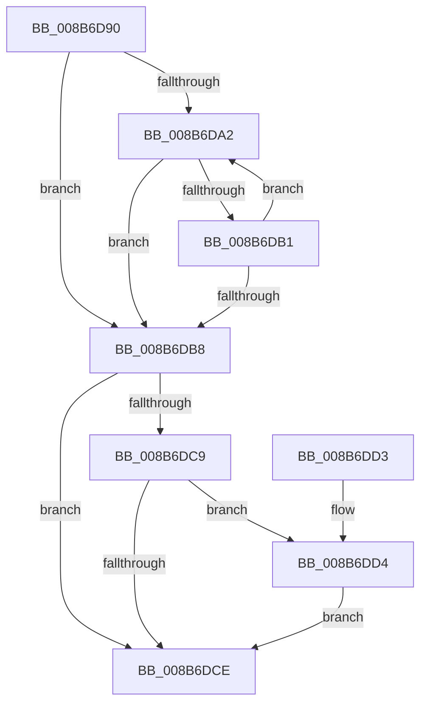

# ObpReferenceSecurityDescriptor

- RVA: `0x008B6D90`–`0x008B6DE1` (길이 `81` bytes)
- VA: `0x00000001408B6D90`
- 실행 섹션: `PAGE`
- PDB 이름 있음: `예`; PDB Function 태그: `아니요`
- unwind 정보 RVA: `0x00082A88`
- 디코드: `26`개 명령, `81/81` bytes 표시
- 미해석 바이트: `0` (있으면 어셈블리에 `.byte`로 보존)

> 이 문서는 커널 이미지의 기계어와 PDB 기호를 분석해 생성했습니다. 4번과 5번은 함수 원형과 자료형을 바이너리 사용 방식에서 추정한 C 해석이며 원본 소스 복구 결과는 아닙니다.

## 1. Dependencies

- 직접 호출 지점: **1**; 고유 호출 대상: **1**
- 직접 호출자로 확인된 함수: **3**
- RIP 상대 이미지 참조: **0**

### Outgoing calls
- `0x008B6DDA` → [ObpReferenceSecurityDescriptorSlow](../87/ObpReferenceSecurityDescriptorSlow_function_0087484C.md) (function, `0x0087484C`)

### Direct callers
- [ObQuerySecurityDescriptorInfo](../87/ObQuerySecurityDescriptorInfo_function_00873624.md) at `0x00873646`
- [SepAppendAceToTokenObjectAcl](SepAppendAceToTokenObjectAcl_function_008B6430.md) at `0x008B64C0`
- [sub_008BAA6F](Unknown_function_008BAA6F.md) at `0x008BAA8D`

### Static image references
- 디코드된 RIP-relative 메모리 참조가 없습니다.

## 2. Other-region calls and transfers

- 다른 실행 섹션으로 향하는 call: **0**
- 별도 외부 분기/꼬리 이동을 확인하지 못했습니다.

## 3. Assembly (complete function range)

```asm
008B6D90  48 83 EC 28                     sub rsp, 0x28
008B6D94  0F 0D 49 28                     prefetchw byte ptr [rcx + 0x28]
008B6D98  4C 8B 49 28                     mov r9, qword ptr [rcx + 0x28]
008B6D9C  41 F6 C1 0F                     test r9b, 0xf
008B6DA0  74 16                           je 0x1408b6db8
008B6DA2  49 8D 51 FF                     lea rdx, [r9 - 1]
008B6DA6  49 8B C1                        mov rax, r9
008B6DA9  F0 48 0F B1 51 28               lock cmpxchg qword ptr [rcx + 0x28], rdx
008B6DAF  74 07                           je 0x1408b6db8
008B6DB1  4C 8B C8                        mov r9, rax
008B6DB4  A8 0F                           test al, 0xf
008B6DB6  75 EA                           jne 0x1408b6da2
008B6DB8  49 8B C1                        mov rax, r9
008B6DBB  41 83 E1 0F                     and r9d, 0xf
008B6DBF  48 83 E0 F0                     and rax, 0xfffffffffffffff0
008B6DC3  41 83 F9 01                     cmp r9d, 1
008B6DC7  77 05                           ja 0x1408b6dce
008B6DC9  48 85 C0                        test rax, rax
008B6DCC  75 06                           jne 0x1408b6dd4
008B6DCE  48 83 C4 28                     add rsp, 0x28
008B6DD2  C3                              ret
008B6DD3  CC                              int3
008B6DD4  4C 8B C0                        mov r8, rax
008B6DD7  41 8B D1                        mov edx, r9d
008B6DDA  E8 6D DA FB FF                  call 0x14087484c
008B6DDF  EB ED                           jmp 0x1408b6dce
```

## 4. C-style interpretation (structured pseudocode)

```c
__int64 __fastcall ObpReferenceSecurityDescriptor(__int64 a1)
{
    __int64 result;
    __int64 v_rsp;

    v_rsp = (v_rsp) - (40);
    if ((((unsigned __int8)(*(unsigned __int64 *)(a1 + 40))) & (15)) == 0) goto loc_008B6DB8;
loc_008B6DA2:
    if ((((unsigned __int8)(*(unsigned __int64 *)(a1 + 40))) & (15)) == 0) goto loc_008B6DB8;
    if ((((unsigned __int8)(*(unsigned __int64 *)(a1 + 40))) & (15)) != 0) goto loc_008B6DA2;
loc_008B6DB8:
    a4 = (unsigned int)((*(unsigned __int64 *)(a1 + 40)) & (15));
    result = (*(unsigned __int64 *)(a1 + 40)) & (-16);
    if (((unsigned int)(a4)) > 1) goto loc_008B6DCE;
    if (result != 0) goto loc_008B6DD4;
loc_008B6DCE:
    v_rsp = (v_rsp) + (40);
    return result;
loc_008B6DD4:
    result = ObpReferenceSecurityDescriptorSlow(a1, (unsigned int)((unsigned int)(a4)), result, a4);
    goto loc_008B6DCE;
}
```

## 5. (Beta) C Style

```c
int64_t ObpReferenceSecurityDescriptor(void *Arg1)
{
    uint8_t *arg1 = (uint8_t *)Arg1;

    int64_t result;
    int64_t local_rsp;

    local_rsp = (local_rsp) - (40);
    if ((((uint8_t)(*(uint64_t *)(arg1 + 0x28))) & (15)) == 0) goto loc_008B6DB8;
loc_008B6DA2:
    if ((((uint8_t)(*(uint64_t *)(arg1 + 0x28))) & (15)) == 0) goto loc_008B6DB8;
    if ((((uint8_t)(*(uint64_t *)(arg1 + 0x28))) & (15)) != 0) goto loc_008B6DA2;
loc_008B6DB8:
    a4 = (uint32_t)((*(uint64_t *)(arg1 + 0x28)) & (15));
    result = (*(uint64_t *)(arg1 + 0x28)) & (-16);
    if (((uint32_t)(a4)) > 1) goto loc_008B6DCE;
    if (result != 0) goto loc_008B6DD4;
loc_008B6DCE:
    local_rsp = (local_rsp) + (40);
    return result;
loc_008B6DD4:
    result = ObpReferenceSecurityDescriptorSlow(Arg1, (uint32_t)((uint32_t)(a4)), result, a4);
    goto loc_008B6DCE;
}
```

### 관측된 메모리 오프셋

구조체 형식이 확인되지 않은 접근은 인자 기준의 오프셋으로만 기록했습니다.

| 기준 인자 | 오프셋 표현 | 폭 (bit) | 접근 |
|---|---:|---:|---|
| `Arg1` | `+ 0x28` | `8` | `R` |
| `Arg1` | `+ 0x28` | `64` | `R` |

## 6. Execution-region graph

[열기: 2D/3D 그래프와 함수 탐색 컨트롤 패널](../../../control-panel.html?section=page&rva=0x008B6D90&view=graph)

- 2D 그래프는 위에서 아래로 흐르고, 3D 그래프는 빈 공간을 드래그해 회전합니다. Shift+드래그는 이동, 휠은 확대·축소, 함수 노드 선택은 대상 보고서 이동입니다.

### Static fallback


