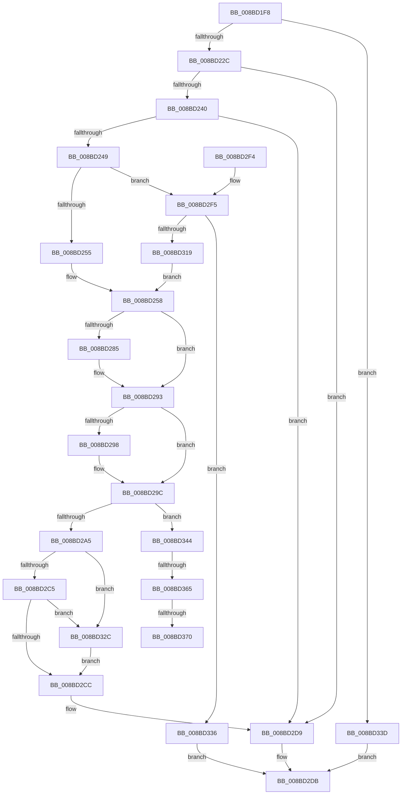

# ObpSetObjectAuditInfo

- RVA: `0x008BD1F8`–`0x008BD375` (길이 `381` bytes)
- VA: `0x00000001408BD1F8`
- 실행 섹션: `PAGE`
- PDB 이름 있음: `예`; PDB Function 태그: `예`
- unwind 정보 RVA: `0x00083040`
- 디코드: `105`개 명령, `381/381` bytes 표시
- 미해석 바이트: `0` (있으면 어셈블리에 `.byte`로 보존)

> 이 문서는 커널 이미지의 기계어와 PDB 기호를 분석해 생성했습니다. 4번과 5번은 함수 원형과 자료형을 바이너리 사용 방식에서 추정한 C 해석이며 원본 소스 복구 결과는 아닙니다.

## 1. Dependencies

- 직접 호출 지점: **10**; 고유 호출 대상: **10**
- 직접 호출자로 확인된 함수: **1**
- RIP 상대 이미지 참조: **0**

### Outgoing calls
- `0x008BD21C` → [RtlValidSecurityDescriptor](RtlValidSecurityDescriptor_function_008BD3F0.md) (function, `0x008BD3F0`)
- `0x008BD22F` → [OBJECT_HEADER_TO_AUDIT_INFO](../../text/41/OBJECT_HEADER_TO_AUDIT_INFO_function_0041BF70.md) (function, `0x0041BF70`)
- `0x008BD275` → [KeAbPreAcquire](../../text/21/KeAbPreAcquire_function_00210230.md) (function, `0x00210230`)
- `0x008BD28E` → [ExfAcquirePushLockExclusiveEx](../../text/20/ExfAcquirePushLockExclusiveEx_function_0020FC90.md) (function, `0x0020FC90`)
- `0x008BD2CF` → [KeAbPostRelease](../../text/2E/KeAbPostRelease_function_002E1600.md) (function, `0x002E1600`)
- `0x008BD2D4` → [KeLeaveCriticalRegion](../../text/25/KeLeaveCriticalRegion_function_0025D8B0.md) (function, `0x0025D8B0`)
- `0x008BD2F8` → [RtlLengthSecurityDescriptor](RtlLengthSecurityDescriptor_function_008BC870.md) (function, `0x008BC870`)
- `0x008BD30C` → [ExAllocatePool2](../../poolcode/B8/ExAllocatePool2_function_00B820F0.md) (function, `0x00B820F0`)
- `0x008BD322` → [memcpy](../../text/6C/memcpy_function_006C6840.md) (function, `0x006C6840`)
- `0x008BD32F` → [ExfReleasePushLock](../../text/26/ExfReleasePushLock_function_002638D0.md) (function, `0x002638D0`)

### Direct callers
- [ObpCreateHandle](../86/ObpCreateHandle_function_0086B950.md) at `0x0086CFC3`
- [ObpCreateHandle](../86/ObpCreateHandle_function_0086B950.md) at `0x0086D224`

### Static image references
- 디코드된 RIP-relative 메모리 참조가 없습니다.

## 2. Other-region calls and transfers

- 다른 실행 섹션으로 향하는 call: **8**
  - `0x008BD22F` → [OBJECT_HEADER_TO_AUDIT_INFO](../../text/41/OBJECT_HEADER_TO_AUDIT_INFO_function_0041BF70.md) (`PAGE` → `.text`)
  - `0x008BD275` → [KeAbPreAcquire](../../text/21/KeAbPreAcquire_function_00210230.md) (`PAGE` → `.text`)
  - `0x008BD28E` → [ExfAcquirePushLockExclusiveEx](../../text/20/ExfAcquirePushLockExclusiveEx_function_0020FC90.md) (`PAGE` → `.text`)
  - `0x008BD2CF` → [KeAbPostRelease](../../text/2E/KeAbPostRelease_function_002E1600.md) (`PAGE` → `.text`)
  - `0x008BD2D4` → [KeLeaveCriticalRegion](../../text/25/KeLeaveCriticalRegion_function_0025D8B0.md) (`PAGE` → `.text`)
  - `0x008BD30C` → [ExAllocatePool2](../../poolcode/B8/ExAllocatePool2_function_00B820F0.md) (`PAGE` → `POOLCODE`)
  - `0x008BD322` → [memcpy](../../text/6C/memcpy_function_006C6840.md) (`PAGE` → `.text`)
  - `0x008BD32F` → [ExfReleasePushLock](../../text/26/ExfReleasePushLock_function_002638D0.md) (`PAGE` → `.text`)
- call이 아닌 외부 분기/꼬리 이동: **3**
  - `0x008BD35F` → [sub_00B1AC5A](../B1/Unknown_function_00B1AC5A.md) (`tail-transfer`)
  - `0x008BD36A` → [sub_00B1AC5A](../B1/Unknown_function_00B1AC5A.md) (`tail-transfer`)
  - `0x008BD370` → [sub_00B1AC5A + 0x8](../B1/Unknown_function_00B1AC5A.md) (`tail-transfer`)

## 3. Assembly (complete function range)

```asm
008BD1F8  48 89 5C 24 08                  mov qword ptr [rsp + 8], rbx
008BD1FD  48 89 6C 24 10                  mov qword ptr [rsp + 0x10], rbp
008BD202  48 89 74 24 18                  mov qword ptr [rsp + 0x18], rsi
008BD207  57                              push rdi
008BD208  41 56                           push r14
008BD20A  41 57                           push r15
008BD20C  48 83 EC 20                     sub rsp, 0x20
008BD210  4C 8B F1                        mov r14, rcx
008BD213  41 8A E8                        mov bpl, r8b
008BD216  48 8B 0A                        mov rcx, qword ptr [rdx]
008BD219  48 8B DA                        mov rbx, rdx
008BD21C  E8 CF 01 00 00                  call 0x1408bd3f0
008BD221  45 33 FF                        xor r15d, r15d
008BD224  84 C0                           test al, al
008BD226  0F 84 11 01 00 00               je 0x1408bd33d
008BD22C  49 8B CE                        mov rcx, r14
008BD22F  E8 3C ED B5 FF                  call 0x14041bf70
008BD234  48 8B F8                        mov rdi, rax
008BD237  48 85 C0                        test rax, rax
008BD23A  0F 84 99 00 00 00               je 0x1408bd2d9
008BD240  4C 39 38                        cmp qword ptr [rax], r15
008BD243  0F 85 90 00 00 00               jne 0x1408bd2d9
008BD249  48 8B 33                        mov rsi, qword ptr [rbx]
008BD24C  40 84 ED                        test bpl, bpl
008BD24F  0F 84 A0 00 00 00               je 0x1408bd2f5
008BD255  4C 89 3B                        mov qword ptr [rbx], r15
008BD258  65 48 8B 04 25 88 01 00 00      mov rax, qword ptr gs:[0x188]
008BD261  49 8D 5E 10                     lea rbx, [r14 + 0x10]
008BD265  45 33 C0                        xor r8d, r8d
008BD268  33 D2                           xor edx, edx
008BD26A  48 8B CB                        mov rcx, rbx
008BD26D  66 FF 88 E4 01 00 00            dec word ptr [rax + 0x1e4]
008BD274  90                              nop
008BD275  E8 B6 2F 95 FF                  call 0x140210230
008BD27A  F0 48 0F BA 2B 00               lock bts qword ptr [rbx], 0
008BD280  48 8B E8                        mov rbp, rax
008BD283  73 0E                           jae 0x1408bd293
008BD285  4C 8B C3                        mov r8, rbx
008BD288  48 8B D0                        mov rdx, rax
008BD28B  48 8B CB                        mov rcx, rbx
008BD28E  E8 FD 29 95 FF                  call 0x14020fc90
008BD293  48 85 ED                        test rbp, rbp
008BD296  74 04                           je 0x1408bd29c
008BD298  C6 45 0A 01                     mov byte ptr [rbp + 0xa], 1
008BD29C  4C 39 3F                        cmp qword ptr [rdi], r15
008BD29F  0F 85 9F 00 00 00               jne 0x1408bd344
008BD2A5  48 89 37                        mov qword ptr [rdi], rsi
008BD2A8  0F 0D 0B                        prefetchw byte ptr [rbx]
008BD2AB  48 8B 03                        mov rax, qword ptr [rbx]
008BD2AE  48 8B C8                        mov rcx, rax
008BD2B1  48 83 E1 F0                     and rcx, 0xfffffffffffffff0
008BD2B5  48 83 F9 10                     cmp rcx, 0x10
008BD2B9  48 8D 50 F0                     lea rdx, [rax - 0x10]
008BD2BD  49 0F 46 D7                     cmovbe rdx, r15
008BD2C1  A8 02                           test al, 2
008BD2C3  75 67                           jne 0x1408bd32c
008BD2C5  F0 48 0F B1 13                  lock cmpxchg qword ptr [rbx], rdx
008BD2CA  75 60                           jne 0x1408bd32c
008BD2CC  48 8B CB                        mov rcx, rbx
008BD2CF  E8 2C 43 A2 FF                  call 0x1402e1600
008BD2D4  E8 D7 05 9A FF                  call 0x14025d8b0
008BD2D9  33 C0                           xor eax, eax
008BD2DB  48 8B 5C 24 40                  mov rbx, qword ptr [rsp + 0x40]
008BD2E0  48 8B 6C 24 48                  mov rbp, qword ptr [rsp + 0x48]
008BD2E5  48 8B 74 24 50                  mov rsi, qword ptr [rsp + 0x50]
008BD2EA  48 83 C4 20                     add rsp, 0x20
008BD2EE  41 5F                           pop r15
008BD2F0  41 5E                           pop r14
008BD2F2  5F                              pop rdi
008BD2F3  C3                              ret
008BD2F4  CC                              int3
008BD2F5  48 8B CE                        mov rcx, rsi
008BD2F8  E8 73 F5 FF FF                  call 0x1408bc870
008BD2FD  41 B8 4F 62 41 49               mov r8d, 0x4941624f
008BD303  8B D0                           mov edx, eax
008BD305  B9 00 01 00 00                  mov ecx, 0x100
008BD30A  8B E8                           mov ebp, eax
008BD30C  E8 DF 4D 2C 00                  call 0x140b820f0
008BD311  48 8B F0                        mov rsi, rax
008BD314  48 85 C0                        test rax, rax
008BD317  74 1D                           je 0x1408bd336
008BD319  48 8B 13                        mov rdx, qword ptr [rbx]
008BD31C  44 8B C5                        mov r8d, ebp
008BD31F  48 8B C8                        mov rcx, rax
008BD322  E8 19 95 E0 FF                  call 0x1406c6840
008BD327  E9 2C FF FF FF                  jmp 0x1408bd258
008BD32C  48 8B CB                        mov rcx, rbx
008BD32F  E8 9C 65 9A FF                  call 0x1402638d0
008BD334  EB 96                           jmp 0x1408bd2cc
008BD336  B8 9A 00 00 C0                  mov eax, 0xc000009a
008BD33B  EB 9E                           jmp 0x1408bd2db
008BD33D  B8 79 00 00 C0                  mov eax, 0xc0000079
008BD342  EB 97                           jmp 0x1408bd2db
008BD344  0F 0D 0B                        prefetchw byte ptr [rbx]
008BD347  48 8B 03                        mov rax, qword ptr [rbx]
008BD34A  48 8B C8                        mov rcx, rax
008BD34D  48 83 E1 F0                     and rcx, 0xfffffffffffffff0
008BD351  48 83 F9 10                     cmp rcx, 0x10
008BD355  48 8D 50 F0                     lea rdx, [rax - 0x10]
008BD359  49 0F 46 D7                     cmovbe rdx, r15
008BD35D  A8 02                           test al, 2
008BD35F  0F 85 F5 D8 25 00               jne 0x140b1ac5a
008BD365  F0 48 0F B1 13                  lock cmpxchg qword ptr [rbx], rdx
008BD36A  0F 85 EA D8 25 00               jne 0x140b1ac5a
008BD370  E9 ED D8 25 00                  jmp 0x140b1ac62
```

## 4. C-style interpretation (structured pseudocode)

```c
__int64 __fastcall ObpSetObjectAuditInfo(__int64 a1, __int64 a2, int a3)
{
    __int64 result;
    __int64 v_r15;
    __int64 v_rsp;
    unsigned __int64 v_stack_p10;
    unsigned __int64 v_stack_p18;
    unsigned __int64 v_stack_p8;

    v_stack_p8 = v_rbx;
    v_stack_p10 = v_rbp;
    v_stack_p18 = v_rsi;
    v_rsp = (v_rsp) - (32);
    result = RtlValidSecurityDescriptor(*(unsigned __int64 *)(a2), a2, a3, a4);
    v_r15 = 0;
    if ((unsigned __int8)(result) == 0) goto loc_008BD33D;
    result = OBJECT_HEADER_TO_AUDIT_INFO(a1, a2, a3, a4);
    if (result == 0) goto loc_008BD2D9;
    if ((*(unsigned __int64 *)(result)) != 0) goto loc_008BD2D9;
    if ((unsigned __int8)((unsigned __int8)(a3)) == 0) goto loc_008BD2F5;
    *(unsigned __int64 *)(a2) = 0;
loc_008BD258:
    a3 = 0;
    a2 = 0;
    result = KeAbPreAcquire(a1 + 16, a2, a3, a4);
    if (!(condition_is_above_or_equal)) {
        a3 = a1 + 16;
        a2 = result;
        a1 = a1 + 16;
        result = ExfAcquirePushLockExclusiveEx(a1, a2, a3, a4);
    }
    if (result != 0) {
        *(unsigned __int8 *)(result + 10) = 1;
    }
    if ((*(unsigned __int64 *)(result)) != 0) goto loc_008BD344;
    *(unsigned __int64 *)(result) = *(unsigned __int64 *)(a2);
    a1 = (*(unsigned __int64 *)(a1 + 16)) & (-16);
    a2 = *(unsigned __int64 *)(a1 + 16) - 16;
    if (a1 <= 16) { a2 = 0; }
    if ((((unsigned __int8)(*(unsigned __int64 *)(a1 + 16))) & (2)) != 0) goto loc_008BD32C;
    if ((((unsigned __int8)(*(unsigned __int64 *)(a1 + 16))) & (2)) != 0) goto loc_008BD32C;
loc_008BD2CC:
    result = KeAbPostRelease(a1 + 16, a2, a3, a4);
    result = KeLeaveCriticalRegion(a1 + 16, a2, a3, a4);
loc_008BD2D9:
    result = 0;
loc_008BD2DB:
    v_rsp = (v_rsp) + (32);
    return result;
loc_008BD2F5:
    result = RtlLengthSecurityDescriptor(v_stack_p18, a2, a3, a4);
    result = ExAllocatePool2(256, (unsigned int)((unsigned int)(result)), (unsigned int)(0x4941624FULL), a4);
    if (result == 0) goto loc_008BD336;
    result = memcpy(result, *(unsigned __int64 *)(v_stack_p8), (unsigned int)((unsigned int)((unsigned int)((unsigned int)(result)))), a4);
    goto loc_008BD258;
loc_008BD32C:
    result = ExfReleasePushLock(v_stack_p8, *(unsigned __int64 *)(v_stack_p8), (unsigned int)((unsigned int)((unsigned int)((unsigned int)(result)))), a4);
    goto loc_008BD2CC;
loc_008BD336:
    goto loc_008BD2DB;
loc_008BD33D:
    goto loc_008BD2DB;
loc_008BD344:
    a1 = (*(unsigned __int64 *)(v_stack_p8)) & (-16);
    a2 = *(unsigned __int64 *)(v_stack_p8) - 16;
    if (a1 <= 16) { a2 = 0; }
}
```

## 5. (Beta) C Style

```c
int64_t ObpSetObjectAuditInfo(void *Arg1, void *Arg2, int32_t Arg3)
{
    uint8_t *arg1 = (uint8_t *)Arg1;
    uint8_t *arg2 = (uint8_t *)Arg2;

    int64_t result;
    int64_t local_r15;
    int64_t local_rsp;
    uint64_t v_stack_p10;
    uint64_t v_stack_p18;
    uint64_t v_stack_p8;

    v_stack_p8 = local_rbx;
    v_stack_p10 = local_rbp;
    v_stack_p18 = local_rsi;
    local_rsp = (local_rsp) - (32);
    result = RtlValidSecurityDescriptor(*(uint64_t *)(arg2), Arg2, Arg3, a4);
    local_r15 = 0;
    if ((uint8_t)(result) == 0) goto loc_008BD33D;
    result = OBJECT_HEADER_TO_AUDIT_INFO(Arg1, Arg2, Arg3, a4);
    if (result == 0) goto loc_008BD2D9;
    if ((*(uint64_t *)(result)) != 0) goto loc_008BD2D9;
    if ((uint8_t)((uint8_t)(Arg3)) == 0) goto loc_008BD2F5;
    *(uint64_t *)(arg2) = 0;
loc_008BD258:
    Arg3 = 0;
    Arg2 = 0;
    result = KeAbPreAcquire(Arg1 + 16, Arg2, Arg3, a4);
    if (!(condition_is_above_or_equal)) {
        Arg3 = Arg1 + 16;
        Arg2 = result;
        Arg1 = Arg1 + 16;
        result = ExfAcquirePushLockExclusiveEx(Arg1, Arg2, Arg3, a4);
    }
    if (result != 0) {
        *(uint8_t *)(result + 0xA) = 1;
    }
    if ((*(uint64_t *)(result)) != 0) goto loc_008BD344;
    *(uint64_t *)(result) = *(uint64_t *)(arg2);
    Arg1 = (*(uint64_t *)(arg1 + 0x10)) & (-16);
    Arg2 = *(uint64_t *)(arg1 + 0x10) - 16;
    if (Arg1 <= 16) { Arg2 = 0; }
    if ((((uint8_t)(*(uint64_t *)(arg1 + 0x10))) & (2)) != 0) goto loc_008BD32C;
    if ((((uint8_t)(*(uint64_t *)(arg1 + 0x10))) & (2)) != 0) goto loc_008BD32C;
loc_008BD2CC:
    result = KeAbPostRelease(Arg1 + 16, Arg2, Arg3, a4);
    result = KeLeaveCriticalRegion(Arg1 + 16, Arg2, Arg3, a4);
loc_008BD2D9:
    result = 0;
loc_008BD2DB:
    local_rsp = (local_rsp) + (32);
    return result;
loc_008BD2F5:
    result = RtlLengthSecurityDescriptor(v_stack_p18, Arg2, Arg3, a4);
    result = ExAllocatePool2(256, (uint32_t)((uint32_t)(result)), (uint32_t)(0x4941624FULL), a4);
    if (result == 0) goto loc_008BD336;
    result = memcpy(result, *(uint64_t *)(v_stack_p8), (uint32_t)((uint32_t)((uint32_t)((uint32_t)(result)))), a4);
    goto loc_008BD258;
loc_008BD32C:
    result = ExfReleasePushLock(v_stack_p8, *(uint64_t *)(v_stack_p8), (uint32_t)((uint32_t)((uint32_t)((uint32_t)(result)))), a4);
    goto loc_008BD2CC;
loc_008BD336:
    goto loc_008BD2DB;
loc_008BD33D:
    goto loc_008BD2DB;
loc_008BD344:
    Arg1 = (*(uint64_t *)(v_stack_p8)) & (-16);
    Arg2 = *(uint64_t *)(v_stack_p8) - 16;
    if (Arg1 <= 16) { Arg2 = 0; }
}
```

### 관측된 메모리 오프셋

구조체 형식이 확인되지 않은 접근은 인자 기준의 오프셋으로만 기록했습니다.

| 기준 인자 | 오프셋 표현 | 폭 (bit) | 접근 |
|---|---:|---:|---|
| `Arg1` | `+ 0x0` | `8` | `R` |
| `Arg1` | `+ 0x0` | `64` | `R` |
| `Arg1` | `+ 0x0` | `64` | `R/W` |
| `Arg1` | `+ 0x10` | `64` | `R` |
| `Arg2` | `+ 0x0` | `64` | `R` |
| `Arg2` | `+ 0x0` | `64` | `W` |

## 6. Execution-region graph

[열기: 2D/3D 그래프와 함수 탐색 컨트롤 패널](../../../control-panel.html?section=page&rva=0x008BD1F8&view=graph)

- 2D 그래프는 위에서 아래로 흐르고, 3D 그래프는 빈 공간을 드래그해 회전합니다. Shift+드래그는 이동, 휠은 확대·축소, 함수 노드 선택은 대상 보고서 이동입니다.

### Static fallback


