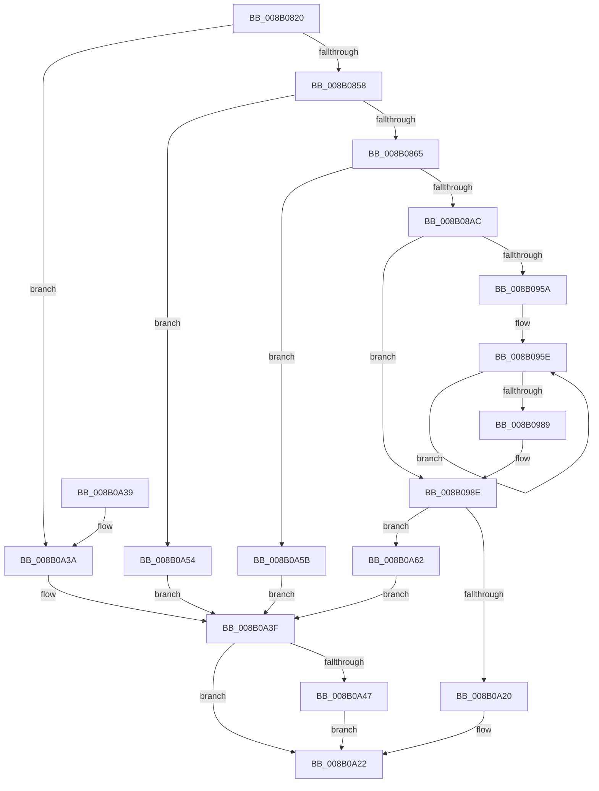

# PfSnBuildDumpFromTrace

- RVA: `0x008B0820`–`0x008B0A69` (길이 `585` bytes)
- VA: `0x00000001408B0820`
- 실행 섹션: `PAGE`
- PDB 이름 있음: `예`; PDB Function 태그: `아니요`
- unwind 정보 RVA: `0x0007FB54`
- 디코드: `153`개 명령, `585/585` bytes 표시
- 미해석 바이트: `0` (있으면 어셈블리에 `.byte`로 보존)

> 이 문서는 커널 이미지의 기계어와 PDB 기호를 분석해 생성했습니다. 4번과 5번은 함수 원형과 자료형을 바이너리 사용 방식에서 추정한 C 해석이며 원본 소스 복구 결과는 아닙니다.

## 1. Dependencies

- 직접 호출 지점: **6**; 고유 호출 대상: **5**
- 직접 호출자로 확인된 함수: **1**
- RIP 상대 이미지 참조: **0**

### Outgoing calls
- `0x008B0898` → [ExAllocatePool2](../../poolcode/B8/ExAllocatePool2_function_00B820F0.md) (function, `0x00B820F0`)
- `0x008B08B4` → [memset](../../text/6C/memset_function_006C6C40.md) (function, `0x006C6C40`)
- `0x008B0979` → [memcpy](../../text/6C/memcpy_function_006C6840.md) (function, `0x006C6840`)
- `0x008B09F9` → [memcpy](../../text/6C/memcpy_function_006C6840.md) (function, `0x006C6840`)
- `0x008B0A17` → [PfVerifyTraceBuffer](PfVerifyTraceBuffer_function_008B0CDC.md) (function, `0x008B0CDC`)
- `0x008B0A49` → [ExFreePoolWithTag](../../poolcode/B8/ExFreePoolWithTag_function_00B82870.md) (function, `0x00B82870`)

### Direct callers
- [PfSnEndTrace](PfSnEndTrace_function_008B04A8.md) at `0x008B059E`

### Static image references
- 디코드된 RIP-relative 메모리 참조가 없습니다.

## 2. Other-region calls and transfers

- 다른 실행 섹션으로 향하는 call: **5**
  - `0x008B0898` → [ExAllocatePool2](../../poolcode/B8/ExAllocatePool2_function_00B820F0.md) (`PAGE` → `POOLCODE`)
  - `0x008B08B4` → [memset](../../text/6C/memset_function_006C6C40.md) (`PAGE` → `.text`)
  - `0x008B0979` → [memcpy](../../text/6C/memcpy_function_006C6840.md) (`PAGE` → `.text`)
  - `0x008B09F9` → [memcpy](../../text/6C/memcpy_function_006C6840.md) (`PAGE` → `.text`)
  - `0x008B0A49` → [ExFreePoolWithTag](../../poolcode/B8/ExFreePoolWithTag_function_00B82870.md) (`PAGE` → `POOLCODE`)
- 별도 외부 분기/꼬리 이동을 확인하지 못했습니다.

## 3. Assembly (complete function range)

```asm
008B0820  48 89 5C 24 18                  mov qword ptr [rsp + 0x18], rbx
008B0825  48 89 4C 24 08                  mov qword ptr [rsp + 8], rcx
008B082A  55                              push rbp
008B082B  56                              push rsi
008B082C  57                              push rdi
008B082D  41 54                           push r12
008B082F  41 55                           push r13
008B0831  41 56                           push r14
008B0833  41 57                           push r15
008B0835  48 83 EC 20                     sub rsp, 0x20
008B0839  83 64 24 68 00                  and dword ptr [rsp + 0x68], 0
008B083E  45 33 E4                        xor r12d, r12d
008B0841  48 83 21 00                     and qword ptr [rcx], 0
008B0845  48 8B F2                        mov rsi, rdx
008B0848  83 BA 4C 01 00 00 20            cmp dword ptr [rdx + 0x14c], 0x20
008B084F  4C 8B F1                        mov r14, rcx
008B0852  0F 8C E2 01 00 00               jl 0x1408b0a3a
008B0858  F6 82 E4 01 00 00 02            test byte ptr [rdx + 0x1e4], 2
008B085F  0F 85 EF 01 00 00               jne 0x1408b0a54
008B0865  8B 92 58 01 00 00               mov edx, dword ptr [rdx + 0x158]
008B086B  41 B8 43 63 50 44               mov r8d, 0x44506343
008B0871  03 56 78                        add edx, dword ptr [rsi + 0x78]
008B0874  8B 86 E0 01 00 00               mov eax, dword ptr [rsi + 0x1e0]
008B087A  C1 E2 04                        shl edx, 4
008B087D  81 C2 D7 00 00 00               add edx, 0xd7
008B0883  83 E2 F8                        and edx, 0xfffffff8
008B0886  8D 48 01                        lea ecx, [rax + 1]
008B0889  8D 0C 48                        lea ecx, [rax + rcx*2]
008B088C  8D 04 CA                        lea eax, [rdx + rcx*8]
008B088F  B9 00 01 00 00                  mov ecx, 0x100
008B0894  8B D0                           mov edx, eax
008B0896  8B F8                           mov edi, eax
008B0898  E8 53 18 2D 00                  call 0x140b820f0
008B089D  49 89 06                        mov qword ptr [r14], rax
008B08A0  48 8B D8                        mov rbx, rax
008B08A3  48 85 C0                        test rax, rax
008B08A6  0F 84 AF 01 00 00               je 0x1408b0a5b
008B08AC  44 8B C7                        mov r8d, edi
008B08AF  33 D2                           xor edx, edx
008B08B1  48 8B C8                        mov rcx, rax
008B08B4  E8 87 63 E1 FF                  call 0x1406c6c40
008B08B9  C7 43 14 41 53 43 43            mov dword ptr [rbx + 0x14], 0x43435341
008B08C0  4C 8D 7B 10                     lea r15, [rbx + 0x10]
008B08C4  41 C7 07 1F 00 00 00            mov dword ptr [r15], 0x1f
008B08CB  4D 8D AF D7 00 00 00            lea r13, [r15 + 0xd7]
008B08D2  0F 10 46 18                     movups xmm0, xmmword ptr [rsi + 0x18]
008B08D6  49 83 E5 F8                     and r13, 0xfffffffffffffff8
008B08DA  0F 11 43 1C                     movups xmmword ptr [rbx + 0x1c], xmm0
008B08DE  0F 10 4E 28                     movups xmm1, xmmword ptr [rsi + 0x28]
008B08E2  0F 11 4B 2C                     movups xmmword ptr [rbx + 0x2c], xmm1
008B08E6  0F 10 46 38                     movups xmm0, xmmword ptr [rsi + 0x38]
008B08EA  0F 11 43 3C                     movups xmmword ptr [rbx + 0x3c], xmm0
008B08EE  0F 10 4E 48                     movups xmm1, xmmword ptr [rsi + 0x48]
008B08F2  0F 11 4B 4C                     movups xmmword ptr [rbx + 0x4c], xmm1
008B08F6  8B 46 58                        mov eax, dword ptr [rsi + 0x58]
008B08F9  89 43 5C                        mov dword ptr [rbx + 0x5c], eax
008B08FC  48 8B 86 D0 01 00 00            mov rax, qword ptr [rsi + 0x1d0]
008B0903  48 89 83 A8 00 00 00            mov qword ptr [rbx + 0xa8], rax
008B090A  48 8B 86 C8 00 00 00            mov rax, qword ptr [rsi + 0xc8]
008B0911  48 89 43 78                     mov qword ptr [rbx + 0x78], rax
008B0915  8B 83 B0 00 00 00               mov eax, dword ptr [rbx + 0xb0]
008B091B  0F B7 8E E4 01 00 00            movzx ecx, word ptr [rsi + 0x1e4]
008B0922  33 C8                           xor ecx, eax
008B0924  83 E1 01                        and ecx, 1
008B0927  33 C8                           xor ecx, eax
008B0929  89 8B B0 00 00 00               mov dword ptr [rbx + 0xb0], ecx
008B092F  0F B7 86 E6 01 00 00            movzx eax, word ptr [rsi + 0x1e6]
008B0936  03 C0                           add eax, eax
008B0938  33 C1                           xor eax, ecx
008B093A  83 E0 02                        and eax, 2
008B093D  33 C1                           xor eax, ecx
008B093F  89 83 B0 00 00 00               mov dword ptr [rbx + 0xb0], eax
008B0945  41 8B C5                        mov eax, r13d
008B0948  41 2B C7                        sub eax, r15d
008B094B  89 43 60                        mov dword ptr [rbx + 0x60], eax
008B094E  48 8D 46 68                     lea rax, [rsi + 0x68]
008B0952  48 8B 28                        mov rbp, qword ptr [rax]
008B0955  48 3B E8                        cmp rbp, rax
008B0958  74 34                           je 0x1408b098e
008B095A  4C 8D 76 68                     lea r14, [rsi + 0x68]
008B095E  8B 7D 10                        mov edi, dword ptr [rbp + 0x10]
008B0961  48 8B D5                        mov rdx, rbp
008B0964  48 8B 6D 00                     mov rbp, qword ptr [rbp]
008B0968  8B C7                           mov eax, edi
008B096A  C1 E0 04                        shl eax, 4
008B096D  48 83 C2 18                     add rdx, 0x18
008B0971  44 8B C0                        mov r8d, eax
008B0974  49 8B CD                        mov rcx, r13
008B0977  8B D8                           mov ebx, eax
008B0979  E8 C2 5E E1 FF                  call 0x1406c6840
008B097E  4C 03 EB                        add r13, rbx
008B0981  44 03 E7                        add r12d, edi
008B0984  49 3B EE                        cmp rbp, r14
008B0987  75 D5                           jne 0x1408b095e
008B0989  4C 8B 74 24 60                  mov r14, qword ptr [rsp + 0x60]
008B098E  45 89 67 54                     mov dword ptr [r15 + 0x54], r12d
008B0992  49 8D 4D 07                     lea rcx, [r13 + 7]
008B0996  8B 86 4C 01 00 00               mov eax, dword ptr [rsi + 0x14c]
008B099C  48 83 E1 F8                     and rcx, 0xfffffffffffffff8
008B09A0  41 89 47 58                     mov dword ptr [r15 + 0x58], eax
008B09A4  8B F9                           mov edi, ecx
008B09A6  8B 86 50 01 00 00               mov eax, dword ptr [rsi + 0x150]
008B09AC  41 2B FF                        sub edi, r15d
008B09AF  41 89 47 5C                     mov dword ptr [r15 + 0x5c], eax
008B09B3  0F 10 86 1C 01 00 00            movups xmm0, xmmword ptr [rsi + 0x11c]
008B09BA  41 0F 11 47 70                  movups xmmword ptr [r15 + 0x70], xmm0
008B09BF  0F 10 8E 2C 01 00 00            movups xmm1, xmmword ptr [rsi + 0x12c]
008B09C6  41 0F 11 8F 80 00 00 00         movups xmmword ptr [r15 + 0x80], xmm1
008B09CE  F2 0F 10 86 3C 01 00 00         movsd xmm0, qword ptr [rsi + 0x13c]
008B09D6  F2 41 0F 11 87 90 00 00 00      movsd qword ptr [r15 + 0x90], xmm0
008B09DF  41 89 7F 60                     mov dword ptr [r15 + 0x60], edi
008B09E3  8B 86 E0 01 00 00               mov eax, dword ptr [rsi + 0x1e0]
008B09E9  48 8B 96 D8 01 00 00            mov rdx, qword ptr [rsi + 0x1d8]
008B09F0  8D 1C 40                        lea ebx, [rax + rax*2]
008B09F3  C1 E3 03                        shl ebx, 3
008B09F6  44 8B C3                        mov r8d, ebx
008B09F9  E8 42 5E E1 FF                  call 0x1406c6840
008B09FE  8B 86 E0 01 00 00               mov eax, dword ptr [rsi + 0x1e0]
008B0A04  8D 14 1F                        lea edx, [rdi + rbx]
008B0A07  4C 8D 44 24 68                  lea r8, [rsp + 0x68]
008B0A0C  41 89 57 08                     mov dword ptr [r15 + 8], edx
008B0A10  49 8B CF                        mov rcx, r15
008B0A13  41 89 47 64                     mov dword ptr [r15 + 0x64], eax
008B0A17  E8 C0 02 00 00                  call 0x1408b0cdc
008B0A1C  84 C0                           test al, al
008B0A1E  74 42                           je 0x1408b0a62
008B0A20  33 DB                           xor ebx, ebx
008B0A22  8B C3                           mov eax, ebx
008B0A24  48 8B 5C 24 70                  mov rbx, qword ptr [rsp + 0x70]
008B0A29  48 83 C4 20                     add rsp, 0x20
008B0A2D  41 5F                           pop r15
008B0A2F  41 5E                           pop r14
008B0A31  41 5D                           pop r13
008B0A33  41 5C                           pop r12
008B0A35  5F                              pop rdi
008B0A36  5E                              pop rsi
008B0A37  5D                              pop rbp
008B0A38  C3                              ret
008B0A39  CC                              int3
008B0A3A  BB 23 00 00 C0                  mov ebx, 0xc0000023
008B0A3F  49 8B 0E                        mov rcx, qword ptr [r14]
008B0A42  48 85 C9                        test rcx, rcx
008B0A45  74 DB                           je 0x1408b0a22
008B0A47  33 D2                           xor edx, edx
008B0A49  E8 22 1E 2D 00                  call 0x140b82870
008B0A4E  49 83 26 00                     and qword ptr [r14], 0
008B0A52  EB CE                           jmp 0x1408b0a22
008B0A54  BB 19 00 19 C0                  mov ebx, 0xc0190019
008B0A59  EB E4                           jmp 0x1408b0a3f
008B0A5B  BB 9A 00 00 C0                  mov ebx, 0xc000009a
008B0A60  EB DD                           jmp 0x1408b0a3f
008B0A62  BB 01 00 00 C0                  mov ebx, 0xc0000001
008B0A67  EB D6                           jmp 0x1408b0a3f
```

## 4. C-style interpretation (structured pseudocode)

```c
__int64 __fastcall PfSnBuildDumpFromTrace(__int64 a1, __int64 a2)
{
    __int64 result;
    __int64 v_r12;
    __int64 v_r13;
    __int64 v_rbx;
    __int64 v_rdi;
    __int64 v_rsp;
    unsigned int v_stack_p10;
    unsigned __int64 v_stack_p18;
    unsigned __int64 v_stack_p8;

    v_stack_p18 = v_rbx;
    v_stack_p8 = a1;
    v_rsp = (v_rsp) - (32);
    v_r12 = 0;
    if ((*(unsigned int *)(a2 + 332)) < 32) goto loc_008B0A3A;
    if (((*(unsigned __int8 *)(a2 + 484)) & (2)) != 0) goto loc_008B0A54;
    a2 = (unsigned int)(((unsigned int)(*(unsigned int *)(a2 + 344))) + (*(unsigned int *)(a2 + 120)));
    a2 = (unsigned int)((a2) << (4));
    a2 = (unsigned int)((a2) + (215));
    a2 = (unsigned int)((a2) & (0xFFFFFFF8ULL));
    result = ExAllocatePool2(256, (unsigned int)((unsigned int)(a2 + (unsigned int)(*(unsigned int *)(a2 + 480)) + (unsigned int)(*(unsigned int *)(a2 + 480)) + 1 * 2 * 8)), (unsigned int)(0x44506343ULL), a4);
    *(unsigned __int64 *)(a1) = result;
    if (result == 0) goto loc_008B0A5B;
    a2 = 0;
    result = memset(result, a2, (unsigned int)((unsigned int)((unsigned int)((unsigned int)(a2 + (unsigned int)(*(unsigned int *)(a2 + 480)) + (unsigned int)(*(unsigned int *)(a2 + 480)) + 1 * 2 * 8)))), a4);
    *(unsigned int *)(result + 20) = 0x43435341ULL;
    *(unsigned int *)(result + 16) = 31;
    v_r13 = (result + 16 + 215) & (-8);
    *(unsigned __int64 *)(result + 28) = v_xmm0;
    *(unsigned __int64 *)(result + 44) = v_xmm1;
    *(unsigned __int64 *)(result + 60) = v_xmm0;
    *(unsigned __int64 *)(result + 76) = v_xmm1;
    *(unsigned int *)(result + 92) = (unsigned int)((unsigned int)(*(unsigned int *)(a2 + 88)));
    *(unsigned __int64 *)(result + 168) = *(unsigned __int64 *)(a2 + 464);
    *(unsigned __int64 *)(result + 120) = *(unsigned __int64 *)(a2 + 200);
    a1 = (unsigned int)((*(unsigned __int16 *)(a2 + 484)) ^ ((unsigned int)((unsigned int)(*(unsigned int *)(result + 176)))));
    a1 = (unsigned int)((a1) & (1));
    a1 = (unsigned int)((a1) ^ ((unsigned int)((unsigned int)(*(unsigned int *)(result + 176)))));
    *(unsigned int *)(result + 176) = (unsigned int)(a1);
    result = (unsigned int)((*(unsigned __int16 *)(a2 + 486)) + ((unsigned int)(*(unsigned __int16 *)(a2 + 486))));
    result = (unsigned int)((result) ^ ((unsigned int)(a1)));
    result = (unsigned int)((result) & (2));
    result = (unsigned int)((result) ^ ((unsigned int)(a1)));
    *(unsigned int *)(result + 176) = (unsigned int)(result);
    result = (unsigned int)(((unsigned int)((unsigned int)(v_r13))) - ((unsigned int)(result + 16)));
    *(unsigned int *)(result + 96) = (unsigned int)(result);
    if ((*(unsigned __int64 *)(a2 + 104)) == (a2 + 104)) goto loc_008B098E;
loc_008B095E:
    result = (unsigned int)(((unsigned int)((unsigned int)((unsigned int)(*(unsigned int *)(*(unsigned __int64 *)(a2 + 104) + 16))))) << (4));
    a2 = (*(unsigned __int64 *)(a2 + 104)) + (24);
    result = memcpy(v_r13, a2, (unsigned int)((unsigned int)(result)), a4);
    v_r13 = (v_r13) + ((unsigned int)((unsigned int)(result)));
    v_r12 = (unsigned int)((v_r12) + ((unsigned int)((unsigned int)(*(unsigned int *)(*(unsigned __int64 *)(a2 + 104) + 16)))));
    if ((*(unsigned __int64 *)(*(unsigned __int64 *)(a2 + 104))) != (a2 + 104)) goto loc_008B095E;
loc_008B098E:
    *(unsigned int *)(result + 16 + 84) = (unsigned int)(v_r12);
    a1 = (v_r13 + 7) & (-8);
    *(unsigned int *)(result + 16 + 88) = (unsigned int)((unsigned int)(*(unsigned int *)(a2 + 332)));
    v_rdi = (unsigned int)(((unsigned int)((unsigned int)(a1))) - ((unsigned int)(result + 16)));
    *(unsigned int *)(result + 16 + 92) = (unsigned int)((unsigned int)(*(unsigned int *)(a2 + 336)));
    *(unsigned __int64 *)(result + 16 + 112) = v_xmm0;
    *(unsigned __int64 *)(result + 16 + 128) = v_xmm1;
    *(unsigned __int64 *)(result + 16 + 144) = v_xmm0;
    *(unsigned int *)(result + 16 + 96) = (unsigned int)(v_rdi);
    v_rbx = (unsigned int)(((unsigned int)(*(unsigned int *)(a2 + 480)) + (unsigned int)(*(unsigned int *)(a2 + 480)) * 2) << (3));
    result = memcpy(a1, *(unsigned __int64 *)(a2 + 472), (unsigned int)((unsigned int)(v_rbx)), a4);
    *(unsigned int *)(result + 16 + 8) = (unsigned int)(v_rdi + v_rbx * 1);
    *(unsigned int *)(result + 16 + 100) = (unsigned int)((unsigned int)(*(unsigned int *)(a2 + 480)));
    result = PfVerifyTraceBuffer(result + 16, v_rdi + v_rbx * 1, v_stack_p10, a4);
    if ((unsigned __int8)(result) == 0) goto loc_008B0A62;
    v_rbx = 0;
loc_008B0A22:
    v_rsp = (v_rsp) + (32);
    return 0;
loc_008B0A3A:
loc_008B0A3F:
    if (*(unsigned __int64 *)(v_stack_p8) == 0) goto loc_008B0A22;
    a2 = 0;
    result = ExFreePoolWithTag(*(unsigned __int64 *)(v_stack_p8), a2, v_stack_p10, a4);
    goto loc_008B0A22;
loc_008B0A54:
    goto loc_008B0A3F;
loc_008B0A5B:
    goto loc_008B0A3F;
loc_008B0A62:
    goto loc_008B0A3F;
}
```

## 5. (Beta) C Style

```c
int64_t PfSnBuildDumpFromTrace(void *Arg1, void *Arg2)
{
    uint8_t *arg1 = (uint8_t *)Arg1;
    uint8_t *arg2 = (uint8_t *)Arg2;

    int64_t result;
    int64_t local_r12;
    int64_t local_r13;
    int64_t local_rbx;
    int64_t local_rdi;
    int64_t local_rsp;
    uint32_t v_stack_p10;
    uint64_t v_stack_p18;
    uint64_t v_stack_p8;

    v_stack_p18 = local_rbx;
    v_stack_p8 = Arg1;
    local_rsp = (local_rsp) - (32);
    local_r12 = 0;
    if ((*(uint32_t *)(arg2 + 0x14C)) < 32) goto loc_008B0A3A;
    if (((*(uint8_t *)(arg2 + 0x1E4)) & (2)) != 0) goto loc_008B0A54;
    Arg2 = (uint32_t)(((uint32_t)(*(uint32_t *)(arg2 + 0x158))) + (*(uint32_t *)(arg2 + 0x78)));
    Arg2 = (uint32_t)((Arg2) << (4));
    Arg2 = (uint32_t)((Arg2) + (215));
    Arg2 = (uint32_t)((Arg2) & (0xFFFFFFF8ULL));
    result = ExAllocatePool2(256, (uint32_t)((uint32_t)(Arg2 + (uint32_t)(*(uint32_t *)(arg2 + 0x1E0)) + (uint32_t)(*(uint32_t *)(arg2 + 0x1E0)) + 1 * 2 * 8)), (uint32_t)(0x44506343ULL), a4);
    *(uint64_t *)(arg1) = result;
    if (result == 0) goto loc_008B0A5B;
    Arg2 = 0;
    result = memset(result, Arg2, (uint32_t)((uint32_t)((uint32_t)((uint32_t)(Arg2 + (uint32_t)(*(uint32_t *)(arg2 + 0x1E0)) + (uint32_t)(*(uint32_t *)(arg2 + 0x1E0)) + 1 * 2 * 8)))), a4);
    *(uint32_t *)(result + 0x14) = 0x43435341ULL;
    *(uint32_t *)(result + 0x10) = 31;
    local_r13 = (result + 16 + 215) & (-8);
    *(uint64_t *)(result + 0x1C) = v_xmm0;
    *(uint64_t *)(result + 0x2C) = v_xmm1;
    *(uint64_t *)(result + 0x3C) = v_xmm0;
    *(uint64_t *)(result + 0x4C) = v_xmm1;
    *(uint32_t *)(result + 0x5C) = (uint32_t)((uint32_t)(*(uint32_t *)(arg2 + 0x58)));
    *(uint64_t *)(result + 0xA8) = *(uint64_t *)(arg2 + 0x1D0);
    *(uint64_t *)(result + 0x78) = *(uint64_t *)(arg2 + 0xC8);
    Arg1 = (uint32_t)((*(uint16_t *)(arg2 + 0x1E4)) ^ ((uint32_t)((uint32_t)(*(uint32_t *)(result + 0xB0)))));
    Arg1 = (uint32_t)((Arg1) & (1));
    Arg1 = (uint32_t)((Arg1) ^ ((uint32_t)((uint32_t)(*(uint32_t *)(result + 0xB0)))));
    *(uint32_t *)(result + 0xB0) = (uint32_t)(Arg1);
    result = (uint32_t)((*(uint16_t *)(arg2 + 0x1E6)) + ((uint32_t)(*(uint16_t *)(arg2 + 0x1E6))));
    result = (uint32_t)((result) ^ ((uint32_t)(Arg1)));
    result = (uint32_t)((result) & (2));
    result = (uint32_t)((result) ^ ((uint32_t)(Arg1)));
    *(uint32_t *)(result + 0xB0) = (uint32_t)(result);
    result = (uint32_t)(((uint32_t)((uint32_t)(local_r13))) - ((uint32_t)(result + 16)));
    *(uint32_t *)(result + 0x60) = (uint32_t)(result);
    if ((*(uint64_t *)(arg2 + 0x68)) == (Arg2 + 104)) goto loc_008B098E;
loc_008B095E:
    result = (uint32_t)(((uint32_t)((uint32_t)((uint32_t)(*(uint32_t *)(*(uint64_t *)(arg2 + 0x68) + 0x10))))) << (4));
    Arg2 = (*(uint64_t *)(arg2 + 0x68)) + (24);
    result = memcpy(local_r13, Arg2, (uint32_t)((uint32_t)(result)), a4);
    local_r13 = (local_r13) + ((uint32_t)((uint32_t)(result)));
    local_r12 = (uint32_t)((local_r12) + ((uint32_t)((uint32_t)(*(uint32_t *)(*(uint64_t *)(arg2 + 0x68) + 0x10)))));
    if ((*(uint64_t *)(*(uint64_t *)(arg2 + 0x68))) != (Arg2 + 104)) goto loc_008B095E;
loc_008B098E:
    *(uint32_t *)(result + 0x10 + 0x54) = (uint32_t)(local_r12);
    Arg1 = (local_r13 + 7) & (-8);
    *(uint32_t *)(result + 0x10 + 0x58) = (uint32_t)((uint32_t)(*(uint32_t *)(arg2 + 0x14C)));
    local_rdi = (uint32_t)(((uint32_t)((uint32_t)(Arg1))) - ((uint32_t)(result + 16)));
    *(uint32_t *)(result + 0x10 + 0x5C) = (uint32_t)((uint32_t)(*(uint32_t *)(arg2 + 0x150)));
    *(uint64_t *)(result + 0x10 + 0x70) = v_xmm0;
    *(uint64_t *)(result + 0x10 + 0x80) = v_xmm1;
    *(uint64_t *)(result + 0x10 + 0x90) = v_xmm0;
    *(uint32_t *)(result + 0x10 + 0x60) = (uint32_t)(local_rdi);
    local_rbx = (uint32_t)(((uint32_t)(*(uint32_t *)(arg2 + 0x1E0)) + (uint32_t)(*(uint32_t *)(arg2 + 0x1E0)) * 2) << (3));
    result = memcpy(Arg1, *(uint64_t *)(arg2 + 0x1D8), (uint32_t)((uint32_t)(local_rbx)), a4);
    *(uint32_t *)(result + 0x10 + 0x8) = (uint32_t)(local_rdi + local_rbx * 1);
    *(uint32_t *)(result + 0x10 + 0x64) = (uint32_t)((uint32_t)(*(uint32_t *)(arg2 + 0x1E0)));
    result = PfVerifyTraceBuffer(result + 16, local_rdi + local_rbx * 1, v_stack_p10, a4);
    if ((uint8_t)(result) == 0) goto loc_008B0A62;
    local_rbx = 0;
loc_008B0A22:
    local_rsp = (local_rsp) + (32);
    return 0;
loc_008B0A3A:
loc_008B0A3F:
    if (*(uint64_t *)(v_stack_p8) == 0) goto loc_008B0A22;
    Arg2 = 0;
    result = ExFreePoolWithTag(*(uint64_t *)(v_stack_p8), Arg2, v_stack_p10, a4);
    goto loc_008B0A22;
loc_008B0A54:
    goto loc_008B0A3F;
loc_008B0A5B:
    goto loc_008B0A3F;
loc_008B0A62:
    goto loc_008B0A3F;
}
```

### 관측된 메모리 오프셋

구조체 형식이 확인되지 않은 접근은 인자 기준의 오프셋으로만 기록했습니다.

| 기준 인자 | 오프셋 표현 | 폭 (bit) | 접근 |
|---|---:|---:|---|
| `Arg1` | `+ 0x0` | `64` | `R/W` |
| `Arg1` | `+ 0x0` | `64` | `W` |
| `Arg2` | `+ 0x0` | `64` | `R` |
| `Arg2` | `+ 0x18` | `128` | `R` |
| `Arg2` | `+ 0x28` | `128` | `R` |
| `Arg2` | `+ 0x38` | `128` | `R` |
| `Arg2` | `+ 0x48` | `128` | `R` |
| `Arg2` | `+ 0x58` | `32` | `R` |
| `Arg2` | `+ 0x68` | `64` | `R` |
| `Arg2` | `+ 0x78` | `32` | `R` |
| `Arg2` | `+ 0xC8` | `64` | `R` |
| `Arg2` | `+ 0x11C` | `128` | `R` |
| `Arg2` | `+ 0x12C` | `128` | `R` |
| `Arg2` | `+ 0x13C` | `64` | `R` |
| `Arg2` | `+ 0x14C` | `32` | `R` |
| `Arg2` | `+ 0x150` | `32` | `R` |
| `Arg2` | `+ 0x158` | `32` | `R` |
| `Arg2` | `+ 0x1D0` | `64` | `R` |
| `Arg2` | `+ 0x1D8` | `64` | `R` |
| `Arg2` | `+ 0x1E0` | `32` | `R` |
| `Arg2` | `+ 0x1E4` | `8` | `R` |
| `Arg2` | `+ 0x1E4` | `16` | `R` |
| `Arg2` | `+ 0x1E6` | `16` | `R` |

## 6. Execution-region graph

[열기: 2D/3D 그래프와 함수 탐색 컨트롤 패널](../../../control-panel.html?section=page&rva=0x008B0820&view=graph)

- 2D 그래프는 위에서 아래로 흐르고, 3D 그래프는 빈 공간을 드래그해 회전합니다. Shift+드래그는 이동, 휠은 확대·축소, 함수 노드 선택은 대상 보고서 이동입니다.

### Static fallback


