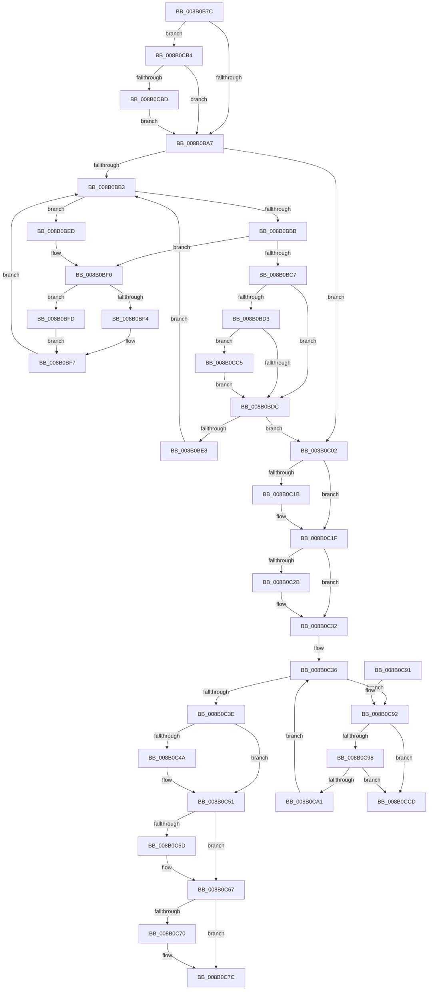

# PfSnCleanupTrace

- RVA: `0x008B0B7C`–`0x008B0CD4` (길이 `344` bytes)
- VA: `0x00000001408B0B7C`
- 실행 섹션: `PAGE`
- PDB 이름 있음: `예`; PDB Function 태그: `아니요`
- unwind 정보 RVA: `0x0007FB90`
- 디코드: `96`개 명령, `344/344` bytes 표시
- 미해석 바이트: `0` (있으면 어셈블리에 `.byte`로 보존)

> 이 문서는 커널 이미지의 기계어와 PDB 기호를 분석해 생성했습니다. 4번과 5번은 함수 원형과 자료형을 바이너리 사용 방식에서 추정한 C 해석이며 원본 소스 복구 결과는 아닙니다.

## 1. Dependencies

- 직접 호출 지점: **6**; 고유 호출 대상: **3**
- 직접 호출자로 확인된 함수: **2**
- RIP 상대 이미지 참조: **1**

### Outgoing calls
- `0x008B0BDE` → [ExFreePoolWithTag](../../poolcode/B8/ExFreePoolWithTag_function_00B82870.md) (function, `0x00B82870`)
- `0x008B0C2D` → [ExFreePoolWithTag](../../poolcode/B8/ExFreePoolWithTag_function_00B82870.md) (function, `0x00B82870`)
- `0x008B0C4C` → [ExFreePoolWithTag](../../poolcode/B8/ExFreePoolWithTag_function_00B82870.md) (function, `0x00B82870`)
- `0x008B0C62` → [ObfDereferenceObjectWithTag](../../text/2F/ObfDereferenceObjectWithTag_function_002F78E0.md) (function, `0x002F78E0`)
- `0x008B0C77` → [ExReleaseRundownProtection](../../text/34/ExReleaseRundownProtection_function_00349E80.md) (function, `0x00349E80`)
- `0x008B0CAD` → [ExFreePoolWithTag](../../poolcode/B8/ExFreePoolWithTag_function_00B82870.md) (function, `0x00B82870`)

### Direct callers
- [PfSnEndTrace](PfSnEndTrace_function_008B04A8.md) at `0x008B05CE`
- [PfSnBeginTrace](../96/PfSnBeginTrace_function_00960DE8.md) at `0x00960FC0`

### Static image references
- `0x008B0C70` → RVA `0x00E671F0` (`.data`; read)

## 2. Other-region calls and transfers

- 다른 실행 섹션으로 향하는 call: **6**
  - `0x008B0BDE` → [ExFreePoolWithTag](../../poolcode/B8/ExFreePoolWithTag_function_00B82870.md) (`PAGE` → `POOLCODE`)
  - `0x008B0C2D` → [ExFreePoolWithTag](../../poolcode/B8/ExFreePoolWithTag_function_00B82870.md) (`PAGE` → `POOLCODE`)
  - `0x008B0C4C` → [ExFreePoolWithTag](../../poolcode/B8/ExFreePoolWithTag_function_00B82870.md) (`PAGE` → `POOLCODE`)
  - `0x008B0C62` → [ObfDereferenceObjectWithTag](../../text/2F/ObfDereferenceObjectWithTag_function_002F78E0.md) (`PAGE` → `.text`)
  - `0x008B0C77` → [ExReleaseRundownProtection](../../text/34/ExReleaseRundownProtection_function_00349E80.md) (`PAGE` → `.text`)
  - `0x008B0CAD` → [ExFreePoolWithTag](../../poolcode/B8/ExFreePoolWithTag_function_00B82870.md) (`PAGE` → `POOLCODE`)
- 별도 외부 분기/꼬리 이동을 확인하지 못했습니다.

## 3. Assembly (complete function range)

```asm
008B0B7C  48 89 5C 24 10                  mov qword ptr [rsp + 0x10], rbx
008B0B81  48 89 6C 24 18                  mov qword ptr [rsp + 0x18], rbp
008B0B86  48 89 74 24 20                  mov qword ptr [rsp + 0x20], rsi
008B0B8B  57                              push rdi
008B0B8C  48 83 EC 20                     sub rsp, 0x20
008B0B90  48 8D 99 08 02 00 00            lea rbx, [rcx + 0x208]
008B0B97  48 8B F1                        mov rsi, rcx
008B0B9A  F6 43 08 01                     test byte ptr [rbx + 8], 1
008B0B9E  48 8B 0B                        mov rcx, qword ptr [rbx]
008B0BA1  0F 85 0D 01 00 00               jne 0x1408b0cb4
008B0BA7  0F B6 6B 08                     movzx ebp, byte ptr [rbx + 8]
008B0BAB  83 E5 01                        and ebp, 1
008B0BAE  48 85 C9                        test rcx, rcx
008B0BB1  74 4F                           je 0x1408b0c02
008B0BB3  48 8B 01                        mov rax, qword ptr [rcx]
008B0BB6  48 85 C0                        test rax, rax
008B0BB9  75 32                           jne 0x1408b0bed
008B0BBB  48 8D 51 08                     lea rdx, [rcx + 8]
008B0BBF  48 8B 02                        mov rax, qword ptr [rdx]
008B0BC2  48 85 C0                        test rax, rax
008B0BC5  75 29                           jne 0x1408b0bf0
008B0BC7  48 8B 79 10                     mov rdi, qword ptr [rcx + 0x10]
008B0BCB  48 83 E7 FC                     and rdi, 0xfffffffffffffffc
008B0BCF  85 ED                           test ebp, ebp
008B0BD1  74 09                           je 0x1408b0bdc
008B0BD3  48 85 FF                        test rdi, rdi
008B0BD6  0F 85 E9 00 00 00               jne 0x1408b0cc5
008B0BDC  33 D2                           xor edx, edx
008B0BDE  E8 8D 1C 2D 00                  call 0x140b82870
008B0BE3  48 85 FF                        test rdi, rdi
008B0BE6  74 1A                           je 0x1408b0c02
008B0BE8  48 8B CF                        mov rcx, rdi
008B0BEB  EB C6                           jmp 0x1408b0bb3
008B0BED  48 8B D1                        mov rdx, rcx
008B0BF0  85 ED                           test ebp, ebp
008B0BF2  74 09                           je 0x1408b0bfd
008B0BF4  48 33 C8                        xor rcx, rax
008B0BF7  48 83 22 00                     and qword ptr [rdx], 0
008B0BFB  EB B6                           jmp 0x1408b0bb3
008B0BFD  48 8B C8                        mov rcx, rax
008B0C00  EB F5                           jmp 0x1408b0bf7
008B0C02  0F B6 43 08                     movzx eax, byte ptr [rbx + 8]
008B0C06  48 C7 03 00 00 00 00            mov qword ptr [rbx], 0
008B0C0D  48 C7 43 08 00 00 00 00         mov qword ptr [rbx + 8], 0
008B0C15  0F BA E0 00                     bt eax, 0
008B0C19  73 04                           jae 0x1408b0c1f
008B0C1B  C6 43 08 01                     mov byte ptr [rbx + 8], 1
008B0C1F  48 8B 8E 48 02 00 00            mov rcx, qword ptr [rsi + 0x248]
008B0C26  48 85 C9                        test rcx, rcx
008B0C29  74 07                           je 0x1408b0c32
008B0C2B  33 D2                           xor edx, edx
008B0C2D  E8 3E 1C 2D 00                  call 0x140b82870
008B0C32  48 8D 5E 68                     lea rbx, [rsi + 0x68]
008B0C36  48 8B 0B                        mov rcx, qword ptr [rbx]
008B0C39  48 3B CB                        cmp rcx, rbx
008B0C3C  75 54                           jne 0x1408b0c92
008B0C3E  48 8B 8E D8 01 00 00            mov rcx, qword ptr [rsi + 0x1d8]
008B0C45  48 85 C9                        test rcx, rcx
008B0C48  74 07                           je 0x1408b0c51
008B0C4A  33 D2                           xor edx, edx
008B0C4C  E8 1F 1C 2D 00                  call 0x140b82870
008B0C51  48 8B 8E 60 01 00 00            mov rcx, qword ptr [rsi + 0x160]
008B0C58  48 85 C9                        test rcx, rcx
008B0C5B  74 0A                           je 0x1408b0c67
008B0C5D  BA 50 66 57 73                  mov edx, 0x73576650
008B0C62  E8 79 6C A4 FF                  call 0x1402f78e0
008B0C67  F6 86 E6 01 00 00 02            test byte ptr [rsi + 0x1e6], 2
008B0C6E  74 0C                           je 0x1408b0c7c
008B0C70  48 8D 0D 79 65 5B 00            lea rcx, [rip + 0x5b6579]
008B0C77  E8 04 92 A9 FF                  call 0x140349e80
008B0C7C  48 8B 5C 24 38                  mov rbx, qword ptr [rsp + 0x38]
008B0C81  48 8B 6C 24 40                  mov rbp, qword ptr [rsp + 0x40]
008B0C86  48 8B 74 24 48                  mov rsi, qword ptr [rsp + 0x48]
008B0C8B  48 83 C4 20                     add rsp, 0x20
008B0C8F  5F                              pop rdi
008B0C90  C3                              ret
008B0C91  CC                              int3
008B0C92  48 39 59 08                     cmp qword ptr [rcx + 8], rbx
008B0C96  75 35                           jne 0x1408b0ccd
008B0C98  48 8B 01                        mov rax, qword ptr [rcx]
008B0C9B  48 39 48 08                     cmp qword ptr [rax + 8], rcx
008B0C9F  75 2C                           jne 0x1408b0ccd
008B0CA1  48 89 03                        mov qword ptr [rbx], rax
008B0CA4  33 D2                           xor edx, edx
008B0CA6  48 89 58 08                     mov qword ptr [rax + 8], rbx
008B0CAA  FF 4E 78                        dec dword ptr [rsi + 0x78]
008B0CAD  E8 BE 1B 2D 00                  call 0x140b82870
008B0CB2  EB 82                           jmp 0x1408b0c36
008B0CB4  48 85 C9                        test rcx, rcx
008B0CB7  0F 84 EA FE FF FF               je 0x1408b0ba7
008B0CBD  48 33 CB                        xor rcx, rbx
008B0CC0  E9 E2 FE FF FF                  jmp 0x1408b0ba7
008B0CC5  48 33 F9                        xor rdi, rcx
008B0CC8  E9 0F FF FF FF                  jmp 0x1408b0bdc
008B0CCD  B9 03 00 00 00                  mov ecx, 3
008B0CD2  CD 29                           int 0x29
```

## 4. C-style interpretation (structured pseudocode)

```c
__int64 __fastcall PfSnCleanupTrace(__int64 a1)
{
    __int64 result;
    __int64 v_rbp;
    __int64 v_rdi;
    __int64 v_rsp;
    unsigned __int64 v_stack_p10;
    unsigned __int64 v_stack_p18;
    unsigned __int64 v_stack_p20;

    v_stack_p10 = v_rbx;
    v_stack_p18 = v_rbp;
    v_stack_p20 = v_rsi;
    v_rsp = (v_rsp) - (32);
    if (((*(unsigned __int8 *)(a1 + 520 + 8)) & (1)) != 0) goto loc_008B0CB4;
loc_008B0BA7:
    v_rbp = (unsigned int)((*(unsigned __int8 *)(a1 + 520 + 8)) & (1));
    if (*(unsigned __int64 *)(a1 + 520) == 0) goto loc_008B0C02;
loc_008B0BB3:
    if (*(unsigned __int64 *)(*(unsigned __int64 *)(a1 + 520)) != 0) goto loc_008B0BED;
    if (*(unsigned __int64 *)(*(unsigned __int64 *)(a1 + 520) + 8) != 0) goto loc_008B0BF0;
    v_rdi = (*(unsigned __int64 *)(*(unsigned __int64 *)(a1 + 520) + 16)) & (-4);
    if ((unsigned int)(v_rbp) == 0) goto loc_008B0BDC;
    if (v_rdi != 0) goto loc_008B0CC5;
loc_008B0BDC:
    a2 = 0;
    result = ExFreePoolWithTag(*(unsigned __int64 *)(a1 + 520), a2, a3, a4);
    if (v_rdi == 0) goto loc_008B0C02;
    goto loc_008B0BB3;
loc_008B0BED:
loc_008B0BF0:
    if ((unsigned int)(v_rbp) == 0) goto loc_008B0BFD;
    a1 = (v_rdi) ^ (result);
loc_008B0BF7:
    goto loc_008B0BB3;
loc_008B0BFD:
    goto loc_008B0BF7;
loc_008B0C02:
    *(unsigned __int64 *)(a1 + 520) = 0;
    *(unsigned __int64 *)(a1 + 520 + 8) = 0;
    if (!(condition_is_above_or_equal)) {
        *(unsigned __int8 *)(a1 + 520 + 8) = 1;
    }
    result = *(unsigned __int8 *)(a1 + 520 + 8);
    if (*(unsigned __int64 *)(a1 + 584) != 0) {
        a2 = 0;
        result = ExFreePoolWithTag(*(unsigned __int64 *)(a1 + 584), a2, a3, a4);
    }
loc_008B0C36:
    if ((*(unsigned __int64 *)(a1 + 104)) != (a1 + 104)) goto loc_008B0C92;
    if (*(unsigned __int64 *)(a1 + 472) != 0) {
        a2 = 0;
        result = ExFreePoolWithTag(*(unsigned __int64 *)(a1 + 472), a2, a3, a4);
    }
    if (*(unsigned __int64 *)(a1 + 352) != 0) {
        a2 = 0x73576650ULL;
        result = ObfDereferenceObjectWithTag(*(unsigned __int64 *)(a1 + 352), a2, a3, a4);
    }
    if (((*(unsigned __int8 *)(a1 + 486)) & (2)) != 0) {
        a1 = v_rip + 5989753;
        result = ExReleaseRundownProtection(a1, a2, a3, a4);
    }
    v_rsp = (v_rsp) + (32);
    return result;
loc_008B0C92:
    if ((*(unsigned __int64 *)(a1 + 8)) != v_stack_p10) goto loc_008B0CCD;
    if ((*(unsigned __int64 *)(*(unsigned __int64 *)(a1) + 8)) != a1) goto loc_008B0CCD;
    *(unsigned __int64 *)(v_stack_p10) = *(unsigned __int64 *)(a1);
    a2 = 0;
    *(unsigned __int64 *)(*(unsigned __int64 *)(a1) + 8) = v_stack_p10;
    result = ExFreePoolWithTag(a1, a2, a3, a4);
    goto loc_008B0C36;
loc_008B0CB4:
    if (a1 == 0) goto loc_008B0BA7;
    a1 = (a1) ^ (v_stack_p10);
    goto loc_008B0BA7;
loc_008B0CC5:
    v_rdi = (v_rdi) ^ (a1);
    goto loc_008B0BDC;
loc_008B0CCD:
    return result;
}
```

## 5. (Beta) C Style

```c
int64_t PfSnCleanupTrace(void *Arg1)
{
    uint8_t *arg1 = (uint8_t *)Arg1;

    int64_t result;
    int64_t local_rbp;
    int64_t local_rdi;
    int64_t local_rsp;
    uint64_t v_stack_p10;
    uint64_t v_stack_p18;
    uint64_t v_stack_p20;

    v_stack_p10 = local_rbx;
    v_stack_p18 = local_rbp;
    v_stack_p20 = local_rsi;
    local_rsp = (local_rsp) - (32);
    if (((*(uint8_t *)(arg1 + 0x208 + 0x8)) & (1)) != 0) goto loc_008B0CB4;
loc_008B0BA7:
    local_rbp = (uint32_t)((*(uint8_t *)(arg1 + 0x208 + 0x8)) & (1));
    if (*(uint64_t *)(arg1 + 0x208) == 0) goto loc_008B0C02;
loc_008B0BB3:
    if (*(uint64_t *)(*(uint64_t *)(arg1 + 0x208)) != 0) goto loc_008B0BED;
    if (*(uint64_t *)(*(uint64_t *)(arg1 + 0x208) + 0x8) != 0) goto loc_008B0BF0;
    local_rdi = (*(uint64_t *)(*(uint64_t *)(arg1 + 0x208) + 0x10)) & (-4);
    if ((uint32_t)(local_rbp) == 0) goto loc_008B0BDC;
    if (local_rdi != 0) goto loc_008B0CC5;
loc_008B0BDC:
    a2 = 0;
    result = ExFreePoolWithTag(*(uint64_t *)(arg1 + 0x208), a2, a3, a4);
    if (local_rdi == 0) goto loc_008B0C02;
    goto loc_008B0BB3;
loc_008B0BED:
loc_008B0BF0:
    if ((uint32_t)(local_rbp) == 0) goto loc_008B0BFD;
    Arg1 = (local_rdi) ^ (result);
loc_008B0BF7:
    goto loc_008B0BB3;
loc_008B0BFD:
    goto loc_008B0BF7;
loc_008B0C02:
    *(uint64_t *)(arg1 + 0x208) = 0;
    *(uint64_t *)(arg1 + 0x208 + 0x8) = 0;
    if (!(condition_is_above_or_equal)) {
        *(uint8_t *)(arg1 + 0x208 + 0x8) = 1;
    }
    result = *(uint8_t *)(arg1 + 0x208 + 0x8);
    if (*(uint64_t *)(arg1 + 0x248) != 0) {
        a2 = 0;
        result = ExFreePoolWithTag(*(uint64_t *)(arg1 + 0x248), a2, a3, a4);
    }
loc_008B0C36:
    if ((*(uint64_t *)(arg1 + 0x68)) != (Arg1 + 104)) goto loc_008B0C92;
    if (*(uint64_t *)(arg1 + 0x1D8) != 0) {
        a2 = 0;
        result = ExFreePoolWithTag(*(uint64_t *)(arg1 + 0x1D8), a2, a3, a4);
    }
    if (*(uint64_t *)(arg1 + 0x160) != 0) {
        a2 = 0x73576650ULL;
        result = ObfDereferenceObjectWithTag(*(uint64_t *)(arg1 + 0x160), a2, a3, a4);
    }
    if (((*(uint8_t *)(arg1 + 0x1E6)) & (2)) != 0) {
        Arg1 = v_rip + 5989753;
        result = ExReleaseRundownProtection(Arg1, a2, a3, a4);
    }
    local_rsp = (local_rsp) + (32);
    return result;
loc_008B0C92:
    if ((*(uint64_t *)(arg1 + 0x8)) != v_stack_p10) goto loc_008B0CCD;
    if ((*(uint64_t *)(*(uint64_t *)(arg1) + 0x8)) != Arg1) goto loc_008B0CCD;
    *(uint64_t *)(v_stack_p10) = *(uint64_t *)(arg1);
    a2 = 0;
    *(uint64_t *)(*(uint64_t *)(arg1) + 0x8) = v_stack_p10;
    result = ExFreePoolWithTag(Arg1, a2, a3, a4);
    goto loc_008B0C36;
loc_008B0CB4:
    if (Arg1 == NULL) goto loc_008B0BA7;
    Arg1 = (Arg1) ^ (v_stack_p10);
    goto loc_008B0BA7;
loc_008B0CC5:
    local_rdi = (local_rdi) ^ (Arg1);
    goto loc_008B0BDC;
loc_008B0CCD:
    return result;
}
```

### 관측된 메모리 오프셋

구조체 형식이 확인되지 않은 접근은 인자 기준의 오프셋으로만 기록했습니다.

| 기준 인자 | 오프셋 표현 | 폭 (bit) | 접근 |
|---|---:|---:|---|
| `Arg1` | `+ 0x0` | `64` | `R` |
| `Arg1` | `+ 0x0` | `64` | `W` |
| `Arg1` | `+ 0x8` | `8` | `R` |
| `Arg1` | `+ 0x8` | `8` | `W` |
| `Arg1` | `+ 0x8` | `64` | `W` |
| `Arg1` | `+ 0x68` | `64` | `R` |
| `Arg1` | `+ 0x78` | `32` | `R/W` |
| `Arg1` | `+ 0x160` | `64` | `R` |
| `Arg1` | `+ 0x1D8` | `64` | `R` |
| `Arg1` | `+ 0x1E6` | `8` | `R` |
| `Arg1` | `+ 0x208` | `64` | `R` |
| `Arg1` | `+ 0x248` | `64` | `R` |

## 6. Execution-region graph

[열기: 2D/3D 그래프와 함수 탐색 컨트롤 패널](../../../control-panel.html?section=page&rva=0x008B0B7C&view=graph)

- 2D 그래프는 위에서 아래로 흐르고, 3D 그래프는 빈 공간을 드래그해 회전합니다. Shift+드래그는 이동, 휠은 확대·축소, 함수 노드 선택은 대상 보고서 이동입니다.

### Static fallback


