# PfSnEndTrace

- RVA: `0x008B04A8`–`0x008B081A` (길이 `882` bytes)
- VA: `0x00000001408B04A8`
- 실행 섹션: `PAGE`
- PDB 이름 있음: `예`; PDB Function 태그: `예`
- unwind 정보 RVA: `0x0007FB1C`
- 디코드: `192`개 명령, `882/882` bytes 표시
- 미해석 바이트: `0` (있으면 어셈블리에 `.byte`로 보존)

> 이 문서는 커널 이미지의 기계어와 PDB 기호를 분석해 생성했습니다. 4번과 5번은 함수 원형과 자료형을 바이너리 사용 방식에서 추정한 C 해석이며 원본 소스 복구 결과는 아닙니다.

## 1. Dependencies

- 직접 호출 지점: **15**; 고유 호출 대상: **12**
- 직접 호출자로 확인된 함수: **1**
- RIP 상대 이미지 참조: **15**

### Outgoing calls
- `0x008B053E` → [PfSnDeactivateTrace](../../text/2A/PfSnDeactivateTrace_function_002A50CC.md) (function, `0x002A50CC`)
- `0x008B0546` → [PfSnLogEndTrace](PfSnLogEndTrace_function_008B0A70.md) (function, `0x008B0A70`)
- `0x008B059E` → [PfSnBuildDumpFromTrace](PfSnBuildDumpFromTrace_function_008B0820.md) (function, `0x008B0820`)
- `0x008B05C3` → [PfpPartitionReferenceParentSafeByProcess](../../text/42/PfpPartitionReferenceParentSafeByProcess_function_0042B080.md) (function, `0x0042B080`)
- `0x008B05CE` → [PfSnCleanupTrace](PfSnCleanupTrace_function_008B0B7C.md) (function, `0x008B0B7C`)
- `0x008B05D8` → [ExFreePoolWithTag](../../poolcode/B8/ExFreePoolWithTag_function_00B82870.md) (function, `0x00B82870`)
- `0x008B05F1` → [ExAcquireFastMutex](../../text/20/ExAcquireFastMutex_function_0020E5A0.md) (function, `0x0020E5A0`)
- `0x008B0682` → [PfFbBufferListFlushStandby](../../text/48/PfFbBufferListFlushStandby_function_00484174.md) (function, `0x00484174`)
- `0x008B06BE` → [ExReleaseFastMutex](../../text/25/ExReleaseFastMutex_function_002519C0.md) (function, `0x002519C0`)
- `0x008B06D4` → [KeSetEvent](../../text/33/KeSetEvent_function_0033F310.md) (function, `0x0033F310`)
- `0x008B06E3` → [PfpPartitionDereferenceParent](../../text/34/PfpPartitionDereferenceParent_function_00341CDC.md) (function, `0x00341CDC`)
- `0x008B0729` → [_security_check_cookie](../../text/6A/_security_check_cookie_function_006AC640.md) (function, `0x006AC640`)
- `0x008B077F` → [ExFreePoolWithTag](../../poolcode/B8/ExFreePoolWithTag_function_00B82870.md) (function, `0x00B82870`)
- `0x008B0798` → [ExReleaseFastMutex](../../text/25/ExReleaseFastMutex_function_002519C0.md) (function, `0x002519C0`)
- `0x008B07A2` → [ExFreePoolWithTag](../../poolcode/B8/ExFreePoolWithTag_function_00B82870.md) (function, `0x00B82870`)

### Direct callers
- [PfSnEndTraceWorkerThreadRoutine](PfSnEndTraceWorkerThreadRoutine_function_008B0490.md) at `0x008B0494`

### Static image references
- `0x008B04C6` → RVA `0x00E0A740` (`.data`; read)
- `0x008B0502` → RVA `0x00E074D8` (`.data`; read)
- `0x008B0566` → RVA `0x00E670A4` (`.data`; read)
- `0x008B05EA` → RVA `0x00E67278` (`.data`; read)
- `0x008B05F6` → RVA `0x00E672B4` (`.data`; read)
- `0x008B0602` → RVA `0x00E67270` (`.data`; read)
- `0x008B0609` → RVA `0x00E67268` (`.data`; read)
- `0x008B061C` → RVA `0x00E074E8` (`.data`; reference)
- `0x008B0696` → RVA `0x00E672B0` (`.data`; read)
- `0x008B069E` → RVA `0x00E67270` (`.data`; write)
- `0x008B06A5` → RVA `0x00E66F3C` (`.data`; read)
- `0x008B06AB` → RVA `0x00E672B0` (`.data`; write)
- `0x008B06C3` → RVA `0x00E672B8` (`.data`; read)
- `0x008B0772` → RVA `0x00E67268` (`.data`; write)
- `0x008B07AC` → RVA `0x00E074F0` (`.data`; read)

## 2. Other-region calls and transfers

- 다른 실행 섹션으로 향하는 call: **12**
  - `0x008B053E` → [PfSnDeactivateTrace](../../text/2A/PfSnDeactivateTrace_function_002A50CC.md) (`PAGE` → `.text`)
  - `0x008B05C3` → [PfpPartitionReferenceParentSafeByProcess](../../text/42/PfpPartitionReferenceParentSafeByProcess_function_0042B080.md) (`PAGE` → `.text`)
  - `0x008B05D8` → [ExFreePoolWithTag](../../poolcode/B8/ExFreePoolWithTag_function_00B82870.md) (`PAGE` → `POOLCODE`)
  - `0x008B05F1` → [ExAcquireFastMutex](../../text/20/ExAcquireFastMutex_function_0020E5A0.md) (`PAGE` → `.text`)
  - `0x008B0682` → [PfFbBufferListFlushStandby](../../text/48/PfFbBufferListFlushStandby_function_00484174.md) (`PAGE` → `.text`)
  - `0x008B06BE` → [ExReleaseFastMutex](../../text/25/ExReleaseFastMutex_function_002519C0.md) (`PAGE` → `.text`)
  - `0x008B06D4` → [KeSetEvent](../../text/33/KeSetEvent_function_0033F310.md) (`PAGE` → `.text`)
  - `0x008B06E3` → [PfpPartitionDereferenceParent](../../text/34/PfpPartitionDereferenceParent_function_00341CDC.md) (`PAGE` → `.text`)
  - `0x008B0729` → [_security_check_cookie](../../text/6A/_security_check_cookie_function_006AC640.md) (`PAGE` → `.text`)
  - `0x008B077F` → [ExFreePoolWithTag](../../poolcode/B8/ExFreePoolWithTag_function_00B82870.md) (`PAGE` → `POOLCODE`)
  - `0x008B0798` → [ExReleaseFastMutex](../../text/25/ExReleaseFastMutex_function_002519C0.md) (`PAGE` → `.text`)
  - `0x008B07A2` → [ExFreePoolWithTag](../../poolcode/B8/ExFreePoolWithTag_function_00B82870.md) (`PAGE` → `POOLCODE`)
- call이 아닌 외부 분기/꼬리 이동: **2**
  - `0x008B0633` → [sub_00B1A590](../B1/Unknown_function_00B1A590.md) (`tail-transfer`)
  - `0x008B071A` → [sub_00B1A590 + 0xA8](../B1/Unknown_function_00B1A590.md) (`tail-transfer`)

## 3. Assembly (complete function range)

```asm
008B04A8  48 89 5C 24 10                  mov qword ptr [rsp + 0x10], rbx
008B04AD  48 89 74 24 18                  mov qword ptr [rsp + 0x18], rsi
008B04B2  55                              push rbp
008B04B3  57                              push rdi
008B04B4  41 54                           push r12
008B04B6  41 56                           push r14
008B04B8  41 57                           push r15
008B04BA  48 8D 6C 24 E0                  lea rbp, [rsp - 0x20]
008B04BF  48 81 EC 20 01 00 00            sub rsp, 0x120
008B04C6  48 8B 05 73 A2 55 00            mov rax, qword ptr [rip + 0x55a273]
008B04CD  48 33 C4                        xor rax, rsp
008B04D0  48 89 45 10                     mov qword ptr [rbp + 0x10], rax
008B04D4  0F 10 41 18                     movups xmm0, xmmword ptr [rcx + 0x18]
008B04D8  48 83 64 24 40 00               and qword ptr [rsp + 0x40], 0
008B04DE  BF 01 00 00 00                  mov edi, 1
008B04E3  0F 10 49 28                     movups xmm1, xmmword ptr [rcx + 0x28]
008B04E7  48 83 64 24 48 00               and qword ptr [rsp + 0x48], 0
008B04ED  48 8B D9                        mov rbx, rcx
008B04F0  0F 29 44 24 60                  movaps xmmword ptr [rsp + 0x60], xmm0
008B04F5  0F 10 41 38                     movups xmm0, xmmword ptr [rcx + 0x38]
008B04F9  44 8D 4F 03                     lea r9d, [rdi + 3]
008B04FD  0F 29 4C 24 70                  movaps xmmword ptr [rsp + 0x70], xmm1
008B0502  44 39 0D CF 6F 55 00            cmp dword ptr [rip + 0x556fcf], r9d
008B0509  0F 10 49 48                     movups xmm1, xmmword ptr [rcx + 0x48]
008B050D  0F 29 45 80                     movaps xmmword ptr [rbp - 0x80], xmm0
008B0511  0F 29 4D 90                     movaps xmmword ptr [rbp - 0x70], xmm1
008B0515  0F 87 01 01 00 00               ja 0x1408b061c
008B051B  65 48 8B 04 25 88 01 00 00      mov rax, qword ptr gs:[0x188]
008B0524  48 8B CB                        mov rcx, rbx
008B0527  44 8A A0 32 02 00 00            mov r12b, byte ptr [rax + 0x232]
008B052E  65 48 8B 04 25 88 01 00 00      mov rax, qword ptr gs:[0x188]
008B0537  C6 80 32 02 00 00 00            mov byte ptr [rax + 0x232], 0
008B053E  E8 89 4B 9F FF                  call 0x1402a50cc
008B0543  48 8B CB                        mov rcx, rbx
008B0546  E8 25 05 00 00                  call 0x1408b0a70
008B054B  8B 93 44 01 00 00               mov edx, dword ptr [rbx + 0x144]
008B0551  8B 8B 4C 01 00 00               mov ecx, dword ptr [rbx + 0x14c]
008B0557  3B D1                           cmp edx, ecx
008B0559  0F 8F 88 02 00 00               jg 0x1408b07e7
008B055F  48 63 83 48 01 00 00            movsxd rax, dword ptr [rbx + 0x148]
008B0566  3B 05 38 6B 5B 00               cmp eax, dword ptr [rip + 0x5b6b38]
008B056C  0F 8D C6 00 00 00               jge 0x1408b0638
008B0572  2B CA                           sub ecx, edx
008B0574  89 8C 83 1C 01 00 00            mov dword ptr [rbx + rax*4 + 0x11c], ecx
008B057B  8B 83 4C 01 00 00               mov eax, dword ptr [rbx + 0x14c]
008B0581  01 BB 48 01 00 00               add dword ptr [rbx + 0x148], edi
008B0587  89 83 44 01 00 00               mov dword ptr [rbx + 0x144], eax
008B058D  39 7B 58                        cmp dword ptr [rbx + 0x58], edi
008B0590  0F 84 6D 02 00 00               je 0x1408b0803
008B0596  48 8B D3                        mov rdx, rbx
008B0599  48 8D 4C 24 40                  lea rcx, [rsp + 0x40]
008B059E  E8 7D 02 00 00                  call 0x1408b0820
008B05A3  8B F0                           mov esi, eax
008B05A5  4C 8B 74 24 40                  mov r14, qword ptr [rsp + 0x40]
008B05AA  48 8D 4C 24 48                  lea rcx, [rsp + 0x48]
008B05AF  48 8B 93 60 01 00 00            mov rdx, qword ptr [rbx + 0x160]
008B05B6  4C 89 B3 C0 01 00 00            mov qword ptr [rbx + 0x1c0], r14
008B05BD  89 B3 C8 01 00 00               mov dword ptr [rbx + 0x1c8], esi
008B05C3  E8 B8 AA B7 FF                  call 0x14042b080
008B05C8  48 8B CB                        mov rcx, rbx
008B05CB  4C 8B F8                        mov r15, rax
008B05CE  E8 A9 05 00 00                  call 0x1408b0b7c
008B05D3  33 D2                           xor edx, edx
008B05D5  48 8B CB                        mov rcx, rbx
008B05D8  E8 93 22 2D 00                  call 0x140b82870
008B05DD  85 F6                           test esi, esi
008B05DF  0F 88 F6 00 00 00               js 0x1408b06db
008B05E5  4D 85 FF                        test r15, r15
008B05E8  75 75                           jne 0x1408b065f
008B05EA  48 8D 0D 87 6C 5B 00            lea rcx, [rip + 0x5b6c87]
008B05F1  E8 AA DF 95 FF                  call 0x14020e5a0
008B05F6  39 3D B8 6C 5B 00               cmp dword ptr [rip + 0x5b6cb8], edi
008B05FC  0F 84 8F 01 00 00               je 0x1408b0791
008B0602  48 8B 05 67 6C 5B 00            mov rax, qword ptr [rip + 0x5b6c67]
008B0609  48 8D 1D 58 6C 5B 00            lea rbx, [rip + 0x5b6c58]
008B0610  48 39 18                        cmp qword ptr [rax], rbx
008B0613  74 77                           je 0x1408b068c
008B0615  B9 03 00 00 00                  mov ecx, 3
008B061A  CD 29                           int 0x29
008B061C  40 84 3D C5 6E 55 00            test byte ptr [rip + 0x556ec5], dil
008B0623  0F 85 9F 01 00 00               jne 0x1408b07c8
008B0629  32 C0                           xor al, al
008B062B  84 C0                           test al, al
008B062D  0F 84 E8 FE FF FF               je 0x1408b051b
008B0633  E9 58 9F 26 00                  jmp 0x140b1a590
008B0638  41 B8 0A 00 00 00               mov r8d, 0xa
008B063E  41 3B C0                        cmp eax, r8d
008B0641  0F 8F AD 01 00 00               jg 0x1408b07f4
008B0647  3B D1                           cmp edx, ecx
008B0649  0F 84 3E FF FF FF               je 0x1408b058d
008B064F  48 98                           cdqe
008B0651  2B CA                           sub ecx, edx
008B0653  01 8C 83 18 01 00 00            add dword ptr [rbx + rax*4 + 0x118], ecx
008B065A  E9 2E FF FF FF                  jmp 0x1408b058d
008B065F  48 8B 4C 24 48                  mov rcx, qword ptr [rsp + 0x48]
008B0664  48 85 C9                        test rcx, rcx
008B0667  74 81                           je 0x1408b05ea
008B0669  8B 81 64 02 00 00               mov eax, dword ptr [rcx + 0x264]
008B066F  39 81 60 02 00 00               cmp dword ptr [rcx + 0x260], eax
008B0675  0F 83 6F FF FF FF               jae 0x1408b05ea
008B067B  48 8D 91 20 01 00 00            lea rdx, [rcx + 0x120]
008B0682  E8 ED 3A BD FF                  call 0x140484174
008B0687  E9 5E FF FF FF                  jmp 0x1408b05ea
008B068C  49 89 46 08                     mov qword ptr [r14 + 8], rax
008B0690  49 89 1E                        mov qword ptr [r14], rbx
008B0693  4C 89 30                        mov qword ptr [rax], r14
008B0696  8B 05 14 6C 5B 00               mov eax, dword ptr [rip + 0x5b6c14]
008B069C  03 C7                           add eax, edi
008B069E  4C 89 35 CB 6B 5B 00            mov qword ptr [rip + 0x5b6bcb], r14
008B06A5  3B 05 91 68 5B 00               cmp eax, dword ptr [rip + 0x5b6891]
008B06AB  89 05 FF 6B 5B 00               mov dword ptr [rip + 0x5b6bff], eax
008B06B1  0F 87 94 00 00 00               ja 0x1408b074b
008B06B7  48 8D 0D BA 6B 5B 00            lea rcx, [rip + 0x5b6bba]
008B06BE  E8 FD 12 9A FF                  call 0x1402519c0
008B06C3  48 8B 0D EE 6B 5B 00            mov rcx, qword ptr [rip + 0x5b6bee]
008B06CA  48 85 C9                        test rcx, rcx
008B06CD  74 0A                           je 0x1408b06d9
008B06CF  45 33 C0                        xor r8d, r8d
008B06D2  33 D2                           xor edx, edx
008B06D4  E8 37 EC A8 FF                  call 0x14033f310
008B06D9  33 F6                           xor esi, esi
008B06DB  4D 85 FF                        test r15, r15
008B06DE  74 08                           je 0x1408b06e8
008B06E0  49 8B CF                        mov rcx, r15
008B06E3  E8 F4 15 A9 FF                  call 0x140341cdc
008B06E8  65 48 8B 04 25 88 01 00 00      mov rax, qword ptr gs:[0x188]
008B06F1  41 BA 04 00 00 00               mov r10d, 4
008B06F7  44 88 A0 32 02 00 00            mov byte ptr [rax + 0x232], r12b
008B06FE  44 39 15 D3 6D 55 00            cmp dword ptr [rip + 0x556dd3], r10d
008B0705  76 19                           jbe 0x1408b0720
008B0707  40 84 3D DA 6D 55 00            test byte ptr [rip + 0x556dda], dil
008B070E  0F 85 98 00 00 00               jne 0x1408b07ac
008B0714  40 32 FF                        xor dil, dil
008B0717  40 84 FF                        test dil, dil
008B071A  0F 85 18 9F 26 00               jne 0x140b1a638
008B0720  8B C6                           mov eax, esi
008B0722  48 8B 4D 10                     mov rcx, qword ptr [rbp + 0x10]
008B0726  48 33 CC                        xor rcx, rsp
008B0729  E8 12 BF DF FF                  call 0x1406ac640
008B072E  4C 8D 9C 24 20 01 00 00         lea r11, [rsp + 0x120]
008B0736  49 8B 5B 38                     mov rbx, qword ptr [r11 + 0x38]
008B073A  49 8B 73 40                     mov rsi, qword ptr [r11 + 0x40]
008B073E  49 8B E3                        mov rsp, r11
008B0741  41 5F                           pop r15
008B0743  41 5E                           pop r14
008B0745  41 5C                           pop r12
008B0747  5F                              pop rdi
008B0748  5D                              pop rbp
008B0749  C3                              ret
008B074A  CC                              int3
008B074B  48 8B 0D 16 6B 5B 00            mov rcx, qword ptr [rip + 0x5b6b16]
008B0752  48 3B CB                        cmp rcx, rbx
008B0755  0F 84 5C FF FF FF               je 0x1408b06b7
008B075B  48 39 59 08                     cmp qword ptr [rcx + 8], rbx
008B075F  0F 85 B0 FE FF FF               jne 0x1408b0615
008B0765  48 8B 01                        mov rax, qword ptr [rcx]
008B0768  48 39 48 08                     cmp qword ptr [rax + 8], rcx
008B076C  0F 85 A3 FE FF FF               jne 0x1408b0615
008B0772  48 89 05 EF 6A 5B 00            mov qword ptr [rip + 0x5b6aef], rax
008B0779  33 D2                           xor edx, edx
008B077B  48 89 58 08                     mov qword ptr [rax + 8], rbx
008B077F  E8 EC 20 2D 00                  call 0x140b82870
008B0784  8B 05 26 6B 5B 00               mov eax, dword ptr [rip + 0x5b6b26]
008B078A  2B C7                           sub eax, edi
008B078C  E9 14 FF FF FF                  jmp 0x1408b06a5
008B0791  48 8D 0D E0 6A 5B 00            lea rcx, [rip + 0x5b6ae0]
008B0798  E8 23 12 9A FF                  call 0x1402519c0
008B079D  33 D2                           xor edx, edx
008B079F  49 8B CE                        mov rcx, r14
008B07A2  E8 C9 20 2D 00                  call 0x140b82870
008B07A7  E9 2F FF FF FF                  jmp 0x1408b06db
008B07AC  48 8B 05 3D 6D 55 00            mov rax, qword ptr [rip + 0x556d3d]
008B07B3  48 23 C7                        and rax, rdi
008B07B6  48 3B 05 33 6D 55 00            cmp rax, qword ptr [rip + 0x556d33]
008B07BD  0F 85 51 FF FF FF               jne 0x1408b0714
008B07C3  E9 4F FF FF FF                  jmp 0x1408b0717
008B07C8  48 8B 05 21 6D 55 00            mov rax, qword ptr [rip + 0x556d21]
008B07CF  48 23 C7                        and rax, rdi
008B07D2  48 3B 05 17 6D 55 00            cmp rax, qword ptr [rip + 0x556d17]
008B07D9  0F 85 4A FE FF FF               jne 0x1408b0629
008B07DF  40 8A C7                        mov al, dil
008B07E2  E9 44 FE FF FF                  jmp 0x1408b062b
008B07E7  89 8B 44 01 00 00               mov dword ptr [rbx + 0x144], ecx
008B07ED  8B D1                           mov edx, ecx
008B07EF  E9 6B FD FF FF                  jmp 0x1408b055f
008B07F4  44 89 83 48 01 00 00            mov dword ptr [rbx + 0x148], r8d
008B07FB  41 8B C0                        mov eax, r8d
008B07FE  E9 44 FE FF FF                  jmp 0x1408b0647
008B0803  83 BB 90 01 00 00 08            cmp dword ptr [rbx + 0x190], 8
008B080A  0F 84 86 FD FF FF               je 0x1408b0596
008B0810  BE 22 00 00 80                  mov esi, 0x80000022
008B0815  E9 8B FD FF FF                  jmp 0x1408b05a5
```

## 4. C-style interpretation (structured pseudocode)

```c
__int64 __fastcall PfSnEndTrace(__int64 a1)
{
    __int64 result;
    __int64 v_rdi;
    __int64 v_rsi;
    __int64 v_rsp;
    unsigned __int64 v_stack_m100;
    unsigned __int64 v_stack_m108;
    unsigned __int64 v_stack_m28;
    unsigned __int64 v_stack_m38;
    unsigned __int64 v_stack_m48;
    unsigned __int64 v_stack_mB8;
    unsigned __int64 v_stack_mC8;
    unsigned __int64 v_stack_mD8;
    unsigned __int64 v_stack_mE8;
    unsigned __int64 v_stack_p10;
    unsigned __int64 v_stack_p18;

    v_stack_p10 = v_rbx;
    v_stack_p18 = v_rsi;
    v_rsp = (v_rsp) - (288);
    result = (*(unsigned __int64 *)(v_rip + 5612147)) ^ (v_rsp);
    v_stack_m38 = result;
    v_stack_mE8 = v_xmm0;
    v_stack_mD8 = v_xmm1;
    v_stack_mC8 = v_xmm0;
    v_stack_mB8 = v_xmm1;
    if ((*(unsigned int *)(v_rip + 5599183)) > ((unsigned int)(1 + 3))) goto loc_008B061C;
loc_008B051B:
    *(unsigned __int8 *)(*(unsigned __int64 *)(gs_base + (0 + 392)) + 562) = 0;
    result = PfSnDeactivateTrace(a1, a2, a3, 1 + 3);
    result = PfSnLogEndTrace(a1, a2, a3, 1 + 3);
    if (((unsigned int)((unsigned int)(*(unsigned int *)(a1 + 324)))) > ((unsigned int)((unsigned int)(*(unsigned int *)(a1 + 332))))) goto loc_008B07E7;
loc_008B055F:
    if (((unsigned int)((int)(*(unsigned int *)(a1 + 328)))) >= (*(unsigned int *)(v_rip + 5991224))) goto loc_008B0638;
    a1 = (unsigned int)(((unsigned int)(*(unsigned int *)(a1 + 332))) - ((unsigned int)((unsigned int)(*(unsigned int *)(a1 + 324)))));
    *(unsigned int *)(a1 + (int)(*(unsigned int *)(a1 + 328)) * 4 + 284) = (unsigned int)(a1);
    *(unsigned int *)(a1 + 324) = (unsigned int)((unsigned int)(*(unsigned int *)(a1 + 332)));
loc_008B058D:
    if ((*(unsigned int *)(a1 + 88)) == 1) goto loc_008B0803;
loc_008B0596:
    result = PfSnBuildDumpFromTrace(v_stack_m108, a1, a3, 1 + 3);
loc_008B05A5:
    *(unsigned __int64 *)(a1 + 448) = v_stack_m108;
    *(unsigned int *)(a1 + 456) = (unsigned int)((unsigned int)((unsigned int)(result)));
    result = PfpPartitionReferenceParentSafeByProcess(v_stack_m100, *(unsigned __int64 *)(a1 + 352), a3, 1 + 3);
    result = PfSnCleanupTrace(a1, *(unsigned __int64 *)(a1 + 352), a3, 1 + 3);
    a2 = 0;
    result = ExFreePoolWithTag(a1, a2, a3, 1 + 3);
    if (sign_flag) goto loc_008B06DB;
    if (result != 0) goto loc_008B065F;
loc_008B05EA:
    result = ExAcquireFastMutex(v_rip + 5991559, a2, a3, 1 + 3);
    if ((*(unsigned int *)(v_rip + 5991608)) == 1) goto loc_008B0791;
    if ((*(unsigned __int64 *)(*(unsigned __int64 *)(v_rip + 5991527))) == (v_rip + 5991512)) goto loc_008B068C;
loc_008B0615:
loc_008B061C:
    if (((*(unsigned __int8 *)(v_rip + 5598917)) & (1)) != 0) goto loc_008B07C8;
loc_008B0629:
    result = 0;
loc_008B062B:
    if (0 == 0) goto loc_008B051B;
loc_008B0638:
    if (0 > 10) goto loc_008B07F4;
loc_008B0647:
    if (0 == 3) goto loc_008B058D;
    a1 = (unsigned int)((3) - (0));
    goto loc_008B058D;
loc_008B065F:
    if (v_stack_m100 == 0) goto loc_008B05EA;
    if ((*(unsigned int *)(v_stack_m100 + 608)) >= ((unsigned int)((unsigned int)(*(unsigned int *)(v_stack_m100 + 612))))) goto loc_008B05EA;
    result = PfFbBufferListFlushStandby(v_stack_m100, v_stack_m100 + 288, 10, 1 + 3);
    goto loc_008B05EA;
loc_008B068C:
    *(unsigned __int64 *)(v_stack_m108 + 8) = result;
    *(unsigned __int64 *)(v_stack_m108) = v_rip + 5991512;
    *(unsigned __int64 *)(result) = v_stack_m108;
    result = (unsigned int)(((unsigned int)(*(unsigned int *)(v_rip + 5991444))) + (1));
    *(unsigned __int64 *)(v_rip + 5991371) = v_stack_m108;
loc_008B06A5:
    *(unsigned int *)(v_rip + 5991423) = (unsigned int)(result);
    if (((unsigned int)(result)) > (*(unsigned int *)(v_rip + 5990545))) goto loc_008B074B;
loc_008B06B7:
    result = ExReleaseFastMutex(v_rip + 5991354, v_stack_m100 + 288, 10, 1 + 3);
    if (*(unsigned __int64 *)(v_rip + 5991406) != 0) {
        a3 = 0;
        a2 = 0;
        result = KeSetEvent(*(unsigned __int64 *)(v_rip + 5991406), a2, a3, 1 + 3);
    }
    v_rsi = 0;
loc_008B06DB:
    if (result != 0) {
        a1 = result;
        result = PfpPartitionDereferenceParent(a1, a2, a3, 1 + 3);
    }
    *(unsigned __int8 *)(*(unsigned __int64 *)(gs_base + (0 + 392)) + 562) = (unsigned __int8)(*(unsigned __int8 *)(*(unsigned __int64 *)(gs_base + (0 + 392)) + 562));
    if ((*(unsigned int *)(v_rip + 5598675)) <= 4) goto loc_008B0720;
    if (((*(unsigned __int8 *)(v_rip + 5598682)) & (1)) != 0) goto loc_008B07AC;
loc_008B0714:
    v_rdi = 0;
loc_008B0717:
loc_008B0720:
    a1 = (v_stack_m38) ^ (v_rsp);
    result = _security_check_cookie(a1, a2, a3, 1 + 3);
    return result;
loc_008B074B:
    if ((*(unsigned __int64 *)(v_rip + 5991190)) == (*(unsigned __int64 *)(v_stack_m28 + 56))) goto loc_008B06B7;
    if ((*(unsigned __int64 *)(*(unsigned __int64 *)(v_rip + 5991190) + 8)) != (*(unsigned __int64 *)(v_stack_m28 + 56))) goto loc_008B0615;
    if ((*(unsigned __int64 *)(*(unsigned __int64 *)(*(unsigned __int64 *)(v_rip + 5991190)) + 8)) != (*(unsigned __int64 *)(v_rip + 5991190))) goto loc_008B0615;
    *(unsigned __int64 *)(v_rip + 5991151) = *(unsigned __int64 *)(*(unsigned __int64 *)(v_rip + 5991190));
    a2 = 0;
    *(unsigned __int64 *)(*(unsigned __int64 *)(*(unsigned __int64 *)(v_rip + 5991190)) + 8) = *(unsigned __int64 *)(v_stack_m28 + 56);
    result = ExFreePoolWithTag(*(unsigned __int64 *)(v_rip + 5991190), a2, a3, 1 + 3);
    result = (unsigned int)(((unsigned int)(*(unsigned int *)(v_rip + 5991206))) - (0));
    goto loc_008B06A5;
loc_008B0791:
    result = ExReleaseFastMutex(v_rip + 5991136, a2, a3, 1 + 3);
    a2 = 0;
    result = ExFreePoolWithTag(v_stack_m108, a2, a3, 1 + 3);
    goto loc_008B06DB;
loc_008B07AC:
    result = (*(unsigned __int64 *)(v_rip + 5598525)) & (0);
    if (result != (*(unsigned __int64 *)(v_rip + 5598515))) goto loc_008B0714;
    goto loc_008B0717;
loc_008B07C8:
    result = (*(unsigned __int64 *)(v_rip + 5598497)) & (0);
    if (result != (*(unsigned __int64 *)(v_rip + 5598487))) goto loc_008B0629;
    goto loc_008B062B;
loc_008B07E7:
    *(unsigned int *)(*(unsigned __int64 *)(v_stack_m28 + 56) + 324) = (unsigned int)(v_stack_m108);
    goto loc_008B055F;
loc_008B07F4:
    *(unsigned int *)(*(unsigned __int64 *)(v_stack_m28 + 56) + 328) = 0;
    goto loc_008B0647;
loc_008B0803:
    if ((*(unsigned int *)(*(unsigned __int64 *)(v_stack_m28 + 56) + 400)) == 8) goto loc_008B0596;
    goto loc_008B05A5;
}
```

## 5. (Beta) C Style

```c
int64_t PfSnEndTrace(void *Arg1)
{
    uint8_t *arg1 = (uint8_t *)Arg1;

    int64_t result;
    int64_t local_rdi;
    int64_t local_rsi;
    int64_t local_rsp;
    uint64_t v_stack_m100;
    uint64_t v_stack_m108;
    uint64_t v_stack_m28;
    uint64_t v_stack_m38;
    uint64_t v_stack_m48;
    uint64_t v_stack_mB8;
    uint64_t v_stack_mC8;
    uint64_t v_stack_mD8;
    uint64_t v_stack_mE8;
    uint64_t v_stack_p10;
    uint64_t v_stack_p18;

    v_stack_p10 = local_rbx;
    v_stack_p18 = local_rsi;
    local_rsp = (local_rsp) - (288);
    result = (*(uint64_t *)(v_rip + 0x55A273)) ^ (local_rsp);
    v_stack_m38 = result;
    v_stack_mE8 = v_xmm0;
    v_stack_mD8 = v_xmm1;
    v_stack_mC8 = v_xmm0;
    v_stack_mB8 = v_xmm1;
    if ((*(uint32_t *)(v_rip + 0x556FCF)) > ((uint32_t)(1 + 3))) goto loc_008B061C;
loc_008B051B:
    *(uint8_t *)(*(uint64_t *)(gs_base + (0 + 0x188)) + 0x232) = 0;
    result = PfSnDeactivateTrace(Arg1, a2, a3, 1 + 3);
    result = PfSnLogEndTrace(Arg1, a2, a3, 1 + 3);
    if (((uint32_t)((uint32_t)(*(uint32_t *)(arg1 + 0x144)))) > ((uint32_t)((uint32_t)(*(uint32_t *)(arg1 + 0x14C))))) goto loc_008B07E7;
loc_008B055F:
    if (((uint32_t)((int32_t)(*(uint32_t *)(arg1 + 0x148)))) >= (*(uint32_t *)(v_rip + 0x5B6B38))) goto loc_008B0638;
    Arg1 = (uint32_t)(((uint32_t)(*(uint32_t *)(arg1 + 0x14C))) - ((uint32_t)((uint32_t)(*(uint32_t *)(arg1 + 0x144)))));
    *(uint32_t *)(arg1 + (int32_t)(*(uint32_t *)(arg1 + 0x148)) * 4 + 0x11C) = (uint32_t)(Arg1);
    *(uint32_t *)(arg1 + 0x144) = (uint32_t)((uint32_t)(*(uint32_t *)(arg1 + 0x14C)));
loc_008B058D:
    if ((*(uint32_t *)(arg1 + 0x58)) == 1) goto loc_008B0803;
loc_008B0596:
    result = PfSnBuildDumpFromTrace(v_stack_m108, Arg1, a3, 1 + 3);
loc_008B05A5:
    *(uint64_t *)(arg1 + 0x1C0) = v_stack_m108;
    *(uint32_t *)(arg1 + 0x1C8) = (uint32_t)((uint32_t)((uint32_t)(result)));
    result = PfpPartitionReferenceParentSafeByProcess(v_stack_m100, *(uint64_t *)(arg1 + 0x160), a3, 1 + 3);
    result = PfSnCleanupTrace(Arg1, *(uint64_t *)(arg1 + 0x160), a3, 1 + 3);
    a2 = 0;
    result = ExFreePoolWithTag(Arg1, a2, a3, 1 + 3);
    if (sign_flag) goto loc_008B06DB;
    if (result != 0) goto loc_008B065F;
loc_008B05EA:
    result = ExAcquireFastMutex(v_rip + 5991559, a2, a3, 1 + 3);
    if ((*(uint32_t *)(v_rip + 0x5B6CB8)) == 1) goto loc_008B0791;
    if ((*(uint64_t *)(*(uint64_t *)(v_rip + 0x5B6C67))) == (v_rip + 5991512)) goto loc_008B068C;
loc_008B0615:
loc_008B061C:
    if (((*(uint8_t *)(v_rip + 0x556EC5)) & (1)) != 0) goto loc_008B07C8;
loc_008B0629:
    result = 0;
loc_008B062B:
    if (0 == 0) goto loc_008B051B;
loc_008B0638:
    if (0 > 10) goto loc_008B07F4;
loc_008B0647:
    if (0 == 3) goto loc_008B058D;
    Arg1 = (uint32_t)((3) - (0));
    goto loc_008B058D;
loc_008B065F:
    if (v_stack_m100 == 0) goto loc_008B05EA;
    if ((*(uint32_t *)(v_stack_m100 + 0x260)) >= ((uint32_t)((uint32_t)(*(uint32_t *)(v_stack_m100 + 0x264))))) goto loc_008B05EA;
    result = PfFbBufferListFlushStandby(v_stack_m100, v_stack_m100 + 288, 10, 1 + 3);
    goto loc_008B05EA;
loc_008B068C:
    *(uint64_t *)(v_stack_m108 + 0x8) = result;
    *(uint64_t *)(v_stack_m108) = v_rip + 5991512;
    *(uint64_t *)(result) = v_stack_m108;
    result = (uint32_t)(((uint32_t)(*(uint32_t *)(v_rip + 0x5B6C14))) + (1));
    *(uint64_t *)(v_rip + 0x5B6BCB) = v_stack_m108;
loc_008B06A5:
    *(uint32_t *)(v_rip + 0x5B6BFF) = (uint32_t)(result);
    if (((uint32_t)(result)) > (*(uint32_t *)(v_rip + 0x5B6891))) goto loc_008B074B;
loc_008B06B7:
    result = ExReleaseFastMutex(v_rip + 5991354, v_stack_m100 + 288, 10, 1 + 3);
    if (*(uint64_t *)(v_rip + 0x5B6BEE) != 0) {
        a3 = 0;
        a2 = 0;
        result = KeSetEvent(*(uint64_t *)(v_rip + 0x5B6BEE), a2, a3, 1 + 3);
    }
    local_rsi = 0;
loc_008B06DB:
    if (result != 0) {
        Arg1 = result;
        result = PfpPartitionDereferenceParent(Arg1, a2, a3, 1 + 3);
    }
    *(uint8_t *)(*(uint64_t *)(gs_base + (0 + 0x188)) + 0x232) = (uint8_t)(*(uint8_t *)(*(uint64_t *)(gs_base + (0 + 0x188)) + 0x232));
    if ((*(uint32_t *)(v_rip + 0x556DD3)) <= 4) goto loc_008B0720;
    if (((*(uint8_t *)(v_rip + 0x556DDA)) & (1)) != 0) goto loc_008B07AC;
loc_008B0714:
    local_rdi = 0;
loc_008B0717:
loc_008B0720:
    Arg1 = (v_stack_m38) ^ (local_rsp);
    result = _security_check_cookie(Arg1, a2, a3, 1 + 3);
    return result;
loc_008B074B:
    if ((*(uint64_t *)(v_rip + 0x5B6B16)) == (*(uint64_t *)(v_stack_m28 + 0x38))) goto loc_008B06B7;
    if ((*(uint64_t *)(*(uint64_t *)(v_rip + 0x5B6B16) + 0x8)) != (*(uint64_t *)(v_stack_m28 + 0x38))) goto loc_008B0615;
    if ((*(uint64_t *)(*(uint64_t *)(*(uint64_t *)(v_rip + 0x5B6B16)) + 0x8)) != (*(uint64_t *)(v_rip + 0x5B6B16))) goto loc_008B0615;
    *(uint64_t *)(v_rip + 0x5B6AEF) = *(uint64_t *)(*(uint64_t *)(v_rip + 0x5B6B16));
    a2 = 0;
    *(uint64_t *)(*(uint64_t *)(*(uint64_t *)(v_rip + 0x5B6B16)) + 0x8) = *(uint64_t *)(v_stack_m28 + 0x38);
    result = ExFreePoolWithTag(*(uint64_t *)(v_rip + 0x5B6B16), a2, a3, 1 + 3);
    result = (uint32_t)(((uint32_t)(*(uint32_t *)(v_rip + 0x5B6B26))) - (0));
    goto loc_008B06A5;
loc_008B0791:
    result = ExReleaseFastMutex(v_rip + 5991136, a2, a3, 1 + 3);
    a2 = 0;
    result = ExFreePoolWithTag(v_stack_m108, a2, a3, 1 + 3);
    goto loc_008B06DB;
loc_008B07AC:
    result = (*(uint64_t *)(v_rip + 0x556D3D)) & (0);
    if (result != (*(uint64_t *)(v_rip + 0x556D33))) goto loc_008B0714;
    goto loc_008B0717;
loc_008B07C8:
    result = (*(uint64_t *)(v_rip + 0x556D21)) & (0);
    if (result != (*(uint64_t *)(v_rip + 0x556D17))) goto loc_008B0629;
    goto loc_008B062B;
loc_008B07E7:
    *(uint32_t *)(*(uint64_t *)(v_stack_m28 + 0x38) + 0x144) = (uint32_t)(v_stack_m108);
    goto loc_008B055F;
loc_008B07F4:
    *(uint32_t *)(*(uint64_t *)(v_stack_m28 + 0x38) + 0x148) = 0;
    goto loc_008B0647;
loc_008B0803:
    if ((*(uint32_t *)(*(uint64_t *)(v_stack_m28 + 0x38) + 0x190)) == 8) goto loc_008B0596;
    goto loc_008B05A5;
}
```

### 관측된 메모리 오프셋

구조체 형식이 확인되지 않은 접근은 인자 기준의 오프셋으로만 기록했습니다.

| 기준 인자 | 오프셋 표현 | 폭 (bit) | 접근 |
|---|---:|---:|---|
| `Arg1` | `+ 0x18` | `128` | `R` |
| `Arg1` | `+ 0x28` | `128` | `R` |
| `Arg1` | `+ 0x38` | `128` | `R` |
| `Arg1` | `+ 0x48` | `128` | `R` |

## 6. Execution-region graph

[열기: 2D/3D 그래프와 함수 탐색 컨트롤 패널](../../../control-panel.html?section=page&rva=0x008B04A8&view=graph)

- 2D 그래프는 위에서 아래로 흐르고, 3D 그래프는 빈 공간을 드래그해 회전합니다. Shift+드래그는 이동, 휠은 확대·축소, 함수 노드 선택은 대상 보고서 이동입니다.

### Static fallback

```mermaid
flowchart TD
  bb_008B04A8[BB_008B04A8]
  bb_008B051B[BB_008B051B]
  bb_008B055F[BB_008B055F]
  bb_008B0572[BB_008B0572]
  bb_008B058D[BB_008B058D]
  bb_008B0596[BB_008B0596]
  bb_008B05A5[BB_008B05A5]
  bb_008B05E5[BB_008B05E5]
  bb_008B05EA[BB_008B05EA]
  bb_008B0602[BB_008B0602]
  bb_008B0615[BB_008B0615]
  bb_008B061C[BB_008B061C]
  bb_008B0629[BB_008B0629]
  bb_008B062B[BB_008B062B]
  bb_008B0633[BB_008B0633]
  bb_008B0638[BB_008B0638]
  bb_008B0647[BB_008B0647]
  bb_008B064F[BB_008B064F]
  bb_008B065F[BB_008B065F]
  bb_008B0669[BB_008B0669]
  bb_008B067B[BB_008B067B]
  bb_008B068C[BB_008B068C]
  bb_008B06A5[BB_008B06A5]
  bb_008B06B7[BB_008B06B7]
  bb_008B06CF[BB_008B06CF]
  bb_008B06D9[BB_008B06D9]
  bb_008B06DB[BB_008B06DB]
  bb_008B06E0[BB_008B06E0]
  bb_008B06E8[BB_008B06E8]
  bb_008B0707[BB_008B0707]
  bb_008B0714[BB_008B0714]
  bb_008B0717[BB_008B0717]
  bb_008B0720[BB_008B0720]
  bb_008B074A[BB_008B074A]
  bb_008B074B[BB_008B074B]
  bb_008B075B[BB_008B075B]
  bb_008B0765[BB_008B0765]
  bb_008B0772[BB_008B0772]
  bb_008B0791[BB_008B0791]
  bb_008B07AC[BB_008B07AC]
  bb_008B07C3[BB_008B07C3]
  bb_008B07C8[BB_008B07C8]
  bb_008B07DF[BB_008B07DF]
  bb_008B07E7[BB_008B07E7]
  bb_008B07F4[BB_008B07F4]
  bb_008B0803[BB_008B0803]
  bb_008B0810[BB_008B0810]
  bb_008B04A8 -->|branch| bb_008B061C
  bb_008B04A8 -->|fallthrough| bb_008B051B
  bb_008B051B -->|branch| bb_008B07E7
  bb_008B051B -->|fallthrough| bb_008B055F
  bb_008B055F -->|branch| bb_008B0638
  bb_008B055F -->|fallthrough| bb_008B0572
  bb_008B0572 -->|flow| bb_008B058D
  bb_008B058D -->|branch| bb_008B0803
  bb_008B058D -->|fallthrough| bb_008B0596
  bb_008B0596 -->|flow| bb_008B05A5
  bb_008B05A5 -->|branch| bb_008B06DB
  bb_008B05A5 -->|fallthrough| bb_008B05E5
  bb_008B05E5 -->|branch| bb_008B065F
  bb_008B05E5 -->|fallthrough| bb_008B05EA
  bb_008B05EA -->|branch| bb_008B0791
  bb_008B05EA -->|fallthrough| bb_008B0602
  bb_008B0602 -->|branch| bb_008B068C
  bb_008B0602 -->|fallthrough| bb_008B0615
  bb_008B0615 -->|flow| bb_008B061C
  bb_008B061C -->|branch| bb_008B07C8
  bb_008B061C -->|fallthrough| bb_008B0629
  bb_008B0629 -->|flow| bb_008B062B
  bb_008B062B -->|branch| bb_008B051B
  bb_008B062B -->|fallthrough| bb_008B0633
  bb_008B0638 -->|branch| bb_008B07F4
  bb_008B0638 -->|fallthrough| bb_008B0647
  bb_008B0647 -->|branch| bb_008B058D
  bb_008B0647 -->|fallthrough| bb_008B064F
  bb_008B064F -->|branch| bb_008B058D
  bb_008B065F -->|branch| bb_008B05EA
  bb_008B065F -->|fallthrough| bb_008B0669
  bb_008B0669 -->|branch| bb_008B05EA
  bb_008B0669 -->|fallthrough| bb_008B067B
  bb_008B067B -->|branch| bb_008B05EA
  bb_008B068C -->|flow| bb_008B06A5
  bb_008B06A5 -->|branch| bb_008B074B
  bb_008B06A5 -->|fallthrough| bb_008B06B7
  bb_008B06B7 -->|branch| bb_008B06D9
  bb_008B06B7 -->|fallthrough| bb_008B06CF
  bb_008B06CF -->|flow| bb_008B06D9
  bb_008B06D9 -->|flow| bb_008B06DB
  bb_008B06DB -->|branch| bb_008B06E8
  bb_008B06DB -->|fallthrough| bb_008B06E0
  bb_008B06E0 -->|flow| bb_008B06E8
  bb_008B06E8 -->|branch| bb_008B0720
  bb_008B06E8 -->|fallthrough| bb_008B0707
  bb_008B0707 -->|branch| bb_008B07AC
  bb_008B0707 -->|fallthrough| bb_008B0714
  bb_008B0714 -->|flow| bb_008B0717
  bb_008B0717 -->|fallthrough| bb_008B0720
  bb_008B074A -->|flow| bb_008B074B
  bb_008B074B -->|branch| bb_008B06B7
  bb_008B074B -->|fallthrough| bb_008B075B
  bb_008B075B -->|branch| bb_008B0615
  bb_008B075B -->|fallthrough| bb_008B0765
  bb_008B0765 -->|branch| bb_008B0615
  bb_008B0765 -->|fallthrough| bb_008B0772
  bb_008B0772 -->|branch| bb_008B06A5
  bb_008B0791 -->|branch| bb_008B06DB
  bb_008B07AC -->|branch| bb_008B0714
  bb_008B07AC -->|fallthrough| bb_008B07C3
  bb_008B07C3 -->|branch| bb_008B0717
  bb_008B07C8 -->|branch| bb_008B0629
  bb_008B07C8 -->|fallthrough| bb_008B07DF
  bb_008B07DF -->|branch| bb_008B062B
  bb_008B07E7 -->|branch| bb_008B055F
  bb_008B07F4 -->|branch| bb_008B0647
  bb_008B0803 -->|branch| bb_008B0596
  bb_008B0803 -->|fallthrough| bb_008B0810
  bb_008B0810 -->|branch| bb_008B05A5
```


