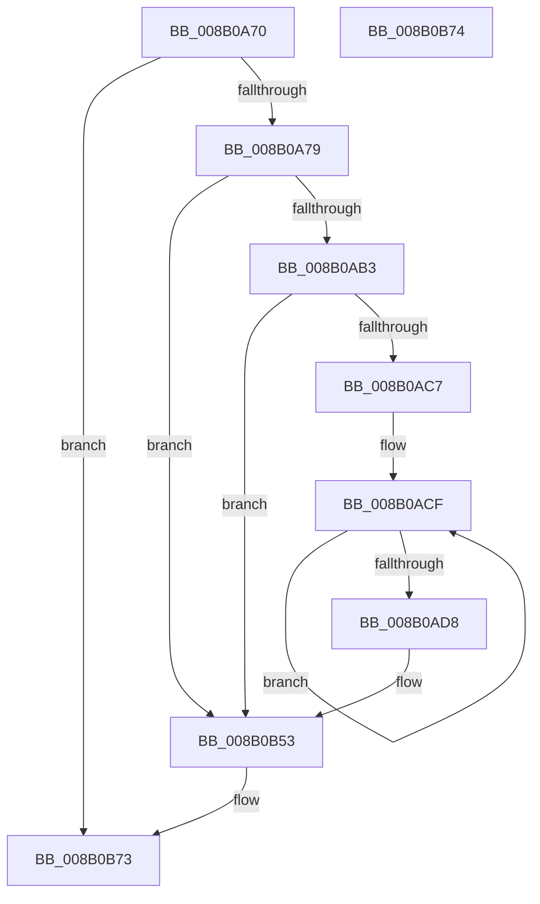

# PfSnLogEndTrace

- RVA: `0x008B0A70`–`0x008B0B75` (길이 `261` bytes)
- VA: `0x00000001408B0A70`
- 실행 섹션: `PAGE`
- PDB 이름 있음: `예`; PDB Function 태그: `아니요`
- unwind 정보 RVA: `0x0007FB70`
- 디코드: `59`개 명령, `261/261` bytes 표시
- 미해석 바이트: `0` (있으면 어셈블리에 `.byte`로 보존)

> 이 문서는 커널 이미지의 기계어와 PDB 기호를 분석해 생성했습니다. 4번과 5번은 함수 원형과 자료형을 바이너리 사용 방식에서 추정한 C 해석이며 원본 소스 복구 결과는 아닙니다.

## 1. Dependencies

- 직접 호출 지점: **3**; 고유 호출 대상: **3**
- 직접 호출자로 확인된 함수: **1**
- RIP 상대 이미지 참조: **3**

### Outgoing calls
- `0x008B0ABA` → [EtwEventEnabled](../../text/39/EtwEventEnabled_function_00392450.md) (function, `0x00392450`)
- `0x008B0B4E` → [EtwWrite](../../text/41/EtwWrite_function_0041C720.md) (function, `0x0041C720`)
- `0x008B0B5A` → [_security_check_cookie](../../text/6A/_security_check_cookie_function_006AC640.md) (function, `0x006AC640`)

### Direct callers
- [PfSnEndTrace](PfSnEndTrace_function_008B04A8.md) at `0x008B0546`

### Static image references
- `0x008B0A90` → RVA `0x00E0A740` (`.data`; read)
- `0x008B0AA3` → RVA `0x00E67358` (`.data`; read)
- `0x008B0AB3` → RVA `0x000111A0` (`.rdata`; read)

## 2. Other-region calls and transfers

- 다른 실행 섹션으로 향하는 call: **3**
  - `0x008B0ABA` → [EtwEventEnabled](../../text/39/EtwEventEnabled_function_00392450.md) (`PAGE` → `.text`)
  - `0x008B0B4E` → [EtwWrite](../../text/41/EtwWrite_function_0041C720.md) (`PAGE` → `.text`)
  - `0x008B0B5A` → [_security_check_cookie](../../text/6A/_security_check_cookie_function_006AC640.md) (`PAGE` → `.text`)
- 별도 외부 분기/꼬리 이동을 확인하지 못했습니다.

## 3. Assembly (complete function range)

```asm
008B0A70  48 85 C9                        test rcx, rcx
008B0A73  0F 84 FA 00 00 00               je 0x1408b0b73
008B0A79  48 89 5C 24 08                  mov qword ptr [rsp + 8], rbx
008B0A7E  48 89 7C 24 10                  mov qword ptr [rsp + 0x10], rdi
008B0A83  55                              push rbp
008B0A84  48 8D 6C 24 A9                  lea rbp, [rsp - 0x57]
008B0A89  48 81 EC A0 00 00 00            sub rsp, 0xa0
008B0A90  48 8B 05 A9 9C 55 00            mov rax, qword ptr [rip + 0x559ca9]
008B0A97  48 33 C4                        xor rax, rsp
008B0A9A  48 89 45 47                     mov qword ptr [rbp + 0x47], rax
008B0A9E  48 8B D9                        mov rbx, rcx
008B0AA1  33 FF                           xor edi, edi
008B0AA3  48 8B 0D AE 68 5B 00            mov rcx, qword ptr [rip + 0x5b68ae]
008B0AAA  48 85 C9                        test rcx, rcx
008B0AAD  0F 84 A0 00 00 00               je 0x1408b0b53
008B0AB3  48 8D 15 E6 06 76 FF            lea rdx, [rip - 0x89f91a]
008B0ABA  E8 91 19 AE FF                  call 0x140392450
008B0ABF  84 C0                           test al, al
008B0AC1  0F 84 8C 00 00 00               je 0x1408b0b53
008B0AC7  48 8D 4B 18                     lea rcx, [rbx + 0x18]
008B0ACB  48 83 C8 FF                     or rax, 0xffffffffffffffff
008B0ACF  48 FF C0                        inc rax
008B0AD2  66 39 3C 41                     cmp word ptr [rcx + rax*2], di
008B0AD6  75 F7                           jne 0x1408b0acf
008B0AD8  66 89 45 E7                     mov word ptr [rbp - 0x19], ax
008B0ADC  48 8D 55 E7                     lea rdx, [rbp - 0x19]
008B0AE0  0F B7 C0                        movzx eax, ax
008B0AE3  41 B9 05 00 00 00               mov r9d, 5
008B0AE9  03 C0                           add eax, eax
008B0AEB  48 89 55 F7                     mov qword ptr [rbp - 9], rdx
008B0AEF  89 45 0F                        mov dword ptr [rbp + 0xf], eax
008B0AF2  48 8D 15 A7 06 76 FF            lea rdx, [rip - 0x89f959]
008B0AF9  48 8D 41 3C                     lea rax, [rcx + 0x3c]
008B0AFD  48 89 4D 07                     mov qword ptr [rbp + 7], rcx
008B0B01  48 8B 0D 50 68 5B 00            mov rcx, qword ptr [rip + 0x5b6850]
008B0B08  45 33 C0                        xor r8d, r8d
008B0B0B  48 89 45 17                     mov qword ptr [rbp + 0x17], rax
008B0B0F  48 8D 43 58                     lea rax, [rbx + 0x58]
008B0B13  48 89 45 27                     mov qword ptr [rbp + 0x27], rax
008B0B17  48 8D 83 90 01 00 00            lea rax, [rbx + 0x190]
008B0B1E  48 89 45 37                     mov qword ptr [rbp + 0x37], rax
008B0B22  48 8D 45 F7                     lea rax, [rbp - 9]
008B0B26  48 89 44 24 20                  mov qword ptr [rsp + 0x20], rax
008B0B2B  48 C7 45 FF 02 00 00 00         mov qword ptr [rbp - 1], 2
008B0B33  89 7D 13                        mov dword ptr [rbp + 0x13], edi
008B0B36  48 C7 45 1F 04 00 00 00         mov qword ptr [rbp + 0x1f], 4
008B0B3E  48 C7 45 2F 04 00 00 00         mov qword ptr [rbp + 0x2f], 4
008B0B46  48 C7 45 3F 04 00 00 00         mov qword ptr [rbp + 0x3f], 4
008B0B4E  E8 CD BB B6 FF                  call 0x14041c720
008B0B53  48 8B 4D 47                     mov rcx, qword ptr [rbp + 0x47]
008B0B57  48 33 CC                        xor rcx, rsp
008B0B5A  E8 E1 BA DF FF                  call 0x1406ac640
008B0B5F  4C 8D 9C 24 A0 00 00 00         lea r11, [rsp + 0xa0]
008B0B67  49 8B 5B 10                     mov rbx, qword ptr [r11 + 0x10]
008B0B6B  49 8B 7B 18                     mov rdi, qword ptr [r11 + 0x18]
008B0B6F  49 8B E3                        mov rsp, r11
008B0B72  5D                              pop rbp
008B0B73  C3                              ret
008B0B74  CC                              int3
```

## 4. C-style interpretation (structured pseudocode)

```c
__int64 __fastcall PfSnLogEndTrace(__int64 a1, __int64 a2, int a3)
{
    __int64 result;
    __int64 v_rdi;
    __int64 v_rsp;
    unsigned __int64 v_stack_m18;
    unsigned __int64 v_stack_m20;
    unsigned __int64 v_stack_m28;
    unsigned __int64 v_stack_m30;
    unsigned __int64 v_stack_m38;
    unsigned __int64 v_stack_m40;
    unsigned __int64 v_stack_m48;
    unsigned int v_stack_m4C;
    unsigned int v_stack_m50;
    unsigned __int64 v_stack_m58;
    unsigned __int64 v_stack_m5F;
    unsigned __int64 v_stack_m60;
    unsigned __int64 v_stack_m68;
    unsigned __int16 v_stack_m78;
    unsigned __int64 v_stack_m8;
    unsigned __int64 v_stack_m88;
    unsigned __int64 v_stack_p10;
    unsigned __int64 v_stack_p8;

    if (a1 == 0) goto loc_008B0B73;
    v_stack_p8 = v_rbx;
    v_stack_p10 = v_rdi;
    v_rsp = (v_rsp) - (160);
    result = (*(unsigned __int64 *)(v_rip + 5610665)) ^ (v_rsp);
    v_stack_m18 = result;
    v_rdi = 0;
    if (*(unsigned __int64 *)(v_rip + 5990574) == 0) goto loc_008B0B53;
    result = EtwEventEnabled(*(unsigned __int64 *)(v_rip + 5990574), v_rip - 9042202, a3, a4);
    if ((unsigned __int8)(result) == 0) goto loc_008B0B53;
    result = (result) | (-1);
loc_008B0ACF:
    result = (result) + 1;
    if ((*(unsigned __int16 *)(a1 + 24 + result * 2)) != 0) goto loc_008B0ACF;
    v_stack_m78 = (unsigned __int16)(result);
    result = (unsigned int)(((unsigned __int16)(result)) + ((unsigned int)((unsigned __int16)(result))));
    v_stack_m68 = v_stack_m78;
    v_stack_m50 = (unsigned int)(result);
    v_stack_m58 = a1 + 24;
    a3 = 0;
    v_stack_m48 = a1 + 24 + 60;
    v_stack_m38 = a1 + 88;
    v_stack_m28 = a1 + 400;
    v_stack_m88 = v_stack_m68;
    v_stack_m60 = 2;
    v_stack_m4C = 0;
    v_stack_m40 = 4;
    v_stack_m30 = 4;
    v_stack_m20 = 4;
    result = EtwWrite(*(unsigned __int64 *)(v_rip + 5990480), v_rip - 9042265, a3, 5);
loc_008B0B53:
    a1 = (v_stack_m18) ^ (v_rsp);
    result = _security_check_cookie(a1, v_rip - 9042265, a3, 5);
loc_008B0B73:
    return result;
}
```

## 5. (Beta) C Style

```c
int64_t PfSnLogEndTrace(int64_t Arg1, int64_t Arg2, int32_t Arg3)
{
    int64_t result;
    int64_t local_rdi;
    int64_t local_rsp;
    uint64_t v_stack_m18;
    uint64_t v_stack_m20;
    uint64_t v_stack_m28;
    uint64_t v_stack_m30;
    uint64_t v_stack_m38;
    uint64_t v_stack_m40;
    uint64_t v_stack_m48;
    uint32_t v_stack_m4C;
    uint32_t v_stack_m50;
    uint64_t v_stack_m58;
    uint64_t v_stack_m5F;
    uint64_t v_stack_m60;
    uint64_t v_stack_m68;
    uint16_t v_stack_m78;
    uint64_t v_stack_m8;
    uint64_t v_stack_m88;
    uint64_t v_stack_p10;
    uint64_t v_stack_p8;

    if (Arg1 == 0) goto loc_008B0B73;
    v_stack_p8 = local_rbx;
    v_stack_p10 = local_rdi;
    local_rsp = (local_rsp) - (160);
    result = (*(uint64_t *)(v_rip + 0x559CA9)) ^ (local_rsp);
    v_stack_m18 = result;
    local_rdi = 0;
    if (*(uint64_t *)(v_rip + 0x5B68AE) == 0) goto loc_008B0B53;
    result = EtwEventEnabled(*(uint64_t *)(v_rip + 0x5B68AE), v_rip - 9042202, Arg3, a4);
    if ((uint8_t)(result) == 0) goto loc_008B0B53;
    result = (result) | (-1);
loc_008B0ACF:
    result = (result) + 1;
    if ((*(uint16_t *)(Arg1 + 0x18 + result * 2)) != 0) goto loc_008B0ACF;
    v_stack_m78 = (uint16_t)(result);
    result = (uint32_t)(((uint16_t)(result)) + ((uint32_t)((uint16_t)(result))));
    v_stack_m68 = v_stack_m78;
    v_stack_m50 = (uint32_t)(result);
    v_stack_m58 = Arg1 + 24;
    Arg3 = 0;
    v_stack_m48 = Arg1 + 24 + 60;
    v_stack_m38 = Arg1 + 88;
    v_stack_m28 = Arg1 + 400;
    v_stack_m88 = v_stack_m68;
    v_stack_m60 = 2;
    v_stack_m4C = 0;
    v_stack_m40 = 4;
    v_stack_m30 = 4;
    v_stack_m20 = 4;
    result = EtwWrite(*(uint64_t *)(v_rip + 0x5B6850), v_rip - 9042265, Arg3, 5);
loc_008B0B53:
    Arg1 = (v_stack_m18) ^ (local_rsp);
    result = _security_check_cookie(Arg1, v_rip - 9042265, Arg3, 5);
loc_008B0B73:
    return result;
}
```

## 6. Execution-region graph

[열기: 2D/3D 그래프와 함수 탐색 컨트롤 패널](../../../control-panel.html?section=page&rva=0x008B0A70&view=graph)

- 2D 그래프는 위에서 아래로 흐르고, 3D 그래프는 빈 공간을 드래그해 회전합니다. Shift+드래그는 이동, 휠은 확대·축소, 함수 노드 선택은 대상 보고서 이동입니다.

### Static fallback


