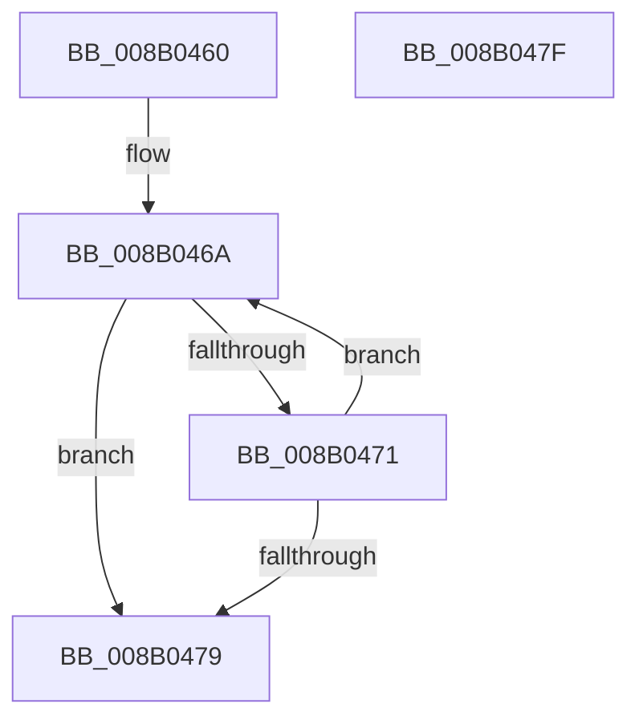

# PfVerifyScenarioId

- RVA: `0x008B0460`–`0x008B0480` (길이 `32` bytes)
- VA: `0x00000001408B0460`
- 실행 섹션: `PAGE`
- PDB 이름 있음: `예`; PDB Function 태그: `아니요`
- unwind 정보 RVA: `0x000DB714`
- 디코드: `12`개 명령, `32/32` bytes 표시
- 미해석 바이트: `0` (있으면 어셈블리에 `.byte`로 보존)

> 이 문서는 커널 이미지의 기계어와 PDB 기호를 분석해 생성했습니다. 4번과 5번은 함수 원형과 자료형을 바이너리 사용 방식에서 추정한 C 해석이며 원본 소스 복구 결과는 아닙니다.

## 1. Dependencies

- 직접 호출 지점: **0**; 고유 호출 대상: **0**
- 직접 호출자로 확인된 함수: **2**
- RIP 상대 이미지 참조: **0**

### Outgoing calls
- 직접 디코드된 call 명령이 없습니다.

### Direct callers
- [PfVerifyScenarioBuffer](../8A/PfVerifyScenarioBuffer_function_008AF9A0.md) at `0x008AFA9D`
- [PfVerifyTraceBuffer](PfVerifyTraceBuffer_function_008B0CDC.md) at `0x008B0D6F`

### Static image references
- 디코드된 RIP-relative 메모리 참조가 없습니다.

## 2. Other-region calls and transfers

- 다른 실행 섹션으로 향하는 call: **0**
- 별도 외부 분기/꼬리 이동을 확인하지 못했습니다.

## 3. Assembly (complete function range)

```asm
008B0460  B8 1D 00 00 00                  mov eax, 0x1d
008B0465  45 33 C0                        xor r8d, r8d
008B0468  8B D0                           mov edx, eax
008B046A  66 44 39 04 51                  cmp word ptr [rcx + rdx*2], r8w
008B046F  74 08                           je 0x1408b0479
008B0471  FF C8                           dec eax
008B0473  48 83 EA 01                     sub rdx, 1
008B0477  79 F1                           jns 0x1408b046a
008B0479  85 C0                           test eax, eax
008B047B  0F 9F C0                        setg al
008B047E  C3                              ret
008B047F  CC                              int3
```

## 4. C-style interpretation (structured pseudocode)

```c
__int64 __fastcall PfVerifyScenarioId(__int64 a1, __int64 a2, int a3)
{
    __int64 result;

    a3 = 0;
loc_008B046A:
    if ((*(unsigned __int16 *)(a1 + 29 * 2)) == 0) goto loc_008B0479;
    result = (unsigned int)((29) - 1);
    a2 = (29) - (1);
    if (!sign_flag) goto loc_008B046A;
loc_008B0479:
    result = (condition_is_greater) ? 1 : 0;
    return result;
}
```

## 5. (Beta) C Style

```c
int64_t PfVerifyScenarioId(void *Arg1, int64_t Arg2, int32_t Arg3)
{
    uint8_t *arg1 = (uint8_t *)Arg1;

    int64_t result;

    Arg3 = 0;
loc_008B046A:
    if ((*(uint16_t *)(arg1 + 0x1D * 2)) == 0) goto loc_008B0479;
    result = (uint32_t)((29) - 1);
    Arg2 = (29) - (1);
    if (!sign_flag) goto loc_008B046A;
loc_008B0479:
    result = (condition_is_greater) ? 1 : 0;
    return result;
}
```

### 관측된 메모리 오프셋

구조체 형식이 확인되지 않은 접근은 인자 기준의 오프셋으로만 기록했습니다.

| 기준 인자 | 오프셋 표현 | 폭 (bit) | 접근 |
|---|---:|---:|---|
| `Arg1` | `+ 0x0 + rdx*2` | `16` | `R` |

## 6. Execution-region graph

[열기: 2D/3D 그래프와 함수 탐색 컨트롤 패널](../../../control-panel.html?section=page&rva=0x008B0460&view=graph)

- 2D 그래프는 위에서 아래로 흐르고, 3D 그래프는 빈 공간을 드래그해 회전합니다. Shift+드래그는 이동, 휠은 확대·축소, 함수 노드 선택은 대상 보고서 이동입니다.

### Static fallback


