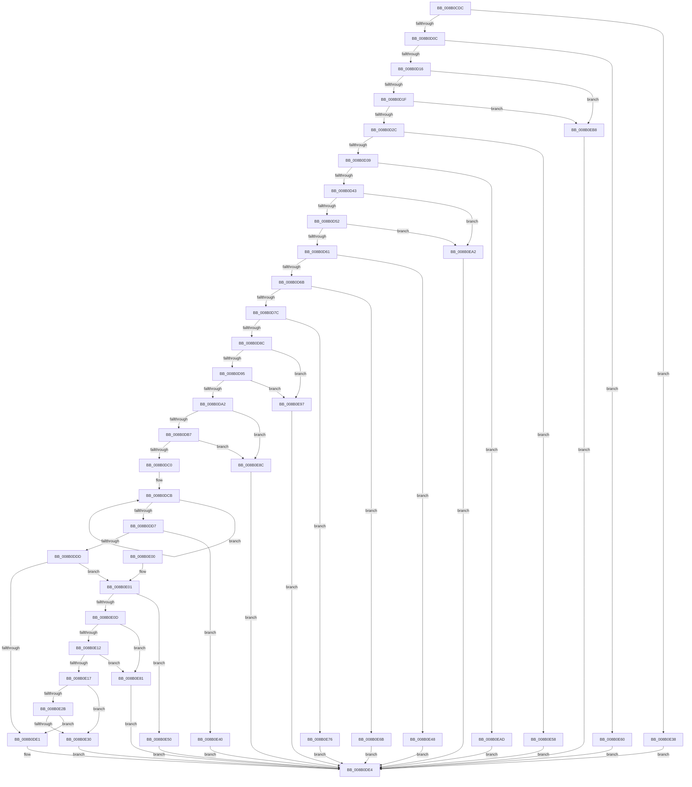

# PfVerifyTraceBuffer

- RVA: `0x008B0CDC`–`0x008B0EC3` (길이 `487` bytes)
- VA: `0x00000001408B0CDC`
- 실행 섹션: `PAGE`
- PDB 이름 있음: `예`; PDB Function 태그: `아니요`
- unwind 정보 RVA: `0x0007FBA8`
- 디코드: `117`개 명령, `487/487` bytes 표시
- 미해석 바이트: `0` (있으면 어셈블리에 `.byte`로 보존)

> 이 문서는 커널 이미지의 기계어와 PDB 기호를 분석해 생성했습니다. 4번과 5번은 함수 원형과 자료형을 바이너리 사용 방식에서 추정한 C 해석이며 원본 소스 복구 결과는 아닙니다.

## 1. Dependencies

- 직접 호출 지점: **1**; 고유 호출 대상: **1**
- 직접 호출자로 확인된 함수: **1**
- RIP 상대 이미지 참조: **0**

### Outgoing calls
- `0x008B0D6F` → [PfVerifyScenarioId](PfVerifyScenarioId_function_008B0460.md) (function, `0x008B0460`)

### Direct callers
- [PfSnBuildDumpFromTrace](PfSnBuildDumpFromTrace_function_008B0820.md) at `0x008B0A17`

### Static image references
- 디코드된 RIP-relative 메모리 참조가 없습니다.

## 2. Other-region calls and transfers

- 다른 실행 섹션으로 향하는 call: **0**
- 별도 외부 분기/꼬리 이동을 확인하지 못했습니다.

## 3. Assembly (complete function range)

```asm
008B0CDC  48 89 5C 24 08                  mov qword ptr [rsp + 8], rbx
008B0CE1  48 89 74 24 10                  mov qword ptr [rsp + 0x10], rsi
008B0CE6  48 89 7C 24 18                  mov qword ptr [rsp + 0x18], rdi
008B0CEB  41 56                           push r14
008B0CED  48 83 EC 20                     sub rsp, 0x20
008B0CF1  45 33 C9                        xor r9d, r9d
008B0CF4  44 8B DA                        mov r11d, edx
008B0CF7  4D 8B F0                        mov r14, r8
008B0CFA  4C 8B D1                        mov r10, rcx
008B0CFD  41 8A F1                        mov sil, r9b
008B0D00  81 FA D0 00 00 00               cmp edx, 0xd0
008B0D06  0F 82 2C 01 00 00               jb 0x1408b0e38
008B0D0C  41 F6 C2 07                     test r10b, 7
008B0D10  0F 85 4A 01 00 00               jne 0x1408b0e60
008B0D16  83 39 1F                        cmp dword ptr [rcx], 0x1f
008B0D19  0F 85 99 01 00 00               jne 0x1408b0eb8
008B0D1F  81 79 04 41 53 43 43            cmp dword ptr [rcx + 4], 0x43435341
008B0D26  0F 85 8C 01 00 00               jne 0x1408b0eb8
008B0D2C  41 81 FB 00 00 00 10            cmp r11d, 0x10000000
008B0D33  0F 87 1F 01 00 00               ja 0x1408b0e58
008B0D39  83 79 4C 01                     cmp dword ptr [rcx + 0x4c], 1
008B0D3D  0F 87 6A 01 00 00               ja 0x1408b0ead
008B0D43  8B 79 64                        mov edi, dword ptr [rcx + 0x64]
008B0D46  81 FF 00 40 08 00               cmp edi, 0x84000
008B0D4C  0F 87 50 01 00 00               ja 0x1408b0ea2
008B0D52  8B 59 54                        mov ebx, dword ptr [rcx + 0x54]
008B0D55  81 FB 00 00 10 00               cmp ebx, 0x100000
008B0D5B  0F 87 41 01 00 00               ja 0x1408b0ea2
008B0D61  44 39 59 08                     cmp dword ptr [rcx + 8], r11d
008B0D65  0F 85 DD 00 00 00               jne 0x1408b0e48
008B0D6B  48 83 C1 0C                     add rcx, 0xc
008B0D6F  E8 EC F6 FF FF                  call 0x1408b0460
008B0D74  84 C0                           test al, al
008B0D76  0F 84 EF 00 00 00               je 0x1408b0e6b
008B0D7C  41 8B 4A 50                     mov ecx, dword ptr [r10 + 0x50]
008B0D80  49 03 CA                        add rcx, r10
008B0D83  F6 C1 07                        test cl, 7
008B0D86  0F 85 EA 00 00 00               jne 0x1408b0e76
008B0D8C  49 3B CA                        cmp rcx, r10
008B0D8F  0F 82 02 01 00 00               jb 0x1408b0e97
008B0D95  4F 8D 04 1A                     lea r8, [r10 + r11]
008B0D99  49 3B C8                        cmp rcx, r8
008B0D9C  0F 83 F5 00 00 00               jae 0x1408b0e97
008B0DA2  8B D3                           mov edx, ebx
008B0DA4  48 C1 E2 04                     shl rdx, 4
008B0DA8  48 FF CA                        dec rdx
008B0DAB  48 03 D1                        add rdx, rcx
008B0DAE  49 3B D2                        cmp rdx, r10
008B0DB1  0F 82 D5 00 00 00               jb 0x1408b0e8c
008B0DB7  49 3B D0                        cmp rdx, r8
008B0DBA  0F 83 CC 00 00 00               jae 0x1408b0e8c
008B0DC0  41 8B C9                        mov ecx, r9d
008B0DC3  49 8D 52 70                     lea rdx, [r10 + 0x70]
008B0DC7  41 8D 41 0A                     lea eax, [r9 + 0xa]
008B0DCB  03 0A                           add ecx, dword ptr [rdx]
008B0DCD  48 8D 52 04                     lea rdx, [rdx + 4]
008B0DD1  48 83 E8 01                     sub rax, 1
008B0DD5  75 F4                           jne 0x1408b0dcb
008B0DD7  41 3B 4A 58                     cmp ecx, dword ptr [r10 + 0x58]
008B0DDB  72 63                           jb 0x1408b0e40
008B0DDD  85 FF                           test edi, edi
008B0DDF  75 20                           jne 0x1408b0e01
008B0DE1  40 B6 01                        mov sil, 1
008B0DE4  48 8B 5C 24 30                  mov rbx, qword ptr [rsp + 0x30]
008B0DE9  40 8A C6                        mov al, sil
008B0DEC  48 8B 74 24 38                  mov rsi, qword ptr [rsp + 0x38]
008B0DF1  48 8B 7C 24 40                  mov rdi, qword ptr [rsp + 0x40]
008B0DF6  45 89 0E                        mov dword ptr [r14], r9d
008B0DF9  48 83 C4 20                     add rsp, 0x20
008B0DFD  41 5E                           pop r14
008B0DFF  C3                              ret
008B0E00  CC                              int3
008B0E01  41 8B 52 60                     mov edx, dword ptr [r10 + 0x60]
008B0E05  49 03 D2                        add rdx, r10
008B0E08  F6 C2 07                        test dl, 7
008B0E0B  75 43                           jne 0x1408b0e50
008B0E0D  49 3B D2                        cmp rdx, r10
008B0E10  72 6F                           jb 0x1408b0e81
008B0E12  49 3B D0                        cmp rdx, r8
008B0E15  73 6A                           jae 0x1408b0e81
008B0E17  48 8D 0C 7F                     lea rcx, [rdi + rdi*2]
008B0E1B  48 8D 04 CD FF FF FF FF         lea rax, [rcx*8 - 1]
008B0E23  48 03 C2                        add rax, rdx
008B0E26  49 3B C2                        cmp rax, r10
008B0E29  72 05                           jb 0x1408b0e30
008B0E2B  49 3B C0                        cmp rax, r8
008B0E2E  72 B1                           jb 0x1408b0de1
008B0E30  41 B9 5A 00 00 00               mov r9d, 0x5a
008B0E36  EB AC                           jmp 0x1408b0de4
008B0E38  41 B9 0A 00 00 00               mov r9d, 0xa
008B0E3E  EB A4                           jmp 0x1408b0de4
008B0E40  41 B9 78 00 00 00               mov r9d, 0x78
008B0E46  EB 9C                           jmp 0x1408b0de4
008B0E48  41 B9 23 00 00 00               mov r9d, 0x23
008B0E4E  EB 94                           jmp 0x1408b0de4
008B0E50  41 B9 41 00 00 00               mov r9d, 0x41
008B0E56  EB 8C                           jmp 0x1408b0de4
008B0E58  41 B9 17 00 00 00               mov r9d, 0x17
008B0E5E  EB 84                           jmp 0x1408b0de4
008B0E60  41 B9 0F 00 00 00               mov r9d, 0xf
008B0E66  E9 79 FF FF FF                  jmp 0x1408b0de4
008B0E6B  41 B9 25 00 00 00               mov r9d, 0x25
008B0E71  E9 6E FF FF FF                  jmp 0x1408b0de4
008B0E76  41 B9 26 00 00 00               mov r9d, 0x26
008B0E7C  E9 63 FF FF FF                  jmp 0x1408b0de4
008B0E81  41 B9 50 00 00 00               mov r9d, 0x50
008B0E87  E9 58 FF FF FF                  jmp 0x1408b0de4
008B0E8C  41 B9 32 00 00 00               mov r9d, 0x32
008B0E92  E9 4D FF FF FF                  jmp 0x1408b0de4
008B0E97  41 B9 28 00 00 00               mov r9d, 0x28
008B0E9D  E9 42 FF FF FF                  jmp 0x1408b0de4
008B0EA2  41 B9 1E 00 00 00               mov r9d, 0x1e
008B0EA8  E9 37 FF FF FF                  jmp 0x1408b0de4
008B0EAD  41 B9 19 00 00 00               mov r9d, 0x19
008B0EB3  E9 2C FF FF FF                  jmp 0x1408b0de4
008B0EB8  41 B9 14 00 00 00               mov r9d, 0x14
008B0EBE  E9 21 FF FF FF                  jmp 0x1408b0de4
```

## 4. C-style interpretation (structured pseudocode)

```c
__int64 __fastcall PfVerifyTraceBuffer(__int64 a1, int a2, __int64 a3, int a4)
{
    __int64 result;
    __int64 v_rsp;
    unsigned __int64 v_stack_p10;
    unsigned __int64 v_stack_p18;
    unsigned __int64 v_stack_p8;

    v_stack_p8 = v_rbx;
    v_stack_p10 = v_rsi;
    v_stack_p18 = v_rdi;
    v_rsp = (v_rsp) - (32);
    a4 = 0;
    if (a2 < 208) goto loc_008B0E38;
    if ((((unsigned __int8)(a1)) & (7)) != 0) goto loc_008B0E60;
    if ((*(unsigned int *)(a1)) != 31) goto loc_008B0EB8;
    if ((*(unsigned int *)(a1 + 4)) != 0x43435341ULL) goto loc_008B0EB8;
    if (((unsigned int)((unsigned int)(a2))) > 0x10000000ULL) goto loc_008B0E58;
    if ((*(unsigned int *)(a1 + 76)) > 1) goto loc_008B0EAD;
    if (((unsigned int)((unsigned int)(*(unsigned int *)(a1 + 100)))) > 0x84000ULL) goto loc_008B0EA2;
    if (((unsigned int)((unsigned int)(*(unsigned int *)(a1 + 84)))) > 0x100000ULL) goto loc_008B0EA2;
    if ((*(unsigned int *)(a1 + 8)) != ((unsigned int)((unsigned int)(a2)))) goto loc_008B0E48;
    a1 = (a1) + (12);
    result = PfVerifyScenarioId(a1, a2, a3, a4);
    if ((unsigned __int8)(result) == 0) goto loc_008B0E6B;
    a1 = ((unsigned int)(*(unsigned int *)(a1 + 80))) + (a1);
    if ((((unsigned __int8)(a1)) & (7)) != 0) goto loc_008B0E76;
    if (a1 < a1) goto loc_008B0E97;
    if (a1 >= (a1 + (unsigned int)(a2) * 1)) goto loc_008B0E97;
    a2 = ((unsigned int)((unsigned int)((unsigned int)(*(unsigned int *)(a1 + 84))))) << (4);
    a2 = (a2) - 1;
    a2 = (a2) + (a1);
    if (a2 < a1) goto loc_008B0E8C;
    if (a2 >= (a1 + (unsigned int)(a2) * 1)) goto loc_008B0E8C;
loc_008B0DCB:
    a1 = (unsigned int)((0) + (*(unsigned int *)(a1 + 112)));
    result = (a4 + 10) - (1);
    if (condition_is_not_equal) goto loc_008B0DCB;
    if (((unsigned int)(a1)) < (*(unsigned int *)(a1 + 88))) goto loc_008B0E40;
    if ((unsigned int)((unsigned int)(*(unsigned int *)(a1 + 100))) != 0) goto loc_008B0E01;
loc_008B0DE1:
loc_008B0DE4:
    *(unsigned int *)(a3) = 0;
    v_rsp = (v_rsp) + (32);
    return 1;
loc_008B0E01:
    a2 = ((unsigned int)(*(unsigned int *)(a1 + 96))) + (a1);
    if ((((unsigned __int8)(a2)) & (7)) != 0) goto loc_008B0E50;
    if (a2 < a1) goto loc_008B0E81;
    if (a2 >= (a1 + (unsigned int)(a2) * 1)) goto loc_008B0E81;
    result = (v_stack_p18 + v_stack_p18 * 2 * 8 - 1) + (a2);
    if (result < a1) goto loc_008B0E30;
    if (result < (a1 + (unsigned int)(a2) * 1)) goto loc_008B0DE1;
loc_008B0E30:
    goto loc_008B0DE4;
loc_008B0E38:
    goto loc_008B0DE4;
loc_008B0E40:
    goto loc_008B0DE4;
loc_008B0E48:
    goto loc_008B0DE4;
loc_008B0E50:
    goto loc_008B0DE4;
loc_008B0E58:
    goto loc_008B0DE4;
loc_008B0E60:
    goto loc_008B0DE4;
loc_008B0E6B:
    goto loc_008B0DE4;
loc_008B0E76:
    goto loc_008B0DE4;
loc_008B0E81:
    goto loc_008B0DE4;
loc_008B0E8C:
    goto loc_008B0DE4;
loc_008B0E97:
    goto loc_008B0DE4;
loc_008B0EA2:
    goto loc_008B0DE4;
loc_008B0EAD:
    goto loc_008B0DE4;
loc_008B0EB8:
    goto loc_008B0DE4;
}
```

## 5. (Beta) C Style

```c
int64_t PfVerifyTraceBuffer(void *Arg1, int32_t Arg2, void *Arg3, int32_t Arg4)
{
    uint8_t *arg1 = (uint8_t *)Arg1;
    uint8_t *arg3 = (uint8_t *)Arg3;

    int64_t result;
    int64_t local_rsp;
    uint64_t v_stack_p10;
    uint64_t v_stack_p18;
    uint64_t v_stack_p8;

    v_stack_p8 = local_rbx;
    v_stack_p10 = local_rsi;
    v_stack_p18 = local_rdi;
    local_rsp = (local_rsp) - (32);
    Arg4 = 0;
    if (Arg2 < 208) goto loc_008B0E38;
    if ((((uint8_t)(Arg1)) & (7)) != 0) goto loc_008B0E60;
    if ((*(uint32_t *)(arg1)) != 31) goto loc_008B0EB8;
    if ((*(uint32_t *)(arg1 + 0x4)) != 0x43435341ULL) goto loc_008B0EB8;
    if (((uint32_t)((uint32_t)(Arg2))) > 0x10000000ULL) goto loc_008B0E58;
    if ((*(uint32_t *)(arg1 + 0x4C)) > 1) goto loc_008B0EAD;
    if (((uint32_t)((uint32_t)(*(uint32_t *)(arg1 + 0x64)))) > 0x84000ULL) goto loc_008B0EA2;
    if (((uint32_t)((uint32_t)(*(uint32_t *)(arg1 + 0x54)))) > 0x100000ULL) goto loc_008B0EA2;
    if ((*(uint32_t *)(arg1 + 0x8)) != ((uint32_t)((uint32_t)(Arg2)))) goto loc_008B0E48;
    Arg1 = (Arg1) + (12);
    result = PfVerifyScenarioId(Arg1, Arg2, Arg3, Arg4);
    if ((uint8_t)(result) == 0) goto loc_008B0E6B;
    Arg1 = ((uint32_t)(*(uint32_t *)(arg1 + 0x50))) + (Arg1);
    if ((((uint8_t)(Arg1)) & (7)) != 0) goto loc_008B0E76;
    if (Arg1 < Arg1) goto loc_008B0E97;
    if (Arg1 >= (Arg1 + (uint32_t)(Arg2) * 1)) goto loc_008B0E97;
    Arg2 = ((uint32_t)((uint32_t)((uint32_t)(*(uint32_t *)(arg1 + 0x54))))) << (4);
    Arg2 = (Arg2) - 1;
    Arg2 = (Arg2) + (Arg1);
    if (Arg2 < Arg1) goto loc_008B0E8C;
    if (Arg2 >= (Arg1 + (uint32_t)(Arg2) * 1)) goto loc_008B0E8C;
loc_008B0DCB:
    Arg1 = (uint32_t)((0) + (*(uint32_t *)(arg1 + 0x70)));
    result = (Arg4 + 10) - (1);
    if (condition_is_not_equal) goto loc_008B0DCB;
    if (((uint32_t)(Arg1)) < (*(uint32_t *)(arg1 + 0x58))) goto loc_008B0E40;
    if ((uint32_t)((uint32_t)(*(uint32_t *)(arg1 + 0x64))) != 0) goto loc_008B0E01;
loc_008B0DE1:
loc_008B0DE4:
    *(uint32_t *)(arg3) = 0;
    local_rsp = (local_rsp) + (32);
    return 1;
loc_008B0E01:
    Arg2 = ((uint32_t)(*(uint32_t *)(arg1 + 0x60))) + (Arg1);
    if ((((uint8_t)(Arg2)) & (7)) != 0) goto loc_008B0E50;
    if (Arg2 < Arg1) goto loc_008B0E81;
    if (Arg2 >= (Arg1 + (uint32_t)(Arg2) * 1)) goto loc_008B0E81;
    result = (v_stack_p18 + v_stack_p18 * 2 * 8 - 1) + (Arg2);
    if (result < Arg1) goto loc_008B0E30;
    if (result < (Arg1 + (uint32_t)(Arg2) * 1)) goto loc_008B0DE1;
loc_008B0E30:
    goto loc_008B0DE4;
loc_008B0E38:
    goto loc_008B0DE4;
loc_008B0E40:
    goto loc_008B0DE4;
loc_008B0E48:
    goto loc_008B0DE4;
loc_008B0E50:
    goto loc_008B0DE4;
loc_008B0E58:
    goto loc_008B0DE4;
loc_008B0E60:
    goto loc_008B0DE4;
loc_008B0E6B:
    goto loc_008B0DE4;
loc_008B0E76:
    goto loc_008B0DE4;
loc_008B0E81:
    goto loc_008B0DE4;
loc_008B0E8C:
    goto loc_008B0DE4;
loc_008B0E97:
    goto loc_008B0DE4;
loc_008B0EA2:
    goto loc_008B0DE4;
loc_008B0EAD:
    goto loc_008B0DE4;
loc_008B0EB8:
    goto loc_008B0DE4;
}
```

### 관측된 메모리 오프셋

구조체 형식이 확인되지 않은 접근은 인자 기준의 오프셋으로만 기록했습니다.

| 기준 인자 | 오프셋 표현 | 폭 (bit) | 접근 |
|---|---:|---:|---|
| `Arg1` | `+ 0x0` | `32` | `R` |
| `Arg1` | `+ 0x4` | `32` | `R` |
| `Arg1` | `+ 0x8` | `32` | `R` |
| `Arg1` | `+ 0x4C` | `32` | `R` |
| `Arg1` | `+ 0x54` | `32` | `R` |
| `Arg1` | `+ 0x64` | `32` | `R` |
| `Arg3` | `+ 0x0` | `32` | `W` |

## 6. Execution-region graph

[열기: 2D/3D 그래프와 함수 탐색 컨트롤 패널](../../../control-panel.html?section=page&rva=0x008B0CDC&view=graph)

- 2D 그래프는 위에서 아래로 흐르고, 3D 그래프는 빈 공간을 드래그해 회전합니다. Shift+드래그는 이동, 휠은 확대·축소, 함수 노드 선택은 대상 보고서 이동입니다.

### Static fallback


