# PsReturnSharedPoolQuota

- RVA: `0x008BCC30`–`0x008BCE58` (길이 `552` bytes)
- VA: `0x00000001408BCC30`
- 실행 섹션: `PAGE`
- PDB 이름 있음: `예`; PDB Function 태그: `아니요`
- unwind 정보 RVA: `0x00083008`
- 디코드: `150`개 명령, `552/552` bytes 표시
- 미해석 바이트: `0` (있으면 어셈블리에 `.byte`로 보존)

> 이 문서는 커널 이미지의 기계어와 PDB 기호를 분석해 생성했습니다. 4번과 5번은 함수 원형과 자료형을 바이너리 사용 방식에서 추정한 C 해석이며 원본 소스 복구 결과는 아닙니다.

## 1. Dependencies

- 직접 호출 지점: **8**; 고유 호출 대상: **4**
- 직접 호출자로 확인된 함수: **9**
- RIP 상대 이미지 참조: **4**

### Outgoing calls
- `0x008BCC54` → [PspReturnQuota](../../text/39/PspReturnQuota_function_00390C40.md) (function, `0x00390C40`)
- `0x008BCC69` → [PspReturnQuota](../../text/39/PspReturnQuota_function_00390C40.md) (function, `0x00390C40`)
- `0x008BCD86` → [PspRemoveQuotaBlock](../9D/PspRemoveQuotaBlock_function_009DAA00.md) (function, `0x009DAA00`)
- `0x008BCD90` → [ExFreePoolWithTag](../../poolcode/B8/ExFreePoolWithTag_function_00B82870.md) (function, `0x00B82870`)
- `0x008BCDBE` → [PspReturnResourceQuota](../../text/38/PspReturnResourceQuota_function_0038FFC4.md) (function, `0x0038FFC4`)
- `0x008BCDEF` → [PspReturnResourceQuota](../../text/38/PspReturnResourceQuota_function_0038FFC4.md) (function, `0x0038FFC4`)
- `0x008BCE20` → [PspReturnResourceQuota](../../text/38/PspReturnResourceQuota_function_0038FFC4.md) (function, `0x0038FFC4`)
- `0x008BCE4E` → [PspReturnResourceQuota](../../text/38/PspReturnResourceQuota_function_0038FFC4.md) (function, `0x0038FFC4`)

### Direct callers
- [PspJobDelete](../../text/4B/PspJobDelete_function_004BF8F0.md) at `0x004BFACD`
- [PspJobDelete](../../text/4B/PspJobDelete_function_004BF8F0.md) at `0x004BFB30`
- [ObpIncrementHandleCountEx](../86/ObpIncrementHandleCountEx_function_0086DA10.md) at `0x0086DDF4`
- [sub_0088B6F6](../88/Unknown_function_0088B6F6.md) at `0x0088B703`
- [sub_008BA74A](Unknown_function_008BA74A.md) at `0x008BA91F`
- [ObSetSecurityDescriptorInfo](ObSetSecurityDescriptorInfo_function_008BAE20.md) at `0x008BB1F0`
- [RtlpFreeAtom](RtlpFreeAtom_function_008BD87C.md) at `0x008BD890`
- [sub_0097525E](../97/Unknown_function_0097525E.md) at `0x00975366`
- [PspFreeRateControl](../99/PspFreeRateControl_function_0099E1BC.md) at `0x0099E1D5`
- [NtSetInformationJobObject](../9F/NtSetInformationJobObject_function_009F84C0.md) at `0x009F9A41`
- [NtSetInformationJobObject](../9F/NtSetInformationJobObject_function_009F84C0.md) at `0x009FA64B`

### Static image references
- `0x008BCC8C` → RVA `0x00FC7350` (`ALMOSTRO`; read)
- `0x008BCCC6` → RVA `0x00FC7358` (`ALMOSTRO`; read)
- `0x008BCD05` → RVA `0x00FC7360` (`ALMOSTRO`; read)
- `0x008BCD44` → RVA `0x00FC7368` (`ALMOSTRO`; read)

## 2. Other-region calls and transfers

- 다른 실행 섹션으로 향하는 call: **7**
  - `0x008BCC54` → [PspReturnQuota](../../text/39/PspReturnQuota_function_00390C40.md) (`PAGE` → `.text`)
  - `0x008BCC69` → [PspReturnQuota](../../text/39/PspReturnQuota_function_00390C40.md) (`PAGE` → `.text`)
  - `0x008BCD90` → [ExFreePoolWithTag](../../poolcode/B8/ExFreePoolWithTag_function_00B82870.md) (`PAGE` → `POOLCODE`)
  - `0x008BCDBE` → [PspReturnResourceQuota](../../text/38/PspReturnResourceQuota_function_0038FFC4.md) (`PAGE` → `.text`)
  - `0x008BCDEF` → [PspReturnResourceQuota](../../text/38/PspReturnResourceQuota_function_0038FFC4.md) (`PAGE` → `.text`)
  - `0x008BCE20` → [PspReturnResourceQuota](../../text/38/PspReturnResourceQuota_function_0038FFC4.md) (`PAGE` → `.text`)
  - `0x008BCE4E` → [PspReturnResourceQuota](../../text/38/PspReturnResourceQuota_function_0038FFC4.md) (`PAGE` → `.text`)
- 별도 외부 분기/꼬리 이동을 확인하지 못했습니다.

## 3. Assembly (complete function range)

```asm
008BCC30  48 83 F9 01                     cmp rcx, 1
008BCC34  74 54                           je 0x1408bcc8a
008BCC36  48 89 5C 24 08                  mov qword ptr [rsp + 8], rbx
008BCC3B  57                              push rdi
008BCC3C  48 83 EC 20                     sub rsp, 0x20
008BCC40  49 8B F8                        mov rdi, r8
008BCC43  48 8B D9                        mov rbx, rcx
008BCC46  48 85 D2                        test rdx, rdx
008BCC49  74 0E                           je 0x1408bcc59
008BCC4B  4C 8B CA                        mov r9, rdx
008BCC4E  33 D2                           xor edx, edx
008BCC50  44 8D 42 01                     lea r8d, [rdx + 1]
008BCC54  E8 E7 3F AD FF                  call 0x140390c40
008BCC59  48 85 FF                        test rdi, rdi
008BCC5C  74 10                           je 0x1408bcc6e
008BCC5E  4C 8B CF                        mov r9, rdi
008BCC61  45 33 C0                        xor r8d, r8d
008BCC64  33 D2                           xor edx, edx
008BCC66  48 8B CB                        mov rcx, rbx
008BCC69  E8 D2 3F AD FF                  call 0x140390c40
008BCC6E  B8 FF FF FF FF                  mov eax, 0xffffffff
008BCC73  F0 0F C1 83 00 02 00 00         lock xadd dword ptr [rbx + 0x200], eax
008BCC7B  83 F8 01                        cmp eax, 1
008BCC7E  74 0C                           je 0x1408bcc8c
008BCC80  48 8B 5C 24 30                  mov rbx, qword ptr [rsp + 0x30]
008BCC85  48 83 C4 20                     add rsp, 0x20
008BCC89  5F                              pop rdi
008BCC8A  C3                              ret
008BCC8B  CC                              int3
008BCC8C  0F B6 05 BD A6 70 00            movzx eax, byte ptr [rip + 0x70a6bd]
008BCC93  33 FF                           xor edi, edi
008BCC95  24 03                           and al, 3
008BCC97  3C 01                           cmp al, 1
008BCC99  75 2B                           jne 0x1408bccc6
008BCC9B  48 8B 53 50                     mov rdx, qword ptr [rbx + 0x50]
008BCC9F  44 8B CF                        mov r9d, edi
008BCCA2  4C 8B 43 40                     mov r8, qword ptr [rbx + 0x40]
008BCCA6  48 85 D2                        test rdx, rdx
008BCCA9  48 8B 4B 48                     mov rcx, qword ptr [rbx + 0x48]
008BCCAD  41 0F 95 C1                     setne r9b
008BCCB1  49 03 C8                        add rcx, r8
008BCCB4  0F 85 E0 00 00 00               jne 0x1408bcd9a
008BCCBA  44 8B C7                        mov r8d, edi
008BCCBD  48 85 D2                        test rdx, rdx
008BCCC0  0F 85 F3 00 00 00               jne 0x1408bcdb9
008BCCC6  0F B6 05 8B A6 70 00            movzx eax, byte ptr [rip + 0x70a68b]
008BCCCD  48 8D 93 80 00 00 00            lea rdx, [rbx + 0x80]
008BCCD4  24 03                           and al, 3
008BCCD6  3C 01                           cmp al, 1
008BCCD8  75 2B                           jne 0x1408bcd05
008BCCDA  4C 8B 4A 50                     mov r9, qword ptr [rdx + 0x50]
008BCCDE  44 8B D7                        mov r10d, edi
008BCCE1  4C 8B 42 40                     mov r8, qword ptr [rdx + 0x40]
008BCCE5  4D 85 C9                        test r9, r9
008BCCE8  48 8B 4A 48                     mov rcx, qword ptr [rdx + 0x48]
008BCCEC  41 0F 95 C2                     setne r10b
008BCCF0  49 03 C8                        add rcx, r8
008BCCF3  0F 85 CF 00 00 00               jne 0x1408bcdc8
008BCCF9  4C 8B C7                        mov r8, rdi
008BCCFC  4D 85 C9                        test r9, r9
008BCCFF  0F 85 E2 00 00 00               jne 0x1408bcde7
008BCD05  0F B6 05 54 A6 70 00            movzx eax, byte ptr [rip + 0x70a654]
008BCD0C  48 8D 93 00 01 00 00            lea rdx, [rbx + 0x100]
008BCD13  24 03                           and al, 3
008BCD15  3C 01                           cmp al, 1
008BCD17  75 2B                           jne 0x1408bcd44
008BCD19  4C 8B 4A 50                     mov r9, qword ptr [rdx + 0x50]
008BCD1D  44 8B D7                        mov r10d, edi
008BCD20  4C 8B 42 40                     mov r8, qword ptr [rdx + 0x40]
008BCD24  4D 85 C9                        test r9, r9
008BCD27  48 8B 4A 48                     mov rcx, qword ptr [rdx + 0x48]
008BCD2B  41 0F 95 C2                     setne r10b
008BCD2F  49 03 C8                        add rcx, r8
008BCD32  0F 85 C1 00 00 00               jne 0x1408bcdf9
008BCD38  4C 8B C7                        mov r8, rdi
008BCD3B  4D 85 C9                        test r9, r9
008BCD3E  0F 85 D4 00 00 00               jne 0x1408bce18
008BCD44  0F B6 05 1D A6 70 00            movzx eax, byte ptr [rip + 0x70a61d]
008BCD4B  48 8D 93 80 01 00 00            lea rdx, [rbx + 0x180]
008BCD52  24 03                           and al, 3
008BCD54  3C 01                           cmp al, 1
008BCD56  75 2B                           jne 0x1408bcd83
008BCD58  4C 8B 4A 50                     mov r9, qword ptr [rdx + 0x50]
008BCD5C  44 8B D7                        mov r10d, edi
008BCD5F  4C 8B 42 40                     mov r8, qword ptr [rdx + 0x40]
008BCD63  4D 85 C9                        test r9, r9
008BCD66  48 8B 4A 48                     mov rcx, qword ptr [rdx + 0x48]
008BCD6A  41 0F 95 C2                     setne r10b
008BCD6E  49 03 C8                        add rcx, r8
008BCD71  0F 85 B3 00 00 00               jne 0x1408bce2a
008BCD77  4C 8B C7                        mov r8, rdi
008BCD7A  4D 85 C9                        test r9, r9
008BCD7D  0F 85 C3 00 00 00               jne 0x1408bce46
008BCD83  48 8B CB                        mov rcx, rbx
008BCD86  E8 75 DC 11 00                  call 0x1409daa00
008BCD8B  33 D2                           xor edx, edx
008BCD8D  48 8B CB                        mov rcx, rbx
008BCD90  E8 DB 5A 2C 00                  call 0x140b82870
008BCD95  E9 E6 FE FF FF                  jmp 0x1408bcc80
008BCD9A  48 85 D2                        test rdx, rdx
008BCD9D  74 11                           je 0x1408bcdb0
008BCD9F  4C 8B C7                        mov r8, rdi
008BCDA2  48 8B C7                        mov rax, rdi
008BCDA5  4C 87 43 48                     xchg qword ptr [rbx + 0x48], r8
008BCDA9  48 87 43 40                     xchg qword ptr [rbx + 0x40], rax
008BCDAD  4C 03 C0                        add r8, rax
008BCDB0  4D 85 C0                        test r8, r8
008BCDB3  0F 84 04 FF FF FF               je 0x1408bccbd
008BCDB9  48 8B D3                        mov rdx, rbx
008BCDBC  33 C9                           xor ecx, ecx
008BCDBE  E8 01 32 AD FF                  call 0x14038ffc4
008BCDC3  E9 FE FE FF FF                  jmp 0x1408bccc6
008BCDC8  4D 85 C9                        test r9, r9
008BCDCB  74 11                           je 0x1408bcdde
008BCDCD  4C 8B C7                        mov r8, rdi
008BCDD0  48 8B C7                        mov rax, rdi
008BCDD3  4C 87 42 48                     xchg qword ptr [rdx + 0x48], r8
008BCDD7  48 87 42 40                     xchg qword ptr [rdx + 0x40], rax
008BCDDB  4C 03 C0                        add r8, rax
008BCDDE  4D 85 C0                        test r8, r8
008BCDE1  0F 84 15 FF FF FF               je 0x1408bccfc
008BCDE7  45 8B CA                        mov r9d, r10d
008BCDEA  B9 01 00 00 00                  mov ecx, 1
008BCDEF  E8 D0 31 AD FF                  call 0x14038ffc4
008BCDF4  E9 0C FF FF FF                  jmp 0x1408bcd05
008BCDF9  4D 85 C9                        test r9, r9
008BCDFC  74 11                           je 0x1408bce0f
008BCDFE  4C 8B C7                        mov r8, rdi
008BCE01  48 8B C7                        mov rax, rdi
008BCE04  4C 87 42 48                     xchg qword ptr [rdx + 0x48], r8
008BCE08  48 87 42 40                     xchg qword ptr [rdx + 0x40], rax
008BCE0C  4C 03 C0                        add r8, rax
008BCE0F  4D 85 C0                        test r8, r8
008BCE12  0F 84 23 FF FF FF               je 0x1408bcd3b
008BCE18  45 8B CA                        mov r9d, r10d
008BCE1B  B9 02 00 00 00                  mov ecx, 2
008BCE20  E8 9F 31 AD FF                  call 0x14038ffc4
008BCE25  E9 1A FF FF FF                  jmp 0x1408bcd44
008BCE2A  4D 85 C9                        test r9, r9
008BCE2D  74 0E                           je 0x1408bce3d
008BCE2F  4C 8B C7                        mov r8, rdi
008BCE32  4C 87 42 48                     xchg qword ptr [rdx + 0x48], r8
008BCE36  48 87 7A 40                     xchg qword ptr [rdx + 0x40], rdi
008BCE3A  4C 03 C7                        add r8, rdi
008BCE3D  4D 85 C0                        test r8, r8
008BCE40  0F 84 34 FF FF FF               je 0x1408bcd7a
008BCE46  45 8B CA                        mov r9d, r10d
008BCE49  B9 03 00 00 00                  mov ecx, 3
008BCE4E  E8 71 31 AD FF                  call 0x14038ffc4
008BCE53  E9 2B FF FF FF                  jmp 0x1408bcd83
```

## 4. C-style interpretation (structured pseudocode)

```c
__int64 __fastcall PsReturnSharedPoolQuota(__int64 a1, __int64 a2, __int64 a3)
{
    __int64 result;
    __int64 v_r10;
    __int64 v_rdi;
    __int64 v_rsp;
    unsigned __int64 v_stack_p8;

    if (a1 == 1) goto loc_008BCC8A;
    v_stack_p8 = v_rbx;
    v_rsp = (v_rsp) - (32);
    if (a2 != 0) {
        a4 = a2;
        a2 = 0;
        a3 = a2 + 1;
        result = PspReturnQuota(a1, a2, a3, a4);
    }
    if (a3 != 0) {
        a4 = a3;
        a3 = 0;
        a2 = 0;
        a1 = a1;
        result = PspReturnQuota(a1, a2, a3, a4);
    }
    if (((unsigned int)((unsigned int)(0xFFFFFFFFULL))) == 1) goto loc_008BCC8C;
loc_008BCC80:
    v_rsp = (v_rsp) + (32);
loc_008BCC8A:
    return (unsigned int)(0xFFFFFFFFULL);
loc_008BCC8C:
    v_rdi = 0;
    result = (unsigned __int8)((*(unsigned __int8 *)(v_rip + 7382717)) & (3));
    if (((unsigned __int8)(result)) != 1) goto loc_008BCCC6;
    a4 = (*(unsigned __int64 *)(v_stack_p8 + 80) != 0) ? 1 : 0;
    a1 = (*(unsigned __int64 *)(v_stack_p8 + 72)) + (*(unsigned __int64 *)(v_stack_p8 + 64));
    if (condition_is_not_equal) goto loc_008BCD9A;
loc_008BCCBD:
    if (*(unsigned __int64 *)(v_stack_p8 + 80) != 0) goto loc_008BCDB9;
loc_008BCCC6:
    result = (unsigned __int8)((*(unsigned __int8 *)(v_rip + 7382667)) & (3));
    if (((unsigned __int8)(result)) != 1) goto loc_008BCD05;
    v_r10 = (*(unsigned __int64 *)(v_stack_p8 + 128 + 80) != 0) ? 1 : 0;
    a1 = (*(unsigned __int64 *)(v_stack_p8 + 128 + 72)) + (*(unsigned __int64 *)(v_stack_p8 + 128 + 64));
    if (condition_is_not_equal) goto loc_008BCDC8;
loc_008BCCFC:
    if (*(unsigned __int64 *)(v_stack_p8 + 128 + 80) != 0) goto loc_008BCDE7;
loc_008BCD05:
    result = (unsigned __int8)((*(unsigned __int8 *)(v_rip + 7382612)) & (3));
    if (((unsigned __int8)(result)) != 1) goto loc_008BCD44;
    v_r10 = (*(unsigned __int64 *)(v_stack_p8 + 256 + 80) != 0) ? 1 : 0;
    a1 = (*(unsigned __int64 *)(v_stack_p8 + 256 + 72)) + (*(unsigned __int64 *)(v_stack_p8 + 256 + 64));
    if (condition_is_not_equal) goto loc_008BCDF9;
loc_008BCD3B:
    if (*(unsigned __int64 *)(v_stack_p8 + 256 + 80) != 0) goto loc_008BCE18;
loc_008BCD44:
    result = (unsigned __int8)((*(unsigned __int8 *)(v_rip + 7382557)) & (3));
    if (((unsigned __int8)(result)) != 1) goto loc_008BCD83;
    v_r10 = (*(unsigned __int64 *)(v_stack_p8 + 384 + 80) != 0) ? 1 : 0;
    a1 = (*(unsigned __int64 *)(v_stack_p8 + 384 + 72)) + (*(unsigned __int64 *)(v_stack_p8 + 384 + 64));
    if (condition_is_not_equal) goto loc_008BCE2A;
loc_008BCD7A:
    if (*(unsigned __int64 *)(v_stack_p8 + 384 + 80) != 0) goto loc_008BCE46;
loc_008BCD83:
    result = PspRemoveQuotaBlock(v_stack_p8, v_stack_p8 + 384, 0, *(unsigned __int64 *)(v_stack_p8 + 384 + 80));
    a2 = 0;
    result = ExFreePoolWithTag(v_stack_p8, a2, 0, *(unsigned __int64 *)(v_stack_p8 + 384 + 80));
    goto loc_008BCC80;
loc_008BCD9A:
    if (0 != 0) {
        a3 = 0;
        result = 0;
        a3 = (a3) + (result);
    }
    if (a3 == 0) goto loc_008BCCBD;
loc_008BCDB9:
    a1 = 0;
    result = PspReturnResourceQuota(a1, v_stack_p8, a3, *(unsigned __int64 *)(v_stack_p8 + 384 + 80));
    goto loc_008BCCC6;
loc_008BCDC8:
    if (*(unsigned __int64 *)(v_stack_p8 + 384 + 80) != 0) {
        a3 = 0;
        result = 0;
        a3 = (a3) + (result);
    }
    if (a3 == 0) goto loc_008BCCFC;
loc_008BCDE7:
    result = PspReturnResourceQuota(1, v_stack_p8, a3, (unsigned int)((unsigned int)(v_r10)));
    goto loc_008BCD05;
loc_008BCDF9:
    if ((unsigned int)((unsigned int)(v_r10)) != 0) {
        a3 = 0;
        result = 0;
        a3 = (a3) + (result);
    }
    if (a3 == 0) goto loc_008BCD3B;
loc_008BCE18:
    result = PspReturnResourceQuota(2, v_stack_p8, a3, (unsigned int)((unsigned int)(v_r10)));
    goto loc_008BCD44;
loc_008BCE2A:
    if ((unsigned int)((unsigned int)(v_r10)) != 0) {
        a3 = 0;
        a3 = (a3) + (0);
    }
    if (a3 == 0) goto loc_008BCD7A;
loc_008BCE46:
    result = PspReturnResourceQuota(3, v_stack_p8, a3, (unsigned int)((unsigned int)(v_r10)));
    goto loc_008BCD83;
}
```

## 5. (Beta) C Style

```c
int64_t PsReturnSharedPoolQuota(int64_t Arg1, int64_t Arg2, int64_t Arg3)
{
    int64_t result;
    int64_t local_r10;
    int64_t local_rdi;
    int64_t local_rsp;
    uint64_t v_stack_p8;

    if (Arg1 == 1) goto loc_008BCC8A;
    v_stack_p8 = local_rbx;
    local_rsp = (local_rsp) - (32);
    if (Arg2 != 0) {
        a4 = Arg2;
        Arg2 = 0;
        Arg3 = Arg2 + 1;
        result = PspReturnQuota(Arg1, Arg2, Arg3, a4);
    }
    if (Arg3 != 0) {
        a4 = Arg3;
        Arg3 = 0;
        Arg2 = 0;
        Arg1 = Arg1;
        result = PspReturnQuota(Arg1, Arg2, Arg3, a4);
    }
    if (((uint32_t)((uint32_t)(0xFFFFFFFFULL))) == 1) goto loc_008BCC8C;
loc_008BCC80:
    local_rsp = (local_rsp) + (32);
loc_008BCC8A:
    return (uint32_t)(0xFFFFFFFFULL);
loc_008BCC8C:
    local_rdi = 0;
    result = (uint8_t)((*(uint8_t *)(v_rip + 0x70A6BD)) & (3));
    if (((uint8_t)(result)) != 1) goto loc_008BCCC6;
    a4 = (*(uint64_t *)(v_stack_p8 + 0x50) != 0) ? 1 : 0;
    Arg1 = (*(uint64_t *)(v_stack_p8 + 0x48)) + (*(uint64_t *)(v_stack_p8 + 0x40));
    if (condition_is_not_equal) goto loc_008BCD9A;
loc_008BCCBD:
    if (*(uint64_t *)(v_stack_p8 + 0x50) != 0) goto loc_008BCDB9;
loc_008BCCC6:
    result = (uint8_t)((*(uint8_t *)(v_rip + 0x70A68B)) & (3));
    if (((uint8_t)(result)) != 1) goto loc_008BCD05;
    local_r10 = (*(uint64_t *)(v_stack_p8 + 0x80 + 0x50) != 0) ? 1 : 0;
    Arg1 = (*(uint64_t *)(v_stack_p8 + 0x80 + 0x48)) + (*(uint64_t *)(v_stack_p8 + 0x80 + 0x40));
    if (condition_is_not_equal) goto loc_008BCDC8;
loc_008BCCFC:
    if (*(uint64_t *)(v_stack_p8 + 0x80 + 0x50) != 0) goto loc_008BCDE7;
loc_008BCD05:
    result = (uint8_t)((*(uint8_t *)(v_rip + 0x70A654)) & (3));
    if (((uint8_t)(result)) != 1) goto loc_008BCD44;
    local_r10 = (*(uint64_t *)(v_stack_p8 + 0x100 + 0x50) != 0) ? 1 : 0;
    Arg1 = (*(uint64_t *)(v_stack_p8 + 0x100 + 0x48)) + (*(uint64_t *)(v_stack_p8 + 0x100 + 0x40));
    if (condition_is_not_equal) goto loc_008BCDF9;
loc_008BCD3B:
    if (*(uint64_t *)(v_stack_p8 + 0x100 + 0x50) != 0) goto loc_008BCE18;
loc_008BCD44:
    result = (uint8_t)((*(uint8_t *)(v_rip + 0x70A61D)) & (3));
    if (((uint8_t)(result)) != 1) goto loc_008BCD83;
    local_r10 = (*(uint64_t *)(v_stack_p8 + 0x180 + 0x50) != 0) ? 1 : 0;
    Arg1 = (*(uint64_t *)(v_stack_p8 + 0x180 + 0x48)) + (*(uint64_t *)(v_stack_p8 + 0x180 + 0x40));
    if (condition_is_not_equal) goto loc_008BCE2A;
loc_008BCD7A:
    if (*(uint64_t *)(v_stack_p8 + 0x180 + 0x50) != 0) goto loc_008BCE46;
loc_008BCD83:
    result = PspRemoveQuotaBlock(v_stack_p8, v_stack_p8 + 384, 0, *(uint64_t *)(v_stack_p8 + 0x180 + 0x50));
    Arg2 = 0;
    result = ExFreePoolWithTag(v_stack_p8, Arg2, 0, *(uint64_t *)(v_stack_p8 + 0x180 + 0x50));
    goto loc_008BCC80;
loc_008BCD9A:
    if (0 != 0) {
        Arg3 = 0;
        result = 0;
        Arg3 = (Arg3) + (result);
    }
    if (Arg3 == 0) goto loc_008BCCBD;
loc_008BCDB9:
    Arg1 = 0;
    result = PspReturnResourceQuota(Arg1, v_stack_p8, Arg3, *(uint64_t *)(v_stack_p8 + 0x180 + 0x50));
    goto loc_008BCCC6;
loc_008BCDC8:
    if (*(uint64_t *)(v_stack_p8 + 0x180 + 0x50) != 0) {
        Arg3 = 0;
        result = 0;
        Arg3 = (Arg3) + (result);
    }
    if (Arg3 == 0) goto loc_008BCCFC;
loc_008BCDE7:
    result = PspReturnResourceQuota(1, v_stack_p8, Arg3, (uint32_t)((uint32_t)(local_r10)));
    goto loc_008BCD05;
loc_008BCDF9:
    if ((uint32_t)((uint32_t)(local_r10)) != 0) {
        Arg3 = 0;
        result = 0;
        Arg3 = (Arg3) + (result);
    }
    if (Arg3 == 0) goto loc_008BCD3B;
loc_008BCE18:
    result = PspReturnResourceQuota(2, v_stack_p8, Arg3, (uint32_t)((uint32_t)(local_r10)));
    goto loc_008BCD44;
loc_008BCE2A:
    if ((uint32_t)((uint32_t)(local_r10)) != 0) {
        Arg3 = 0;
        Arg3 = (Arg3) + (0);
    }
    if (Arg3 == 0) goto loc_008BCD7A;
loc_008BCE46:
    result = PspReturnResourceQuota(3, v_stack_p8, Arg3, (uint32_t)((uint32_t)(local_r10)));
    goto loc_008BCD83;
}
```

## 6. Execution-region graph

[열기: 2D/3D 그래프와 함수 탐색 컨트롤 패널](../../../control-panel.html?section=page&rva=0x008BCC30&view=graph)

- 2D 그래프는 위에서 아래로 흐르고, 3D 그래프는 빈 공간을 드래그해 회전합니다. Shift+드래그는 이동, 휠은 확대·축소, 함수 노드 선택은 대상 보고서 이동입니다.

### Static fallback

```mermaid
flowchart TD
  bb_008BCC30[BB_008BCC30]
  bb_008BCC36[BB_008BCC36]
  bb_008BCC4B[BB_008BCC4B]
  bb_008BCC59[BB_008BCC59]
  bb_008BCC5E[BB_008BCC5E]
  bb_008BCC6E[BB_008BCC6E]
  bb_008BCC80[BB_008BCC80]
  bb_008BCC8A[BB_008BCC8A]
  bb_008BCC8B[BB_008BCC8B]
  bb_008BCC8C[BB_008BCC8C]
  bb_008BCC9B[BB_008BCC9B]
  bb_008BCCBA[BB_008BCCBA]
  bb_008BCCBD[BB_008BCCBD]
  bb_008BCCC6[BB_008BCCC6]
  bb_008BCCDA[BB_008BCCDA]
  bb_008BCCF9[BB_008BCCF9]
  bb_008BCCFC[BB_008BCCFC]
  bb_008BCD05[BB_008BCD05]
  bb_008BCD19[BB_008BCD19]
  bb_008BCD38[BB_008BCD38]
  bb_008BCD3B[BB_008BCD3B]
  bb_008BCD44[BB_008BCD44]
  bb_008BCD58[BB_008BCD58]
  bb_008BCD77[BB_008BCD77]
  bb_008BCD7A[BB_008BCD7A]
  bb_008BCD83[BB_008BCD83]
  bb_008BCD9A[BB_008BCD9A]
  bb_008BCD9F[BB_008BCD9F]
  bb_008BCDB0[BB_008BCDB0]
  bb_008BCDB9[BB_008BCDB9]
  bb_008BCDC8[BB_008BCDC8]
  bb_008BCDCD[BB_008BCDCD]
  bb_008BCDDE[BB_008BCDDE]
  bb_008BCDE7[BB_008BCDE7]
  bb_008BCDF9[BB_008BCDF9]
  bb_008BCDFE[BB_008BCDFE]
  bb_008BCE0F[BB_008BCE0F]
  bb_008BCE18[BB_008BCE18]
  bb_008BCE2A[BB_008BCE2A]
  bb_008BCE2F[BB_008BCE2F]
  bb_008BCE3D[BB_008BCE3D]
  bb_008BCE46[BB_008BCE46]
  bb_008BCC30 -->|branch| bb_008BCC8A
  bb_008BCC30 -->|fallthrough| bb_008BCC36
  bb_008BCC36 -->|branch| bb_008BCC59
  bb_008BCC36 -->|fallthrough| bb_008BCC4B
  bb_008BCC4B -->|flow| bb_008BCC59
  bb_008BCC59 -->|branch| bb_008BCC6E
  bb_008BCC59 -->|fallthrough| bb_008BCC5E
  bb_008BCC5E -->|flow| bb_008BCC6E
  bb_008BCC6E -->|branch| bb_008BCC8C
  bb_008BCC6E -->|fallthrough| bb_008BCC80
  bb_008BCC80 -->|flow| bb_008BCC8A
  bb_008BCC8B -->|flow| bb_008BCC8C
  bb_008BCC8C -->|branch| bb_008BCCC6
  bb_008BCC8C -->|fallthrough| bb_008BCC9B
  bb_008BCC9B -->|branch| bb_008BCD9A
  bb_008BCC9B -->|fallthrough| bb_008BCCBA
  bb_008BCCBA -->|flow| bb_008BCCBD
  bb_008BCCBD -->|branch| bb_008BCDB9
  bb_008BCCBD -->|fallthrough| bb_008BCCC6
  bb_008BCCC6 -->|branch| bb_008BCD05
  bb_008BCCC6 -->|fallthrough| bb_008BCCDA
  bb_008BCCDA -->|branch| bb_008BCDC8
  bb_008BCCDA -->|fallthrough| bb_008BCCF9
  bb_008BCCF9 -->|flow| bb_008BCCFC
  bb_008BCCFC -->|branch| bb_008BCDE7
  bb_008BCCFC -->|fallthrough| bb_008BCD05
  bb_008BCD05 -->|branch| bb_008BCD44
  bb_008BCD05 -->|fallthrough| bb_008BCD19
  bb_008BCD19 -->|branch| bb_008BCDF9
  bb_008BCD19 -->|fallthrough| bb_008BCD38
  bb_008BCD38 -->|flow| bb_008BCD3B
  bb_008BCD3B -->|branch| bb_008BCE18
  bb_008BCD3B -->|fallthrough| bb_008BCD44
  bb_008BCD44 -->|branch| bb_008BCD83
  bb_008BCD44 -->|fallthrough| bb_008BCD58
  bb_008BCD58 -->|branch| bb_008BCE2A
  bb_008BCD58 -->|fallthrough| bb_008BCD77
  bb_008BCD77 -->|flow| bb_008BCD7A
  bb_008BCD7A -->|branch| bb_008BCE46
  bb_008BCD7A -->|fallthrough| bb_008BCD83
  bb_008BCD83 -->|branch| bb_008BCC80
  bb_008BCD9A -->|branch| bb_008BCDB0
  bb_008BCD9A -->|fallthrough| bb_008BCD9F
  bb_008BCD9F -->|flow| bb_008BCDB0
  bb_008BCDB0 -->|branch| bb_008BCCBD
  bb_008BCDB0 -->|fallthrough| bb_008BCDB9
  bb_008BCDB9 -->|branch| bb_008BCCC6
  bb_008BCDC8 -->|branch| bb_008BCDDE
  bb_008BCDC8 -->|fallthrough| bb_008BCDCD
  bb_008BCDCD -->|flow| bb_008BCDDE
  bb_008BCDDE -->|branch| bb_008BCCFC
  bb_008BCDDE -->|fallthrough| bb_008BCDE7
  bb_008BCDE7 -->|branch| bb_008BCD05
  bb_008BCDF9 -->|branch| bb_008BCE0F
  bb_008BCDF9 -->|fallthrough| bb_008BCDFE
  bb_008BCDFE -->|flow| bb_008BCE0F
  bb_008BCE0F -->|branch| bb_008BCD3B
  bb_008BCE0F -->|fallthrough| bb_008BCE18
  bb_008BCE18 -->|branch| bb_008BCD44
  bb_008BCE2A -->|branch| bb_008BCE3D
  bb_008BCE2A -->|fallthrough| bb_008BCE2F
  bb_008BCE2F -->|flow| bb_008BCE3D
  bb_008BCE3D -->|branch| bb_008BCD7A
  bb_008BCE3D -->|fallthrough| bb_008BCE46
  bb_008BCE46 -->|branch| bb_008BCD83
```


