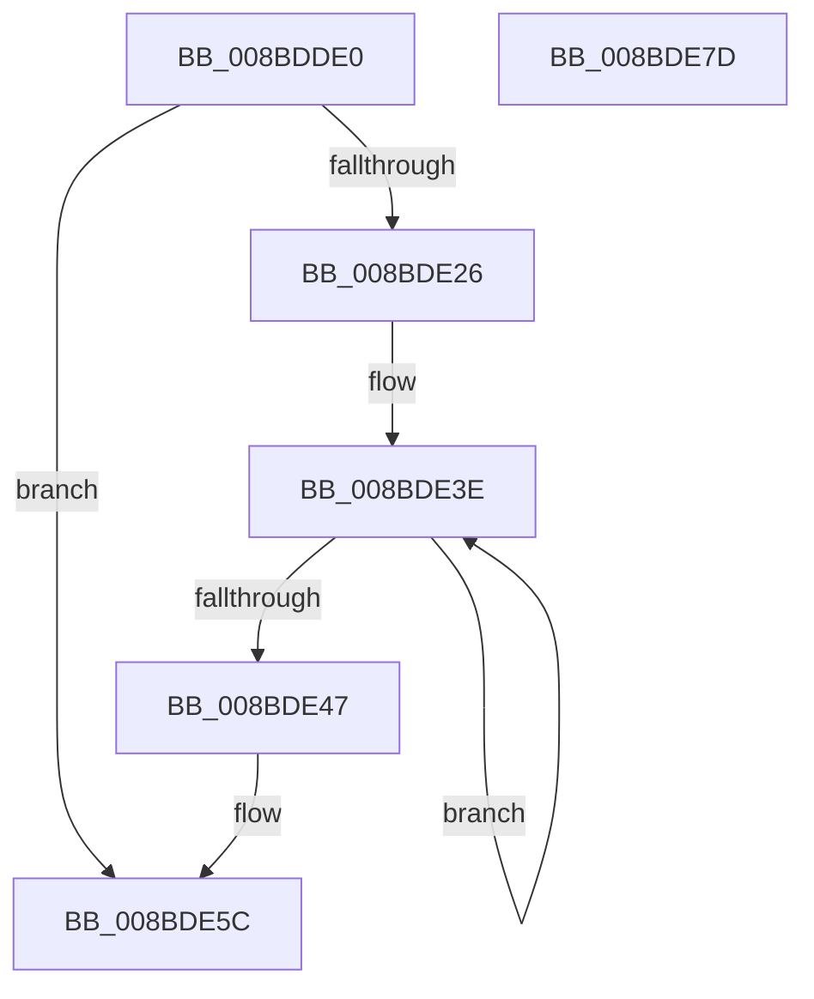

# RtlInt64ToUnicodeString

- RVA: `0x008BDDE0`–`0x008BDE7E` (길이 `158` bytes)
- VA: `0x00000001408BDDE0`
- 실행 섹션: `PAGE`
- PDB 이름 있음: `예`; PDB Function 태그: `아니요`
- unwind 정보 RVA: `0x00083108`
- 디코드: `38`개 명령, `158/158` bytes 표시
- 미해석 바이트: `0` (있으면 어셈블리에 `.byte`로 보존)

> 이 문서는 커널 이미지의 기계어와 PDB 기호를 분석해 생성했습니다. 4번과 5번은 함수 원형과 자료형을 바이너리 사용 방식에서 추정한 C 해석이며 원본 소스 복구 결과는 아닙니다.

## 1. Dependencies

- 직접 호출 지점: **3**; 고유 호출 대상: **3**
- 직접 호출자로 확인된 함수: **1**
- RIP 상대 이미지 참조: **1**

### Outgoing calls
- `0x008BDE1D` → [RtlLargeIntegerToChar](../90/RtlLargeIntegerToChar_function_0090BD30.md) (function, `0x0090BD30`)
- `0x008BDE57` → [RtlAnsiStringToUnicodeString](../90/RtlAnsiStringToUnicodeString_function_0090BEA0.md) (function, `0x0090BEA0`)
- `0x008BDE67` → [_security_check_cookie](../../text/6A/_security_check_cookie_function_006AC640.md) (function, `0x006AC640`)

### Direct callers
- [ExpWnfComposeValueName](ExpWnfComposeValueName_function_008BDBCC.md) at `0x008BDBF0`

### Static image references
- `0x008BDDEF` → RVA `0x00E0A740` (`.data`; read)

## 2. Other-region calls and transfers

- 다른 실행 섹션으로 향하는 call: **1**
  - `0x008BDE67` → [_security_check_cookie](../../text/6A/_security_check_cookie_function_006AC640.md) (`PAGE` → `.text`)
- 별도 외부 분기/꼬리 이동을 확인하지 못했습니다.

## 3. Assembly (complete function range)

```asm
008BDDE0  4C 8B DC                        mov r11, rsp
008BDDE3  49 89 5B 08                     mov qword ptr [r11 + 8], rbx
008BDDE7  57                              push rdi
008BDDE8  48 81 EC A0 00 00 00            sub rsp, 0xa0
008BDDEF  48 8B 05 4A C9 54 00            mov rax, qword ptr [rip + 0x54c94a]
008BDDF6  48 33 C4                        xor rax, rsp
008BDDF9  48 89 84 24 90 00 00 00         mov qword ptr [rsp + 0x90], rax
008BDE01  83 64 24 24 00                  and dword ptr [rsp + 0x24], 0
008BDE06  4D 8D 4B 98                     lea r9, [r11 - 0x68]
008BDE0A  49 8B D8                        mov rbx, r8
008BDE0D  49 89 4B 88                     mov qword ptr [r11 - 0x78], rcx
008BDE11  BF 41 00 00 00                  mov edi, 0x41
008BDE16  49 8D 4B 88                     lea rcx, [r11 - 0x78]
008BDE1A  44 8B C7                        mov r8d, edi
008BDE1D  E8 0E DF 04 00                  call 0x14090bd30
008BDE22  85 C0                           test eax, eax
008BDE24  78 36                           js 0x1408bde5c
008BDE26  48 8D 44 24 40                  lea rax, [rsp + 0x40]
008BDE2B  66 89 7C 24 22                  mov word ptr [rsp + 0x22], di
008BDE30  48 89 44 24 28                  mov qword ptr [rsp + 0x28], rax
008BDE35  48 8D 4C 24 40                  lea rcx, [rsp + 0x40]
008BDE3A  48 83 C8 FF                     or rax, 0xffffffffffffffff
008BDE3E  48 FF C0                        inc rax
008BDE41  80 3C 01 00                     cmp byte ptr [rcx + rax], 0
008BDE45  75 F7                           jne 0x1408bde3e
008BDE47  45 33 C0                        xor r8d, r8d
008BDE4A  66 89 44 24 20                  mov word ptr [rsp + 0x20], ax
008BDE4F  48 8D 54 24 20                  lea rdx, [rsp + 0x20]
008BDE54  48 8B CB                        mov rcx, rbx
008BDE57  E8 44 E0 04 00                  call 0x14090bea0
008BDE5C  48 8B 8C 24 90 00 00 00         mov rcx, qword ptr [rsp + 0x90]
008BDE64  48 33 CC                        xor rcx, rsp
008BDE67  E8 D4 E7 DE FF                  call 0x1406ac640
008BDE6C  48 8B 9C 24 B0 00 00 00         mov rbx, qword ptr [rsp + 0xb0]
008BDE74  48 81 C4 A0 00 00 00            add rsp, 0xa0
008BDE7B  5F                              pop rdi
008BDE7C  C3                              ret
008BDE7D  CC                              int3
```

## 4. C-style interpretation (structured pseudocode)

```c
__int64 __fastcall RtlInt64ToUnicodeString(__int64 a1, __int64 a2, __int64 a3)
{
    __int64 result;
    __int64 v_rsp;
    unsigned __int64 v_stack_m18;
    unsigned __int64 v_stack_m68;
    unsigned __int64 v_stack_m80;
    unsigned int v_stack_m84;
    unsigned __int16 v_stack_m86;
    unsigned __int16 v_stack_m88;
    unsigned __int64 v_stack_p8;

    *(unsigned __int64 *)(v_rsp + 8) = v_rbx;
    v_rsp = (v_rsp) - (160);
    result = (*(unsigned __int64 *)(v_rip + 5556554)) ^ (v_rsp);
    v_stack_m18 = result;
    *(unsigned __int64 *)(v_rsp - 120) = a1;
    result = RtlLargeIntegerToChar(v_rsp - 120, a2, 65, v_rsp - 104);
    if (sign_flag) goto loc_008BDE5C;
    v_stack_m86 = 65;
    v_stack_m80 = v_stack_m68;
    result = (v_stack_m68) | (-1);
loc_008BDE3E:
    result = (result) + 1;
    if ((*(unsigned __int8 *)(v_stack_m68 + result * 1)) != 0) goto loc_008BDE3E;
    a3 = 0;
    v_stack_m88 = (unsigned __int16)(result);
    result = RtlAnsiStringToUnicodeString(0, v_stack_m88, a3, v_rsp - 104);
loc_008BDE5C:
    a1 = (v_stack_m18) ^ (v_rsp);
    result = _security_check_cookie(a1, v_stack_m88, a3, v_rsp - 104);
    v_rsp = (v_rsp) + (160);
    return result;
}
```

## 5. (Beta) C Style

```c
int64_t RtlInt64ToUnicodeString(int64_t Arg1, int64_t Arg2, int64_t Arg3)
{
    int64_t result;
    int64_t local_rsp;
    uint64_t v_stack_m18;
    uint64_t v_stack_m68;
    uint64_t v_stack_m80;
    uint32_t v_stack_m84;
    uint16_t v_stack_m86;
    uint16_t v_stack_m88;
    uint64_t v_stack_p8;

    *(uint64_t *)(local_rsp + 0x8) = local_rbx;
    local_rsp = (local_rsp) - (160);
    result = (*(uint64_t *)(v_rip + 0x54C94A)) ^ (local_rsp);
    v_stack_m18 = result;
    *(uint64_t *)(local_rsp - 0x78) = Arg1;
    result = RtlLargeIntegerToChar(local_rsp - 120, Arg2, 65, local_rsp - 104);
    if (sign_flag) goto loc_008BDE5C;
    v_stack_m86 = 65;
    v_stack_m80 = v_stack_m68;
    result = (v_stack_m68) | (-1);
loc_008BDE3E:
    result = (result) + 1;
    if ((*(uint8_t *)(v_stack_m68 + result * 1)) != 0) goto loc_008BDE3E;
    Arg3 = 0;
    v_stack_m88 = (uint16_t)(result);
    result = RtlAnsiStringToUnicodeString(0, v_stack_m88, Arg3, local_rsp - 104);
loc_008BDE5C:
    Arg1 = (v_stack_m18) ^ (local_rsp);
    result = _security_check_cookie(Arg1, v_stack_m88, Arg3, local_rsp - 104);
    local_rsp = (local_rsp) + (160);
    return result;
}
```

## 6. Execution-region graph

[열기: 2D/3D 그래프와 함수 탐색 컨트롤 패널](../../../control-panel.html?section=page&rva=0x008BDDE0&view=graph)

- 2D 그래프는 위에서 아래로 흐르고, 3D 그래프는 빈 공간을 드래그해 회전합니다. Shift+드래그는 이동, 휠은 확대·축소, 함수 노드 선택은 대상 보고서 이동입니다.

### Static fallback


