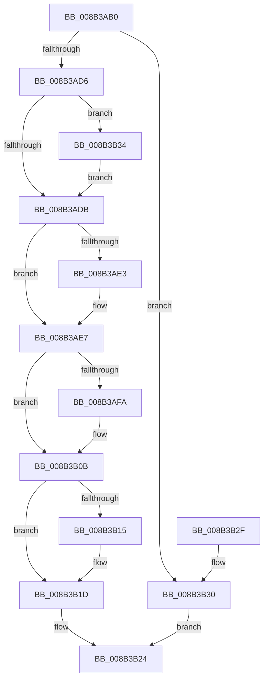

# RtlIsSandboxedToken

- RVA: `0x008B3AB0`–`0x008B3B45` (길이 `149` bytes)
- VA: `0x00000001408B3AB0`
- 실행 섹션: `PAGE`
- PDB 이름 있음: `예`; PDB Function 태그: `아니요`
- unwind 정보 RVA: `0x00082774`
- 디코드: `44`개 명령, `149/149` bytes 표시
- 미해석 바이트: `0` (있으면 어셈블리에 `.byte`로 보존)

> 이 문서는 커널 이미지의 기계어와 PDB 기호를 분석해 생성했습니다. 4번과 5번은 함수 원형과 자료형을 바이너리 사용 방식에서 추정한 C 해석이며 원본 소스 복구 결과는 아닙니다.

## 1. Dependencies

- 직접 호출 지점: **3**; 고유 호출 대상: **3**
- 직접 호출자로 확인된 함수: **13**
- RIP 상대 이미지 참조: **0**

### Outgoing calls
- `0x008B3AF1` → [SeQueryInformationToken](SeQueryInformationToken_function_008B5090.md) (function, `0x008B5090`)
- `0x008B3B18` → [SeReleaseSubjectContext](../86/SeReleaseSubjectContext_function_0086B710.md) (function, `0x0086B710`)
- `0x008B3B3E` → [SeCaptureSubjectContext](../86/SeCaptureSubjectContext_function_0086B820.md) (function, `0x0086B820`)

### Direct callers
- [NtSetInformationFile](../../text/29/NtSetInformationFile_function_0029C5E0.md) at `0x0029CAA0`
- [IopCheckInitiatorHint](../../text/45/IopCheckInitiatorHint_function_00457134.md) at `0x0045719E`
- [CmSetValueKey](../84/CmSetValueKey_function_008457C0.md) at `0x00846594`
- [ObpLookupObjectName](../89/ObpLookupObjectName_function_0089BE90.md) at `0x0089DD49`
- [ObpParseSymbolicLinkEx](ObpParseSymbolicLinkEx_function_008B35C0.md) at `0x008B3A12`
- [NtDuplicateToken](NtDuplicateToken_function_008B6DF0.md) at `0x008B70B6`
- [CmpCheckCreateAccess](../8C/CmpCheckCreateAccess_function_008C6E8C.md) at `0x008C6FCC`
- [IopXxxControlFile](../8E/IopXxxControlFile_function_008E9AD0.md) at `0x008EB190`
- [SepFilterToken](../9C/SepFilterToken_function_009C6B80.md) at `0x009C7712`
- [SepFilterToken](../9C/SepFilterToken_function_009C6B80.md) at `0x009C7721`
- [ObCreateSymbolicLink](../A3/ObCreateSymbolicLink_function_00A33B98.md) at `0x00A33CFE`
- [ObpCreateDirectoryObject](../A5/ObpCreateDirectoryObject_function_00A56230.md) at `0x00A56364`
- [NtSetInformationProcess](../AE/NtSetInformationProcess_function_00AE5370.md) at `0x00AE6755`
- [NtSetInformationProcess](../AE/NtSetInformationProcess_function_00AE5370.md) at `0x00AE7DC0`
- [NtSetInformationProcess](../AE/NtSetInformationProcess_function_00AE5370.md) at `0x00AE7DDB`
- [sub_00B20A40](../B2/Unknown_function_00B20A40.md) at `0x00B20AEE`

### Static image references
- 디코드된 RIP-relative 메모리 참조가 없습니다.

## 2. Other-region calls and transfers

- 다른 실행 섹션으로 향하는 call: **0**
- 별도 외부 분기/꼬리 이동을 확인하지 못했습니다.

## 3. Assembly (complete function range)

```asm
008B3AB0  48 89 5C 24 08                  mov qword ptr [rsp + 8], rbx
008B3AB5  57                              push rdi
008B3AB6  48 83 EC 40                     sub rsp, 0x40
008B3ABA  40 32 FF                        xor dil, dil
008B3ABD  0F 57 C0                        xorps xmm0, xmm0
008B3AC0  40 88 7C 24 58                  mov byte ptr [rsp + 0x58], dil
008B3AC5  48 8B D9                        mov rbx, rcx
008B3AC8  0F 11 44 24 20                  movups xmmword ptr [rsp + 0x20], xmm0
008B3ACD  0F 11 44 24 30                  movups xmmword ptr [rsp + 0x30], xmm0
008B3AD2  84 D2                           test dl, dl
008B3AD4  74 5A                           je 0x1408b3b30
008B3AD6  48 85 C9                        test rcx, rcx
008B3AD9  74 59                           je 0x1408b3b34
008B3ADB  48 8B 0B                        mov rcx, qword ptr [rbx]
008B3ADE  48 85 C9                        test rcx, rcx
008B3AE1  75 04                           jne 0x1408b3ae7
008B3AE3  48 8B 4B 10                     mov rcx, qword ptr [rbx + 0x10]
008B3AE7  4C 8D 44 24 58                  lea r8, [rsp + 0x58]
008B3AEC  BA 2F 00 00 00                  mov edx, 0x2f
008B3AF1  E8 9A 15 00 00                  call 0x1408b5090
008B3AF6  85 C0                           test eax, eax
008B3AF8  78 11                           js 0x1408b3b0b
008B3AFA  80 7C 24 58 00                  cmp byte ptr [rsp + 0x58], 0
008B3AFF  B8 01 00 00 00                  mov eax, 1
008B3B04  40 0F B6 FF                     movzx edi, dil
008B3B08  0F 44 F8                        cmove edi, eax
008B3B0B  48 8D 44 24 20                  lea rax, [rsp + 0x20]
008B3B10  48 3B D8                        cmp rbx, rax
008B3B13  75 08                           jne 0x1408b3b1d
008B3B15  48 8B CB                        mov rcx, rbx
008B3B18  E8 F3 7B FB FF                  call 0x14086b710
008B3B1D  40 80 FF 01                     cmp dil, 1
008B3B21  0F 95 C0                        setne al
008B3B24  48 8B 5C 24 50                  mov rbx, qword ptr [rsp + 0x50]
008B3B29  48 83 C4 40                     add rsp, 0x40
008B3B2D  5F                              pop rdi
008B3B2E  C3                              ret
008B3B2F  CC                              int3
008B3B30  32 C0                           xor al, al
008B3B32  EB F0                           jmp 0x1408b3b24
008B3B34  48 8D 4C 24 20                  lea rcx, [rsp + 0x20]
008B3B39  48 8D 5C 24 20                  lea rbx, [rsp + 0x20]
008B3B3E  E8 DD 7C FB FF                  call 0x14086b820
008B3B43  EB 96                           jmp 0x1408b3adb
```

## 4. C-style interpretation (structured pseudocode)

```c
__int64 __fastcall RtlIsSandboxedToken(__int64 a1, unsigned __int8 a2)
{
    __int64 result;
    __int64 v_rdi;
    __int64 v_rsp;
    unsigned __int64 v_stack_m18;
    unsigned __int64 v_stack_m28;
    unsigned __int8 v_stack_p10;
    unsigned __int64 v_stack_p20;
    unsigned __int64 v_stack_p8;

    v_stack_p8 = v_rbx;
    v_rsp = (v_rsp) - (64);
    v_rdi = 0;
    v_stack_p10 = 0;
    v_stack_m28 = v_xmm0;
    v_stack_m18 = v_xmm0;
    if (a2 == 0) goto loc_008B3B30;
    if (a1 == 0) goto loc_008B3B34;
loc_008B3ADB:
    if (*(unsigned __int64 *)(a1) == 0) {
        a1 = *(unsigned __int64 *)(a1 + 16);
    }
    result = SeQueryInformationToken(a1, 47, v_stack_p10, a4);
    if (!(sign_flag)) {
        result = 1;
        v_rdi = 0;
        if (v_stack_p10 == 0) { v_rdi = (unsigned int)(result); }
    }
    result = v_stack_m28;
    if (a1 == v_stack_m28) {
        a1 = a1;
        result = SeReleaseSubjectContext(a1, 47, v_stack_p10, a4);
    }
    result = (((unsigned __int8)(v_rdi)) != 1) ? 1 : 0;
loc_008B3B24:
    v_rsp = (v_rsp) + (64);
    return result;
loc_008B3B30:
    result = 0;
    goto loc_008B3B24;
loc_008B3B34:
    result = SeCaptureSubjectContext(v_stack_p20, 47, v_stack_p10, a4);
    goto loc_008B3ADB;
}
```

## 5. (Beta) C Style

```c
int64_t RtlIsSandboxedToken(int64_t Arg1, uint8_t Arg2)
{
    int64_t result;
    int64_t local_rdi;
    int64_t local_rsp;
    uint64_t v_stack_m18;
    uint64_t v_stack_m28;
    uint8_t v_stack_p10;
    uint64_t v_stack_p20;
    uint64_t v_stack_p8;

    v_stack_p8 = local_rbx;
    local_rsp = (local_rsp) - (64);
    local_rdi = 0;
    v_stack_p10 = 0;
    v_stack_m28 = v_xmm0;
    v_stack_m18 = v_xmm0;
    if (Arg2 == 0) goto loc_008B3B30;
    if (Arg1 == 0) goto loc_008B3B34;
loc_008B3ADB:
    if (*(uint64_t *)(Arg1) == 0) {
        Arg1 = *(uint64_t *)(Arg1 + 0x10);
    }
    result = SeQueryInformationToken(Arg1, 47, v_stack_p10, a4);
    if (!(sign_flag)) {
        result = 1;
        local_rdi = 0;
        if (v_stack_p10 == 0) { local_rdi = (uint32_t)(result); }
    }
    result = v_stack_m28;
    if (Arg1 == v_stack_m28) {
        Arg1 = Arg1;
        result = SeReleaseSubjectContext(Arg1, 47, v_stack_p10, a4);
    }
    result = (((uint8_t)(local_rdi)) != 1) ? 1 : 0;
loc_008B3B24:
    local_rsp = (local_rsp) + (64);
    return result;
loc_008B3B30:
    result = 0;
    goto loc_008B3B24;
loc_008B3B34:
    result = SeCaptureSubjectContext(v_stack_p20, 47, v_stack_p10, a4);
    goto loc_008B3ADB;
}
```

## 6. Execution-region graph

[열기: 2D/3D 그래프와 함수 탐색 컨트롤 패널](../../../control-panel.html?section=page&rva=0x008B3AB0&view=graph)

- 2D 그래프는 위에서 아래로 흐르고, 3D 그래프는 빈 공간을 드래그해 회전합니다. Shift+드래그는 이동, 휠은 확대·축소, 함수 노드 선택은 대상 보고서 이동입니다.

### Static fallback


