# RtlLengthSecurityDescriptor

- RVA: `0x008BC870`–`0x008BC93D` (길이 `205` bytes)
- VA: `0x00000001408BC870`
- 실행 섹션: `PAGE`
- PDB 이름 있음: `예`; PDB Function 태그: `아니요`
- unwind 정보 RVA: `0x000DB714`
- 디코드: `68`개 명령, `205/205` bytes 표시
- 미해석 바이트: `0` (있으면 어셈블리에 `.byte`로 보존)

> 이 문서는 커널 이미지의 기계어와 PDB 기호를 분석해 생성했습니다. 4번과 5번은 함수 원형과 자료형을 바이너리 사용 방식에서 추정한 C 해석이며 원본 소스 복구 결과는 아닙니다.

## 1. Dependencies

- 직접 호출 지점: **0**; 고유 호출 대상: **0**
- 직접 호출자로 확인된 함수: **24**
- RIP 상대 이미지 참조: **0**

### Outgoing calls
- 직접 디코드된 call 명령이 없습니다.

### Direct callers
- [AdtpBuildAccessReasonAuditString](../../text/40/AdtpBuildAccessReasonAuditString_function_0040EE04.md) at `0x0040EF5F`
- [PiAuGetServiceStateSecurityObject](../73/PiAuGetServiceStateSecurityObject_function_007314F0.md) at `0x007316B3`
- [PiAuGetStateDirectorySecurityObject](../73/PiAuGetStateDirectorySecurityObject_function_00731738.md) at `0x00731993`
- [WmipSaveGuidSecurityDescriptor](../7B/WmipSaveGuidSecurityDescriptor_function_007B4A38.md) at `0x007B4A53`
- [CmSetInstallerClassRegPropWorker](../82/CmSetInstallerClassRegPropWorker_function_0082ABF4.md) at `0x0082AD07`
- [PnpGetEnumSecurityDescriptor](../83/PnpGetEnumSecurityDescriptor_function_00831FCC.md) at `0x00832265`
- [DrvDbGetRegistrarSecurityDescriptor](../83/DrvDbGetRegistrarSecurityDescriptor_function_00835728.md) at `0x008357A8`
- [DrvDbGetSecurityDescriptor](../83/DrvDbGetSecurityDescriptor_function_0083580C.md) at `0x00835AF5`
- [ObSetSecurityDescriptorInfo](ObSetSecurityDescriptorInfo_function_008BAE20.md) at `0x008BAEFB`
- [ObpSetObjectAuditInfo](ObpSetObjectAuditInfo_function_008BD1F8.md) at `0x008BD2F8`
- [ExpWnfLookupPermanentName](ExpWnfLookupPermanentName_function_008BD914.md) at `0x008BDA26`
- [ExpWnfRegisterPermanentName](ExpWnfRegisterPermanentName_function_008BE17C.md) at `0x008BE20A`
- [WmipGetGuidSecurityDescriptor](../8C/WmipGetGuidSecurityDescriptor_function_008C7B4C.md) at `0x008C7D0F`
- [PnpValidatePropertyData](../8F/PnpValidatePropertyData_function_008F7658.md) at `0x008F78C7`
- [_CmSetDeviceRegPropWorker](../8F/_CmSetDeviceRegPropWorker_function_008FD804.md) at `0x008FDA43`
- [BiCreateKeySecurityDescriptor](../91/BiCreateKeySecurityDescriptor_function_00916D6C.md) at `0x00916EA2`
- [BiCreateKeySecurityDescriptor](../91/BiCreateKeySecurityDescriptor_function_00916D6C.md) at `0x00916EBB`
- [PiDevCfgGetKeySecurityDescriptor](../99/PiDevCfgGetKeySecurityDescriptor_function_00996240.md) at `0x00996542`
- [IopUpdateSecureDeviceClassState](../9A/IopUpdateSecureDeviceClassState_function_009A2CE8.md) at `0x009A2EDC`
- [_PnpGetPropertiesSecurityDescriptor](../A9/_PnpGetPropertiesSecurityDescriptor_function_00A91B8C.md) at `0x00A91CF6`
- [sub_00B1B086](../B1/Unknown_function_00B1B086.md) at `0x00B1B099`
- [sub_00B4403A](../B4/Unknown_function_00B4403A.md) at `0x00B440C5`
- [PiAuCreateLocalSystemSecurityObject](../../init/C3/PiAuCreateLocalSystemSecurityObject_function_00C34570.md) at `0x00C34683`
- [PiAuCreateStandardSecurityObject](../../init/C3/PiAuCreateStandardSecurityObject_function_00C34710.md) at `0x00C34BC9`
- [PiAuGetDriverDataDirectorySecurityObject](../../init/C3/PiAuGetDriverDataDirectorySecurityObject_function_00C34EEC.md) at `0x00C35098`

### Static image references
- 디코드된 RIP-relative 메모리 참조가 없습니다.

## 2. Other-region calls and transfers

- 다른 실행 섹션으로 향하는 call: **0**
- 별도 외부 분기/꼬리 이동을 확인하지 못했습니다.

## 3. Assembly (complete function range)

```asm
008BC870  44 0F BF 41 02                  movsx r8d, word ptr [rcx + 2]
008BC875  48 8B D1                        mov rdx, rcx
008BC878  41 8B C0                        mov eax, r8d
008BC87B  C1 F8 1F                        sar eax, 0x1f
008BC87E  83 E0 EC                        and eax, 0xffffffec
008BC881  83 C0 28                        add eax, 0x28
008BC884  66 45 85 C0                     test r8w, r8w
008BC888  0F 89 94 00 00 00               jns 0x1408bc922
008BC88E  8B 49 04                        mov ecx, dword ptr [rcx + 4]
008BC891  85 C9                           test ecx, ecx
008BC893  74 1E                           je 0x1408bc8b3
008BC895  48 03 CA                        add rcx, rdx
008BC898  48 85 C9                        test rcx, rcx
008BC89B  74 10                           je 0x1408bc8ad
008BC89D  0F B6 49 01                     movzx ecx, byte ptr [rcx + 1]
008BC8A1  8D 0C 8D 0B 00 00 00            lea ecx, [rcx*4 + 0xb]
008BC8A8  83 E1 FC                        and ecx, 0xfffffffc
008BC8AB  03 C1                           add eax, ecx
008BC8AD  66 45 85 C0                     test r8w, r8w
008BC8B1  79 78                           jns 0x1408bc92b
008BC8B3  8B 4A 08                        mov ecx, dword ptr [rdx + 8]
008BC8B6  85 C9                           test ecx, ecx
008BC8B8  74 18                           je 0x1408bc8d2
008BC8BA  48 03 CA                        add rcx, rdx
008BC8BD  48 85 C9                        test rcx, rcx
008BC8C0  74 10                           je 0x1408bc8d2
008BC8C2  0F B6 49 01                     movzx ecx, byte ptr [rcx + 1]
008BC8C6  8D 0C 8D 0B 00 00 00            lea ecx, [rcx*4 + 0xb]
008BC8CD  83 E1 FC                        and ecx, 0xfffffffc
008BC8D0  03 C1                           add eax, ecx
008BC8D2  41 F6 C0 04                     test r8b, 4
008BC8D6  74 21                           je 0x1408bc8f9
008BC8D8  66 45 85 C0                     test r8w, r8w
008BC8DC  79 53                           jns 0x1408bc931
008BC8DE  8B 4A 10                        mov ecx, dword ptr [rdx + 0x10]
008BC8E1  85 C9                           test ecx, ecx
008BC8E3  74 14                           je 0x1408bc8f9
008BC8E5  48 03 CA                        add rcx, rdx
008BC8E8  48 85 C9                        test rcx, rcx
008BC8EB  74 0C                           je 0x1408bc8f9
008BC8ED  0F B7 49 02                     movzx ecx, word ptr [rcx + 2]
008BC8F1  83 C1 03                        add ecx, 3
008BC8F4  83 E1 FC                        and ecx, 0xfffffffc
008BC8F7  03 C1                           add eax, ecx
008BC8F9  41 F6 C0 10                     test r8b, 0x10
008BC8FD  74 21                           je 0x1408bc920
008BC8FF  66 45 85 C0                     test r8w, r8w
008BC903  79 32                           jns 0x1408bc937
008BC905  8B 4A 0C                        mov ecx, dword ptr [rdx + 0xc]
008BC908  85 C9                           test ecx, ecx
008BC90A  74 14                           je 0x1408bc920
008BC90C  48 03 CA                        add rcx, rdx
008BC90F  48 85 C9                        test rcx, rcx
008BC912  74 0C                           je 0x1408bc920
008BC914  0F B7 49 02                     movzx ecx, word ptr [rcx + 2]
008BC918  83 C1 03                        add ecx, 3
008BC91B  83 E1 FC                        and ecx, 0xfffffffc
008BC91E  03 C1                           add eax, ecx
008BC920  C3                              ret
008BC921  CC                              int3
008BC922  48 8B 49 08                     mov rcx, qword ptr [rcx + 8]
008BC926  E9 6D FF FF FF                  jmp 0x1408bc898
008BC92B  48 8B 4A 10                     mov rcx, qword ptr [rdx + 0x10]
008BC92F  EB 8C                           jmp 0x1408bc8bd
008BC931  48 8B 4A 20                     mov rcx, qword ptr [rdx + 0x20]
008BC935  EB B1                           jmp 0x1408bc8e8
008BC937  48 8B 4A 18                     mov rcx, qword ptr [rdx + 0x18]
008BC93B  EB D2                           jmp 0x1408bc90f
```

## 4. C-style interpretation (structured pseudocode)

```c
__int64 __fastcall RtlLengthSecurityDescriptor(__int64 a1)
{
    __int64 result;

    result = (unsigned int)(((unsigned int)((unsigned int)((__int16)(*(unsigned __int16 *)(a1 + 2))))) >> (31));
    result = (unsigned int)((result) & (0xFFFFFFECULL));
    result = (unsigned int)((result) + (40));
    if (!sign_flag) goto loc_008BC922;
    if ((unsigned int)((unsigned int)(*(unsigned int *)(a1 + 4))) == 0) goto loc_008BC8B3;
    a1 = ((unsigned int)(*(unsigned int *)(a1 + 4))) + (a1);
loc_008BC898:
    if (a1 != 0) {
        a1 = *(unsigned __int8 *)(a1 + 1);
        a1 = a1 * 4 + 11;
        a1 = (unsigned int)((a1) & (0xFFFFFFFCULL));
        result = (unsigned int)((result) + ((unsigned int)(a1)));
    }
    if (!sign_flag) goto loc_008BC92B;
loc_008BC8B3:
    if ((unsigned int)((unsigned int)(*(unsigned int *)(a1 + 8))) == 0) goto loc_008BC8D2;
    a1 = ((unsigned int)(*(unsigned int *)(a1 + 8))) + (a1);
loc_008BC8BD:
    if (a1 != 0) {
        a1 = *(unsigned __int8 *)(a1 + 1);
        a1 = a1 * 4 + 11;
        a1 = (unsigned int)((a1) & (0xFFFFFFFCULL));
        result = (unsigned int)((result) + ((unsigned int)(a1)));
    }
    if ((((unsigned __int8)((__int16)(*(unsigned __int16 *)(a1 + 2)))) & (4)) == 0) goto loc_008BC8F9;
    if (!sign_flag) goto loc_008BC931;
    if ((unsigned int)((unsigned int)(*(unsigned int *)(a1 + 16))) == 0) goto loc_008BC8F9;
    a1 = ((unsigned int)(*(unsigned int *)(a1 + 16))) + (a1);
loc_008BC8E8:
    if (a1 != 0) {
        a1 = *(unsigned __int16 *)(a1 + 2);
        a1 = (unsigned int)((a1) + (3));
        a1 = (unsigned int)((a1) & (0xFFFFFFFCULL));
        result = (unsigned int)((result) + ((unsigned int)(a1)));
    }
    if ((((unsigned __int8)((__int16)(*(unsigned __int16 *)(a1 + 2)))) & (16)) == 0) goto loc_008BC920;
    if (!sign_flag) goto loc_008BC937;
    if ((unsigned int)((unsigned int)(*(unsigned int *)(a1 + 12))) == 0) goto loc_008BC920;
    a1 = ((unsigned int)(*(unsigned int *)(a1 + 12))) + (a1);
loc_008BC90F:
    if (a1 != 0) {
        a1 = *(unsigned __int16 *)(a1 + 2);
        a1 = (unsigned int)((a1) + (3));
        a1 = (unsigned int)((a1) & (0xFFFFFFFCULL));
        result = (unsigned int)((result) + ((unsigned int)(a1)));
    }
    return result;
loc_008BC922:
    goto loc_008BC898;
loc_008BC92B:
    goto loc_008BC8BD;
loc_008BC931:
    goto loc_008BC8E8;
loc_008BC937:
    goto loc_008BC90F;
}
```

## 5. (Beta) C Style

```c
int64_t RtlLengthSecurityDescriptor(void *Arg1)
{
    uint8_t *arg1 = (uint8_t *)Arg1;

    int64_t result;

    result = (uint32_t)(((uint32_t)((uint32_t)((int16_t)(*(uint16_t *)(arg1 + 0x2))))) >> (31));
    result = (uint32_t)((result) & (0xFFFFFFECULL));
    result = (uint32_t)((result) + (40));
    if (!sign_flag) goto loc_008BC922;
    if ((uint32_t)((uint32_t)(*(uint32_t *)(arg1 + 0x4))) == 0) goto loc_008BC8B3;
    Arg1 = ((uint32_t)(*(uint32_t *)(arg1 + 0x4))) + (Arg1);
loc_008BC898:
    if (Arg1 != NULL) {
        Arg1 = *(uint8_t *)(arg1 + 0x1);
        Arg1 = Arg1 * 4 + 11;
        Arg1 = (uint32_t)((Arg1) & (0xFFFFFFFCULL));
        result = (uint32_t)((result) + ((uint32_t)(Arg1)));
    }
    if (!sign_flag) goto loc_008BC92B;
loc_008BC8B3:
    if ((uint32_t)((uint32_t)(*(uint32_t *)(arg1 + 0x8))) == 0) goto loc_008BC8D2;
    Arg1 = ((uint32_t)(*(uint32_t *)(arg1 + 0x8))) + (Arg1);
loc_008BC8BD:
    if (Arg1 != NULL) {
        Arg1 = *(uint8_t *)(arg1 + 0x1);
        Arg1 = Arg1 * 4 + 11;
        Arg1 = (uint32_t)((Arg1) & (0xFFFFFFFCULL));
        result = (uint32_t)((result) + ((uint32_t)(Arg1)));
    }
    if ((((uint8_t)((int16_t)(*(uint16_t *)(arg1 + 0x2)))) & (4)) == 0) goto loc_008BC8F9;
    if (!sign_flag) goto loc_008BC931;
    if ((uint32_t)((uint32_t)(*(uint32_t *)(arg1 + 0x10))) == 0) goto loc_008BC8F9;
    Arg1 = ((uint32_t)(*(uint32_t *)(arg1 + 0x10))) + (Arg1);
loc_008BC8E8:
    if (Arg1 != NULL) {
        Arg1 = *(uint16_t *)(arg1 + 0x2);
        Arg1 = (uint32_t)((Arg1) + (3));
        Arg1 = (uint32_t)((Arg1) & (0xFFFFFFFCULL));
        result = (uint32_t)((result) + ((uint32_t)(Arg1)));
    }
    if ((((uint8_t)((int16_t)(*(uint16_t *)(arg1 + 0x2)))) & (16)) == 0) goto loc_008BC920;
    if (!sign_flag) goto loc_008BC937;
    if ((uint32_t)((uint32_t)(*(uint32_t *)(arg1 + 0xC))) == 0) goto loc_008BC920;
    Arg1 = ((uint32_t)(*(uint32_t *)(arg1 + 0xC))) + (Arg1);
loc_008BC90F:
    if (Arg1 != NULL) {
        Arg1 = *(uint16_t *)(arg1 + 0x2);
        Arg1 = (uint32_t)((Arg1) + (3));
        Arg1 = (uint32_t)((Arg1) & (0xFFFFFFFCULL));
        result = (uint32_t)((result) + ((uint32_t)(Arg1)));
    }
    return result;
loc_008BC922:
    goto loc_008BC898;
loc_008BC92B:
    goto loc_008BC8BD;
loc_008BC931:
    goto loc_008BC8E8;
loc_008BC937:
    goto loc_008BC90F;
}
```

### 관측된 메모리 오프셋

구조체 형식이 확인되지 않은 접근은 인자 기준의 오프셋으로만 기록했습니다.

| 기준 인자 | 오프셋 표현 | 폭 (bit) | 접근 |
|---|---:|---:|---|
| `Arg1` | `+ 0x2` | `16` | `R` |
| `Arg1` | `+ 0x4` | `32` | `R` |
| `Arg1` | `+ 0x8` | `32` | `R` |
| `Arg1` | `+ 0x8` | `64` | `R` |
| `Arg1` | `+ 0xC` | `32` | `R` |
| `Arg1` | `+ 0x10` | `32` | `R` |
| `Arg1` | `+ 0x10` | `64` | `R` |
| `Arg1` | `+ 0x18` | `64` | `R` |
| `Arg1` | `+ 0x20` | `64` | `R` |

## 6. Execution-region graph

[열기: 2D/3D 그래프와 함수 탐색 컨트롤 패널](../../../control-panel.html?section=page&rva=0x008BC870&view=graph)

- 2D 그래프는 위에서 아래로 흐르고, 3D 그래프는 빈 공간을 드래그해 회전합니다. Shift+드래그는 이동, 휠은 확대·축소, 함수 노드 선택은 대상 보고서 이동입니다.

### Static fallback

```mermaid
flowchart TD
  bb_008BC870[BB_008BC870]
  bb_008BC88E[BB_008BC88E]
  bb_008BC895[BB_008BC895]
  bb_008BC898[BB_008BC898]
  bb_008BC89D[BB_008BC89D]
  bb_008BC8AD[BB_008BC8AD]
  bb_008BC8B3[BB_008BC8B3]
  bb_008BC8BA[BB_008BC8BA]
  bb_008BC8BD[BB_008BC8BD]
  bb_008BC8C2[BB_008BC8C2]
  bb_008BC8D2[BB_008BC8D2]
  bb_008BC8D8[BB_008BC8D8]
  bb_008BC8DE[BB_008BC8DE]
  bb_008BC8E5[BB_008BC8E5]
  bb_008BC8E8[BB_008BC8E8]
  bb_008BC8ED[BB_008BC8ED]
  bb_008BC8F9[BB_008BC8F9]
  bb_008BC8FF[BB_008BC8FF]
  bb_008BC905[BB_008BC905]
  bb_008BC90C[BB_008BC90C]
  bb_008BC90F[BB_008BC90F]
  bb_008BC914[BB_008BC914]
  bb_008BC920[BB_008BC920]
  bb_008BC921[BB_008BC921]
  bb_008BC922[BB_008BC922]
  bb_008BC92B[BB_008BC92B]
  bb_008BC931[BB_008BC931]
  bb_008BC937[BB_008BC937]
  bb_008BC870 -->|branch| bb_008BC922
  bb_008BC870 -->|fallthrough| bb_008BC88E
  bb_008BC88E -->|branch| bb_008BC8B3
  bb_008BC88E -->|fallthrough| bb_008BC895
  bb_008BC895 -->|flow| bb_008BC898
  bb_008BC898 -->|branch| bb_008BC8AD
  bb_008BC898 -->|fallthrough| bb_008BC89D
  bb_008BC89D -->|flow| bb_008BC8AD
  bb_008BC8AD -->|branch| bb_008BC92B
  bb_008BC8AD -->|fallthrough| bb_008BC8B3
  bb_008BC8B3 -->|branch| bb_008BC8D2
  bb_008BC8B3 -->|fallthrough| bb_008BC8BA
  bb_008BC8BA -->|flow| bb_008BC8BD
  bb_008BC8BD -->|branch| bb_008BC8D2
  bb_008BC8BD -->|fallthrough| bb_008BC8C2
  bb_008BC8C2 -->|flow| bb_008BC8D2
  bb_008BC8D2 -->|branch| bb_008BC8F9
  bb_008BC8D2 -->|fallthrough| bb_008BC8D8
  bb_008BC8D8 -->|branch| bb_008BC931
  bb_008BC8D8 -->|fallthrough| bb_008BC8DE
  bb_008BC8DE -->|branch| bb_008BC8F9
  bb_008BC8DE -->|fallthrough| bb_008BC8E5
  bb_008BC8E5 -->|flow| bb_008BC8E8
  bb_008BC8E8 -->|branch| bb_008BC8F9
  bb_008BC8E8 -->|fallthrough| bb_008BC8ED
  bb_008BC8ED -->|flow| bb_008BC8F9
  bb_008BC8F9 -->|branch| bb_008BC920
  bb_008BC8F9 -->|fallthrough| bb_008BC8FF
  bb_008BC8FF -->|branch| bb_008BC937
  bb_008BC8FF -->|fallthrough| bb_008BC905
  bb_008BC905 -->|branch| bb_008BC920
  bb_008BC905 -->|fallthrough| bb_008BC90C
  bb_008BC90C -->|flow| bb_008BC90F
  bb_008BC90F -->|branch| bb_008BC920
  bb_008BC90F -->|fallthrough| bb_008BC914
  bb_008BC914 -->|flow| bb_008BC920
  bb_008BC921 -->|flow| bb_008BC922
  bb_008BC922 -->|branch| bb_008BC898
  bb_008BC92B -->|branch| bb_008BC8BD
  bb_008BC931 -->|branch| bb_008BC8E8
  bb_008BC937 -->|branch| bb_008BC90F
```


