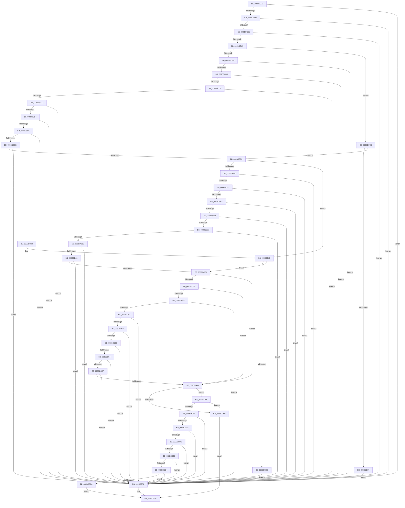

# RtlValidRelativeSecurityDescriptor

- RVA: `0x008BDC70`–`0x008BDDCC` (길이 `348` bytes)
- VA: `0x00000001408BDC70`
- 실행 섹션: `PAGE`
- PDB 이름 있음: `예`; PDB Function 태그: `아니요`
- unwind 정보 RVA: `0x000734C4`
- 디코드: `113`개 명령, `348/348` bytes 표시
- 미해석 바이트: `0` (있으면 어셈블리에 `.byte`로 보존)

> 이 문서는 커널 이미지의 기계어와 PDB 기호를 분석해 생성했습니다. 4번과 5번은 함수 원형과 자료형을 바이너리 사용 방식에서 추정한 C 해석이며 원본 소스 복구 결과는 아닙니다.

## 1. Dependencies

- 직접 호출 지점: **2**; 고유 호출 대상: **1**
- 직접 호출자로 확인된 함수: **8**
- RIP 상대 이미지 참조: **0**

### Outgoing calls
- `0x008BDD5F` → [RtlValidAcl](../92/RtlValidAcl_function_0092A7A0.md) (function, `0x0092A7A0`)
- `0x008BDDC0` → [RtlValidAcl](../92/RtlValidAcl_function_0092A7A0.md) (function, `0x0092A7A0`)

### Direct callers
- [CmpVerifyLogRecord](../7F/CmpVerifyLogRecord_function_007F10DC.md) at `0x007F11FC`
- [CmSetInstallerClassRegPropWorker](../82/CmSetInstallerClassRegPropWorker_function_0082ABF4.md) at `0x0082ACFB`
- [ExpWnfLookupPermanentName](ExpWnfLookupPermanentName_function_008BD914.md) at `0x008BDA0C`
- [PnpValidatePropertyData](../8F/PnpValidatePropertyData_function_008F7658.md) at `0x008F78B7`
- [_CmSetDeviceRegPropWorker](../8F/_CmSetDeviceRegPropWorker_function_008FD804.md) at `0x008FDA33`
- [CmpValidateHiveSecurityDescriptors](../96/CmpValidateHiveSecurityDescriptors_function_0096DAFC.md) at `0x0096DC37`
- [PipGetRegistrySecurityWithFallback](../99/PipGetRegistrySecurityWithFallback_function_0099542C.md) at `0x0099558F`
- [PipGetRegistrySecurityWithFallback](../99/PipGetRegistrySecurityWithFallback_function_0099542C.md) at `0x0099562D`
- [sub_00B28A98](../B2/Unknown_function_00B28A98.md) at `0x00B28BA4`

### Static image references
- 디코드된 RIP-relative 메모리 참조가 없습니다.

## 2. Other-region calls and transfers

- 다른 실행 섹션으로 향하는 call: **0**
- 별도 외부 분기/꼬리 이동을 확인하지 못했습니다.

## 3. Assembly (complete function range)

```asm
008BDC70  48 89 5C 24 08                  mov qword ptr [rsp + 8], rbx
008BDC75  48 89 74 24 10                  mov qword ptr [rsp + 0x10], rsi
008BDC7A  57                              push rdi
008BDC7B  48 83 EC 20                     sub rsp, 0x20
008BDC7F  8B DA                           mov ebx, edx
008BDC81  48 8B F9                        mov rdi, rcx
008BDC84  83 FA 14                        cmp edx, 0x14
008BDC87  0F 82 E5 00 00 00               jb 0x1408bdd72
008BDC8D  80 39 01                        cmp byte ptr [rcx], 1
008BDC90  0F 85 DC 00 00 00               jne 0x1408bdd72
008BDC96  44 0F B7 49 02                  movzx r9d, word ptr [rcx + 2]
008BDC9B  66 45 85 C9                     test r9w, r9w
008BDC9F  0F 89 CD 00 00 00               jns 0x1408bdd72
008BDCA5  8B 41 04                        mov eax, dword ptr [rcx + 4]
008BDCA8  85 C0                           test eax, eax
008BDCAA  0F 84 DD 00 00 00               je 0x1408bdd8d
008BDCB0  83 F8 14                        cmp eax, 0x14
008BDCB3  0F 82 B9 00 00 00               jb 0x1408bdd72
008BDCB9  3B C2                           cmp eax, edx
008BDCBB  0F 83 B1 00 00 00               jae 0x1408bdd72
008BDCC1  2B D0                           sub edx, eax
008BDCC3  83 FA 0C                        cmp edx, 0xc
008BDCC6  0F 82 A6 00 00 00               jb 0x1408bdd72
008BDCCC  A8 03                           test al, 3
008BDCCE  0F 85 9E 00 00 00               jne 0x1408bdd72
008BDCD4  80 3C 08 01                     cmp byte ptr [rax + rcx], 1
008BDCD8  0F 85 94 00 00 00               jne 0x1408bdd72
008BDCDE  0F B6 44 08 01                  movzx eax, byte ptr [rax + rcx + 1]
008BDCE3  3C 0F                           cmp al, 0xf
008BDCE5  0F 87 87 00 00 00               ja 0x1408bdd72
008BDCEB  8D 04 85 08 00 00 00            lea eax, [rax*4 + 8]
008BDCF2  3B D0                           cmp edx, eax
008BDCF4  72 7C                           jb 0x1408bdd72
008BDCF6  8B 41 08                        mov eax, dword ptr [rcx + 8]
008BDCF9  85 C0                           test eax, eax
008BDCFB  0F 84 84 00 00 00               je 0x1408bdd85
008BDD01  83 F8 14                        cmp eax, 0x14
008BDD04  72 6C                           jb 0x1408bdd72
008BDD06  3B C3                           cmp eax, ebx
008BDD08  73 68                           jae 0x1408bdd72
008BDD0A  8B D3                           mov edx, ebx
008BDD0C  2B D0                           sub edx, eax
008BDD0E  83 FA 0C                        cmp edx, 0xc
008BDD11  72 5F                           jb 0x1408bdd72
008BDD13  A8 03                           test al, 3
008BDD15  75 5B                           jne 0x1408bdd72
008BDD17  80 3C 08 01                     cmp byte ptr [rax + rcx], 1
008BDD1B  75 55                           jne 0x1408bdd72
008BDD1D  0F B6 44 08 01                  movzx eax, byte ptr [rax + rcx + 1]
008BDD22  3C 0F                           cmp al, 0xf
008BDD24  77 4C                           ja 0x1408bdd72
008BDD26  8D 04 85 08 00 00 00            lea eax, [rax*4 + 8]
008BDD2D  3B D0                           cmp edx, eax
008BDD2F  72 41                           jb 0x1408bdd72
008BDD31  41 F6 C1 04                     test r9b, 4
008BDD35  74 31                           je 0x1408bdd68
008BDD37  8B 41 10                        mov eax, dword ptr [rcx + 0x10]
008BDD3A  85 C0                           test eax, eax
008BDD3C  74 2A                           je 0x1408bdd68
008BDD3E  83 F8 14                        cmp eax, 0x14
008BDD41  72 2F                           jb 0x1408bdd72
008BDD43  3B C3                           cmp eax, ebx
008BDD45  73 2B                           jae 0x1408bdd72
008BDD47  8B D3                           mov edx, ebx
008BDD49  2B D0                           sub edx, eax
008BDD4B  83 FA 08                        cmp edx, 8
008BDD4E  72 22                           jb 0x1408bdd72
008BDD50  A8 03                           test al, 3
008BDD52  75 1E                           jne 0x1408bdd72
008BDD54  48 03 C8                        add rcx, rax
008BDD57  0F B7 41 02                     movzx eax, word ptr [rcx + 2]
008BDD5B  3B D0                           cmp edx, eax
008BDD5D  72 13                           jb 0x1408bdd72
008BDD5F  E8 3C CA 06 00                  call 0x14092a7a0
008BDD64  84 C0                           test al, al
008BDD66  74 0A                           je 0x1408bdd72
008BDD68  F6 47 02 10                     test byte ptr [rdi + 2], 0x10
008BDD6C  75 2B                           jne 0x1408bdd99
008BDD6E  B0 01                           mov al, 1
008BDD70  EB 02                           jmp 0x1408bdd74
008BDD72  32 C0                           xor al, al
008BDD74  48 8B 5C 24 30                  mov rbx, qword ptr [rsp + 0x30]
008BDD79  48 8B 74 24 38                  mov rsi, qword ptr [rsp + 0x38]
008BDD7E  48 83 C4 20                     add rsp, 0x20
008BDD82  5F                              pop rdi
008BDD83  C3                              ret
008BDD84  CC                              int3
008BDD85  41 F6 C0 02                     test r8b, 2
008BDD89  74 A6                           je 0x1408bdd31
008BDD8B  EB E5                           jmp 0x1408bdd72
008BDD8D  41 F6 C0 01                     test r8b, 1
008BDD91  0F 84 5F FF FF FF               je 0x1408bdcf6
008BDD97  EB D9                           jmp 0x1408bdd72
008BDD99  8B 47 0C                        mov eax, dword ptr [rdi + 0xc]
008BDD9C  85 C0                           test eax, eax
008BDD9E  74 CE                           je 0x1408bdd6e
008BDDA0  83 F8 14                        cmp eax, 0x14
008BDDA3  72 CD                           jb 0x1408bdd72
008BDDA5  3B C3                           cmp eax, ebx
008BDDA7  73 C9                           jae 0x1408bdd72
008BDDA9  2B D8                           sub ebx, eax
008BDDAB  83 FB 08                        cmp ebx, 8
008BDDAE  72 C2                           jb 0x1408bdd72
008BDDB0  A8 03                           test al, 3
008BDDB2  75 BE                           jne 0x1408bdd72
008BDDB4  48 8D 0C 07                     lea rcx, [rdi + rax]
008BDDB8  0F B7 41 02                     movzx eax, word ptr [rcx + 2]
008BDDBC  3B D8                           cmp ebx, eax
008BDDBE  72 B2                           jb 0x1408bdd72
008BDDC0  E8 DB C9 06 00                  call 0x14092a7a0
008BDDC5  84 C0                           test al, al
008BDDC7  0F 95 C0                        setne al
008BDDCA  EB A8                           jmp 0x1408bdd74
```

## 4. C-style interpretation (structured pseudocode)

```c
__int64 __fastcall RtlValidRelativeSecurityDescriptor(__int64 a1, int a2, unsigned __int8 a3)
{
    __int64 result;
    __int64 v_rbx;
    __int64 v_rsp;
    unsigned __int64 v_stack_p10;
    unsigned __int64 v_stack_p8;

    v_stack_p8 = v_rbx;
    v_stack_p10 = v_rsi;
    v_rsp = (v_rsp) - (32);
    if (a2 < 20) goto loc_008BDD72;
    if ((*(unsigned __int8 *)(a1)) != 1) goto loc_008BDD72;
    if (!sign_flag) goto loc_008BDD72;
    if ((unsigned int)((unsigned int)(*(unsigned int *)(a1 + 4))) == 0) goto loc_008BDD8D;
    if (((unsigned int)((unsigned int)(*(unsigned int *)(a1 + 4)))) < 20) goto loc_008BDD72;
    if (((unsigned int)((unsigned int)(*(unsigned int *)(a1 + 4)))) >= a2) goto loc_008BDD72;
    a2 = (unsigned int)((a2) - ((unsigned int)((unsigned int)(*(unsigned int *)(a1 + 4)))));
    if (a2 < 12) goto loc_008BDD72;
    if ((((unsigned __int8)((unsigned int)(*(unsigned int *)(a1 + 4)))) & (3)) != 0) goto loc_008BDD72;
    if ((*(unsigned __int8 *)((unsigned int)(*(unsigned int *)(a1 + 4)) + a1 * 1)) != 1) goto loc_008BDD72;
    if (((unsigned __int8)(*(unsigned __int8 *)((unsigned int)(*(unsigned int *)(a1 + 4)) + a1 * 1 + 1))) > 15) goto loc_008BDD72;
    if (a2 < ((unsigned int)(*(unsigned __int8 *)((unsigned int)(*(unsigned int *)(a1 + 4)) + a1 * 1 + 1) * 4 + 8))) goto loc_008BDD72;
loc_008BDCF6:
    if ((unsigned int)((unsigned int)(*(unsigned int *)(a1 + 8))) == 0) goto loc_008BDD85;
    if (((unsigned int)((unsigned int)(*(unsigned int *)(a1 + 8)))) < 20) goto loc_008BDD72;
    if (((unsigned int)((unsigned int)(*(unsigned int *)(a1 + 8)))) >= ((unsigned int)((unsigned int)(a2)))) goto loc_008BDD72;
    a2 = (unsigned int)(((unsigned int)((unsigned int)((unsigned int)(a2)))) - ((unsigned int)((unsigned int)(*(unsigned int *)(a1 + 8)))));
    if (a2 < 12) goto loc_008BDD72;
    if ((((unsigned __int8)((unsigned int)(*(unsigned int *)(a1 + 8)))) & (3)) != 0) goto loc_008BDD72;
    if ((*(unsigned __int8 *)((unsigned int)(*(unsigned int *)(a1 + 8)) + a1 * 1)) != 1) goto loc_008BDD72;
    if (((unsigned __int8)(*(unsigned __int8 *)((unsigned int)(*(unsigned int *)(a1 + 8)) + a1 * 1 + 1))) > 15) goto loc_008BDD72;
    if (a2 < ((unsigned int)(*(unsigned __int8 *)((unsigned int)(*(unsigned int *)(a1 + 8)) + a1 * 1 + 1) * 4 + 8))) goto loc_008BDD72;
loc_008BDD31:
    if ((((unsigned __int8)(*(unsigned __int16 *)(a1 + 2))) & (4)) == 0) goto loc_008BDD68;
    if ((unsigned int)((unsigned int)(*(unsigned int *)(a1 + 16))) == 0) goto loc_008BDD68;
    if (((unsigned int)((unsigned int)(*(unsigned int *)(a1 + 16)))) < 20) goto loc_008BDD72;
    if (((unsigned int)((unsigned int)(*(unsigned int *)(a1 + 16)))) >= ((unsigned int)((unsigned int)(a2)))) goto loc_008BDD72;
    a2 = (unsigned int)(((unsigned int)((unsigned int)((unsigned int)(a2)))) - ((unsigned int)((unsigned int)(*(unsigned int *)(a1 + 16)))));
    if (a2 < 8) goto loc_008BDD72;
    if ((((unsigned __int8)((unsigned int)(*(unsigned int *)(a1 + 16)))) & (3)) != 0) goto loc_008BDD72;
    a1 = (a1) + ((unsigned int)(*(unsigned int *)(a1 + 16)));
    if (a2 < ((unsigned int)(*(unsigned __int16 *)(a1 + 2)))) goto loc_008BDD72;
    result = RtlValidAcl(a1, a2, a3, *(unsigned __int16 *)(a1 + 2));
    if ((unsigned __int8)(result) == 0) goto loc_008BDD72;
loc_008BDD68:
    if (((*(unsigned __int8 *)(a1 + 2)) & (16)) != 0) goto loc_008BDD99;
loc_008BDD6E:
    goto loc_008BDD74;
loc_008BDD72:
    result = 0;
loc_008BDD74:
    v_rsp = (v_rsp) + (32);
    return result;
loc_008BDD85:
    if (((a3) & (2)) == 0) goto loc_008BDD31;
    goto loc_008BDD72;
loc_008BDD8D:
    if (((a3) & (1)) == 0) goto loc_008BDCF6;
    goto loc_008BDD72;
loc_008BDD99:
    if ((unsigned int)((unsigned int)(*(unsigned int *)(a1 + 12))) == 0) goto loc_008BDD6E;
    if (((unsigned int)((unsigned int)(*(unsigned int *)(a1 + 12)))) < 20) goto loc_008BDD72;
    if (((unsigned int)((unsigned int)(*(unsigned int *)(a1 + 12)))) >= ((unsigned int)(v_stack_p8))) goto loc_008BDD72;
    v_rbx = (unsigned int)((v_stack_p8) - ((unsigned int)((unsigned int)(*(unsigned int *)(a1 + 12)))));
    if (((unsigned int)(v_rbx)) < 8) goto loc_008BDD72;
    if ((((unsigned __int8)((unsigned int)(*(unsigned int *)(a1 + 12)))) & (3)) != 0) goto loc_008BDD72;
    if (((unsigned int)(v_rbx)) < ((unsigned int)(*(unsigned __int16 *)(a1 + (unsigned int)(*(unsigned int *)(a1 + 12)) * 1 + 2)))) goto loc_008BDD72;
    result = RtlValidAcl(a1 + (unsigned int)(*(unsigned int *)(a1 + 12)) * 1, a2, a3, *(unsigned __int16 *)(a1 + 2));
    result = ((unsigned __int8)(result) != 0) ? 1 : 0;
    goto loc_008BDD74;
}
```

## 5. (Beta) C Style

```c
int64_t RtlValidRelativeSecurityDescriptor(void *Arg1, int32_t Arg2, uint8_t Arg3)
{
    uint8_t *arg1 = (uint8_t *)Arg1;

    int64_t result;
    int64_t local_rbx;
    int64_t local_rsp;
    uint64_t v_stack_p10;
    uint64_t v_stack_p8;

    v_stack_p8 = local_rbx;
    v_stack_p10 = local_rsi;
    local_rsp = (local_rsp) - (32);
    if (Arg2 < 20) goto loc_008BDD72;
    if ((*(uint8_t *)(arg1)) != 1) goto loc_008BDD72;
    if (!sign_flag) goto loc_008BDD72;
    if ((uint32_t)((uint32_t)(*(uint32_t *)(arg1 + 0x4))) == 0) goto loc_008BDD8D;
    if (((uint32_t)((uint32_t)(*(uint32_t *)(arg1 + 0x4)))) < 20) goto loc_008BDD72;
    if (((uint32_t)((uint32_t)(*(uint32_t *)(arg1 + 0x4)))) >= Arg2) goto loc_008BDD72;
    Arg2 = (uint32_t)((Arg2) - ((uint32_t)((uint32_t)(*(uint32_t *)(arg1 + 0x4)))));
    if (Arg2 < 12) goto loc_008BDD72;
    if ((((uint8_t)((uint32_t)(*(uint32_t *)(arg1 + 0x4)))) & (3)) != 0) goto loc_008BDD72;
    if ((*(uint8_t *)((uint32_t)(*(uint32_t *)(arg1 + 0x4)) + arg1 * 1)) != 1) goto loc_008BDD72;
    if (((uint8_t)(*(uint8_t *)((uint32_t)(*(uint32_t *)(arg1 + 0x4)) + arg1 * 1 + 0x1))) > 15) goto loc_008BDD72;
    if (Arg2 < ((uint32_t)(*(uint8_t *)((uint32_t)(*(uint32_t *)(arg1 + 0x4)) + arg1 * 1 + 0x1) * 4 + 8))) goto loc_008BDD72;
loc_008BDCF6:
    if ((uint32_t)((uint32_t)(*(uint32_t *)(arg1 + 0x8))) == 0) goto loc_008BDD85;
    if (((uint32_t)((uint32_t)(*(uint32_t *)(arg1 + 0x8)))) < 20) goto loc_008BDD72;
    if (((uint32_t)((uint32_t)(*(uint32_t *)(arg1 + 0x8)))) >= ((uint32_t)((uint32_t)(Arg2)))) goto loc_008BDD72;
    Arg2 = (uint32_t)(((uint32_t)((uint32_t)((uint32_t)(Arg2)))) - ((uint32_t)((uint32_t)(*(uint32_t *)(arg1 + 0x8)))));
    if (Arg2 < 12) goto loc_008BDD72;
    if ((((uint8_t)((uint32_t)(*(uint32_t *)(arg1 + 0x8)))) & (3)) != 0) goto loc_008BDD72;
    if ((*(uint8_t *)((uint32_t)(*(uint32_t *)(arg1 + 0x8)) + arg1 * 1)) != 1) goto loc_008BDD72;
    if (((uint8_t)(*(uint8_t *)((uint32_t)(*(uint32_t *)(arg1 + 0x8)) + arg1 * 1 + 0x1))) > 15) goto loc_008BDD72;
    if (Arg2 < ((uint32_t)(*(uint8_t *)((uint32_t)(*(uint32_t *)(arg1 + 0x8)) + arg1 * 1 + 0x1) * 4 + 8))) goto loc_008BDD72;
loc_008BDD31:
    if ((((uint8_t)(*(uint16_t *)(arg1 + 0x2))) & (4)) == 0) goto loc_008BDD68;
    if ((uint32_t)((uint32_t)(*(uint32_t *)(arg1 + 0x10))) == 0) goto loc_008BDD68;
    if (((uint32_t)((uint32_t)(*(uint32_t *)(arg1 + 0x10)))) < 20) goto loc_008BDD72;
    if (((uint32_t)((uint32_t)(*(uint32_t *)(arg1 + 0x10)))) >= ((uint32_t)((uint32_t)(Arg2)))) goto loc_008BDD72;
    Arg2 = (uint32_t)(((uint32_t)((uint32_t)((uint32_t)(Arg2)))) - ((uint32_t)((uint32_t)(*(uint32_t *)(arg1 + 0x10)))));
    if (Arg2 < 8) goto loc_008BDD72;
    if ((((uint8_t)((uint32_t)(*(uint32_t *)(arg1 + 0x10)))) & (3)) != 0) goto loc_008BDD72;
    Arg1 = (Arg1) + ((uint32_t)(*(uint32_t *)(arg1 + 0x10)));
    if (Arg2 < ((uint32_t)(*(uint16_t *)(arg1 + 0x2)))) goto loc_008BDD72;
    result = RtlValidAcl(Arg1, Arg2, Arg3, *(uint16_t *)(arg1 + 0x2));
    if ((uint8_t)(result) == 0) goto loc_008BDD72;
loc_008BDD68:
    if (((*(uint8_t *)(arg1 + 0x2)) & (16)) != 0) goto loc_008BDD99;
loc_008BDD6E:
    goto loc_008BDD74;
loc_008BDD72:
    result = 0;
loc_008BDD74:
    local_rsp = (local_rsp) + (32);
    return result;
loc_008BDD85:
    if (((Arg3) & (2)) == 0) goto loc_008BDD31;
    goto loc_008BDD72;
loc_008BDD8D:
    if (((Arg3) & (1)) == 0) goto loc_008BDCF6;
    goto loc_008BDD72;
loc_008BDD99:
    if ((uint32_t)((uint32_t)(*(uint32_t *)(arg1 + 0xC))) == 0) goto loc_008BDD6E;
    if (((uint32_t)((uint32_t)(*(uint32_t *)(arg1 + 0xC)))) < 20) goto loc_008BDD72;
    if (((uint32_t)((uint32_t)(*(uint32_t *)(arg1 + 0xC)))) >= ((uint32_t)(v_stack_p8))) goto loc_008BDD72;
    local_rbx = (uint32_t)((v_stack_p8) - ((uint32_t)((uint32_t)(*(uint32_t *)(arg1 + 0xC)))));
    if (((uint32_t)(local_rbx)) < 8) goto loc_008BDD72;
    if ((((uint8_t)((uint32_t)(*(uint32_t *)(arg1 + 0xC)))) & (3)) != 0) goto loc_008BDD72;
    if (((uint32_t)(local_rbx)) < ((uint32_t)(*(uint16_t *)(arg1 + (uint32_t)(*(uint32_t *)(arg1 + 0xC)) * 1 + 0x2)))) goto loc_008BDD72;
    result = RtlValidAcl(Arg1 + (uint32_t)(*(uint32_t *)(arg1 + 0xC)) * 1, Arg2, Arg3, *(uint16_t *)(arg1 + 0x2));
    result = ((uint8_t)(result) != 0) ? 1 : 0;
    goto loc_008BDD74;
}
```

### 관측된 메모리 오프셋

구조체 형식이 확인되지 않은 접근은 인자 기준의 오프셋으로만 기록했습니다.

| 기준 인자 | 오프셋 표현 | 폭 (bit) | 접근 |
|---|---:|---:|---|
| `Arg1` | `+ 0x0` | `8` | `R` |
| `Arg1` | `+ 0x0 + rax*1` | `64` | `R` |
| `Arg1` | `+ 0x2` | `8` | `R` |
| `Arg1` | `+ 0x2` | `16` | `R` |
| `Arg1` | `+ 0x4` | `32` | `R` |
| `Arg1` | `+ 0x8` | `32` | `R` |
| `Arg1` | `+ 0xC` | `32` | `R` |
| `Arg1` | `+ 0x10` | `32` | `R` |

## 6. Execution-region graph

[열기: 2D/3D 그래프와 함수 탐색 컨트롤 패널](../../../control-panel.html?section=page&rva=0x008BDC70&view=graph)

- 2D 그래프는 위에서 아래로 흐르고, 3D 그래프는 빈 공간을 드래그해 회전합니다. Shift+드래그는 이동, 휠은 확대·축소, 함수 노드 선택은 대상 보고서 이동입니다.

### Static fallback


