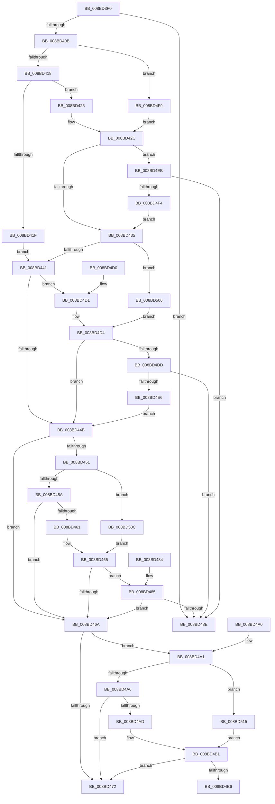

# RtlValidSecurityDescriptor

- RVA: `0x008BD3F0`–`0x008BD51B` (길이 `299` bytes)
- VA: `0x00000001408BD3F0`
- 실행 섹션: `PAGE`
- PDB 이름 있음: `예`; PDB Function 태그: `아니요`
- unwind 정보 RVA: `0x00083080`
- 디코드: `92`개 명령, `299/299` bytes 표시
- 미해석 바이트: `0` (있으면 어셈블리에 `.byte`로 보존)

> 이 문서는 커널 이미지의 기계어와 PDB 기호를 분석해 생성했습니다. 4번과 5번은 함수 원형과 자료형을 바이너리 사용 방식에서 추정한 C 해석이며 원본 소스 복구 결과는 아닙니다.

## 1. Dependencies

- 직접 호출 지점: **4**; 고유 호출 대상: **2**
- 직접 호출자로 확인된 함수: **18**
- RIP 상대 이미지 참조: **0**

### Outgoing calls
- `0x008BD485` → [RtlValidAcl](../92/RtlValidAcl_function_0092A7A0.md) (function, `0x0092A7A0`)
- `0x008BD4B6` → [RtlValidAcl](../92/RtlValidAcl_function_0092A7A0.md) (function, `0x0092A7A0`)
- `0x008BD4DD` → [RtlValidSid](../92/RtlValidSid_function_00929710.md) (function, `0x00929710`)
- `0x008BD4EB` → [RtlValidSid](../92/RtlValidSid_function_00929710.md) (function, `0x00929710`)

### Direct callers
- [AdtpIsSDValidSelfRelative](../../text/4D/AdtpIsSDValidSelfRelative_function_004DF684.md) at `0x004DF6A6`
- [PiAuGetServiceStateSecurityObject](../73/PiAuGetServiceStateSecurityObject_function_007314F0.md) at `0x0073169F`
- [PiAuGetStateDirectorySecurityObject](../73/PiAuGetStateDirectorySecurityObject_function_00731738.md) at `0x0073197F`
- [CMFCreateSecurityDescriptor](../7D/CMFCreateSecurityDescriptor_function_007D2B10.md) at `0x007D3049`
- [PnpGetEnumSecurityDescriptor](../83/PnpGetEnumSecurityDescriptor_function_00831FCC.md) at `0x00832258`
- [DrvDbGetSecurityDescriptor](../83/DrvDbGetSecurityDescriptor_function_0083580C.md) at `0x00835AE8`
- [sub_0089AEE3](../89/Unknown_function_0089AEE3.md) at `0x0089AF44`
- [ObInsertObjectEx](ObInsertObjectEx_function_008B97A0.md) at `0x008B9E42`
- [ObpSetObjectAuditInfo](ObpSetObjectAuditInfo_function_008BD1F8.md) at `0x008BD21C`
- [ObpAdjustAccessMask](ObpAdjustAccessMask_function_008BD380.md) at `0x008BD3A7`
- [_PnpOpenPropertiesKey](../99/_PnpOpenPropertiesKey_function_009938A0.md) at `0x00993AFC`
- [PiDevCfgGetKeySecurityDescriptor](../99/PiDevCfgGetKeySecurityDescriptor_function_00996240.md) at `0x0099652E`
- [PnpInitializeInheritedRestrictedSd](../A7/PnpInitializeInheritedRestrictedSd_function_00A7FB28.md) at `0x00A7FC53`
- [_PnpGetPropertiesSecurityDescriptor](../A9/_PnpGetPropertiesSecurityDescriptor_function_00A91B8C.md) at `0x00A91CB6`
- [sub_00B4403A](../B4/Unknown_function_00B4403A.md) at `0x00B440AE`
- [PiAuCreateLocalSystemSecurityObject](../../init/C3/PiAuCreateLocalSystemSecurityObject_function_00C34570.md) at `0x00C3466F`
- [PiAuCreateStandardSecurityObject](../../init/C3/PiAuCreateStandardSecurityObject_function_00C34710.md) at `0x00C34BB7`
- [PiAuGetDriverDataDirectorySecurityObject](../../init/C3/PiAuGetDriverDataDirectorySecurityObject_function_00C34EEC.md) at `0x00C35084`

### Static image references
- 디코드된 RIP-relative 메모리 참조가 없습니다.

## 2. Other-region calls and transfers

- 다른 실행 섹션으로 향하는 call: **0**
- 별도 외부 분기/꼬리 이동을 확인하지 못했습니다.

## 3. Assembly (complete function range)

```asm
008BD3F0  48 89 5C 24 08                  mov qword ptr [rsp + 8], rbx
008BD3F5  48 89 74 24 10                  mov qword ptr [rsp + 0x10], rsi
008BD3FA  57                              push rdi
008BD3FB  48 83 EC 20                     sub rsp, 0x20
008BD3FF  80 39 01                        cmp byte ptr [rcx], 1
008BD402  48 8B D9                        mov rbx, rcx
008BD405  0F 85 83 00 00 00               jne 0x1408bd48e
008BD40B  0F B7 79 02                     movzx edi, word ptr [rcx + 2]
008BD40F  66 85 FF                        test di, di
008BD412  0F 89 E1 00 00 00               jns 0x1408bd4f9
008BD418  8B 41 04                        mov eax, dword ptr [rcx + 4]
008BD41B  85 C0                           test eax, eax
008BD41D  75 06                           jne 0x1408bd425
008BD41F  48 8D 41 08                     lea rax, [rcx + 8]
008BD423  EB 1C                           jmp 0x1408bd441
008BD425  48 03 C8                        add rcx, rax
008BD428  48 8D 73 08                     lea rsi, [rbx + 8]
008BD42C  48 85 C9                        test rcx, rcx
008BD42F  0F 85 B6 00 00 00               jne 0x1408bd4eb
008BD435  48 8B C6                        mov rax, rsi
008BD438  66 85 FF                        test di, di
008BD43B  0F 89 C5 00 00 00               jns 0x1408bd506
008BD441  8B 08                           mov ecx, dword ptr [rax]
008BD443  85 C9                           test ecx, ecx
008BD445  0F 85 86 00 00 00               jne 0x1408bd4d1
008BD44B  40 F6 C7 04                     test dil, 4
008BD44F  74 19                           je 0x1408bd46a
008BD451  66 85 FF                        test di, di
008BD454  0F 89 B2 00 00 00               jns 0x1408bd50c
008BD45A  8B 43 10                        mov eax, dword ptr [rbx + 0x10]
008BD45D  85 C0                           test eax, eax
008BD45F  74 09                           je 0x1408bd46a
008BD461  48 8D 0C 03                     lea rcx, [rbx + rax]
008BD465  48 85 C9                        test rcx, rcx
008BD468  75 1B                           jne 0x1408bd485
008BD46A  0F B7 43 02                     movzx eax, word ptr [rbx + 2]
008BD46E  A8 10                           test al, 0x10
008BD470  75 2F                           jne 0x1408bd4a1
008BD472  B0 01                           mov al, 1
008BD474  48 8B 5C 24 30                  mov rbx, qword ptr [rsp + 0x30]
008BD479  48 8B 74 24 38                  mov rsi, qword ptr [rsp + 0x38]
008BD47E  48 83 C4 20                     add rsp, 0x20
008BD482  5F                              pop rdi
008BD483  C3                              ret
008BD484  CC                              int3
008BD485  E8 16 D3 06 00                  call 0x14092a7a0
008BD48A  84 C0                           test al, al
008BD48C  75 DC                           jne 0x1408bd46a
008BD48E  32 C0                           xor al, al
008BD490  48 8B 5C 24 30                  mov rbx, qword ptr [rsp + 0x30]
008BD495  48 8B 74 24 38                  mov rsi, qword ptr [rsp + 0x38]
008BD49A  48 83 C4 20                     add rsp, 0x20
008BD49E  5F                              pop rdi
008BD49F  C3                              ret
008BD4A0  CC                              int3
008BD4A1  66 85 C0                        test ax, ax
008BD4A4  79 6F                           jns 0x1408bd515
008BD4A6  8B 43 0C                        mov eax, dword ptr [rbx + 0xc]
008BD4A9  85 C0                           test eax, eax
008BD4AB  74 C5                           je 0x1408bd472
008BD4AD  48 8D 0C 03                     lea rcx, [rbx + rax]
008BD4B1  48 85 C9                        test rcx, rcx
008BD4B4  74 BC                           je 0x1408bd472
008BD4B6  E8 E5 D2 06 00                  call 0x14092a7a0
008BD4BB  48 8B 5C 24 30                  mov rbx, qword ptr [rsp + 0x30]
008BD4C0  84 C0                           test al, al
008BD4C2  48 8B 74 24 38                  mov rsi, qword ptr [rsp + 0x38]
008BD4C7  0F 95 C0                        setne al
008BD4CA  48 83 C4 20                     add rsp, 0x20
008BD4CE  5F                              pop rdi
008BD4CF  C3                              ret
008BD4D0  CC                              int3
008BD4D1  48 03 CB                        add rcx, rbx
008BD4D4  48 85 C9                        test rcx, rcx
008BD4D7  0F 84 6E FF FF FF               je 0x1408bd44b
008BD4DD  E8 2E C2 06 00                  call 0x140929710
008BD4E2  84 C0                           test al, al
008BD4E4  74 A8                           je 0x1408bd48e
008BD4E6  E9 60 FF FF FF                  jmp 0x1408bd44b
008BD4EB  E8 20 C2 06 00                  call 0x140929710
008BD4F0  84 C0                           test al, al
008BD4F2  74 9A                           je 0x1408bd48e
008BD4F4  E9 3C FF FF FF                  jmp 0x1408bd435
008BD4F9  48 8D 71 08                     lea rsi, [rcx + 8]
008BD4FD  48 8B 49 08                     mov rcx, qword ptr [rcx + 8]
008BD501  E9 26 FF FF FF                  jmp 0x1408bd42c
008BD506  48 8B 4B 10                     mov rcx, qword ptr [rbx + 0x10]
008BD50A  EB C8                           jmp 0x1408bd4d4
008BD50C  48 8B 4B 20                     mov rcx, qword ptr [rbx + 0x20]
008BD510  E9 50 FF FF FF                  jmp 0x1408bd465
008BD515  48 8B 4B 18                     mov rcx, qword ptr [rbx + 0x18]
008BD519  EB 96                           jmp 0x1408bd4b1
```

## 4. C-style interpretation (structured pseudocode)

```c
__int64 __fastcall RtlValidSecurityDescriptor(__int64 a1)
{
    __int64 result;
    __int64 v_rsp;
    unsigned __int64 v_stack_p10;
    unsigned __int64 v_stack_p30;
    unsigned __int64 v_stack_p38;
    unsigned __int64 v_stack_p58;
    unsigned __int64 v_stack_p60;
    unsigned __int64 v_stack_p8;

    v_stack_p8 = v_rbx;
    v_stack_p10 = v_rsi;
    v_rsp = (v_rsp) - (32);
    if ((*(unsigned __int8 *)(a1)) != 1) goto loc_008BD48E;
    if (!sign_flag) goto loc_008BD4F9;
    if ((unsigned int)((unsigned int)(*(unsigned int *)(a1 + 4))) != 0) goto loc_008BD425;
    goto loc_008BD441;
loc_008BD425:
    a1 = (a1) + (a1 + 8);
loc_008BD42C:
    if (a1 != 0) goto loc_008BD4EB;
loc_008BD435:
    if (!sign_flag) goto loc_008BD506;
loc_008BD441:
    if ((unsigned int)((unsigned int)(*(unsigned int *)(a1 + 8))) != 0) goto loc_008BD4D1;
loc_008BD44B:
    if ((((unsigned __int8)(*(unsigned __int16 *)(a1 + 2))) & (4)) == 0) goto loc_008BD46A;
    if (!sign_flag) goto loc_008BD50C;
    if ((unsigned int)((unsigned int)(*(unsigned int *)(a1 + 16))) == 0) goto loc_008BD46A;
loc_008BD465:
    if (a1 + (unsigned int)(*(unsigned int *)(a1 + 16)) * 1 != 0) goto loc_008BD485;
loc_008BD46A:
    if ((((unsigned __int8)(*(unsigned __int16 *)(a1 + 2))) & (16)) != 0) goto loc_008BD4A1;
loc_008BD472:
    v_rsp = (v_rsp) + (32);
    return 1;
loc_008BD485:
    result = RtlValidAcl(a1 + (unsigned int)(*(unsigned int *)(a1 + 16)) * 1, a2, a3, a4);
    if ((unsigned __int8)(result) != 0) goto loc_008BD46A;
loc_008BD48E:
    result = 0;
    v_rsp = (v_rsp) + (32);
    return result;
loc_008BD4A1:
    if (!sign_flag) goto loc_008BD515;
    if ((unsigned int)((unsigned int)(*(unsigned int *)(v_stack_p30 + 12))) == 0) goto loc_008BD472;
loc_008BD4B1:
    if (v_stack_p30 + (unsigned int)(*(unsigned int *)(v_stack_p30 + 12)) * 1 == 0) goto loc_008BD472;
    result = RtlValidAcl(v_stack_p30 + (unsigned int)(*(unsigned int *)(v_stack_p30 + 12)) * 1, a2, a3, a4);
    result = ((unsigned __int8)(result) != 0) ? 1 : 0;
    v_rsp = (v_rsp) + (32);
    return result;
loc_008BD4D1:
    a1 = (v_stack_p30 + (unsigned int)(*(unsigned int *)(v_stack_p30 + 12)) * 1) + (v_stack_p58);
loc_008BD4D4:
    if (a1 == 0) goto loc_008BD44B;
    result = RtlValidSid(a1, a2, a3, a4);
    if ((unsigned __int8)(result) == 0) goto loc_008BD48E;
    goto loc_008BD44B;
loc_008BD4EB:
    result = RtlValidSid(a1, a2, a3, a4);
    if ((unsigned __int8)(result) == 0) goto loc_008BD48E;
    goto loc_008BD435;
loc_008BD4F9:
    goto loc_008BD42C;
loc_008BD506:
    goto loc_008BD4D4;
loc_008BD50C:
    goto loc_008BD465;
loc_008BD515:
    goto loc_008BD4B1;
}
```

## 5. (Beta) C Style

```c
int64_t RtlValidSecurityDescriptor(void *Arg1)
{
    uint8_t *arg1 = (uint8_t *)Arg1;

    int64_t result;
    int64_t local_rsp;
    uint64_t v_stack_p10;
    uint64_t v_stack_p30;
    uint64_t v_stack_p38;
    uint64_t v_stack_p58;
    uint64_t v_stack_p60;
    uint64_t v_stack_p8;

    v_stack_p8 = local_rbx;
    v_stack_p10 = local_rsi;
    local_rsp = (local_rsp) - (32);
    if ((*(uint8_t *)(arg1)) != 1) goto loc_008BD48E;
    if (!sign_flag) goto loc_008BD4F9;
    if ((uint32_t)((uint32_t)(*(uint32_t *)(arg1 + 0x4))) != 0) goto loc_008BD425;
    goto loc_008BD441;
loc_008BD425:
    Arg1 = (Arg1) + (Arg1 + 8);
loc_008BD42C:
    if (Arg1 != NULL) goto loc_008BD4EB;
loc_008BD435:
    if (!sign_flag) goto loc_008BD506;
loc_008BD441:
    if ((uint32_t)((uint32_t)(*(uint32_t *)(arg1 + 0x8))) != 0) goto loc_008BD4D1;
loc_008BD44B:
    if ((((uint8_t)(*(uint16_t *)(arg1 + 0x2))) & (4)) == 0) goto loc_008BD46A;
    if (!sign_flag) goto loc_008BD50C;
    if ((uint32_t)((uint32_t)(*(uint32_t *)(arg1 + 0x10))) == 0) goto loc_008BD46A;
loc_008BD465:
    if (Arg1 + (uint32_t)(*(uint32_t *)(arg1 + 0x10)) * 1 != 0) goto loc_008BD485;
loc_008BD46A:
    if ((((uint8_t)(*(uint16_t *)(arg1 + 0x2))) & (16)) != 0) goto loc_008BD4A1;
loc_008BD472:
    local_rsp = (local_rsp) + (32);
    return 1;
loc_008BD485:
    result = RtlValidAcl(Arg1 + (uint32_t)(*(uint32_t *)(arg1 + 0x10)) * 1, a2, a3, a4);
    if ((uint8_t)(result) != 0) goto loc_008BD46A;
loc_008BD48E:
    result = 0;
    local_rsp = (local_rsp) + (32);
    return result;
loc_008BD4A1:
    if (!sign_flag) goto loc_008BD515;
    if ((uint32_t)((uint32_t)(*(uint32_t *)(v_stack_p30 + 0xC))) == 0) goto loc_008BD472;
loc_008BD4B1:
    if (v_stack_p30 + (uint32_t)(*(uint32_t *)(v_stack_p30 + 0xC)) * 1 == 0) goto loc_008BD472;
    result = RtlValidAcl(v_stack_p30 + (uint32_t)(*(uint32_t *)(v_stack_p30 + 0xC)) * 1, a2, a3, a4);
    result = ((uint8_t)(result) != 0) ? 1 : 0;
    local_rsp = (local_rsp) + (32);
    return result;
loc_008BD4D1:
    Arg1 = (v_stack_p30 + (uint32_t)(*(uint32_t *)(v_stack_p30 + 0xC)) * 1) + (v_stack_p58);
loc_008BD4D4:
    if (Arg1 == NULL) goto loc_008BD44B;
    result = RtlValidSid(Arg1, a2, a3, a4);
    if ((uint8_t)(result) == 0) goto loc_008BD48E;
    goto loc_008BD44B;
loc_008BD4EB:
    result = RtlValidSid(Arg1, a2, a3, a4);
    if ((uint8_t)(result) == 0) goto loc_008BD48E;
    goto loc_008BD435;
loc_008BD4F9:
    goto loc_008BD42C;
loc_008BD506:
    goto loc_008BD4D4;
loc_008BD50C:
    goto loc_008BD465;
loc_008BD515:
    goto loc_008BD4B1;
}
```

### 관측된 메모리 오프셋

구조체 형식이 확인되지 않은 접근은 인자 기준의 오프셋으로만 기록했습니다.

| 기준 인자 | 오프셋 표현 | 폭 (bit) | 접근 |
|---|---:|---:|---|
| `Arg1` | `+ 0x0` | `8` | `R` |
| `Arg1` | `+ 0x0` | `32` | `R` |
| `Arg1` | `+ 0x0 + rax*1` | `64` | `R` |
| `Arg1` | `+ 0x2` | `16` | `R` |
| `Arg1` | `+ 0x4` | `32` | `R` |
| `Arg1` | `+ 0x8` | `64` | `R` |
| `Arg1` | `+ 0xC` | `32` | `R` |
| `Arg1` | `+ 0x10` | `32` | `R` |
| `Arg1` | `+ 0x10` | `64` | `R` |
| `Arg1` | `+ 0x18` | `64` | `R` |
| `Arg1` | `+ 0x20` | `64` | `R` |

## 6. Execution-region graph

[열기: 2D/3D 그래프와 함수 탐색 컨트롤 패널](../../../control-panel.html?section=page&rva=0x008BD3F0&view=graph)

- 2D 그래프는 위에서 아래로 흐르고, 3D 그래프는 빈 공간을 드래그해 회전합니다. Shift+드래그는 이동, 휠은 확대·축소, 함수 노드 선택은 대상 보고서 이동입니다.

### Static fallback


