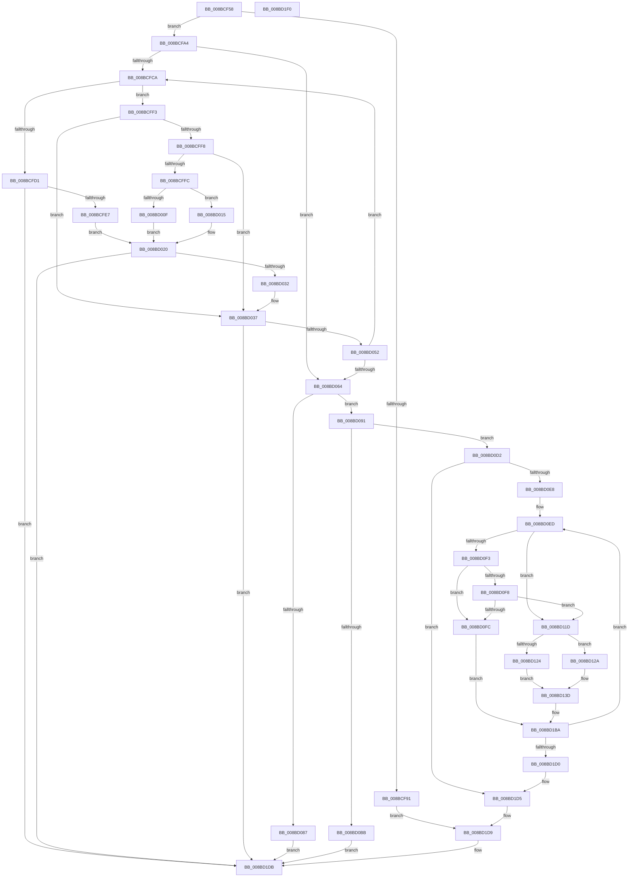

# RtlpCreateServerAcl

- RVA: `0x008BCF58`–`0x008BD1F1` (길이 `665` bytes)
- VA: `0x00000001408BCF58`
- 실행 섹션: `PAGE`
- PDB 이름 있음: `예`; PDB Function 태그: `아니요`
- unwind 정보 RVA: `0x0006F230`
- 디코드: `184`개 명령, `665/665` bytes 표시
- 미해석 바이트: `0` (있으면 어셈블리에 `.byte`로 보존)

> 이 문서는 커널 이미지의 기계어와 PDB 기호를 분석해 생성했습니다. 4번과 5번은 함수 원형과 자료형을 바이너리 사용 방식에서 추정한 C 해석이며 원본 소스 복구 결과는 아닙니다.

## 1. Dependencies

- 직접 호출 지점: **10**; 고유 호출 대상: **6**
- 직접 호출자로 확인된 함수: **2**
- RIP 상대 이미지 참조: **0**

### Outgoing calls
- `0x008BCFDA` → [RtlUShortAdd](../../text/47/RtlUShortAdd_function_00474F70.md) (function, `0x00474F70`)
- `0x008BD025` → [RtlUShortAdd](../../text/47/RtlUShortAdd_function_00474F70.md) (function, `0x00474F70`)
- `0x008BD045` → [RtlUShortAdd](../../text/47/RtlUShortAdd_function_00474F70.md) (function, `0x00474F70`)
- `0x008BD07A` → [ExAllocatePool2](../../poolcode/B8/ExAllocatePool2_function_00B820F0.md) (function, `0x00B820F0`)
- `0x008BD0A8` → [RtlCreateAcl](../91/RtlCreateAcl_function_00916F00.md) (function, `0x00916F00`)
- `0x008BD0C0` → [ExFreePoolWithTag](../../poolcode/B8/ExFreePoolWithTag_function_00B82870.md) (function, `0x00B82870`)
- `0x008BD107` → [memcpy](../../text/6C/memcpy_function_006C6840.md) (function, `0x006C6840`)
- `0x008BD12E` → [RtlLengthSid](../../text/45/RtlLengthSid_function_0045D270.md) (function, `0x0045D270`)
- `0x008BD15A` → [memcpy](../../text/6C/memcpy_function_006C6840.md) (function, `0x006C6840`)
- `0x008BD180` → [memcpy](../../text/6C/memcpy_function_006C6840.md) (function, `0x006C6840`)

### Direct callers
- [sub_008BC25B](Unknown_function_008BC25B.md) at `0x008BC2B3`
- [RtlpNewSecurityObject](../92/RtlpNewSecurityObject_function_0092AB50.md) at `0x0092C30B`

### Static image references
- 디코드된 RIP-relative 메모리 참조가 없습니다.

## 2. Other-region calls and transfers

- 다른 실행 섹션으로 향하는 call: **9**
  - `0x008BCFDA` → [RtlUShortAdd](../../text/47/RtlUShortAdd_function_00474F70.md) (`PAGE` → `.text`)
  - `0x008BD025` → [RtlUShortAdd](../../text/47/RtlUShortAdd_function_00474F70.md) (`PAGE` → `.text`)
  - `0x008BD045` → [RtlUShortAdd](../../text/47/RtlUShortAdd_function_00474F70.md) (`PAGE` → `.text`)
  - `0x008BD07A` → [ExAllocatePool2](../../poolcode/B8/ExAllocatePool2_function_00B820F0.md) (`PAGE` → `POOLCODE`)
  - `0x008BD0C0` → [ExFreePoolWithTag](../../poolcode/B8/ExFreePoolWithTag_function_00B82870.md) (`PAGE` → `POOLCODE`)
  - `0x008BD107` → [memcpy](../../text/6C/memcpy_function_006C6840.md) (`PAGE` → `.text`)
  - `0x008BD12E` → [RtlLengthSid](../../text/45/RtlLengthSid_function_0045D270.md) (`PAGE` → `.text`)
  - `0x008BD15A` → [memcpy](../../text/6C/memcpy_function_006C6840.md) (`PAGE` → `.text`)
  - `0x008BD180` → [memcpy](../../text/6C/memcpy_function_006C6840.md) (`PAGE` → `.text`)
- 별도 외부 분기/꼬리 이동을 확인하지 못했습니다.

## 3. Assembly (complete function range)

```asm
008BCF58  48 89 5C 24 10                  mov qword ptr [rsp + 0x10], rbx
008BCF5D  4C 89 44 24 18                  mov qword ptr [rsp + 0x18], r8
008BCF62  55                              push rbp
008BCF63  56                              push rsi
008BCF64  57                              push rdi
008BCF65  41 54                           push r12
008BCF67  41 55                           push r13
008BCF69  41 56                           push r14
008BCF6B  41 57                           push r15
008BCF6D  48 83 EC 20                     sub rsp, 0x20
008BCF71  4C 8B F1                        mov r14, rcx
008BCF74  41 BF 08 00 00 00               mov r15d, 8
008BCF7A  45 33 E4                        xor r12d, r12d
008BCF7D  41 0F B7 CF                     movzx ecx, r15w
008BCF81  66 89 4C 24 60                  mov word ptr [rsp + 0x60], cx
008BCF86  49 8B F1                        mov rsi, r9
008BCF89  44 8A EA                        mov r13b, dl
008BCF8C  4D 85 F6                        test r14, r14
008BCF8F  75 13                           jne 0x1408bcfa4
008BCF91  48 8B 84 24 80 00 00 00         mov rax, qword ptr [rsp + 0x80]
008BCF99  4D 89 21                        mov qword ptr [r9], r12
008BCF9C  44 88 20                        mov byte ptr [rax], r12b
008BCF9F  E9 35 02 00 00                  jmp 0x1408bd1d9
008BCFA4  45 0F B6 48 01                  movzx r9d, byte ptr [r8 + 1]
008BCFA9  49 8D 7E 08                     lea rdi, [r14 + 8]
008BCFAD  41 0F B7 6E 04                  movzx ebp, word ptr [r14 + 4]
008BCFB2  66 41 83 C1 02                  add r9w, 2
008BCFB7  66 41 C1 E1 02                  shl r9w, 2
008BCFBC  41 8B DC                        mov ebx, r12d
008BCFBF  4C 8B D7                        mov r10, rdi
008BCFC2  85 ED                           test ebp, ebp
008BCFC4  0F 84 9A 00 00 00               je 0x1408bd064
008BCFCA  41 8A 02                        mov al, byte ptr [r10]
008BCFCD  84 C0                           test al, al
008BCFCF  75 22                           jne 0x1408bcff3
008BCFD1  4C 8D 44 24 60                  lea r8, [rsp + 0x60]
008BCFD6  41 0F B7 D1                     movzx edx, r9w
008BCFDA  E8 91 7F BB FF                  call 0x140474f70
008BCFDF  85 C0                           test eax, eax
008BCFE1  0F 88 F4 01 00 00               js 0x1408bd1db
008BCFE7  0F B7 4C 24 60                  movzx ecx, word ptr [rsp + 0x60]
008BCFEC  BA 04 00 00 00                  mov edx, 4
008BCFF1  EB 2D                           jmp 0x1408bd020
008BCFF3  45 84 ED                        test r13b, r13b
008BCFF6  74 3F                           je 0x1408bd037
008BCFF8  3C 04                           cmp al, 4
008BCFFA  75 3B                           jne 0x1408bd037
008BCFFC  41 0F B6 42 0D                  movzx eax, byte ptr [r10 + 0xd]
008BD001  66 C1 E0 02                     shl ax, 2
008BD005  41 8D 14 07                     lea edx, [r15 + rax]
008BD009  66 41 3B D1                     cmp dx, r9w
008BD00D  76 06                           jbe 0x1408bd015
008BD00F  66 41 2B D1                     sub dx, r9w
008BD013  EB 0B                           jmp 0x1408bd020
008BD015  41 0F B7 D1                     movzx edx, r9w
008BD019  66 2B D0                        sub dx, ax
008BD01C  66 41 2B D7                     sub dx, r15w
008BD020  4C 8D 44 24 60                  lea r8, [rsp + 0x60]
008BD025  E8 46 7F BB FF                  call 0x140474f70
008BD02A  85 C0                           test eax, eax
008BD02C  0F 88 A9 01 00 00               js 0x1408bd1db
008BD032  0F B7 4C 24 60                  movzx ecx, word ptr [rsp + 0x60]
008BD037  45 0F B7 5A 02                  movzx r11d, word ptr [r10 + 2]
008BD03C  4C 8D 44 24 60                  lea r8, [rsp + 0x60]
008BD041  41 0F B7 D3                     movzx edx, r11w
008BD045  E8 26 7F BB FF                  call 0x140474f70
008BD04A  85 C0                           test eax, eax
008BD04C  0F 88 89 01 00 00               js 0x1408bd1db
008BD052  0F B7 4C 24 60                  movzx ecx, word ptr [rsp + 0x60]
008BD057  FF C3                           inc ebx
008BD059  4D 03 D3                        add r10, r11
008BD05C  3B DD                           cmp ebx, ebp
008BD05E  0F 82 66 FF FF FF               jb 0x1408bcfca
008BD064  0F B7 D9                        movzx ebx, cx
008BD067  41 B8 53 65 41 63               mov r8d, 0x63416553
008BD06D  83 C3 03                        add ebx, 3
008BD070  B9 00 01 00 00                  mov ecx, 0x100
008BD075  83 E3 FC                        and ebx, 0xfffffffc
008BD078  8B D3                           mov edx, ebx
008BD07A  E8 71 50 2C 00                  call 0x140b820f0
008BD07F  48 89 06                        mov qword ptr [rsi], rax
008BD082  48 85 C0                        test rax, rax
008BD085  75 0A                           jne 0x1408bd091
008BD087  B8 9A 00 00 C0                  mov eax, 0xc000009a
008BD08C  E9 4A 01 00 00                  jmp 0x1408bd1db
008BD091  4C 8B BC 24 80 00 00 00         mov r15, qword ptr [rsp + 0x80]
008BD099  41 B8 03 00 00 00               mov r8d, 3
008BD09F  8B D3                           mov edx, ebx
008BD0A1  48 8B C8                        mov rcx, rax
008BD0A4  41 C6 07 01                     mov byte ptr [r15], 1
008BD0A8  E8 53 9E 05 00                  call 0x140916f00
008BD0AD  48 8B 2E                        mov rbp, qword ptr [rsi]
008BD0B0  8B D8                           mov ebx, eax
008BD0B2  48 89 6C 24 60                  mov qword ptr [rsp + 0x60], rbp
008BD0B7  85 C0                           test eax, eax
008BD0B9  79 17                           jns 0x1408bd0d2
008BD0BB  33 D2                           xor edx, edx
008BD0BD  48 8B CD                        mov rcx, rbp
008BD0C0  E8 AB 57 2C 00                  call 0x140b82870
008BD0C5  8B C3                           mov eax, ebx
008BD0C7  4C 89 26                        mov qword ptr [rsi], r12
008BD0CA  45 88 27                        mov byte ptr [r15], r12b
008BD0CD  E9 09 01 00 00                  jmp 0x1408bd1db
008BD0D2  41 0F B7 46 04                  movzx eax, word ptr [r14 + 4]
008BD0D7  48 8D 5D 08                     lea rbx, [rbp + 8]
008BD0DB  41 8B F4                        mov esi, r12d
008BD0DE  66 44 3B E0                     cmp r12w, ax
008BD0E2  0F 83 ED 00 00 00               jae 0x1408bd1d5
008BD0E8  48 8B 6C 24 70                  mov rbp, qword ptr [rsp + 0x70]
008BD0ED  8A 07                           mov al, byte ptr [rdi]
008BD0EF  84 C0                           test al, al
008BD0F1  74 2A                           je 0x1408bd11d
008BD0F3  45 84 ED                        test r13b, r13b
008BD0F6  74 04                           je 0x1408bd0fc
008BD0F8  3C 04                           cmp al, 4
008BD0FA  74 21                           je 0x1408bd11d
008BD0FC  44 0F B7 47 02                  movzx r8d, word ptr [rdi + 2]
008BD101  48 8B D7                        mov rdx, rdi
008BD104  48 8B CB                        mov rcx, rbx
008BD107  E8 34 97 E0 FF                  call 0x1406c6840
008BD10C  0F B7 47 02                     movzx eax, word ptr [rdi + 2]
008BD110  48 03 D8                        add rbx, rax
008BD113  B8 01 00 00 00                  mov eax, 1
008BD118  E9 9D 00 00 00                  jmp 0x1408bd1ba
008BD11D  4C 8B E3                        mov r12, rbx
008BD120  84 C0                           test al, al
008BD122  75 06                           jne 0x1408bd12a
008BD124  4C 8D 7F 08                     lea r15, [rdi + 8]
008BD128  EB 13                           jmp 0x1408bd13d
008BD12A  48 8D 4F 0C                     lea rcx, [rdi + 0xc]
008BD12E  E8 3D 01 BA FF                  call 0x14045d270
008BD133  44 8B F8                        mov r15d, eax
008BD136  49 83 C7 0C                     add r15, 0xc
008BD13A  4C 03 FF                        add r15, rdi
008BD13D  48 8B 07                        mov rax, qword ptr [rdi]
008BD140  48 8B D5                        mov rdx, rbp
008BD143  48 89 03                        mov qword ptr [rbx], rax
008BD146  48 83 C3 0C                     add rbx, 0xc
008BD14A  44 0F B6 45 01                  movzx r8d, byte ptr [rbp + 1]
008BD14F  48 8B CB                        mov rcx, rbx
008BD152  4E 8D 04 85 08 00 00 00         lea r8, [r8*4 + 8]
008BD15A  E8 E1 96 E0 FF                  call 0x1406c6840
008BD15F  8A 45 01                        mov al, byte ptr [rbp + 1]
008BD162  49 8B D7                        mov rdx, r15
008BD165  45 0F B6 47 01                  movzx r8d, byte ptr [r15 + 1]
008BD16A  04 02                           add al, 2
008BD16C  C0 E0 02                        shl al, 2
008BD16F  0F B6 C0                        movzx eax, al
008BD172  48 03 D8                        add rbx, rax
008BD175  48 8B CB                        mov rcx, rbx
008BD178  4E 8D 04 85 08 00 00 00         lea r8, [r8*4 + 8]
008BD180  E8 BB 96 E0 FF                  call 0x1406c6840
008BD185  41 0F B6 47 01                  movzx eax, byte ptr [r15 + 1]
008BD18A  0F B6 4D 01                     movzx ecx, byte ptr [rbp + 1]
008BD18E  66 83 C1 07                     add cx, 7
008BD192  41 C6 04 24 04                  mov byte ptr [r12], 4
008BD197  66 03 C8                        add cx, ax
008BD19A  48 8D 1C 83                     lea rbx, [rbx + rax*4]
008BD19E  66 C1 E1 02                     shl cx, 2
008BD1A2  B8 01 00 00 00                  mov eax, 1
008BD1A7  66 41 89 4C 24 02               mov word ptr [r12 + 2], cx
008BD1AD  48 83 C3 08                     add rbx, 8
008BD1B1  66 41 89 44 24 08               mov word ptr [r12 + 8], ax
008BD1B7  45 33 E4                        xor r12d, r12d
008BD1BA  03 F0                           add esi, eax
008BD1BC  0F B7 47 02                     movzx eax, word ptr [rdi + 2]
008BD1C0  48 03 F8                        add rdi, rax
008BD1C3  41 0F B7 46 04                  movzx eax, word ptr [r14 + 4]
008BD1C8  3B F0                           cmp esi, eax
008BD1CA  0F 82 1D FF FF FF               jb 0x1408bd0ed
008BD1D0  48 8B 6C 24 60                  mov rbp, qword ptr [rsp + 0x60]
008BD1D5  66 89 45 04                     mov word ptr [rbp + 4], ax
008BD1D9  33 C0                           xor eax, eax
008BD1DB  48 8B 5C 24 68                  mov rbx, qword ptr [rsp + 0x68]
008BD1E0  48 83 C4 20                     add rsp, 0x20
008BD1E4  41 5F                           pop r15
008BD1E6  41 5E                           pop r14
008BD1E8  41 5D                           pop r13
008BD1EA  41 5C                           pop r12
008BD1EC  5F                              pop rdi
008BD1ED  5E                              pop rsi
008BD1EE  5D                              pop rbp
008BD1EF  C3                              ret
008BD1F0  CC                              int3
```

## 4. C-style interpretation (structured pseudocode)

```c
__int64 __fastcall RtlpCreateServerAcl(__int64 a1, unsigned __int8 a2, __int64 a3, __int64 a4, __int64 a5)
{
    __int64 result;
    __int64 v_r10;
    __int64 v_r12;
    __int64 v_r15;
    __int64 v_rbx;
    __int64 v_rdi;
    __int64 v_rsi;
    __int64 v_rsp;
    unsigned __int64 v_stack_p10;
    unsigned __int64 v_stack_p18;
    unsigned __int16 v_stack_p8;

    v_stack_p10 = v_rbx;
    v_stack_p18 = a3;
    v_rsp = (v_rsp) - (32);
    v_r12 = 0;
    v_stack_p8 = 8;
    if (a1 != 0) goto loc_008BCFA4;
    *(unsigned __int64 *)(a4) = 0;
    *(unsigned __int8 *)(a5) = 0;
    goto loc_008BD1D9;
loc_008BCFA4:
    a4 = (unsigned __int16)((*(unsigned __int8 *)(a3 + 1)) + (2));
    a4 = (unsigned __int16)((a4) << (2));
    if ((unsigned int)(*(unsigned __int16 *)(a1 + 4)) == 0) goto loc_008BD064;
loc_008BCFCA:
    if ((unsigned __int8)(*(unsigned __int8 *)(a1 + 8)) != 0) goto loc_008BCFF3;
    result = RtlUShortAdd(8, (unsigned __int16)(a4), v_stack_p8, a4);
    if (sign_flag) goto loc_008BD1DB;
    goto loc_008BD020;
loc_008BCFF3:
    if (a2 == 0) goto loc_008BD037;
    if (((unsigned __int8)(result)) != 4) goto loc_008BD037;
    result = (unsigned __int16)((*(unsigned __int8 *)(a1 + 8 + 13)) << (2));
    if (((unsigned __int16)(8 + result * 1)) <= ((unsigned __int16)(a4))) goto loc_008BD015;
    a2 = (unsigned __int16)((8 + result * 1) - ((unsigned __int16)(a4)));
    goto loc_008BD020;
loc_008BD015:
    a2 = (unsigned __int16)(((unsigned __int16)(a4)) - ((unsigned __int16)(result)));
    a2 = (unsigned __int16)((a2) - (8));
loc_008BD020:
    result = RtlUShortAdd(v_stack_p8, a2, v_stack_p8, a4);
    if (sign_flag) goto loc_008BD1DB;
loc_008BD037:
    result = RtlUShortAdd(v_stack_p8, (unsigned __int16)(*(unsigned __int16 *)(a1 + 8 + 2)), v_stack_p8, a4);
    if (sign_flag) goto loc_008BD1DB;
    v_rbx = (unsigned int)((0) + 1);
    v_r10 = (a1 + 8) + (*(unsigned __int16 *)(a1 + 8 + 2));
    if (((unsigned int)(v_rbx)) < ((unsigned int)(*(unsigned __int16 *)(a1 + 4)))) goto loc_008BCFCA;
loc_008BD064:
    v_rbx = (unsigned int)(((unsigned __int16)(v_stack_p8)) + (3));
    v_rbx = (unsigned int)((v_rbx) & (0xFFFFFFFCULL));
    result = ExAllocatePool2(256, (unsigned int)((unsigned int)(v_rbx)), (unsigned int)(0x63416553ULL), a4);
    *(unsigned __int64 *)(a4) = result;
    if (result != 0) goto loc_008BD091;
    goto loc_008BD1DB;
loc_008BD091:
    *(unsigned __int8 *)(a5) = 1;
    result = RtlCreateAcl((unsigned int)(0xC000009AULL), (unsigned int)((unsigned int)(v_rbx)), 3, a4);
    v_stack_p8 = *(unsigned __int64 *)(a4);
    if (!sign_flag) goto loc_008BD0D2;
    a2 = 0;
    result = ExFreePoolWithTag(*(unsigned __int64 *)(a4), a2, 3, a4);
    *(unsigned __int64 *)(a4) = 0;
    *(unsigned __int8 *)(a5) = 0;
    goto loc_008BD1DB;
loc_008BD0D2:
    if (0 >= ((unsigned __int16)(*(unsigned __int16 *)(a1 + 4)))) goto loc_008BD1D5;
loc_008BD0ED:
    if ((unsigned __int8)(*(unsigned __int8 *)(a1 + 8)) == 0) goto loc_008BD11D;
    if (0 == 0) goto loc_008BD0FC;
    if (((unsigned __int8)(*(unsigned __int8 *)(a1 + 8))) == 4) goto loc_008BD11D;
loc_008BD0FC:
    result = memcpy(*(unsigned __int64 *)(a4) + 8, a1 + 8, *(unsigned __int16 *)(a1 + 8 + 2), a4);
    v_rbx = (*(unsigned __int64 *)(a4) + 8) + (*(unsigned __int16 *)(a1 + 8 + 2));
    goto loc_008BD1BA;
loc_008BD11D:
    if (1 != 0) goto loc_008BD12A;
    goto loc_008BD13D;
loc_008BD12A:
    result = RtlLengthSid(a1 + 8 + 12, a1 + 8, *(unsigned __int16 *)(a1 + 8 + 2), a4);
    v_r15 = ((unsigned int)((unsigned int)(result))) + (12);
    v_r15 = (v_r15) + (a1 + 8);
loc_008BD13D:
    *(unsigned __int64 *)(v_rbx) = *(unsigned __int64 *)(a1 + 8);
    v_rbx = (v_rbx) + (12);
    result = memcpy(v_rbx, v_stack_p18, *(unsigned __int8 *)(v_stack_p18 + 1) * 4 + 8, a4);
    result = (unsigned __int8)((*(unsigned __int8 *)(v_stack_p18 + 1)) + (2));
    result = (unsigned __int8)((result) << (2));
    v_rbx = (v_rbx) + ((unsigned __int8)(result));
    result = memcpy(v_rbx, v_r15, *(unsigned __int8 *)(v_r15 + 1) * 4 + 8, a4);
    a1 = (unsigned __int16)((*(unsigned __int8 *)(v_stack_p18 + 1)) + (7));
    *(unsigned __int8 *)(v_rbx) = 4;
    a1 = (unsigned __int16)((a1) + ((unsigned __int16)(*(unsigned __int8 *)(v_r15 + 1))));
    a1 = (unsigned __int16)((a1) << (2));
    *(unsigned __int16 *)(v_rbx + 2) = (unsigned __int16)(a1);
    v_rbx = (v_rbx + *(unsigned __int8 *)(v_r15 + 1) * 4) + (8);
    *(unsigned __int16 *)(v_rbx + 8) = 1;
    v_r12 = 0;
loc_008BD1BA:
    v_rsi = (unsigned int)((0) + (1));
    v_rdi = (a1 + 8) + (*(unsigned __int16 *)(a1 + 8 + 2));
    if (((unsigned int)(v_rsi)) < ((unsigned int)(*(unsigned __int16 *)(a1 + 4)))) goto loc_008BD0ED;
loc_008BD1D5:
    *(unsigned __int16 *)(v_stack_p8 + 4) = (unsigned __int16)(*(unsigned __int16 *)(a1 + 4));
loc_008BD1D9:
    result = 0;
loc_008BD1DB:
    v_rsp = (v_rsp) + (32);
    return result;
}
```

## 5. (Beta) C Style

```c
int64_t RtlpCreateServerAcl(int64_t Arg1, uint8_t Arg2, void *Arg3, void *Arg4, void *Arg5)
{
    uint8_t *arg3 = (uint8_t *)Arg3;
    uint8_t *arg4 = (uint8_t *)Arg4;
    uint8_t *arg5 = (uint8_t *)Arg5;

    int64_t result;
    int64_t local_r10;
    int64_t local_r12;
    int64_t local_r15;
    int64_t local_rbx;
    int64_t local_rdi;
    int64_t local_rsi;
    int64_t local_rsp;
    uint64_t v_stack_p10;
    uint64_t v_stack_p18;
    uint16_t v_stack_p8;

    v_stack_p10 = local_rbx;
    v_stack_p18 = Arg3;
    local_rsp = (local_rsp) - (32);
    local_r12 = 0;
    v_stack_p8 = 8;
    if (Arg1 != 0) goto loc_008BCFA4;
    *(uint64_t *)(arg4) = 0;
    *(uint8_t *)(arg5) = 0;
    goto loc_008BD1D9;
loc_008BCFA4:
    Arg4 = (uint16_t)((*(uint8_t *)(arg3 + 0x1)) + (2));
    Arg4 = (uint16_t)((Arg4) << (2));
    if ((uint32_t)(*(uint16_t *)(Arg1 + 0x4)) == 0) goto loc_008BD064;
loc_008BCFCA:
    if ((uint8_t)(*(uint8_t *)(Arg1 + 0x8)) != 0) goto loc_008BCFF3;
    result = RtlUShortAdd(8, (uint16_t)(Arg4), v_stack_p8, Arg4);
    if (sign_flag) goto loc_008BD1DB;
    goto loc_008BD020;
loc_008BCFF3:
    if (Arg2 == 0) goto loc_008BD037;
    if (((uint8_t)(result)) != 4) goto loc_008BD037;
    result = (uint16_t)((*(uint8_t *)(Arg1 + 0x8 + 0xD)) << (2));
    if (((uint16_t)(8 + result * 1)) <= ((uint16_t)(Arg4))) goto loc_008BD015;
    Arg2 = (uint16_t)((8 + result * 1) - ((uint16_t)(Arg4)));
    goto loc_008BD020;
loc_008BD015:
    Arg2 = (uint16_t)(((uint16_t)(Arg4)) - ((uint16_t)(result)));
    Arg2 = (uint16_t)((Arg2) - (8));
loc_008BD020:
    result = RtlUShortAdd(v_stack_p8, Arg2, v_stack_p8, Arg4);
    if (sign_flag) goto loc_008BD1DB;
loc_008BD037:
    result = RtlUShortAdd(v_stack_p8, (uint16_t)(*(uint16_t *)(Arg1 + 0x8 + 0x2)), v_stack_p8, Arg4);
    if (sign_flag) goto loc_008BD1DB;
    local_rbx = (uint32_t)((0) + 1);
    local_r10 = (Arg1 + 8) + (*(uint16_t *)(Arg1 + 0x8 + 0x2));
    if (((uint32_t)(local_rbx)) < ((uint32_t)(*(uint16_t *)(Arg1 + 0x4)))) goto loc_008BCFCA;
loc_008BD064:
    local_rbx = (uint32_t)(((uint16_t)(v_stack_p8)) + (3));
    local_rbx = (uint32_t)((local_rbx) & (0xFFFFFFFCULL));
    result = ExAllocatePool2(256, (uint32_t)((uint32_t)(local_rbx)), (uint32_t)(0x63416553ULL), Arg4);
    *(uint64_t *)(arg4) = result;
    if (result != 0) goto loc_008BD091;
    goto loc_008BD1DB;
loc_008BD091:
    *(uint8_t *)(arg5) = 1;
    result = RtlCreateAcl((uint32_t)(0xC000009AULL), (uint32_t)((uint32_t)(local_rbx)), 3, Arg4);
    v_stack_p8 = *(uint64_t *)(arg4);
    if (!sign_flag) goto loc_008BD0D2;
    Arg2 = 0;
    result = ExFreePoolWithTag(*(uint64_t *)(arg4), Arg2, 3, Arg4);
    *(uint64_t *)(arg4) = 0;
    *(uint8_t *)(arg5) = 0;
    goto loc_008BD1DB;
loc_008BD0D2:
    if (0 >= ((uint16_t)(*(uint16_t *)(Arg1 + 0x4)))) goto loc_008BD1D5;
loc_008BD0ED:
    if ((uint8_t)(*(uint8_t *)(Arg1 + 0x8)) == 0) goto loc_008BD11D;
    if (0 == 0) goto loc_008BD0FC;
    if (((uint8_t)(*(uint8_t *)(Arg1 + 0x8))) == 4) goto loc_008BD11D;
loc_008BD0FC:
    result = memcpy(*(uint64_t *)(arg4) + 8, Arg1 + 8, *(uint16_t *)(Arg1 + 0x8 + 0x2), Arg4);
    local_rbx = (*(uint64_t *)(arg4) + 8) + (*(uint16_t *)(Arg1 + 0x8 + 0x2));
    goto loc_008BD1BA;
loc_008BD11D:
    if (1 != 0) goto loc_008BD12A;
    goto loc_008BD13D;
loc_008BD12A:
    result = RtlLengthSid(Arg1 + 8 + 12, Arg1 + 8, *(uint16_t *)(Arg1 + 0x8 + 0x2), Arg4);
    local_r15 = ((uint32_t)((uint32_t)(result))) + (12);
    local_r15 = (local_r15) + (Arg1 + 8);
loc_008BD13D:
    *(uint64_t *)(local_rbx) = *(uint64_t *)(Arg1 + 0x8);
    local_rbx = (local_rbx) + (12);
    result = memcpy(local_rbx, v_stack_p18, *(uint8_t *)(v_stack_p18 + 0x1) * 4 + 8, Arg4);
    result = (uint8_t)((*(uint8_t *)(v_stack_p18 + 0x1)) + (2));
    result = (uint8_t)((result) << (2));
    local_rbx = (local_rbx) + ((uint8_t)(result));
    result = memcpy(local_rbx, local_r15, *(uint8_t *)(local_r15 + 0x1) * 4 + 8, Arg4);
    Arg1 = (uint16_t)((*(uint8_t *)(v_stack_p18 + 0x1)) + (7));
    *(uint8_t *)(local_rbx) = 4;
    Arg1 = (uint16_t)((Arg1) + ((uint16_t)(*(uint8_t *)(local_r15 + 0x1))));
    Arg1 = (uint16_t)((Arg1) << (2));
    *(uint16_t *)(local_rbx + 0x2) = (uint16_t)(Arg1);
    local_rbx = (local_rbx + *(uint8_t *)(local_r15 + 0x1) * 4) + (8);
    *(uint16_t *)(local_rbx + 0x8) = 1;
    local_r12 = 0;
loc_008BD1BA:
    local_rsi = (uint32_t)((0) + (1));
    local_rdi = (Arg1 + 8) + (*(uint16_t *)(Arg1 + 0x8 + 0x2));
    if (((uint32_t)(local_rsi)) < ((uint32_t)(*(uint16_t *)(Arg1 + 0x4)))) goto loc_008BD0ED;
loc_008BD1D5:
    *(uint16_t *)(v_stack_p8 + 0x4) = (uint16_t)(*(uint16_t *)(Arg1 + 0x4));
loc_008BD1D9:
    result = 0;
loc_008BD1DB:
    local_rsp = (local_rsp) + (32);
    return result;
}
```

### 관측된 메모리 오프셋

구조체 형식이 확인되지 않은 접근은 인자 기준의 오프셋으로만 기록했습니다.

| 기준 인자 | 오프셋 표현 | 폭 (bit) | 접근 |
|---|---:|---:|---|
| `Arg3` | `+ 0x1` | `8` | `R` |
| `Arg4` | `+ 0x0` | `64` | `R` |
| `Arg4` | `+ 0x0` | `64` | `W` |
| `Arg5` | `+ 0x0` | `8` | `W` |

## 6. Execution-region graph

[열기: 2D/3D 그래프와 함수 탐색 컨트롤 패널](../../../control-panel.html?section=page&rva=0x008BCF58&view=graph)

- 2D 그래프는 위에서 아래로 흐르고, 3D 그래프는 빈 공간을 드래그해 회전합니다. Shift+드래그는 이동, 휠은 확대·축소, 함수 노드 선택은 대상 보고서 이동입니다.

### Static fallback


