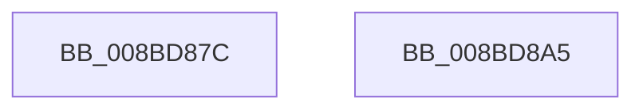

# RtlpFreeAtom

- RVA: `0x008BD87C`–`0x008BD8A6` (길이 `42` bytes)
- VA: `0x00000001408BD87C`
- 실행 섹션: `PAGE`
- PDB 이름 있음: `예`; PDB Function 태그: `아니요`
- unwind 정보 RVA: `0x0005CF00`
- 디코드: `14`개 명령, `42/42` bytes 표시
- 미해석 바이트: `0` (있으면 어셈블리에 `.byte`로 보존)

> 이 문서는 커널 이미지의 기계어와 PDB 기호를 분석해 생성했습니다. 4번과 5번은 함수 원형과 자료형을 바이너리 사용 방식에서 추정한 C 해석이며 원본 소스 복구 결과는 아닙니다.

## 1. Dependencies

- 직접 호출 지점: **2**; 고유 호출 대상: **2**
- 직접 호출자로 확인된 함수: **8**
- RIP 상대 이미지 참조: **0**

### Outgoing calls
- `0x008BD890` → [PsReturnSharedPoolQuota](PsReturnSharedPoolQuota_function_008BCC30.md) (function, `0x008BCC30`)
- `0x008BD89A` → [ExFreePoolWithTag](../../poolcode/B8/ExFreePoolWithTag_function_00B82870.md) (function, `0x00B82870`)

### Direct callers
- [RtlAddAtomToAtomTableEx](../../text/43/RtlAddAtomToAtomTableEx_function_00438550.md) at `0x00438767`
- [RtlAddAtomToAtomTableEx](../../text/43/RtlAddAtomToAtomTableEx_function_00438550.md) at `0x0043876F`
- [RtlpAllocateAtomTableEntry](../../text/43/RtlpAllocateAtomTableEntry_function_004387CC.md) at `0x0043885F`
- [RtlDestroyLowBoxAtoms](../../text/47/RtlDestroyLowBoxAtoms_function_004790E0.md) at `0x00479195`
- [RtlpDereferenceAtom](../../text/47/RtlpDereferenceAtom_function_004791B4.md) at `0x00479228`
- [RtlpFreeAllAtom](../../text/47/RtlpFreeAllAtom_function_00479244.md) at `0x004792BA`
- [RtlpFreeAllAtom](../../text/47/RtlpFreeAllAtom_function_00479244.md) at `0x004792DE`
- [RtlCreateAtomTableEx](../../text/4A/RtlCreateAtomTableEx_function_004A0670.md) at `0x004A072A`
- [RtlEmptyAtomTable](../78/RtlEmptyAtomTable_function_0078E1B0.md) at `0x0078E241`
- [RtlEmptyAtomTable](../78/RtlEmptyAtomTable_function_0078E1B0.md) at `0x0078E24B`
- [RtlDestroyAtomTable](../9C/RtlDestroyAtomTable_function_009C43F0.md) at `0x009C448D`
- [RtlDestroyAtomTable](../9C/RtlDestroyAtomTable_function_009C43F0.md) at `0x009C44AA`
- [RtlDestroyAtomTable](../9C/RtlDestroyAtomTable_function_009C43F0.md) at `0x009C44C7`

### Static image references
- 디코드된 RIP-relative 메모리 참조가 없습니다.

## 2. Other-region calls and transfers

- 다른 실행 섹션으로 향하는 call: **1**
  - `0x008BD89A` → [ExFreePoolWithTag](../../poolcode/B8/ExFreePoolWithTag_function_00B82870.md) (`PAGE` → `POOLCODE`)
- 별도 외부 분기/꼬리 이동을 확인하지 못했습니다.

## 3. Assembly (complete function range)

```asm
008BD87C  40 53                           push rbx
008BD87E  48 83 EC 20                     sub rsp, 0x20
008BD882  48 8D 59 F0                     lea rbx, [rcx - 0x10]
008BD886  45 33 C0                        xor r8d, r8d
008BD889  48 8B 53 08                     mov rdx, qword ptr [rbx + 8]
008BD88D  48 8B 0B                        mov rcx, qword ptr [rbx]
008BD890  E8 9B F3 FF FF                  call 0x1408bcc30
008BD895  33 D2                           xor edx, edx
008BD897  48 8B CB                        mov rcx, rbx
008BD89A  E8 D1 4F 2C 00                  call 0x140b82870
008BD89F  48 83 C4 20                     add rsp, 0x20
008BD8A3  5B                              pop rbx
008BD8A4  C3                              ret
008BD8A5  CC                              int3
```

## 4. C-style interpretation (structured pseudocode)

```c
__int64 __fastcall RtlpFreeAtom(__int64 a1, __int64 a2, int a3)
{
    __int64 result;
    __int64 v_rsp;

    v_rsp = (v_rsp) - (32);
    a3 = 0;
    result = PsReturnSharedPoolQuota(*(unsigned __int64 *)(a1 - 16), *(unsigned __int64 *)(a1 - 16 + 8), a3, a4);
    a2 = 0;
    result = ExFreePoolWithTag(a1 - 16, a2, a3, a4);
    v_rsp = (v_rsp) + (32);
    return result;
}
```

## 5. (Beta) C Style

```c
int64_t RtlpFreeAtom(void *Arg1, int64_t Arg2, int32_t Arg3)
{
    uint8_t *arg1 = (uint8_t *)Arg1;

    int64_t result;
    int64_t local_rsp;

    local_rsp = (local_rsp) - (32);
    Arg3 = 0;
    result = PsReturnSharedPoolQuota(*(uint64_t *)(arg1 - 0x10), *(uint64_t *)(arg1 - 0x10 + 0x8), Arg3, a4);
    Arg2 = 0;
    result = ExFreePoolWithTag(Arg1 - 16, Arg2, Arg3, a4);
    local_rsp = (local_rsp) + (32);
    return result;
}
```

### 관측된 메모리 오프셋

구조체 형식이 확인되지 않은 접근은 인자 기준의 오프셋으로만 기록했습니다.

| 기준 인자 | 오프셋 표현 | 폭 (bit) | 접근 |
|---|---:|---:|---|
| `Arg1` | `- 0x10` | `64` | `R` |
| `Arg1` | `+ 0x0` | `64` | `R` |
| `Arg1` | `+ 0x8` | `64` | `R` |

## 6. Execution-region graph

[열기: 2D/3D 그래프와 함수 탐색 컨트롤 패널](../../../control-panel.html?section=page&rva=0x008BD87C&view=graph)

- 2D 그래프는 위에서 아래로 흐르고, 3D 그래프는 빈 공간을 드래그해 회전합니다. Shift+드래그는 이동, 휠은 확대·축소, 함수 노드 선택은 대상 보고서 이동입니다.

### Static fallback


