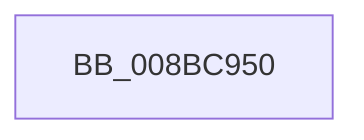

# RtlpNormalizeAcl

- RVA: `0x008BC950`–`0x008BC997` (길이 `71` bytes)
- VA: `0x00000001408BC950`
- 실행 섹션: `PAGE`
- PDB 이름 있음: `예`; PDB Function 태그: `예`
- unwind 정보 RVA: `0x00082FC0`
- 디코드: `20`개 명령, `71/71` bytes 표시
- 미해석 바이트: `0` (있으면 어셈블리에 `.byte`로 보존)

> 이 문서는 커널 이미지의 기계어와 PDB 기호를 분석해 생성했습니다. 4번과 5번은 함수 원형과 자료형을 바이너리 사용 방식에서 추정한 C 해석이며 원본 소스 복구 결과는 아닙니다.

## 1. Dependencies

- 직접 호출 지점: **0**; 고유 호출 대상: **0**
- 직접 호출자로 확인된 함수: **4**
- RIP 상대 이미지 참조: **1**

### Outgoing calls
- 직접 디코드된 call 명령이 없습니다.

### Direct callers
- [RtlNormalizeSecurityDescriptor](../../text/4B/RtlNormalizeSecurityDescriptor_function_004BABA0.md) at `0x004BACAC`
- [RtlNormalizeSecurityDescriptor](../../text/4B/RtlNormalizeSecurityDescriptor_function_004BABA0.md) at `0x004BAD24`
- [sub_008BB534](Unknown_function_008BB534.md) at `0x008BB860`
- [sub_008BC25B](Unknown_function_008BC25B.md) at `0x008BC362`
- [RtlpNewSecurityObject](../92/RtlpNewSecurityObject_function_0092AB50.md) at `0x0092C4A8`
- [RtlpNewSecurityObject](../92/RtlpNewSecurityObject_function_0092AB50.md) at `0x0092C5A1`

### Static image references
- `0x008BC963` → RVA `0x00E0A740` (`.data`; read)

## 2. Other-region calls and transfers

- 다른 실행 섹션으로 향하는 call: **0**
- 별도 외부 분기/꼬리 이동을 확인하지 못했습니다.

## 3. Assembly (complete function range)

```asm
008BC950  40 53                           push rbx
008BC952  56                              push rsi
008BC953  57                              push rdi
008BC954  41 54                           push r12
008BC956  41 55                           push r13
008BC958  41 56                           push r14
008BC95A  41 57                           push r15
008BC95C  48 81 EC 80 00 00 00            sub rsp, 0x80
008BC963  48 8B 05 D6 DD 54 00            mov rax, qword ptr [rip + 0x54ddd6]
008BC96A  48 33 C4                        xor rax, rsp
008BC96D  48 89 44 24 70                  mov qword ptr [rsp + 0x70], rax
008BC972  45 33 C9                        xor r9d, r9d
008BC975  4C 89 44 24 48                  mov qword ptr [rsp + 0x48], r8
008BC97A  4C 8D 5A 08                     lea r11, [rdx + 8]
008BC97E  48 89 4C 24 40                  mov qword ptr [rsp + 0x40], rcx
008BC983  4D 8B D0                        mov r10, r8
008BC986  48 89 54 24 58                  mov qword ptr [rsp + 0x58], rdx
008BC98B  4C 8B F9                        mov r15, rcx
008BC98E  4C 89 5C 24 50                  mov qword ptr [rsp + 0x50], r11
008BC993  48 8D 79 08                     lea rdi, [rcx + 8]
```

## 4. C-style interpretation (structured pseudocode)

```c
__int64 __fastcall RtlpNormalizeAcl(__int64 a1, __int64 a2, __int64 a3, int a4)
{
    __int64 result;
    __int64 v_rsp;
    unsigned __int64 v_stack_m48;
    unsigned __int64 v_stack_m60;
    unsigned __int64 v_stack_m68;
    unsigned __int64 v_stack_m70;
    unsigned __int64 v_stack_m78;

    v_rsp = (v_rsp) - (128);
    result = (*(unsigned __int64 *)(v_rip + 5561814)) ^ (v_rsp);
    v_stack_m48 = result;
    a4 = 0;
    v_stack_m70 = a3;
    v_stack_m78 = a1;
    v_stack_m60 = a2;
    v_stack_m68 = a2 + 8;
    return result;
}
```

## 5. (Beta) C Style

```c
int64_t RtlpNormalizeAcl(void *Arg1, void *Arg2, int64_t Arg3, int32_t Arg4)
{
    uint8_t *arg1 = (uint8_t *)Arg1;
    uint8_t *arg2 = (uint8_t *)Arg2;

    int64_t result;
    int64_t local_rsp;
    uint64_t v_stack_m48;
    uint64_t v_stack_m60;
    uint64_t v_stack_m68;
    uint64_t v_stack_m70;
    uint64_t v_stack_m78;

    local_rsp = (local_rsp) - (128);
    result = (*(uint64_t *)(v_rip + 0x54DDD6)) ^ (local_rsp);
    v_stack_m48 = result;
    Arg4 = 0;
    v_stack_m70 = Arg3;
    v_stack_m78 = Arg1;
    v_stack_m60 = Arg2;
    v_stack_m68 = Arg2 + 8;
    return result;
}
```

### 관측된 메모리 오프셋

구조체 형식이 확인되지 않은 접근은 인자 기준의 오프셋으로만 기록했습니다.

| 기준 인자 | 오프셋 표현 | 폭 (bit) | 접근 |
|---|---:|---:|---|
| `Arg1` | `+ 0x8` | `64` | `R` |
| `Arg2` | `+ 0x8` | `64` | `R` |

## 6. Execution-region graph

[열기: 2D/3D 그래프와 함수 탐색 컨트롤 패널](../../../control-panel.html?section=page&rva=0x008BC950&view=graph)

- 2D 그래프는 위에서 아래로 흐르고, 3D 그래프는 빈 공간을 드래그해 회전합니다. Shift+드래그는 이동, 휠은 확대·축소, 함수 노드 선택은 대상 보고서 이동입니다.

### Static fallback


