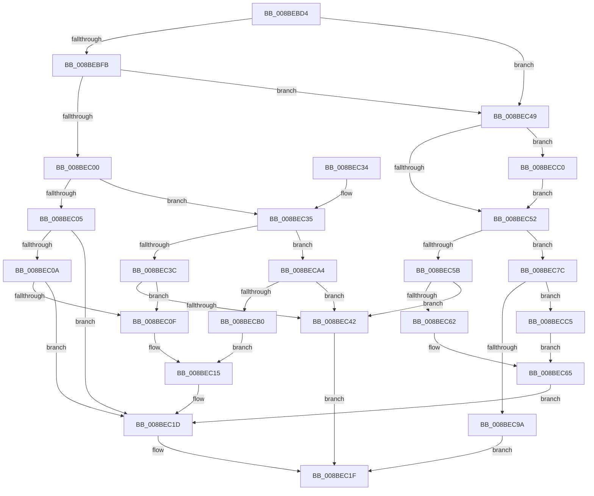

# RtlpQueryRegistryDirect

- RVA: `0x008BEBD4`–`0x008BECCB` (길이 `247` bytes)
- VA: `0x00000001408BEBD4`
- 실행 섹션: `PAGE`
- PDB 이름 있음: `예`; PDB Function 태그: `아니요`
- unwind 정보 RVA: `0x0008323C`
- 디코드: `78`개 명령, `247/247` bytes 표시
- 미해석 바이트: `0` (있으면 어셈블리에 `.byte`로 보존)

> 이 문서는 커널 이미지의 기계어와 PDB 기호를 분석해 생성했습니다. 4번과 5번은 함수 원형과 자료형을 바이너리 사용 방식에서 추정한 C 해석이며 원본 소스 복구 결과는 아닙니다.

## 1. Dependencies

- 직접 호출 지점: **3**; 고유 호출 대상: **2**
- 직접 호출자로 확인된 함수: **2**
- RIP 상대 이미지 참조: **0**

### Outgoing calls
- `0x008BEC18` → [memcpy](../../text/6C/memcpy_function_006C6840.md) (function, `0x006C6840`)
- `0x008BEC6E` → [memcpy](../../text/6C/memcpy_function_006C6840.md) (function, `0x006C6840`)
- `0x008BEC8C` → [ExAllocatePool2](../../poolcode/B8/ExAllocatePool2_function_00B820F0.md) (function, `0x00B820F0`)

### Direct callers
- [RtlpCallQueryRegistryRoutine](RtlpCallQueryRegistryRoutine_function_008BE844.md) at `0x008BE919`
- [sub_00B1AD48](../B1/Unknown_function_00B1AD48.md) at `0x00B1AD57`

### Static image references
- 디코드된 RIP-relative 메모리 참조가 없습니다.

## 2. Other-region calls and transfers

- 다른 실행 섹션으로 향하는 call: **3**
  - `0x008BEC18` → [memcpy](../../text/6C/memcpy_function_006C6840.md) (`PAGE` → `.text`)
  - `0x008BEC6E` → [memcpy](../../text/6C/memcpy_function_006C6840.md) (`PAGE` → `.text`)
  - `0x008BEC8C` → [ExAllocatePool2](../../poolcode/B8/ExAllocatePool2_function_00B820F0.md) (`PAGE` → `POOLCODE`)
- 별도 외부 분기/꼬리 이동을 확인하지 못했습니다.

## 3. Assembly (complete function range)

```asm
008BEBD4  48 89 5C 24 08                  mov qword ptr [rsp + 8], rbx
008BEBD9  48 89 6C 24 10                  mov qword ptr [rsp + 0x10], rbp
008BEBDE  48 89 74 24 18                  mov qword ptr [rsp + 0x18], rsi
008BEBE3  57                              push rdi
008BEBE4  48 83 EC 20                     sub rsp, 0x20
008BEBE8  8D 41 FF                        lea eax, [rcx - 1]
008BEBEB  41 8B D8                        mov ebx, r8d
008BEBEE  48 8B F2                        mov rsi, rdx
008BEBF1  49 8B F9                        mov rdi, r9
008BEBF4  8B D1                           mov edx, ecx
008BEBF6  83 F8 01                        cmp eax, 1
008BEBF9  76 4E                           jbe 0x1408bec49
008BEBFB  83 F9 07                        cmp ecx, 7
008BEBFE  74 49                           je 0x1408bec49
008BEC00  83 FB 04                        cmp ebx, 4
008BEC03  77 30                           ja 0x1408bec35
008BEC05  4C 3B CE                        cmp r9, rsi
008BEC08  74 13                           je 0x1408bec1d
008BEC0A  45 85 C0                        test r8d, r8d
008BEC0D  74 0E                           je 0x1408bec1d
008BEC0F  4C 8B C3                        mov r8, rbx
008BEC12  48 8B CF                        mov rcx, rdi
008BEC15  48 8B D6                        mov rdx, rsi
008BEC18  E8 23 7C E0 FF                  call 0x1406c6840
008BEC1D  33 C0                           xor eax, eax
008BEC1F  48 8B 5C 24 30                  mov rbx, qword ptr [rsp + 0x30]
008BEC24  48 8B 6C 24 38                  mov rbp, qword ptr [rsp + 0x38]
008BEC29  48 8B 74 24 40                  mov rsi, qword ptr [rsp + 0x40]
008BEC2E  48 83 C4 20                     add rsp, 0x20
008BEC32  5F                              pop rdi
008BEC33  C3                              ret
008BEC34  CC                              int3
008BEC35  41 8B 01                        mov eax, dword ptr [r9]
008BEC38  85 C0                           test eax, eax
008BEC3A  79 68                           jns 0x1408beca4
008BEC3C  F7 D8                           neg eax
008BEC3E  3B C3                           cmp eax, ebx
008BEC40  73 CD                           jae 0x1408bec0f
008BEC42  B8 23 00 00 C0                  mov eax, 0xc0000023
008BEC47  EB D6                           jmp 0x1408bec1f
008BEC49  B8 FE FF 00 00                  mov eax, 0xfffe
008BEC4E  3B D8                           cmp ebx, eax
008BEC50  77 6E                           ja 0x1408becc0
008BEC52  49 8B 41 08                     mov rax, qword ptr [r9 + 8]
008BEC56  48 85 C0                        test rax, rax
008BEC59  74 21                           je 0x1408bec7c
008BEC5B  66 41 3B 59 02                  cmp bx, word ptr [r9 + 2]
008BEC60  77 E0                           ja 0x1408bec42
008BEC62  0F B7 EB                        movzx ebp, bx
008BEC65  4C 8B C5                        mov r8, rbp
008BEC68  48 8B D6                        mov rdx, rsi
008BEC6B  48 8B C8                        mov rcx, rax
008BEC6E  E8 CD 7B E0 FF                  call 0x1406c6840
008BEC73  66 83 EB 02                     sub bx, 2
008BEC77  66 89 1F                        mov word ptr [rdi], bx
008BEC7A  EB A1                           jmp 0x1408bec1d
008BEC7C  0F B7 EB                        movzx ebp, bx
008BEC7F  41 B8 53 74 72 67               mov r8d, 0x67727453
008BEC85  8B D5                           mov edx, ebp
008BEC87  B9 00 01 00 00                  mov ecx, 0x100
008BEC8C  E8 5F 34 2C 00                  call 0x140b820f0
008BEC91  48 89 47 08                     mov qword ptr [rdi + 8], rax
008BEC95  48 85 C0                        test rax, rax
008BEC98  75 2B                           jne 0x1408becc5
008BEC9A  B8 17 00 00 C0                  mov eax, 0xc0000017
008BEC9F  E9 7B FF FF FF                  jmp 0x1408bec1f
008BECA4  48 8D 4B 08                     lea rcx, [rbx + 8]
008BECA8  4C 8B C3                        mov r8, rbx
008BECAB  48 3B C1                        cmp rax, rcx
008BECAE  72 92                           jb 0x1408bec42
008BECB0  41 89 19                        mov dword ptr [r9], ebx
008BECB3  49 8D 49 08                     lea rcx, [r9 + 8]
008BECB7  41 89 51 04                     mov dword ptr [r9 + 4], edx
008BECBB  E9 55 FF FF FF                  jmp 0x1408bec15
008BECC0  0F B7 D8                        movzx ebx, ax
008BECC3  EB 8D                           jmp 0x1408bec52
008BECC5  66 89 5F 02                     mov word ptr [rdi + 2], bx
008BECC9  EB 9A                           jmp 0x1408bec65
```

## 4. C-style interpretation (structured pseudocode)

```c
__int64 __fastcall RtlpQueryRegistryDirect(__int64 a1, __int64 a2, int a3, __int64 a4)
{
    __int64 result;
    __int64 v_rbx;
    __int64 v_rsp;
    unsigned __int64 v_stack_p10;
    unsigned __int64 v_stack_p18;
    unsigned __int64 v_stack_p8;

    v_stack_p8 = v_rbx;
    v_stack_p10 = v_rbp;
    v_stack_p18 = v_rsi;
    v_rsp = (v_rsp) - (32);
    if (((unsigned int)(a1 - 1)) <= 1) goto loc_008BEC49;
    if (((unsigned int)(a1)) == 7) goto loc_008BEC49;
    if (((unsigned int)((unsigned int)(a3))) > 4) goto loc_008BEC35;
    if (a4 == a2) goto loc_008BEC1D;
    if (a3 == 0) goto loc_008BEC1D;
loc_008BEC0F:
loc_008BEC15:
    result = memcpy(a4, a2, (unsigned int)(a3), a4);
loc_008BEC1D:
    result = 0;
loc_008BEC1F:
    v_rsp = (v_rsp) + (32);
    return result;
loc_008BEC35:
    if (!sign_flag) goto loc_008BECA4;
    result = (unsigned int)(-((unsigned int)(*(unsigned int *)(a4))));
    if (((unsigned int)(result)) >= ((unsigned int)(v_stack_p8))) goto loc_008BEC0F;
loc_008BEC42:
    goto loc_008BEC1F;
loc_008BEC49:
    if (((unsigned int)(v_stack_p8)) > ((unsigned int)((unsigned int)(0xFFFEULL)))) goto loc_008BECC0;
loc_008BEC52:
    if (*(unsigned __int64 *)(a4 + 8) == 0) goto loc_008BEC7C;
    if (((unsigned __int16)(v_stack_p8)) > (*(unsigned __int16 *)(a4 + 2))) goto loc_008BEC42;
loc_008BEC65:
    result = memcpy(*(unsigned __int64 *)(a4 + 8), v_stack_p18, (unsigned __int16)(v_stack_p8), a4);
    v_rbx = (unsigned __int16)((v_stack_p8) - (2));
    *(unsigned __int16 *)(a4) = (unsigned __int16)(v_rbx);
    goto loc_008BEC1D;
loc_008BEC7C:
    result = ExAllocatePool2(256, (unsigned int)((unsigned int)((unsigned __int16)(v_rbx))), (unsigned int)(0x67727453ULL), a4);
    *(unsigned __int64 *)(a4 + 8) = result;
    if (result != 0) goto loc_008BECC5;
    goto loc_008BEC1F;
loc_008BECA4:
    if (((unsigned int)(0xC0000017ULL)) < (v_rbx + 8)) goto loc_008BEC42;
    *(unsigned int *)(a4) = (unsigned int)(v_rbx);
    *(unsigned int *)(a4 + 4) = (unsigned int)((unsigned int)((unsigned int)((unsigned __int16)(v_rbx))));
    goto loc_008BEC15;
loc_008BECC0:
    goto loc_008BEC52;
loc_008BECC5:
    *(unsigned __int16 *)(a4 + 2) = (unsigned __int16)((unsigned __int16)((unsigned int)(0xC0000017ULL)));
    goto loc_008BEC65;
}
```

## 5. (Beta) C Style

```c
int64_t RtlpQueryRegistryDirect(void *Arg1, int64_t Arg2, int32_t Arg3, void *Arg4)
{
    uint8_t *arg1 = (uint8_t *)Arg1;
    uint8_t *arg4 = (uint8_t *)Arg4;

    int64_t result;
    int64_t local_rbx;
    int64_t local_rsp;
    uint64_t v_stack_p10;
    uint64_t v_stack_p18;
    uint64_t v_stack_p8;

    v_stack_p8 = local_rbx;
    v_stack_p10 = local_rbp;
    v_stack_p18 = local_rsi;
    local_rsp = (local_rsp) - (32);
    if (((uint32_t)(Arg1 - 1)) <= 1) goto loc_008BEC49;
    if (((uint32_t)(Arg1)) == 7) goto loc_008BEC49;
    if (((uint32_t)((uint32_t)(Arg3))) > 4) goto loc_008BEC35;
    if (Arg4 == Arg2) goto loc_008BEC1D;
    if (Arg3 == 0) goto loc_008BEC1D;
loc_008BEC0F:
loc_008BEC15:
    result = memcpy(Arg4, Arg2, (uint32_t)(Arg3), Arg4);
loc_008BEC1D:
    result = 0;
loc_008BEC1F:
    local_rsp = (local_rsp) + (32);
    return result;
loc_008BEC35:
    if (!sign_flag) goto loc_008BECA4;
    result = (uint32_t)(-((uint32_t)(*(uint32_t *)(arg4))));
    if (((uint32_t)(result)) >= ((uint32_t)(v_stack_p8))) goto loc_008BEC0F;
loc_008BEC42:
    goto loc_008BEC1F;
loc_008BEC49:
    if (((uint32_t)(v_stack_p8)) > ((uint32_t)((uint32_t)(0xFFFEULL)))) goto loc_008BECC0;
loc_008BEC52:
    if (*(uint64_t *)(arg4 + 0x8) == 0) goto loc_008BEC7C;
    if (((uint16_t)(v_stack_p8)) > (*(uint16_t *)(arg4 + 0x2))) goto loc_008BEC42;
loc_008BEC65:
    result = memcpy(*(uint64_t *)(arg4 + 0x8), v_stack_p18, (uint16_t)(v_stack_p8), Arg4);
    local_rbx = (uint16_t)((v_stack_p8) - (2));
    *(uint16_t *)(arg4) = (uint16_t)(local_rbx);
    goto loc_008BEC1D;
loc_008BEC7C:
    result = ExAllocatePool2(256, (uint32_t)((uint32_t)((uint16_t)(local_rbx))), (uint32_t)(0x67727453ULL), Arg4);
    *(uint64_t *)(arg4 + 0x8) = result;
    if (result != 0) goto loc_008BECC5;
    goto loc_008BEC1F;
loc_008BECA4:
    if (((uint32_t)(0xC0000017ULL)) < (local_rbx + 8)) goto loc_008BEC42;
    *(uint32_t *)(arg4) = (uint32_t)(local_rbx);
    *(uint32_t *)(arg4 + 0x4) = (uint32_t)((uint32_t)((uint32_t)((uint16_t)(local_rbx))));
    goto loc_008BEC15;
loc_008BECC0:
    goto loc_008BEC52;
loc_008BECC5:
    *(uint16_t *)(arg4 + 0x2) = (uint16_t)((uint16_t)((uint32_t)(0xC0000017ULL)));
    goto loc_008BEC65;
}
```

### 관측된 메모리 오프셋

구조체 형식이 확인되지 않은 접근은 인자 기준의 오프셋으로만 기록했습니다.

| 기준 인자 | 오프셋 표현 | 폭 (bit) | 접근 |
|---|---:|---:|---|
| `Arg1` | `- 0x1` | `32` | `R` |
| `Arg4` | `+ 0x0` | `16` | `W` |
| `Arg4` | `+ 0x0` | `32` | `R` |
| `Arg4` | `+ 0x0` | `32` | `W` |
| `Arg4` | `+ 0x2` | `16` | `R` |
| `Arg4` | `+ 0x2` | `16` | `W` |
| `Arg4` | `+ 0x4` | `32` | `W` |
| `Arg4` | `+ 0x8` | `64` | `R` |
| `Arg4` | `+ 0x8` | `64` | `W` |

## 6. Execution-region graph

[열기: 2D/3D 그래프와 함수 탐색 컨트롤 패널](../../../control-panel.html?section=page&rva=0x008BEBD4&view=graph)

- 2D 그래프는 위에서 아래로 흐르고, 3D 그래프는 빈 공간을 드래그해 회전합니다. Shift+드래그는 이동, 휠은 확대·축소, 함수 노드 선택은 대상 보고서 이동입니다.

### Static fallback


