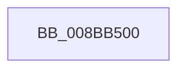

# RtlpSetSecurityObject

- RVA: `0x008BB500`–`0x008BB534` (길이 `52` bytes)
- VA: `0x00000001408BB500`
- 실행 섹션: `PAGE`
- PDB 이름 있음: `예`; PDB Function 태그: `예`
- unwind 정보 RVA: `0x00082E3C`
- 디코드: `11`개 명령, `52/52` bytes 표시
- 미해석 바이트: `0` (있으면 어셈블리에 `.byte`로 보존)

> 이 문서는 커널 이미지의 기계어와 PDB 기호를 분석해 생성했습니다. 4번과 5번은 함수 원형과 자료형을 바이너리 사용 방식에서 추정한 C 해석이며 원본 소스 복구 결과는 아닙니다.

## 1. Dependencies

- 직접 호출 지점: **0**; 고유 호출 대상: **0**
- 직접 호출자로 확인된 함수: **6**
- RIP 상대 이미지 참조: **1**

### Outgoing calls
- 직접 디코드된 call 명령이 없습니다.

### Direct callers
- [sub_008BA74A](Unknown_function_008BA74A.md) at `0x008BA7EF`
- [SeSetSecurityDescriptorInfo](SeSetSecurityDescriptorInfo_function_008BADD0.md) at `0x008BADFA`
- [ObSetSecurityDescriptorInfo](ObSetSecurityDescriptorInfo_function_008BAE20.md) at `0x008BAEDF`
- [SeSetSecurityDescriptorInfoEx](SeSetSecurityDescriptorInfoEx_function_008BCF10.md) at `0x008BCF3F`
- [CmpSetSecurityDescriptorInfo](../94/CmpSetSecurityDescriptorInfo_function_00949688.md) at `0x009497E6`
- [IopSetDeviceSecurityDescriptor](../A7/IopSetDeviceSecurityDescriptor_function_00A7199C.md) at `0x00A71A60`

### Static image references
- `0x008BB513` → RVA `0x00E0A740` (`.data`; read)

## 2. Other-region calls and transfers

- 다른 실행 섹션으로 향하는 call: **0**
- 별도 외부 분기/꼬리 이동을 확인하지 못했습니다.

## 3. Assembly (complete function range)

```asm
008BB500  4C 8B DC                        mov r11, rsp
008BB503  55                              push rbp
008BB504  53                              push rbx
008BB505  49 8D AB 18 FF FF FF            lea rbp, [r11 - 0xe8]
008BB50C  48 81 EC D8 01 00 00            sub rsp, 0x1d8
008BB513  48 8B 05 26 F2 54 00            mov rax, qword ptr [rip + 0x54f226]
008BB51A  48 33 C4                        xor rax, rsp
008BB51D  48 89 85 A0 00 00 00            mov qword ptr [rbp + 0xa0], rax
008BB524  8B 85 18 01 00 00               mov eax, dword ptr [rbp + 0x118]
008BB52A  0F 57 C0                        xorps xmm0, xmm0
008BB52D  48 8B 9D 20 01 00 00            mov rbx, qword ptr [rbp + 0x120]
```

## 4. C-style interpretation (structured pseudocode)

```c
__int64 __fastcall RtlpSetSecurityObject(void)
{
    __int64 result;
    __int64 v_rsp;

    v_rsp = (v_rsp) - (472);
    result = (*(unsigned __int64 *)(v_rip + 5567014)) ^ (v_rsp);
    *(unsigned __int64 *)(v_rsp - 232 + 160) = result;
    return (unsigned int)(*(unsigned int *)(v_rsp - 232 + 280));
}
```

## 5. (Beta) C Style

```c
void RtlpSetSecurityObject(void)
{
    int64_t result;
    int64_t local_rsp;

    local_rsp = (local_rsp) - (472);
    result = (*(uint64_t *)(v_rip + 0x54F226)) ^ (local_rsp);
    *(uint64_t *)(local_rsp - 0xE8 + 0xA0) = result;
    return (uint32_t)(*(uint32_t *)(local_rsp - 0xE8 + 0x118));
}
```

## 6. Execution-region graph

[열기: 2D/3D 그래프와 함수 탐색 컨트롤 패널](../../../control-panel.html?section=page&rva=0x008BB500&view=graph)

- 2D 그래프는 위에서 아래로 흐르고, 3D 그래프는 빈 공간을 드래그해 회전합니다. Shift+드래그는 이동, 휠은 확대·축소, 함수 노드 선택은 대상 보고서 이동입니다.

### Static fallback


