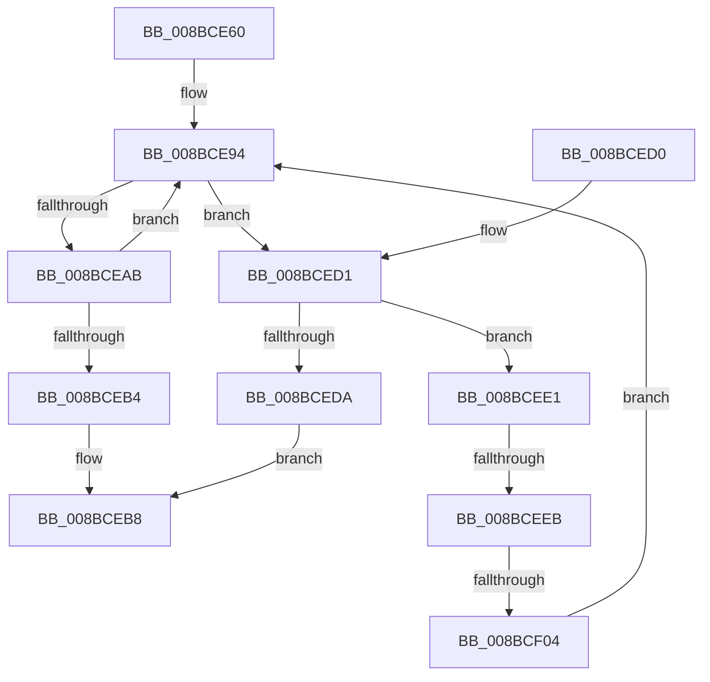

# RtlpValidFilterAclSubjectContext

- RVA: `0x008BCE60`–`0x008BCF0A` (길이 `170` bytes)
- VA: `0x00000001408BCE60`
- 실행 섹션: `PAGE`
- PDB 이름 있음: `예`; PDB Function 태그: `예`
- unwind 정보 RVA: `0x00083018`
- 디코드: `45`개 명령, `170/170` bytes 표시
- 미해석 바이트: `0` (있으면 어셈블리에 `.byte`로 보존)

> 이 문서는 커널 이미지의 기계어와 PDB 기호를 분석해 생성했습니다. 4번과 5번은 함수 원형과 자료형을 바이너리 사용 방식에서 추정한 C 해석이며 원본 소스 복구 결과는 아닙니다.

## 1. Dependencies

- 직접 호출 지점: **3**; 고유 호출 대상: **3**
- 직접 호출자로 확인된 함수: **1**
- RIP 상대 이미지 참조: **1**

### Outgoing calls
- `0x008BCEA1` → [RtlFindAceByType](../../text/41/RtlFindAceByType_function_00410AF0.md) (function, `0x00410AF0`)
- `0x008BCEC0` → [_security_check_cookie](../../text/6A/_security_check_cookie_function_006AC640.md) (function, `0x006AC640`)
- `0x008BCEF7` → [RtlpValidTrustSubjectContext](../../text/3E/RtlpValidTrustSubjectContext_function_003ED770.md) (function, `0x003ED770`)

### Direct callers
- [sub_008BBC01](Unknown_function_008BBC01.md) at `0x008BBE77`

### Static image references
- `0x008BCE6A` → RVA `0x00E0A740` (`.data`; read)

## 2. Other-region calls and transfers

- 다른 실행 섹션으로 향하는 call: **3**
  - `0x008BCEA1` → [RtlFindAceByType](../../text/41/RtlFindAceByType_function_00410AF0.md) (`PAGE` → `.text`)
  - `0x008BCEC0` → [_security_check_cookie](../../text/6A/_security_check_cookie_function_006AC640.md) (`PAGE` → `.text`)
  - `0x008BCEF7` → [RtlpValidTrustSubjectContext](../../text/3E/RtlpValidTrustSubjectContext_function_003ED770.md) (`PAGE` → `.text`)
- call이 아닌 외부 분기/꼬리 이동: **2**
  - `0x008BCEE5` → [sub_00B1AC1C](../B1/Unknown_function_00B1AC1C.md) (`tail-transfer`)
  - `0x008BCEFE` → [sub_00B1AC1C + 0x34](../B1/Unknown_function_00B1AC1C.md) (`tail-transfer`)

## 3. Assembly (complete function range)

```asm
008BCE60  48 89 5C 24 18                  mov qword ptr [rsp + 0x18], rbx
008BCE65  57                              push rdi
008BCE66  48 83 EC 40                     sub rsp, 0x40
008BCE6A  48 8B 05 CF D8 54 00            mov rax, qword ptr [rip + 0x54d8cf]
008BCE71  48 33 C4                        xor rax, rsp
008BCE74  48 89 44 24 30                  mov qword ptr [rsp + 0x30], rax
008BCE79  33 C0                           xor eax, eax
008BCE7B  66 C7 44 24 2C 00 01            mov word ptr [rsp + 0x2c], 0x100
008BCE82  89 44 24 24                     mov dword ptr [rsp + 0x24], eax
008BCE86  48 8B FA                        mov rdi, rdx
008BCE89  89 44 24 28                     mov dword ptr [rsp + 0x28], eax
008BCE8D  48 8B D9                        mov rbx, rcx
008BCE90  89 44 24 20                     mov dword ptr [rsp + 0x20], eax
008BCE94  4C 8D 44 24 20                  lea r8, [rsp + 0x20]
008BCE99  BA 15 00 00 00                  mov edx, 0x15
008BCE9E  48 8B CB                        mov rcx, rbx
008BCEA1  E8 4A 3C B5 FF                  call 0x140410af0
008BCEA6  48 85 C0                        test rax, rax
008BCEA9  75 26                           jne 0x1408bced1
008BCEAB  FF 44 24 20                     inc dword ptr [rsp + 0x20]
008BCEAF  48 85 C0                        test rax, rax
008BCEB2  75 E0                           jne 0x1408bce94
008BCEB4  8B 44 24 24                     mov eax, dword ptr [rsp + 0x24]
008BCEB8  48 8B 4C 24 30                  mov rcx, qword ptr [rsp + 0x30]
008BCEBD  48 33 CC                        xor rcx, rsp
008BCEC0  E8 7B F7 DE FF                  call 0x1406ac640
008BCEC5  48 8B 5C 24 60                  mov rbx, qword ptr [rsp + 0x60]
008BCECA  48 83 C4 40                     add rsp, 0x40
008BCECE  5F                              pop rdi
008BCECF  C3                              ret
008BCED0  CC                              int3
008BCED1  F7 40 04 00 00 00 FF            test dword ptr [rax + 4], 0xff000000
008BCED8  74 07                           je 0x1408bcee1
008BCEDA  B8 0D 00 00 C0                  mov eax, 0xc000000d
008BCEDF  EB D7                           jmp 0x1408bceb8
008BCEE1  F6 40 01 40                     test byte ptr [rax + 1], 0x40
008BCEE5  0F 84 31 DD 25 00               je 0x140b1ac1c
008BCEEB  4C 8D 4C 24 24                  lea r9, [rsp + 0x24]
008BCEF0  48 8B CF                        mov rcx, rdi
008BCEF3  48 8D 50 08                     lea rdx, [rax + 8]
008BCEF7  E8 74 08 B3 FF                  call 0x1403ed770
008BCEFC  84 C0                           test al, al
008BCEFE  0F 84 4C DD 25 00               je 0x140b1ac50
008BCF04  FF 44 24 20                     inc dword ptr [rsp + 0x20]
008BCF08  EB 8A                           jmp 0x1408bce94
```

## 4. C-style interpretation (structured pseudocode)

```c
__int64 __fastcall RtlpValidFilterAclSubjectContext(__int64 a1, __int64 a2)
{
    __int64 result;
    __int64 v_rsp;
    unsigned __int64 v_stack_m18;
    unsigned __int16 v_stack_m1C;
    unsigned int v_stack_m20;
    unsigned int v_stack_m24;
    unsigned int v_stack_m28;
    unsigned __int64 v_stack_p18;
    unsigned int v_stack_p20;
    unsigned __int64 v_stack_p24;

    v_stack_p18 = v_rbx;
    v_rsp = (v_rsp) - (64);
    result = (*(unsigned __int64 *)(v_rip + 5560527)) ^ (v_rsp);
    v_stack_m18 = result;
    result = 0;
    v_stack_m1C = 256;
    v_stack_m24 = 0;
    v_stack_m20 = 0;
    v_stack_m28 = 0;
loc_008BCE94:
    result = RtlFindAceByType(a1, 21, v_stack_m28, a4);
    if (result != 0) goto loc_008BCED1;
    if (result != 0) goto loc_008BCE94;
loc_008BCEB8:
    a1 = (v_stack_m18) ^ (v_rsp);
    result = _security_check_cookie(a1, 21, v_stack_m28, a4);
    v_rsp = (v_rsp) + (64);
    return result;
loc_008BCED1:
    if (((*(unsigned int *)(result + 4)) & (0xFF000000ULL)) == 0) goto loc_008BCEE1;
    goto loc_008BCEB8;
loc_008BCEE1:
    result = RtlpValidTrustSubjectContext(a2, (unsigned int)(0xC000000DULL) + 8, v_stack_m28, v_stack_p24);
    goto loc_008BCE94;
}
```

## 5. (Beta) C Style

```c
int64_t RtlpValidFilterAclSubjectContext(int64_t Arg1, int64_t Arg2)
{
    int64_t result;
    int64_t local_rsp;
    uint64_t v_stack_m18;
    uint16_t v_stack_m1C;
    uint32_t v_stack_m20;
    uint32_t v_stack_m24;
    uint32_t v_stack_m28;
    uint64_t v_stack_p18;
    uint32_t v_stack_p20;
    uint64_t v_stack_p24;

    v_stack_p18 = local_rbx;
    local_rsp = (local_rsp) - (64);
    result = (*(uint64_t *)(v_rip + 0x54D8CF)) ^ (local_rsp);
    v_stack_m18 = result;
    result = 0;
    v_stack_m1C = 256;
    v_stack_m24 = 0;
    v_stack_m20 = 0;
    v_stack_m28 = 0;
loc_008BCE94:
    result = RtlFindAceByType(Arg1, 21, v_stack_m28, a4);
    if (result != 0) goto loc_008BCED1;
    if (result != 0) goto loc_008BCE94;
loc_008BCEB8:
    Arg1 = (v_stack_m18) ^ (local_rsp);
    result = _security_check_cookie(Arg1, 21, v_stack_m28, a4);
    local_rsp = (local_rsp) + (64);
    return result;
loc_008BCED1:
    if (((*(uint32_t *)(result + 0x4)) & (0xFF000000ULL)) == 0) goto loc_008BCEE1;
    goto loc_008BCEB8;
loc_008BCEE1:
    result = RtlpValidTrustSubjectContext(Arg2, (uint32_t)(0xC000000DULL) + 8, v_stack_m28, v_stack_p24);
    goto loc_008BCE94;
}
```

## 6. Execution-region graph

[열기: 2D/3D 그래프와 함수 탐색 컨트롤 패널](../../../control-panel.html?section=page&rva=0x008BCE60&view=graph)

- 2D 그래프는 위에서 아래로 흐르고, 3D 그래프는 빈 공간을 드래그해 회전합니다. Shift+드래그는 이동, 휠은 확대·축소, 함수 노드 선택은 대상 보고서 이동입니다.

### Static fallback


