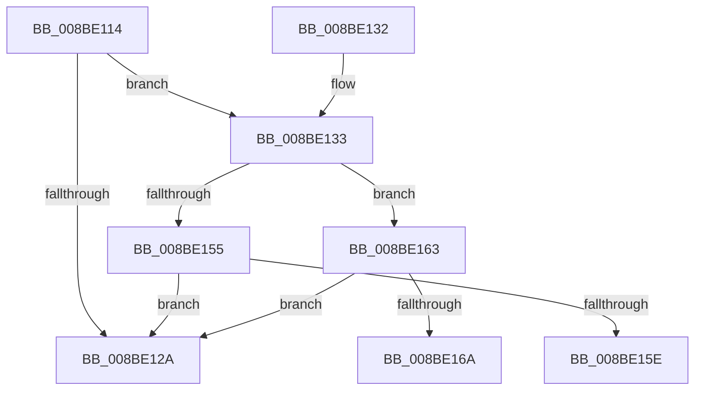

# RtlpValidateKeyTrust

- RVA: `0x008BE114`–`0x008BE174` (길이 `96` bytes)
- VA: `0x00000001408BE114`
- 실행 섹션: `PAGE`
- PDB 이름 있음: `예`; PDB Function 태그: `예`
- unwind 정보 RVA: `0x0008314C`
- 디코드: `28`개 명령, `96/96` bytes 표시
- 미해석 바이트: `0` (있으면 어셈블리에 `.byte`로 보존)

> 이 문서는 커널 이미지의 기계어와 PDB 기호를 분석해 생성했습니다. 4번과 5번은 함수 원형과 자료형을 바이너리 사용 방식에서 추정한 C 해석이며 원본 소스 복구 결과는 아닙니다.

## 1. Dependencies

- 직접 호출 지점: **1**; 고유 호출 대상: **1**
- 직접 호출자로 확인된 함수: **1**
- RIP 상대 이미지 참조: **0**

### Outgoing calls
- `0x008BE14C` → [ZwQueryKey](../../text/6A/ZwQueryKey_function_006AD390.md) (function, `0x006AD390`)

### Direct callers
- [RtlpCallQueryRegistryRoutine](RtlpCallQueryRegistryRoutine_function_008BE844.md) at `0x008BEA63`
- [RtlpCallQueryRegistryRoutine](RtlpCallQueryRegistryRoutine_function_008BE844.md) at `0x008BEB91`

### Static image references
- 디코드된 RIP-relative 메모리 참조가 없습니다.

## 2. Other-region calls and transfers

- 다른 실행 섹션으로 향하는 call: **1**
  - `0x008BE14C` → [ZwQueryKey](../../text/6A/ZwQueryKey_function_006AD390.md) (`PAGE` → `.text`)
- call이 아닌 외부 분기/꼬리 이동: **2**
  - `0x008BE15E` → [sub_00B1AD3C](../B1/Unknown_function_00B1AD3C.md) (`tail-transfer`)
  - `0x008BE16F` → [sub_00B1AD3C](../B1/Unknown_function_00B1AD3C.md) (`tail-transfer`)

## 3. Assembly (complete function range)

```asm
008BE114  40 53                           push rbx
008BE116  48 83 EC 30                     sub rsp, 0x30
008BE11A  33 DB                           xor ebx, ebx
008BE11C  89 5C 24 48                     mov dword ptr [rsp + 0x48], ebx
008BE120  89 5C 24 50                     mov dword ptr [rsp + 0x50], ebx
008BE124  0F BA E2 08                     bt edx, 8
008BE128  73 09                           jae 0x1408be133
008BE12A  8B C3                           mov eax, ebx
008BE12C  48 83 C4 30                     add rsp, 0x30
008BE130  5B                              pop rbx
008BE131  C3                              ret
008BE132  CC                              int3
008BE133  41 B9 04 00 00 00               mov r9d, 4
008BE139  48 8D 44 24 50                  lea rax, [rsp + 0x50]
008BE13E  4C 8D 44 24 48                  lea r8, [rsp + 0x48]
008BE143  48 89 44 24 20                  mov qword ptr [rsp + 0x20], rax
008BE148  41 8D 51 04                     lea edx, [r9 + 4]
008BE14C  E8 3F F2 DE FF                  call 0x1406ad390
008BE151  85 C0                           test eax, eax
008BE153  79 0E                           jns 0x1408be163
008BE155  8B D8                           mov ebx, eax
008BE157  3D 89 01 00 C0                  cmp eax, 0xc0000189
008BE15C  74 CC                           je 0x1408be12a
008BE15E  E9 D9 CB 25 00                  jmp 0x140b1ad3c
008BE163  F6 44 24 48 01                  test byte ptr [rsp + 0x48], 1
008BE168  75 C0                           jne 0x1408be12a
008BE16A  BB 22 00 00 C0                  mov ebx, 0xc0000022
008BE16F  E9 C8 CB 25 00                  jmp 0x140b1ad3c
```

## 4. C-style interpretation (structured pseudocode)

```c
__int64 __fastcall RtlpValidateKeyTrust(__int64 a1, int a2)
{
    __int64 result;
    __int64 v_rbx;
    __int64 v_rsp;
    unsigned int v_stack_p10;
    unsigned int v_stack_p18;
    unsigned __int64 v_stack_p20;
    unsigned __int64 v_stack_p48;
    unsigned __int64 v_stack_p50;

    v_rsp = (v_rsp) - (48);
    v_rbx = 0;
    v_stack_p10 = 0;
    v_stack_p18 = 0;
    if (condition_is_above_or_equal) goto loc_008BE133;
loc_008BE12A:
    v_rsp = (v_rsp) + (48);
    return 0;
loc_008BE133:
    v_stack_p20 = v_stack_p50;
    result = ZwQueryKey(a1, 4 + 4, v_stack_p48, 4);
    if (!sign_flag) goto loc_008BE163;
    if (((unsigned int)(result)) == 0xC0000189ULL) goto loc_008BE12A;
loc_008BE163:
    if (((v_stack_p48) & (1)) != 0) goto loc_008BE12A;
}
```

## 5. (Beta) C Style

```c
int64_t RtlpValidateKeyTrust(int64_t Arg1, int32_t Arg2)
{
    int64_t result;
    int64_t local_rbx;
    int64_t local_rsp;
    uint32_t v_stack_p10;
    uint32_t v_stack_p18;
    uint64_t v_stack_p20;
    uint64_t v_stack_p48;
    uint64_t v_stack_p50;

    local_rsp = (local_rsp) - (48);
    local_rbx = 0;
    v_stack_p10 = 0;
    v_stack_p18 = 0;
    if (condition_is_above_or_equal) goto loc_008BE133;
loc_008BE12A:
    local_rsp = (local_rsp) + (48);
    return 0;
loc_008BE133:
    v_stack_p20 = v_stack_p50;
    result = ZwQueryKey(Arg1, 4 + 4, v_stack_p48, 4);
    if (!sign_flag) goto loc_008BE163;
    if (((uint32_t)(result)) == 0xC0000189ULL) goto loc_008BE12A;
loc_008BE163:
    if (((v_stack_p48) & (1)) != 0) goto loc_008BE12A;
}
```

## 6. Execution-region graph

[열기: 2D/3D 그래프와 함수 탐색 컨트롤 패널](../../../control-panel.html?section=page&rva=0x008BE114&view=graph)

- 2D 그래프는 위에서 아래로 흐르고, 3D 그래프는 빈 공간을 드래그해 회전합니다. Shift+드래그는 이동, 휠은 확대·축소, 함수 노드 선택은 대상 보고서 이동입니다.

### Static fallback


