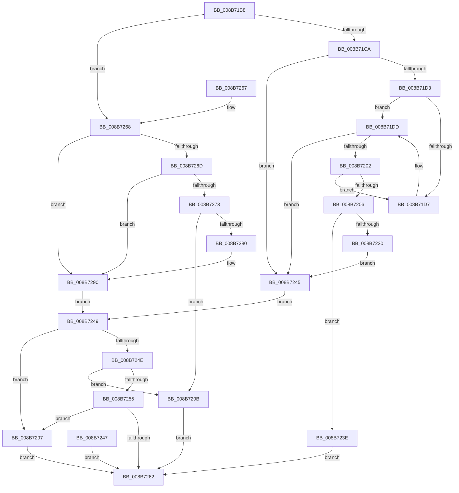

# SeCaptureSecurityQos

- RVA: `0x008B71B8`–`0x008B72A2` (길이 `234` bytes)
- VA: `0x00000001408B71B8`
- 실행 섹션: `PAGE`
- PDB 이름 있음: `예`; PDB Function 태그: `아니요`
- unwind 정보 RVA: `0x00082AE0`
- 디코드: `74`개 명령, `234/234` bytes 표시
- 미해석 바이트: `0` (있으면 어셈블리에 `.byte`로 보존)

> 이 문서는 커널 이미지의 기계어와 PDB 기호를 분석해 생성했습니다. 4번과 5번은 함수 원형과 자료형을 바이너리 사용 방식에서 추정한 C 해석이며 원본 소스 복구 결과는 아닙니다.

## 1. Dependencies

- 직접 호출 지점: **1**; 고유 호출 대상: **1**
- 직접 호출자로 확인된 함수: **2**
- RIP 상대 이미지 참조: **0**

### Outgoing calls
- `0x008B71D7` → [ExRaiseDatatypeMisalignment](../89/ExRaiseDatatypeMisalignment_function_00899FD0.md) (function, `0x00899FD0`)

### Direct callers
- [NtDuplicateToken](NtDuplicateToken_function_008B6DF0.md) at `0x008B6E89`
- [NtCreateTokenEx](../9C/NtCreateTokenEx_function_009C7C80.md) at `0x009C803B`

### Static image references
- 디코드된 RIP-relative 메모리 참조가 없습니다.

## 2. Other-region calls and transfers

- 다른 실행 섹션으로 향하는 call: **0**
- 별도 외부 분기/꼬리 이동을 확인하지 못했습니다.

## 3. Assembly (complete function range)

```asm
008B71B8  48 83 EC 28                     sub rsp, 0x28
008B71BC  45 33 D2                        xor r10d, r10d
008B71BF  45 88 10                        mov byte ptr [r8], r10b
008B71C2  84 D2                           test dl, dl
008B71C4  0F 84 9E 00 00 00               je 0x1408b7268
008B71CA  41 8D 52 03                     lea edx, [r10 + 3]
008B71CE  48 85 C9                        test rcx, rcx
008B71D1  74 72                           je 0x1408b7245
008B71D3  84 CA                           test dl, cl
008B71D5  74 06                           je 0x1408b71dd
008B71D7  E8 F4 2D FE FF                  call 0x140899fd0
008B71DC  CC                              int3
008B71DD  49 BB 00 00 FF FF FF 7F 00 00   movabs r11, 0x7fffffff0000
008B71E7  49 8B C3                        mov rax, r11
008B71EA  49 3B CB                        cmp rcx, r11
008B71ED  48 0F 42 C1                     cmovb rax, rcx
008B71F1  90                              nop
008B71F2  8A 00                           mov al, byte ptr [rax]
008B71F4  48 8B 41 28                     mov rax, qword ptr [rcx + 0x28]
008B71F8  48 89 44 24 40                  mov qword ptr [rsp + 0x40], rax
008B71FD  48 85 C0                        test rax, rax
008B7200  74 43                           je 0x1408b7245
008B7202  84 C2                           test dl, al
008B7204  75 D1                           jne 0x1408b71d7
008B7206  49 3B C3                        cmp rax, r11
008B7209  49 0F 43 C3                     cmovae rax, r11
008B720D  90                              nop
008B720E  8A 00                           mov al, byte ptr [rax]
008B7210  48 8B 44 24 40                  mov rax, qword ptr [rsp + 0x40]
008B7215  8B 08                           mov ecx, dword ptr [rax]
008B7217  89 4C 24 38                     mov dword ptr [rsp + 0x38], ecx
008B721B  83 F9 0C                        cmp ecx, 0xc
008B721E  75 1E                           jne 0x1408b723e
008B7220  41 C6 00 01                     mov byte ptr [r8], 1
008B7224  48 8B 44 24 40                  mov rax, qword ptr [rsp + 0x40]
008B7229  F2 0F 10 00                     movsd xmm0, qword ptr [rax]
008B722D  F2 41 0F 11 01                  movsd qword ptr [r9], xmm0
008B7232  8B 40 08                        mov eax, dword ptr [rax + 8]
008B7235  41 89 41 08                     mov dword ptr [r9 + 8], eax
008B7239  41 89 09                        mov dword ptr [r9], ecx
008B723C  EB 07                           jmp 0x1408b7245
008B723E  B8 0D 00 00 C0                  mov eax, 0xc000000d
008B7243  EB 1D                           jmp 0x1408b7262
008B7245  EB 02                           jmp 0x1408b7249
008B7247  EB 19                           jmp 0x1408b7262
008B7249  45 38 10                        cmp byte ptr [r8], r10b
008B724C  74 49                           je 0x1408b7297
008B724E  41 80 79 08 02                  cmp byte ptr [r9 + 8], 2
008B7253  73 46                           jae 0x1408b729b
008B7255  41 3B 51 04                     cmp edx, dword ptr [r9 + 4]
008B7259  1B C0                           sbb eax, eax
008B725B  25 A5 00 00 C0                  and eax, 0xc00000a5
008B7260  7D 35                           jge 0x1408b7297
008B7262  48 83 C4 28                     add rsp, 0x28
008B7266  C3                              ret
008B7267  CC                              int3
008B7268  48 85 C9                        test rcx, rcx
008B726B  74 23                           je 0x1408b7290
008B726D  4C 39 51 28                     cmp qword ptr [rcx + 0x28], r10
008B7271  74 1D                           je 0x1408b7290
008B7273  41 C6 00 01                     mov byte ptr [r8], 1
008B7277  48 8B 41 28                     mov rax, qword ptr [rcx + 0x28]
008B727B  83 38 0C                        cmp dword ptr [rax], 0xc
008B727E  75 1B                           jne 0x1408b729b
008B7280  F2 0F 10 00                     movsd xmm0, qword ptr [rax]
008B7284  F2 41 0F 11 01                  movsd qword ptr [r9], xmm0
008B7289  8B 40 08                        mov eax, dword ptr [rax + 8]
008B728C  41 89 41 08                     mov dword ptr [r9 + 8], eax
008B7290  BA 03 00 00 00                  mov edx, 3
008B7295  EB B2                           jmp 0x1408b7249
008B7297  33 C0                           xor eax, eax
008B7299  EB C7                           jmp 0x1408b7262
008B729B  B8 0D 00 00 C0                  mov eax, 0xc000000d
008B72A0  EB C0                           jmp 0x1408b7262
```

## 4. C-style interpretation (structured pseudocode)

```c
__int64 __fastcall SeCaptureSecurityQos(__int64 a1, unsigned __int8 a2, __int64 a3, __int64 a4)
{
    __int64 result;
    __int64 v_r10;
    __int64 v_rsp;
    unsigned int v_stack_p10;
    unsigned __int64 v_stack_p18;

    v_rsp = (v_rsp) - (40);
    v_r10 = 0;
    *(unsigned __int8 *)(a3) = 0;
    if (a2 == 0) goto loc_008B7268;
    if (a1 == 0) goto loc_008B7245;
    if ((((unsigned __int8)(v_r10 + 3)) & ((unsigned __int8)(a1))) != 0) {
        result = ExRaiseDatatypeMisalignment(a1, v_r10 + 3, a3, a4);
    }
    result = v_r11;
    if (a1 < v_r11) { result = a1; }
    v_stack_p18 = *(unsigned __int64 *)(a1 + 40);
    if (*(unsigned __int64 *)(a1 + 40) == 0) goto loc_008B7245;
    if ((((unsigned __int8)(v_r10 + 3)) & ((unsigned __int8)(*(unsigned __int64 *)(a1 + 40)))) != 0) goto loc_008B71D7;
    result = *(unsigned __int64 *)(a1 + 40);
    if ((*(unsigned __int64 *)(a1 + 40)) >= v_r11) { result = v_r11; }
    v_stack_p10 = (unsigned int)((unsigned int)(*(unsigned int *)(v_stack_p18)));
    if (((unsigned int)((unsigned int)(*(unsigned int *)(v_stack_p18)))) != 12) goto loc_008B723E;
    *(unsigned __int8 *)(a3) = 1;
    *(unsigned __int64 *)(a4) = v_xmm0;
    *(unsigned int *)(a4 + 8) = (unsigned int)((unsigned int)(*(unsigned int *)(v_stack_p18 + 8)));
    *(unsigned int *)(a4) = (unsigned int)((unsigned int)(*(unsigned int *)(v_stack_p18)));
    goto loc_008B7245;
loc_008B723E:
    goto loc_008B7262;
loc_008B7245:
    goto loc_008B7249;
loc_008B7249:
    if ((*(unsigned __int8 *)(a3)) == 0) goto loc_008B7297;
    if ((*(unsigned __int8 *)(a4 + 8)) >= 2) goto loc_008B729B;
    result = (unsigned int)(((unsigned int)(0xC000000DULL)) & (0xC00000A5ULL));
    if (condition_is_greater_or_equal) goto loc_008B7297;
loc_008B7262:
    v_rsp = (v_rsp) + (40);
    return result;
loc_008B7268:
    if ((unsigned int)(*(unsigned int *)(v_stack_p18)) == 0) goto loc_008B7290;
    if ((*(unsigned __int64 *)((unsigned int)(*(unsigned int *)(v_stack_p18)) + 40)) == 0) goto loc_008B7290;
    *(unsigned __int8 *)(a3) = 1;
    if ((*(unsigned int *)(*(unsigned __int64 *)((unsigned int)(*(unsigned int *)(v_stack_p18)) + 40))) != 12) goto loc_008B729B;
    *(unsigned __int64 *)(a4) = v_xmm0;
    *(unsigned int *)(a4 + 8) = (unsigned int)((unsigned int)(*(unsigned int *)(*(unsigned __int64 *)((unsigned int)(*(unsigned int *)(v_stack_p18)) + 40) + 8)));
loc_008B7290:
    goto loc_008B7249;
loc_008B7297:
    result = 0;
    goto loc_008B7262;
loc_008B729B:
    goto loc_008B7262;
}
```

## 5. (Beta) C Style

```c
int64_t SeCaptureSecurityQos(int64_t Arg1, uint8_t Arg2, void *Arg3, void *Arg4)
{
    uint8_t *arg3 = (uint8_t *)Arg3;
    uint8_t *arg4 = (uint8_t *)Arg4;

    int64_t result;
    int64_t local_r10;
    int64_t local_rsp;
    uint32_t v_stack_p10;
    uint64_t v_stack_p18;

    local_rsp = (local_rsp) - (40);
    local_r10 = 0;
    *(uint8_t *)(arg3) = 0;
    if (Arg2 == 0) goto loc_008B7268;
    if (Arg1 == 0) goto loc_008B7245;
    if ((((uint8_t)(local_r10 + 3)) & ((uint8_t)(Arg1))) != 0) {
        result = ExRaiseDatatypeMisalignment(Arg1, local_r10 + 3, Arg3, Arg4);
    }
    result = local_r11;
    if (Arg1 < local_r11) { result = Arg1; }
    v_stack_p18 = *(uint64_t *)(Arg1 + 0x28);
    if (*(uint64_t *)(Arg1 + 0x28) == 0) goto loc_008B7245;
    if ((((uint8_t)(local_r10 + 3)) & ((uint8_t)(*(uint64_t *)(Arg1 + 0x28)))) != 0) goto loc_008B71D7;
    result = *(uint64_t *)(Arg1 + 0x28);
    if ((*(uint64_t *)(Arg1 + 0x28)) >= local_r11) { result = local_r11; }
    v_stack_p10 = (uint32_t)((uint32_t)(*(uint32_t *)(v_stack_p18)));
    if (((uint32_t)((uint32_t)(*(uint32_t *)(v_stack_p18)))) != 12) goto loc_008B723E;
    *(uint8_t *)(arg3) = 1;
    *(uint64_t *)(arg4) = v_xmm0;
    *(uint32_t *)(arg4 + 0x8) = (uint32_t)((uint32_t)(*(uint32_t *)(v_stack_p18 + 0x8)));
    *(uint32_t *)(arg4) = (uint32_t)((uint32_t)(*(uint32_t *)(v_stack_p18)));
    goto loc_008B7245;
loc_008B723E:
    goto loc_008B7262;
loc_008B7245:
    goto loc_008B7249;
loc_008B7249:
    if ((*(uint8_t *)(arg3)) == 0) goto loc_008B7297;
    if ((*(uint8_t *)(arg4 + 0x8)) >= 2) goto loc_008B729B;
    result = (uint32_t)(((uint32_t)(0xC000000DULL)) & (0xC00000A5ULL));
    if (condition_is_greater_or_equal) goto loc_008B7297;
loc_008B7262:
    local_rsp = (local_rsp) + (40);
    return result;
loc_008B7268:
    if ((uint32_t)(*(uint32_t *)(v_stack_p18)) == 0) goto loc_008B7290;
    if ((*(uint64_t *)((uint32_t)(*(uint32_t *)(v_stack_p18)) + 0x28)) == 0) goto loc_008B7290;
    *(uint8_t *)(arg3) = 1;
    if ((*(uint32_t *)(*(uint64_t *)((uint32_t)(*(uint32_t *)(v_stack_p18)) + 0x28))) != 12) goto loc_008B729B;
    *(uint64_t *)(arg4) = v_xmm0;
    *(uint32_t *)(arg4 + 0x8) = (uint32_t)((uint32_t)(*(uint32_t *)(*(uint64_t *)((uint32_t)(*(uint32_t *)(v_stack_p18)) + 0x28) + 0x8)));
loc_008B7290:
    goto loc_008B7249;
loc_008B7297:
    result = 0;
    goto loc_008B7262;
loc_008B729B:
    goto loc_008B7262;
}
```

### 관측된 메모리 오프셋

구조체 형식이 확인되지 않은 접근은 인자 기준의 오프셋으로만 기록했습니다.

| 기준 인자 | 오프셋 표현 | 폭 (bit) | 접근 |
|---|---:|---:|---|
| `Arg3` | `+ 0x0` | `8` | `W` |
| `Arg4` | `+ 0x0` | `64` | `W` |
| `Arg4` | `+ 0x8` | `32` | `W` |

## 6. Execution-region graph

[열기: 2D/3D 그래프와 함수 탐색 컨트롤 패널](../../../control-panel.html?section=page&rva=0x008B71B8&view=graph)

- 2D 그래프는 위에서 아래로 흐르고, 3D 그래프는 빈 공간을 드래그해 회전합니다. Shift+드래그는 이동, 휠은 확대·축소, 함수 노드 선택은 대상 보고서 이동입니다.

### Static fallback


