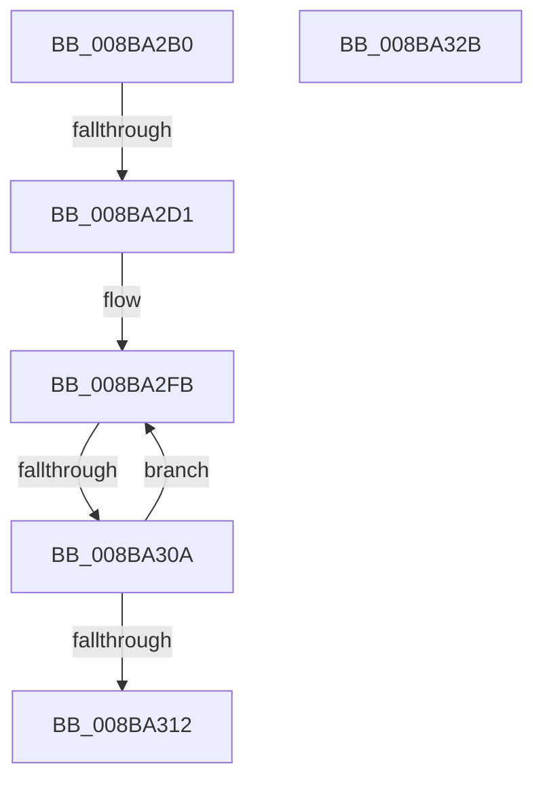

# SeDefaultObjectMethod

- RVA: `0x008BA2B0`–`0x008BA32C` (길이 `124` bytes)
- VA: `0x00000001408BA2B0`
- 실행 섹션: `PAGE`
- PDB 이름 있음: `예`; PDB Function 태그: `아니요`
- unwind 정보 RVA: `0x00082D24`
- 디코드: `40`개 명령, `124/124` bytes 표시
- 미해석 바이트: `0` (있으면 어셈블리에 `.byte`로 보존)

> 이 문서는 커널 이미지의 기계어와 PDB 기호를 분석해 생성했습니다. 4번과 5번은 함수 원형과 자료형을 바이너리 사용 방식에서 추정한 C 해석이며 원본 소스 복구 결과는 아닙니다.

## 1. Dependencies

- 직접 호출 지점: **0**; 고유 호출 대상: **0**
- 직접 호출자로 확인된 함수: **5**
- RIP 상대 이미지 참조: **0**

### Outgoing calls
- 직접 디코드된 call 명령이 없습니다.

### Direct callers
- [NtQuerySecurityObject](../87/NtQuerySecurityObject_function_008737B0.md) at `0x00873943`
- [SepAppendAceToTokenObjectAcl](SepAppendAceToTokenObjectAcl_function_008B6430.md) at `0x008B6B25`
- [ObInsertObjectEx](ObInsertObjectEx_function_008B97A0.md) at `0x008B9B35`
- [sub_008BA0FD](Unknown_function_008BA0FD.md) at `0x008BA1F3`
- [ObSetSecurityObjectByPointer](ObSetSecurityObjectByPointer_function_008BAD20.md) at `0x008BADA7`

### Static image references
- 디코드된 RIP-relative 메모리 참조가 없습니다.

## 2. Other-region calls and transfers

- 다른 실행 섹션으로 향하는 call: **0**
- call이 아닌 외부 분기/꼬리 이동: **2**
  - `0x008BA2CF` → [sub_008BA32C](Unknown_function_008BA32C.md) (`tail-transfer`)
  - `0x008BA304` → [sub_008BA676](Unknown_function_008BA676.md) (`tail-transfer`)

## 3. Assembly (complete function range)

```asm
008BA2B0  48 89 5C 24 18                  mov qword ptr [rsp + 0x18], rbx
008BA2B5  55                              push rbp
008BA2B6  56                              push rsi
008BA2B7  57                              push rdi
008BA2B8  41 56                           push r14
008BA2BA  41 57                           push r15
008BA2BC  48 81 EC 80 00 00 00            sub rsp, 0x80
008BA2C3  49 8B E9                        mov rbp, r9
008BA2C6  49 8B F8                        mov rdi, r8
008BA2C9  4C 8B F9                        mov r15, rcx
008BA2CC  83 FA 02                        cmp edx, 2
008BA2CF  75 5B                           jne 0x1408ba32c
008BA2D1  48 8B 84 24 D8 00 00 00         mov rax, qword ptr [rsp + 0xd8]
008BA2D9  45 33 F6                        xor r14d, r14d
008BA2DC  48 8B 18                        mov rbx, qword ptr [rax]
008BA2DF  8B FB                           mov edi, ebx
008BA2E1  4C 89 30                        mov qword ptr [rax], r14
008BA2E4  83 E7 0F                        and edi, 0xf
008BA2E7  48 83 E3 F0                     and rbx, 0xfffffffffffffff0
008BA2EB  FF C7                           inc edi
008BA2ED  48 83 EB 20                     sub rbx, 0x20
008BA2F1  0F 0D 4B 08                     prefetchw byte ptr [rbx + 8]
008BA2F5  48 8B 43 08                     mov rax, qword ptr [rbx + 8]
008BA2F9  8B D7                           mov edx, edi
008BA2FB  48 8B C8                        mov rcx, rax
008BA2FE  48 2B CA                        sub rcx, rdx
008BA301  48 85 C9                        test rcx, rcx
008BA304  0F 8E 6C 03 00 00               jle 0x1408ba676
008BA30A  F0 48 0F B1 4B 08               lock cmpxchg qword ptr [rbx + 8], rcx
008BA310  75 E9                           jne 0x1408ba2fb
008BA312  33 C0                           xor eax, eax
008BA314  48 8B 9C 24 C0 00 00 00         mov rbx, qword ptr [rsp + 0xc0]
008BA31C  48 81 C4 80 00 00 00            add rsp, 0x80
008BA323  41 5F                           pop r15
008BA325  41 5E                           pop r14
008BA327  5F                              pop rdi
008BA328  5E                              pop rsi
008BA329  5D                              pop rbp
008BA32A  C3                              ret
008BA32B  CC                              int3
```

## 4. C-style interpretation (structured pseudocode)

```c
__int64 __fastcall SeDefaultObjectMethod(__int64 a1, int a2, __int64 a3, __int64 a4, __int64 a5, __int64 a6)
{
    __int64 result;
    __int64 v_r14;
    __int64 v_rbx;
    __int64 v_rdi;
    __int64 v_rsp;
    unsigned __int64 v_stack_p18;

    v_stack_p18 = v_rbx;
    v_rsp = (v_rsp) - (128);
    v_r14 = 0;
    *(unsigned __int64 *)(a6) = 0;
    v_rdi = (unsigned int)(((unsigned int)((unsigned int)(*(unsigned __int64 *)(a6)))) & (15));
    v_rbx = (*(unsigned __int64 *)(a6)) & (-16);
    v_rdi = (unsigned int)((v_rdi) + 1);
    v_rbx = (v_rbx) - (32);
loc_008BA2FB:
    a1 = (*(unsigned __int64 *)(v_rbx + 8)) - ((unsigned int)((unsigned int)(v_rdi)));
    if (a1 != 0) goto loc_008BA2FB;
    result = 0;
    v_rsp = (v_rsp) + (128);
    return result;
}
```

## 5. (Beta) C Style

```c
int64_t SeDefaultObjectMethod(int64_t Arg1, int32_t Arg2, int64_t Arg3, int64_t Arg4, uint64_t Arg5, void *Arg6)
{
    uint8_t *arg6 = (uint8_t *)Arg6;

    int64_t result;
    int64_t local_r14;
    int64_t local_rbx;
    int64_t local_rdi;
    int64_t local_rsp;
    uint64_t v_stack_p18;

    v_stack_p18 = local_rbx;
    local_rsp = (local_rsp) - (128);
    local_r14 = 0;
    *(uint64_t *)(arg6) = 0;
    local_rdi = (uint32_t)(((uint32_t)((uint32_t)(*(uint64_t *)(arg6)))) & (15));
    local_rbx = (*(uint64_t *)(arg6)) & (-16);
    local_rdi = (uint32_t)((local_rdi) + 1);
    local_rbx = (local_rbx) - (32);
loc_008BA2FB:
    Arg1 = (*(uint64_t *)(local_rbx + 0x8)) - ((uint32_t)((uint32_t)(local_rdi)));
    if (Arg1 != 0) goto loc_008BA2FB;
    result = 0;
    local_rsp = (local_rsp) + (128);
    return result;
}
```

### 관측된 메모리 오프셋

구조체 형식이 확인되지 않은 접근은 인자 기준의 오프셋으로만 기록했습니다.

| 기준 인자 | 오프셋 표현 | 폭 (bit) | 접근 |
|---|---:|---:|---|
| `Arg6` | `+ 0x0` | `64` | `R` |
| `Arg6` | `+ 0x0` | `64` | `W` |

## 6. Execution-region graph

[열기: 2D/3D 그래프와 함수 탐색 컨트롤 패널](../../../control-panel.html?section=page&rva=0x008BA2B0&view=graph)

- 2D 그래프는 위에서 아래로 흐르고, 3D 그래프는 빈 공간을 드래그해 회전합니다. Shift+드래그는 이동, 휠은 확대·축소, 함수 노드 선택은 대상 보고서 이동입니다.

### Static fallback


