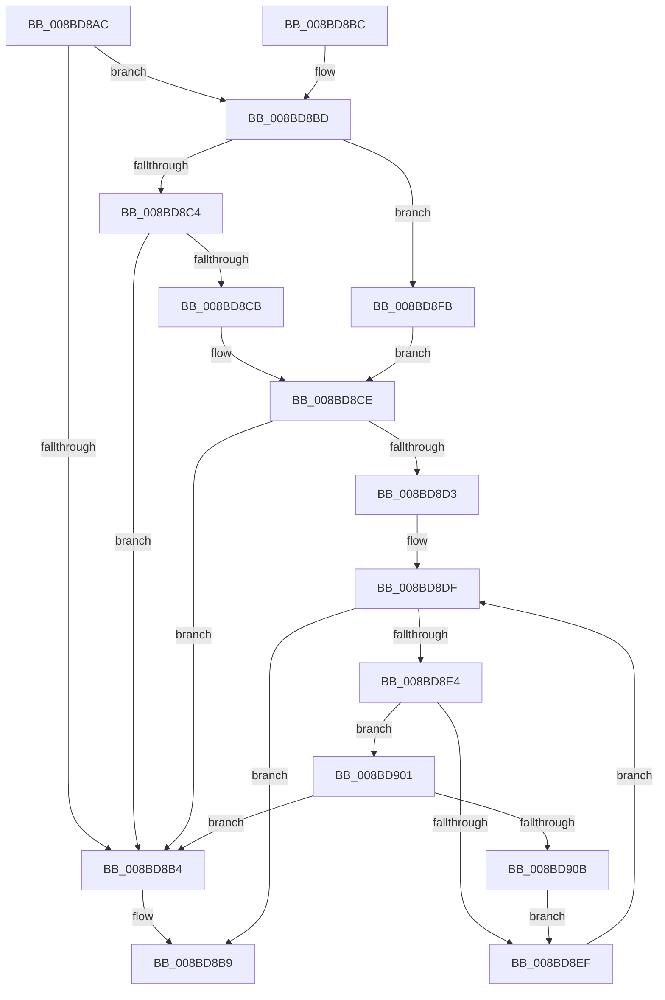

# SeObjectCreateSaclAccessBits

- RVA: `0x008BD8AC`–`0x008BD90D` (길이 `97` bytes)
- VA: `0x00000001408BD8AC`
- 실행 섹션: `PAGE`
- PDB 이름 있음: `예`; PDB Function 태그: `아니요`
- unwind 정보 RVA: `0x000DB714`
- 디코드: `35`개 명령, `97/97` bytes 표시
- 미해석 바이트: `0` (있으면 어셈블리에 `.byte`로 보존)

> 이 문서는 커널 이미지의 기계어와 PDB 기호를 분석해 생성했습니다. 4번과 5번은 함수 원형과 자료형을 바이너리 사용 방식에서 추정한 C 해석이며 원본 소스 복구 결과는 아닙니다.

## 1. Dependencies

- 직접 호출 지점: **0**; 고유 호출 대상: **0**
- 직접 호출자로 확인된 함수: **3**
- RIP 상대 이미지 참조: **0**

### Outgoing calls
- 직접 디코드된 call 명령이 없습니다.

### Direct callers
- [sub_0089AEE3](../89/Unknown_function_0089AEE3.md) at `0x0089AF6C`
- [ObInsertObjectEx](ObInsertObjectEx_function_008B97A0.md) at `0x008B9E6A`
- [ObpAdjustAccessMask](ObpAdjustAccessMask_function_008BD380.md) at `0x008BD3C2`

### Static image references
- 디코드된 RIP-relative 메모리 참조가 없습니다.

## 2. Other-region calls and transfers

- 다른 실행 섹션으로 향하는 call: **0**
- 별도 외부 분기/꼬리 이동을 확인하지 못했습니다.

## 3. Assembly (complete function range)

```asm
008BD8AC  0F B7 41 02                     movzx eax, word ptr [rcx + 2]
008BD8B0  A8 10                           test al, 0x10
008BD8B2  75 09                           jne 0x1408bd8bd
008BD8B4  BA 00 00 00 01                  mov edx, 0x1000000
008BD8B9  8B C2                           mov eax, edx
008BD8BB  C3                              ret
008BD8BC  CC                              int3
008BD8BD  33 D2                           xor edx, edx
008BD8BF  66 85 C0                        test ax, ax
008BD8C2  79 37                           jns 0x1408bd8fb
008BD8C4  8B 41 0C                        mov eax, dword ptr [rcx + 0xc]
008BD8C7  85 C0                           test eax, eax
008BD8C9  74 E9                           je 0x1408bd8b4
008BD8CB  48 03 C1                        add rax, rcx
008BD8CE  48 85 C0                        test rax, rax
008BD8D1  74 E1                           je 0x1408bd8b4
008BD8D3  44 0F B7 50 04                  movzx r10d, word ptr [rax + 4]
008BD8D8  48 8D 48 08                     lea rcx, [rax + 8]
008BD8DC  44 8B CA                        mov r9d, edx
008BD8DF  45 3B CA                        cmp r9d, r10d
008BD8E2  73 D5                           jae 0x1408bd8b9
008BD8E4  44 8A 01                        mov r8b, byte ptr [rcx]
008BD8E7  41 8D 40 EF                     lea eax, [r8 - 0x11]
008BD8EB  3C 01                           cmp al, 1
008BD8ED  77 12                           ja 0x1408bd901
008BD8EF  0F B7 41 02                     movzx eax, word ptr [rcx + 2]
008BD8F3  41 FF C1                        inc r9d
008BD8F6  48 03 C8                        add rcx, rax
008BD8F9  EB E4                           jmp 0x1408bd8df
008BD8FB  48 8B 41 18                     mov rax, qword ptr [rcx + 0x18]
008BD8FF  EB CD                           jmp 0x1408bd8ce
008BD901  41 80 E8 14                     sub r8b, 0x14
008BD905  41 80 F8 01                     cmp r8b, 1
008BD909  77 A9                           ja 0x1408bd8b4
008BD90B  EB E2                           jmp 0x1408bd8ef
```

## 4. C-style interpretation (structured pseudocode)

```c
__int64 __fastcall SeObjectCreateSaclAccessBits(__int64 a1)
{
    __int64 result;

    if ((((unsigned __int8)(*(unsigned __int16 *)(a1 + 2))) & (16)) != 0) goto loc_008BD8BD;
loc_008BD8B4:
loc_008BD8B9:
    return (unsigned int)((unsigned int)((unsigned int)(0x1000000ULL)));
loc_008BD8BD:
    a2 = 0;
    if (!sign_flag) goto loc_008BD8FB;
    if ((unsigned int)((unsigned int)(*(unsigned int *)(a1 + 12))) == 0) goto loc_008BD8B4;
    result = ((unsigned int)(*(unsigned int *)(a1 + 12))) + (a1);
loc_008BD8CE:
    if (result == 0) goto loc_008BD8B4;
loc_008BD8DF:
    if (0 >= ((unsigned int)(*(unsigned __int16 *)(result + 4)))) goto loc_008BD8B9;
    if (((unsigned __int8)(*(unsigned __int8 *)(result + 8) - 17)) > 1) goto loc_008BD901;
loc_008BD8EF:
    a4 = (unsigned int)((0) + 1);
    a1 = (result + 8) + (*(unsigned __int16 *)(result + 8 + 2));
    goto loc_008BD8DF;
loc_008BD8FB:
    goto loc_008BD8CE;
loc_008BD901:
    a3 = (unsigned __int8)((*(unsigned __int8 *)(result + 8)) - (20));
    if (((unsigned __int8)(a3)) > 1) goto loc_008BD8B4;
    goto loc_008BD8EF;
}
```

## 5. (Beta) C Style

```c
int64_t SeObjectCreateSaclAccessBits(void *Arg1)
{
    uint8_t *arg1 = (uint8_t *)Arg1;

    int64_t result;

    if ((((uint8_t)(*(uint16_t *)(arg1 + 0x2))) & (16)) != 0) goto loc_008BD8BD;
loc_008BD8B4:
loc_008BD8B9:
    return (uint32_t)((uint32_t)((uint32_t)(0x1000000ULL)));
loc_008BD8BD:
    a2 = 0;
    if (!sign_flag) goto loc_008BD8FB;
    if ((uint32_t)((uint32_t)(*(uint32_t *)(arg1 + 0xC))) == 0) goto loc_008BD8B4;
    result = ((uint32_t)(*(uint32_t *)(arg1 + 0xC))) + (Arg1);
loc_008BD8CE:
    if (result == 0) goto loc_008BD8B4;
loc_008BD8DF:
    if (0 >= ((uint32_t)(*(uint16_t *)(result + 0x4)))) goto loc_008BD8B9;
    if (((uint8_t)(*(uint8_t *)(result + 0x8) - 17)) > 1) goto loc_008BD901;
loc_008BD8EF:
    a4 = (uint32_t)((0) + 1);
    Arg1 = (result + 8) + (*(uint16_t *)(result + 0x8 + 0x2));
    goto loc_008BD8DF;
loc_008BD8FB:
    goto loc_008BD8CE;
loc_008BD901:
    a3 = (uint8_t)((*(uint8_t *)(result + 0x8)) - (20));
    if (((uint8_t)(a3)) > 1) goto loc_008BD8B4;
    goto loc_008BD8EF;
}
```

### 관측된 메모리 오프셋

구조체 형식이 확인되지 않은 접근은 인자 기준의 오프셋으로만 기록했습니다.

| 기준 인자 | 오프셋 표현 | 폭 (bit) | 접근 |
|---|---:|---:|---|
| `Arg1` | `+ 0x2` | `16` | `R` |
| `Arg1` | `+ 0xC` | `32` | `R` |
| `Arg1` | `+ 0x18` | `64` | `R` |

## 6. Execution-region graph

[열기: 2D/3D 그래프와 함수 탐색 컨트롤 패널](../../../control-panel.html?section=page&rva=0x008BD8AC&view=graph)

- 2D 그래프는 위에서 아래로 흐르고, 3D 그래프는 빈 공간을 드래그해 회전합니다. Shift+드래그는 이동, 휠은 확대·축소, 함수 노드 선택은 대상 보고서 이동입니다.

### Static fallback


