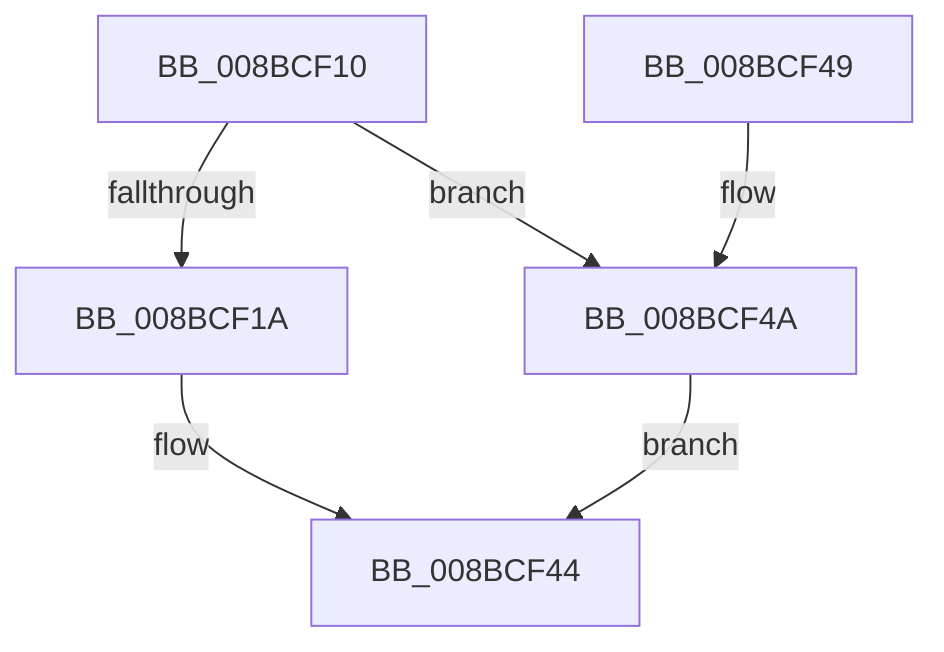

# SeSetSecurityDescriptorInfoEx

- RVA: `0x008BCF10`–`0x008BCF51` (길이 `65` bytes)
- VA: `0x00000001408BCF10`
- 실행 섹션: `PAGE`
- PDB 이름 있음: `예`; PDB Function 태그: `아니요`
- unwind 정보 RVA: `0x00082E10`
- 디코드: `17`개 명령, `65/65` bytes 표시
- 미해석 바이트: `0` (있으면 어셈블리에 `.byte`로 보존)

> 이 문서는 커널 이미지의 기계어와 PDB 기호를 분석해 생성했습니다. 4번과 5번은 함수 원형과 자료형을 바이너리 사용 방식에서 추정한 C 해석이며 원본 소스 복구 결과는 아닙니다.

## 1. Dependencies

- 직접 호출 지점: **1**; 고유 호출 대상: **1**
- 직접 호출자로 확인된 함수: **0**
- RIP 상대 이미지 참조: **0**

### Outgoing calls
- `0x008BCF3F` → [RtlpSetSecurityObject](RtlpSetSecurityObject_function_008BB500.md) (function, `0x008BB500`)

### Direct callers
- 이 함수 시작 RVA로 연결되는 직접 call은 확인되지 않았습니다. 간접 호출은 완전히 역산할 수 없습니다.

### Static image references
- 디코드된 RIP-relative 메모리 참조가 없습니다.

## 2. Other-region calls and transfers

- 다른 실행 섹션으로 향하는 call: **0**
- 별도 외부 분기/꼬리 이동을 확인하지 못했습니다.

## 3. Assembly (complete function range)

```asm
008BCF10  48 83 EC 48                     sub rsp, 0x48
008BCF14  49 83 39 00                     cmp qword ptr [r9], 0
008BCF18  74 30                           je 0x1408bcf4a
008BCF1A  48 83 64 24 38 00               and qword ptr [rsp + 0x38], 0
008BCF20  48 8B 84 24 80 00 00 00         mov rax, qword ptr [rsp + 0x80]
008BCF28  8B 12                           mov edx, dword ptr [rdx]
008BCF2A  48 89 44 24 30                  mov qword ptr [rsp + 0x30], rax
008BCF2F  8B 44 24 78                     mov eax, dword ptr [rsp + 0x78]
008BCF33  89 44 24 28                     mov dword ptr [rsp + 0x28], eax
008BCF37  8B 44 24 70                     mov eax, dword ptr [rsp + 0x70]
008BCF3B  89 44 24 20                     mov dword ptr [rsp + 0x20], eax
008BCF3F  E8 BC E5 FF FF                  call 0x1408bb500
008BCF44  48 83 C4 48                     add rsp, 0x48
008BCF48  C3                              ret
008BCF49  CC                              int3
008BCF4A  B8 D7 00 00 C0                  mov eax, 0xc00000d7
008BCF4F  EB F3                           jmp 0x1408bcf44
```

## 4. C-style interpretation (structured pseudocode)

```c
__int64 __fastcall SeSetSecurityDescriptorInfoEx(__int64 a1, __int64 a2, __int64 a3, __int64 a4, unsigned int a5, unsigned int a6, __int64 a7)
{
    __int64 result;
    __int64 v_rsp;
    unsigned __int64 v_stack_m10;
    unsigned __int64 v_stack_m18;
    unsigned int v_stack_m20;
    unsigned int v_stack_m28;

    v_rsp = (v_rsp) - (72);
    if ((*(unsigned __int64 *)(a4)) == 0) goto loc_008BCF4A;
    v_stack_m18 = a7;
    v_stack_m20 = (unsigned int)((unsigned int)(a6));
    v_stack_m28 = (unsigned int)((unsigned int)(a5));
    result = RtlpSetSecurityObject(a1, (unsigned int)(*(unsigned int *)(a2)), a3, a4);
loc_008BCF44:
    v_rsp = (v_rsp) + (72);
    return result;
loc_008BCF4A:
    goto loc_008BCF44;
}
```

## 5. (Beta) C Style

```c
int64_t SeSetSecurityDescriptorInfoEx(int64_t Arg1, void *Arg2, int64_t Arg3, void *Arg4, uint32_t Arg5, uint32_t Arg6, int64_t Arg7)
{
    uint8_t *arg2 = (uint8_t *)Arg2;
    uint8_t *arg4 = (uint8_t *)Arg4;

    int64_t result;
    int64_t local_rsp;
    uint64_t v_stack_m10;
    uint64_t v_stack_m18;
    uint32_t v_stack_m20;
    uint32_t v_stack_m28;

    local_rsp = (local_rsp) - (72);
    if ((*(uint64_t *)(arg4)) == 0) goto loc_008BCF4A;
    v_stack_m18 = Arg7;
    v_stack_m20 = (uint32_t)((uint32_t)(Arg6));
    v_stack_m28 = (uint32_t)((uint32_t)(Arg5));
    result = RtlpSetSecurityObject(Arg1, (uint32_t)(*(uint32_t *)(arg2)), Arg3, Arg4);
loc_008BCF44:
    local_rsp = (local_rsp) + (72);
    return result;
loc_008BCF4A:
    goto loc_008BCF44;
}
```

### 관측된 메모리 오프셋

구조체 형식이 확인되지 않은 접근은 인자 기준의 오프셋으로만 기록했습니다.

| 기준 인자 | 오프셋 표현 | 폭 (bit) | 접근 |
|---|---:|---:|---|
| `Arg2` | `+ 0x0` | `32` | `R` |
| `Arg4` | `+ 0x0` | `64` | `R` |

## 6. Execution-region graph

[열기: 2D/3D 그래프와 함수 탐색 컨트롤 패널](../../../control-panel.html?section=page&rva=0x008BCF10&view=graph)

- 2D 그래프는 위에서 아래로 흐르고, 3D 그래프는 빈 공간을 드래그해 회전합니다. Shift+드래그는 이동, 휠은 확대·축소, 함수 노드 선택은 대상 보고서 이동입니다.

### Static fallback


