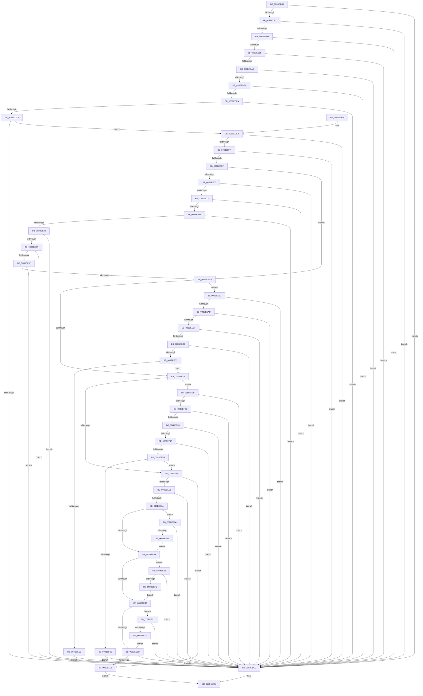

# SeValidSecurityDescriptor

- RVA: `0x008BED60`–`0x008BEF89` (길이 `553` bytes)
- VA: `0x00000001408BED60`
- 실행 섹션: `PAGE`
- PDB 이름 있음: `예`; PDB Function 태그: `아니요`
- unwind 정보 RVA: `0x00083268`
- 디코드: `164`개 명령, `553/553` bytes 표시
- 미해석 바이트: `0` (있으면 어셈블리에 `.byte`로 보존)

> 이 문서는 커널 이미지의 기계어와 PDB 기호를 분석해 생성했습니다. 4번과 5번은 함수 원형과 자료형을 바이너리 사용 방식에서 추정한 C 해석이며 원본 소스 복구 결과는 아닙니다.

## 1. Dependencies

- 직접 호출 지점: **3**; 고유 호출 대상: **2**
- 직접 호출자로 확인된 함수: **5**
- RIP 상대 이미지 참조: **0**

### Outgoing calls
- `0x008BEE4F` → [Feature_2077227322__private_IsEnabledDeviceUsageNoInline](../../text/4F/Feature_2077227322__private_IsEnabledDeviceUsageNoInline_function_004F4118.md) (function, `0x004F4118`)
- `0x008BEED6` → [RtlValidAcl](../92/RtlValidAcl_function_0092A7A0.md) (function, `0x0092A7A0`)
- `0x008BEF58` → [RtlValidAcl](../92/RtlValidAcl_function_0092A7A0.md) (function, `0x0092A7A0`)

### Direct callers
- [RtlNormalizeSecurityDescriptor](../../text/4B/RtlNormalizeSecurityDescriptor_function_004BABA0.md) at `0x004BABDA`
- [SepReadAndPopulateCapes](../7A/SepReadAndPopulateCapes_function_007A3CB8.md) at `0x007A4270`
- [SepReadAndPopulateCapes](../7A/SepReadAndPopulateCapes_function_007A3CB8.md) at `0x007A42ED`
- [WmipSDRegistryQueryRoutine](WmipSDRegistryQueryRoutine_function_008BECE0.md) at `0x008BED19`
- [EtwpGetGuidSecurityDescriptor](../8C/EtwpGetGuidSecurityDescriptor_function_008C05D4.md) at `0x008C0746`
- [PiSwValidateCreateData](../8D/PiSwValidateCreateData_function_008DB958.md) at `0x008DBC35`

### Static image references
- 디코드된 RIP-relative 메모리 참조가 없습니다.

## 2. Other-region calls and transfers

- 다른 실행 섹션으로 향하는 call: **1**
  - `0x008BEE4F` → [Feature_2077227322__private_IsEnabledDeviceUsageNoInline](../../text/4F/Feature_2077227322__private_IsEnabledDeviceUsageNoInline_function_004F4118.md) (`PAGE` → `.text`)
- 별도 외부 분기/꼬리 이동을 확인하지 못했습니다.

## 3. Assembly (complete function range)

```asm
008BED60  48 8B C4                        mov rax, rsp
008BED63  48 89 58 08                     mov qword ptr [rax + 8], rbx
008BED67  48 89 68 10                     mov qword ptr [rax + 0x10], rbp
008BED6B  48 89 70 18                     mov qword ptr [rax + 0x18], rsi
008BED6F  48 89 78 20                     mov qword ptr [rax + 0x20], rdi
008BED73  41 54                           push r12
008BED75  41 56                           push r14
008BED77  41 57                           push r15
008BED79  48 83 EC 20                     sub rsp, 0x20
008BED7D  45 33 E4                        xor r12d, r12d
008BED80  48 8B DA                        mov rbx, rdx
008BED83  8B F9                           mov edi, ecx
008BED85  41 8B EC                        mov ebp, r12d
008BED88  45 8B F4                        mov r14d, r12d
008BED8B  41 8B F4                        mov esi, r12d
008BED8E  83 F9 14                        cmp ecx, 0x14
008BED91  72 36                           jb 0x1408bedc9
008BED93  80 3A 01                        cmp byte ptr [rdx], 1
008BED96  75 31                           jne 0x1408bedc9
008BED98  66 44 39 62 02                  cmp word ptr [rdx + 2], r12w
008BED9D  7D 2A                           jge 0x1408bedc9
008BED9F  8B 4A 04                        mov ecx, dword ptr [rdx + 4]
008BEDA2  85 C9                           test ecx, ecx
008BEDA4  74 23                           je 0x1408bedc9
008BEDA6  48 8D 41 03                     lea rax, [rcx + 3]
008BEDAA  44 8B F9                        mov r15d, ecx
008BEDAD  48 83 E0 FC                     and rax, 0xfffffffffffffffc
008BEDB1  48 3B C1                        cmp rax, rcx
008BEDB4  75 13                           jne 0x1408bedc9
008BEDB6  3B CF                           cmp ecx, edi
008BEDB8  77 0F                           ja 0x1408bedc9
008BEDBA  8B D7                           mov edx, edi
008BEDBC  2B D1                           sub edx, ecx
008BEDBE  83 FA 0C                        cmp edx, 0xc
008BEDC1  72 06                           jb 0x1408bedc9
008BEDC3  80 3C 19 01                     cmp byte ptr [rcx + rbx], 1
008BEDC7  74 22                           je 0x1408bedeb
008BEDC9  32 C0                           xor al, al
008BEDCB  48 8B 5C 24 40                  mov rbx, qword ptr [rsp + 0x40]
008BEDD0  48 8B 6C 24 48                  mov rbp, qword ptr [rsp + 0x48]
008BEDD5  48 8B 74 24 50                  mov rsi, qword ptr [rsp + 0x50]
008BEDDA  48 8B 7C 24 58                  mov rdi, qword ptr [rsp + 0x58]
008BEDDF  48 83 C4 20                     add rsp, 0x20
008BEDE3  41 5F                           pop r15
008BEDE5  41 5E                           pop r14
008BEDE7  41 5C                           pop r12
008BEDE9  C3                              ret
008BEDEA  CC                              int3
008BEDEB  0F B6 44 19 01                  movzx eax, byte ptr [rcx + rbx + 1]
008BEDF0  3C 0F                           cmp al, 0xf
008BEDF2  77 D5                           ja 0x1408bedc9
008BEDF4  8D 04 85 08 00 00 00            lea eax, [rax*4 + 8]
008BEDFB  3B D0                           cmp edx, eax
008BEDFD  72 CA                           jb 0x1408bedc9
008BEDFF  8B 4B 08                        mov ecx, dword ptr [rbx + 8]
008BEE02  85 C9                           test ecx, ecx
008BEE04  74 37                           je 0x1408bee3d
008BEE06  48 8D 41 03                     lea rax, [rcx + 3]
008BEE0A  48 83 E0 FC                     and rax, 0xfffffffffffffffc
008BEE0E  48 3B C1                        cmp rax, rcx
008BEE11  75 B6                           jne 0x1408bedc9
008BEE13  3B CF                           cmp ecx, edi
008BEE15  77 B2                           ja 0x1408bedc9
008BEE17  8B D7                           mov edx, edi
008BEE19  2B D1                           sub edx, ecx
008BEE1B  83 FA 0C                        cmp edx, 0xc
008BEE1E  72 A9                           jb 0x1408bedc9
008BEE20  48 8D 2C 19                     lea rbp, [rcx + rbx]
008BEE24  80 7D 00 01                     cmp byte ptr [rbp], 1
008BEE28  75 9F                           jne 0x1408bedc9
008BEE2A  0F B6 45 01                     movzx eax, byte ptr [rbp + 1]
008BEE2E  3C 0F                           cmp al, 0xf
008BEE30  77 97                           ja 0x1408bedc9
008BEE32  8D 04 85 08 00 00 00            lea eax, [rax*4 + 8]
008BEE39  3B D0                           cmp edx, eax
008BEE3B  72 8C                           jb 0x1408bedc9
008BEE3D  8B 4B 10                        mov ecx, dword ptr [rbx + 0x10]
008BEE40  85 C9                           test ecx, ecx
008BEE42  75 58                           jne 0x1408bee9c
008BEE44  8B 4B 0C                        mov ecx, dword ptr [rbx + 0xc]
008BEE47  85 C9                           test ecx, ecx
008BEE49  0F 85 D0 00 00 00               jne 0x1408bef1f
008BEE4F  E8 C4 52 C3 FF                  call 0x1404f4118
008BEE54  85 C0                           test eax, eax
008BEE56  74 3D                           je 0x1408bee95
008BEE58  41 0F B6 44 1F 01               movzx eax, byte ptr [r15 + rbx + 1]
008BEE5E  41 B8 FC FF FF FF               mov r8d, 0xfffffffc
008BEE64  8D 14 85 0B 00 00 00            lea edx, [rax*4 + 0xb]
008BEE6B  41 23 D0                        and edx, r8d
008BEE6E  83 C2 14                        add edx, 0x14
008BEE71  83 FA 14                        cmp edx, 0x14
008BEE74  0F 82 4F FF FF FF               jb 0x1408bedc9
008BEE7A  48 85 ED                        test rbp, rbp
008BEE7D  0F 85 E7 00 00 00               jne 0x1408bef6a
008BEE83  4D 85 F6                        test r14, r14
008BEE86  75 60                           jne 0x1408beee8
008BEE88  48 85 F6                        test rsi, rsi
008BEE8B  75 74                           jne 0x1408bef01
008BEE8D  3B D7                           cmp edx, edi
008BEE8F  0F 87 34 FF FF FF               ja 0x1408bedc9
008BEE95  B0 01                           mov al, 1
008BEE97  E9 2F FF FF FF                  jmp 0x1408bedcb
008BEE9C  48 8D 41 03                     lea rax, [rcx + 3]
008BEEA0  48 83 E0 FC                     and rax, 0xfffffffffffffffc
008BEEA4  48 3B C1                        cmp rax, rcx
008BEEA7  0F 85 1C FF FF FF               jne 0x1408bedc9
008BEEAD  3B CF                           cmp ecx, edi
008BEEAF  0F 87 14 FF FF FF               ja 0x1408bedc9
008BEEB5  8B D7                           mov edx, edi
008BEEB7  2B D1                           sub edx, ecx
008BEEB9  83 FA 08                        cmp edx, 8
008BEEBC  0F 82 07 FF FF FF               jb 0x1408bedc9
008BEEC2  4C 8D 34 19                     lea r14, [rcx + rbx]
008BEEC6  41 0F B7 46 02                  movzx eax, word ptr [r14 + 2]
008BEECB  3B D0                           cmp edx, eax
008BEECD  0F 82 F6 FE FF FF               jb 0x1408bedc9
008BEED3  49 8B CE                        mov rcx, r14
008BEED6  E8 C5 B8 06 00                  call 0x14092a7a0
008BEEDB  84 C0                           test al, al
008BEEDD  0F 85 61 FF FF FF               jne 0x1408bee44
008BEEE3  E9 E1 FE FF FF                  jmp 0x1408bedc9
008BEEE8  41 0F B7 4E 02                  movzx ecx, word ptr [r14 + 2]
008BEEED  83 C1 03                        add ecx, 3
008BEEF0  41 23 C8                        and ecx, r8d
008BEEF3  03 CA                           add ecx, edx
008BEEF5  3B CA                           cmp ecx, edx
008BEEF7  0F 82 CC FE FF FF               jb 0x1408bedc9
008BEEFD  8B D1                           mov edx, ecx
008BEEFF  EB 87                           jmp 0x1408bee88
008BEF01  0F B7 4E 02                     movzx ecx, word ptr [rsi + 2]
008BEF05  83 C1 03                        add ecx, 3
008BEF08  44 23 C1                        and r8d, ecx
008BEF0B  44 03 C2                        add r8d, edx
008BEF0E  44 3B C2                        cmp r8d, edx
008BEF11  0F 82 B2 FE FF FF               jb 0x1408bedc9
008BEF17  41 8B D0                        mov edx, r8d
008BEF1A  E9 6E FF FF FF                  jmp 0x1408bee8d
008BEF1F  48 8D 41 03                     lea rax, [rcx + 3]
008BEF23  48 83 E0 FC                     and rax, 0xfffffffffffffffc
008BEF27  48 3B C1                        cmp rax, rcx
008BEF2A  0F 85 99 FE FF FF               jne 0x1408bedc9
008BEF30  3B CF                           cmp ecx, edi
008BEF32  0F 87 91 FE FF FF               ja 0x1408bedc9
008BEF38  8B D7                           mov edx, edi
008BEF3A  2B D1                           sub edx, ecx
008BEF3C  83 FA 08                        cmp edx, 8
008BEF3F  0F 82 84 FE FF FF               jb 0x1408bedc9
008BEF45  48 8D 34 19                     lea rsi, [rcx + rbx]
008BEF49  0F B7 46 02                     movzx eax, word ptr [rsi + 2]
008BEF4D  3B D0                           cmp edx, eax
008BEF4F  0F 82 74 FE FF FF               jb 0x1408bedc9
008BEF55  48 8B CE                        mov rcx, rsi
008BEF58  E8 43 B8 06 00                  call 0x14092a7a0
008BEF5D  84 C0                           test al, al
008BEF5F  0F 85 EA FE FF FF               jne 0x1408bee4f
008BEF65  E9 5F FE FF FF                  jmp 0x1408bedc9
008BEF6A  0F B6 45 01                     movzx eax, byte ptr [rbp + 1]
008BEF6E  8D 0C 85 0B 00 00 00            lea ecx, [rax*4 + 0xb]
008BEF75  41 23 C8                        and ecx, r8d
008BEF78  03 CA                           add ecx, edx
008BEF7A  3B CA                           cmp ecx, edx
008BEF7C  0F 82 47 FE FF FF               jb 0x1408bedc9
008BEF82  8B D1                           mov edx, ecx
008BEF84  E9 FA FE FF FF                  jmp 0x1408bee83
```

## 4. C-style interpretation (structured pseudocode)

```c
__int64 __fastcall SeValidSecurityDescriptor(int a1, __int64 a2)
{
    __int64 result;
    __int64 v_r12;
    __int64 v_rsp;
    unsigned __int64 v_stack_p10;
    unsigned __int64 v_stack_p18;
    unsigned __int64 v_stack_p20;
    unsigned __int64 v_stack_p8;

    *(unsigned __int64 *)(v_rsp + 8) = v_rbx;
    *(unsigned __int64 *)(v_rsp + 16) = v_rbp;
    *(unsigned __int64 *)(v_rsp + 24) = v_rsi;
    *(unsigned __int64 *)(v_rsp + 32) = v_rdi;
    v_rsp = (v_rsp) - (32);
    v_r12 = 0;
    if (a1 < 20) goto loc_008BEDC9;
    if ((*(unsigned __int8 *)(a2)) != 1) goto loc_008BEDC9;
    if ((*(unsigned __int16 *)(a2 + 2)) >= 0) goto loc_008BEDC9;
    if ((unsigned int)((unsigned int)(*(unsigned int *)(a2 + 4))) == 0) goto loc_008BEDC9;
    result = ((unsigned int)(*(unsigned int *)(a2 + 4)) + 3) & (-4);
    if (result != ((unsigned int)(*(unsigned int *)(a2 + 4)))) goto loc_008BEDC9;
    if (((unsigned int)((unsigned int)(*(unsigned int *)(a2 + 4)))) > ((unsigned int)((unsigned int)(a1)))) goto loc_008BEDC9;
    a2 = (unsigned int)(((unsigned int)((unsigned int)((unsigned int)(a1)))) - ((unsigned int)((unsigned int)(*(unsigned int *)(a2 + 4)))));
    if (((unsigned int)(a2)) < 12) goto loc_008BEDC9;
    if ((*(unsigned __int8 *)((unsigned int)(*(unsigned int *)(a2 + 4)) + a2 * 1)) == 1) goto loc_008BEDEB;
loc_008BEDC9:
    result = 0;
loc_008BEDCB:
    v_rsp = (v_rsp) + (32);
    return result;
loc_008BEDEB:
    if (((unsigned __int8)(*(unsigned __int8 *)((unsigned int)(*(unsigned int *)(a2 + 4)) + v_stack_p8 * 1 + 1))) > 15) goto loc_008BEDC9;
    if (((unsigned int)(a2)) < ((unsigned int)(*(unsigned __int8 *)((unsigned int)(*(unsigned int *)(a2 + 4)) + v_stack_p8 * 1 + 1) * 4 + 8))) goto loc_008BEDC9;
    if ((unsigned int)((unsigned int)(*(unsigned int *)(v_stack_p8 + 8))) == 0) goto loc_008BEE3D;
    result = ((unsigned int)(*(unsigned int *)(v_stack_p8 + 8)) + 3) & (-4);
    if (result != ((unsigned int)(*(unsigned int *)(v_stack_p8 + 8)))) goto loc_008BEDC9;
    if (((unsigned int)((unsigned int)(*(unsigned int *)(v_stack_p8 + 8)))) > ((unsigned int)(v_stack_p20))) goto loc_008BEDC9;
    a2 = (unsigned int)(((unsigned int)((unsigned int)(v_stack_p20))) - ((unsigned int)((unsigned int)(*(unsigned int *)(v_stack_p8 + 8)))));
    if (((unsigned int)(a2)) < 12) goto loc_008BEDC9;
    if ((*(unsigned __int8 *)((unsigned int)(*(unsigned int *)(v_stack_p8 + 8)) + v_stack_p8 * 1)) != 1) goto loc_008BEDC9;
    if (((unsigned __int8)(*(unsigned __int8 *)((unsigned int)(*(unsigned int *)(v_stack_p8 + 8)) + v_stack_p8 * 1 + 1))) > 15) goto loc_008BEDC9;
    if (((unsigned int)(a2)) < ((unsigned int)(*(unsigned __int8 *)((unsigned int)(*(unsigned int *)(v_stack_p8 + 8)) + v_stack_p8 * 1 + 1) * 4 + 8))) goto loc_008BEDC9;
loc_008BEE3D:
    if ((unsigned int)((unsigned int)(*(unsigned int *)(v_stack_p8 + 16))) != 0) goto loc_008BEE9C;
loc_008BEE44:
    if ((unsigned int)((unsigned int)(*(unsigned int *)(v_stack_p8 + 12))) != 0) goto loc_008BEF1F;
loc_008BEE4F:
    result = Feature_2077227322__private_IsEnabledDeviceUsageNoInline((unsigned int)(*(unsigned int *)(v_stack_p8 + 12)), a2, a3, a4);
    if ((unsigned int)(result) == 0) goto loc_008BEE95;
    a2 = (unsigned int)((*(unsigned __int8 *)((unsigned int)((unsigned int)((unsigned int)(*(unsigned int *)(a2 + 4)))) + v_stack_p8 * 1 + 1) * 4 + 11) & ((unsigned int)((unsigned int)(0xFFFFFFFCULL))));
    a2 = (unsigned int)((a2) + (20));
    if (((unsigned int)(a2)) < 20) goto loc_008BEDC9;
    if ((unsigned int)(*(unsigned int *)(v_stack_p8 + 8)) + v_stack_p8 * 1 != 0) goto loc_008BEF6A;
loc_008BEE83:
    if (0 != 0) goto loc_008BEEE8;
loc_008BEE88:
    if (v_stack_p18 != 0) goto loc_008BEF01;
loc_008BEE8D:
    if (((unsigned int)(a2)) > ((unsigned int)(v_stack_p20))) goto loc_008BEDC9;
loc_008BEE95:
    goto loc_008BEDCB;
loc_008BEE9C:
    result = ((unsigned int)(*(unsigned int *)(v_stack_p8 + 12)) + 3) & (-4);
    if (result != ((unsigned int)(*(unsigned int *)(v_stack_p8 + 12)))) goto loc_008BEDC9;
    if (((unsigned int)((unsigned int)(*(unsigned int *)(v_stack_p8 + 12)))) > ((unsigned int)(v_stack_p20))) goto loc_008BEDC9;
    a2 = (unsigned int)(((unsigned int)((unsigned int)(v_stack_p20))) - ((unsigned int)((unsigned int)(*(unsigned int *)(v_stack_p8 + 12)))));
    if (((unsigned int)(a2)) < 8) goto loc_008BEDC9;
    if (((unsigned int)(a2)) < ((unsigned int)(*(unsigned __int16 *)((unsigned int)(*(unsigned int *)(v_stack_p8 + 12)) + v_stack_p8 * 1 + 2)))) goto loc_008BEDC9;
    result = RtlValidAcl((unsigned int)(*(unsigned int *)(v_stack_p8 + 12)) + v_stack_p8 * 1, a2, (unsigned int)(0xFFFFFFFCULL), a4);
    if ((unsigned __int8)(result) != 0) goto loc_008BEE44;
    goto loc_008BEDC9;
loc_008BEEE8:
    a1 = (unsigned int)((*(unsigned __int16 *)((unsigned int)(*(unsigned int *)(v_stack_p8 + 12)) + v_stack_p8 * 1 + 2)) + (3));
    a1 = (unsigned int)((a1) & ((unsigned int)((unsigned int)(0xFFFFFFFCULL))));
    a1 = (unsigned int)((a1) + ((unsigned int)(a2)));
    if (a1 < ((unsigned int)(a2))) goto loc_008BEDC9;
    goto loc_008BEE88;
loc_008BEF01:
    a1 = (unsigned int)((*(unsigned __int16 *)(v_stack_p18 + 2)) + (3));
    a3 = (unsigned int)(((unsigned int)(0xFFFFFFFCULL)) & (a1));
    a3 = (unsigned int)((a3) + ((unsigned int)((unsigned int)(a1))));
    if (((unsigned int)(a3)) < ((unsigned int)((unsigned int)(a1)))) goto loc_008BEDC9;
    goto loc_008BEE8D;
loc_008BEF1F:
    result = (a1 + 3) & (-4);
    if (result != a1) goto loc_008BEDC9;
    if (a1 > ((unsigned int)(v_stack_p20))) goto loc_008BEDC9;
    a2 = (unsigned int)(((unsigned int)((unsigned int)(v_stack_p20))) - (a1));
    if (((unsigned int)(a2)) < 8) goto loc_008BEDC9;
    if (((unsigned int)(a2)) < ((unsigned int)(*(unsigned __int16 *)(a1 + v_stack_p8 * 1 + 2)))) goto loc_008BEDC9;
    result = RtlValidAcl(a1 + v_stack_p8 * 1, a2, a3, a4);
    if ((unsigned __int8)(result) != 0) goto loc_008BEE4F;
    goto loc_008BEDC9;
loc_008BEF6A:
    a1 = (unsigned int)((*(unsigned __int8 *)((unsigned int)(*(unsigned int *)(v_stack_p8 + 8)) + v_stack_p8 * 1 + 1) * 4 + 11) & ((unsigned int)(a3)));
    a1 = (unsigned int)((a1) + ((unsigned int)(a2)));
    if (a1 < ((unsigned int)(a2))) goto loc_008BEDC9;
    goto loc_008BEE83;
}
```

## 5. (Beta) C Style

```c
int64_t SeValidSecurityDescriptor(int32_t Arg1, void *Arg2)
{
    uint8_t *arg2 = (uint8_t *)Arg2;

    int64_t result;
    int64_t local_r12;
    int64_t local_rsp;
    uint64_t v_stack_p10;
    uint64_t v_stack_p18;
    uint64_t v_stack_p20;
    uint64_t v_stack_p8;

    *(uint64_t *)(local_rsp + 0x8) = local_rbx;
    *(uint64_t *)(local_rsp + 0x10) = local_rbp;
    *(uint64_t *)(local_rsp + 0x18) = local_rsi;
    *(uint64_t *)(local_rsp + 0x20) = local_rdi;
    local_rsp = (local_rsp) - (32);
    local_r12 = 0;
    if (Arg1 < 20) goto loc_008BEDC9;
    if ((*(uint8_t *)(arg2)) != 1) goto loc_008BEDC9;
    if ((*(uint16_t *)(arg2 + 0x2)) >= 0) goto loc_008BEDC9;
    if ((uint32_t)((uint32_t)(*(uint32_t *)(arg2 + 0x4))) == 0) goto loc_008BEDC9;
    result = ((uint32_t)(*(uint32_t *)(arg2 + 0x4)) + 3) & (-4);
    if (result != ((uint32_t)(*(uint32_t *)(arg2 + 0x4)))) goto loc_008BEDC9;
    if (((uint32_t)((uint32_t)(*(uint32_t *)(arg2 + 0x4)))) > ((uint32_t)((uint32_t)(Arg1)))) goto loc_008BEDC9;
    Arg2 = (uint32_t)(((uint32_t)((uint32_t)((uint32_t)(Arg1)))) - ((uint32_t)((uint32_t)(*(uint32_t *)(arg2 + 0x4)))));
    if (((uint32_t)(Arg2)) < 12) goto loc_008BEDC9;
    if ((*(uint8_t *)((uint32_t)(*(uint32_t *)(arg2 + 0x4)) + arg2 * 1)) == 1) goto loc_008BEDEB;
loc_008BEDC9:
    result = 0;
loc_008BEDCB:
    local_rsp = (local_rsp) + (32);
    return result;
loc_008BEDEB:
    if (((uint8_t)(*(uint8_t *)((uint32_t)(*(uint32_t *)(arg2 + 0x4)) + v_stack_p8 * 1 + 0x1))) > 15) goto loc_008BEDC9;
    if (((uint32_t)(Arg2)) < ((uint32_t)(*(uint8_t *)((uint32_t)(*(uint32_t *)(arg2 + 0x4)) + v_stack_p8 * 1 + 0x1) * 4 + 8))) goto loc_008BEDC9;
    if ((uint32_t)((uint32_t)(*(uint32_t *)(v_stack_p8 + 0x8))) == 0) goto loc_008BEE3D;
    result = ((uint32_t)(*(uint32_t *)(v_stack_p8 + 0x8)) + 3) & (-4);
    if (result != ((uint32_t)(*(uint32_t *)(v_stack_p8 + 0x8)))) goto loc_008BEDC9;
    if (((uint32_t)((uint32_t)(*(uint32_t *)(v_stack_p8 + 0x8)))) > ((uint32_t)(v_stack_p20))) goto loc_008BEDC9;
    Arg2 = (uint32_t)(((uint32_t)((uint32_t)(v_stack_p20))) - ((uint32_t)((uint32_t)(*(uint32_t *)(v_stack_p8 + 0x8)))));
    if (((uint32_t)(Arg2)) < 12) goto loc_008BEDC9;
    if ((*(uint8_t *)((uint32_t)(*(uint32_t *)(v_stack_p8 + 0x8)) + v_stack_p8 * 1)) != 1) goto loc_008BEDC9;
    if (((uint8_t)(*(uint8_t *)((uint32_t)(*(uint32_t *)(v_stack_p8 + 0x8)) + v_stack_p8 * 1 + 0x1))) > 15) goto loc_008BEDC9;
    if (((uint32_t)(Arg2)) < ((uint32_t)(*(uint8_t *)((uint32_t)(*(uint32_t *)(v_stack_p8 + 0x8)) + v_stack_p8 * 1 + 0x1) * 4 + 8))) goto loc_008BEDC9;
loc_008BEE3D:
    if ((uint32_t)((uint32_t)(*(uint32_t *)(v_stack_p8 + 0x10))) != 0) goto loc_008BEE9C;
loc_008BEE44:
    if ((uint32_t)((uint32_t)(*(uint32_t *)(v_stack_p8 + 0xC))) != 0) goto loc_008BEF1F;
loc_008BEE4F:
    result = Feature_2077227322__private_IsEnabledDeviceUsageNoInline((uint32_t)(*(uint32_t *)(v_stack_p8 + 0xC)), Arg2, a3, a4);
    if ((uint32_t)(result) == 0) goto loc_008BEE95;
    Arg2 = (uint32_t)((*(uint8_t *)((uint32_t)((uint32_t)((uint32_t)(*(uint32_t *)(arg2 + 0x4)))) + v_stack_p8 * 1 + 0x1) * 4 + 11) & ((uint32_t)((uint32_t)(0xFFFFFFFCULL))));
    Arg2 = (uint32_t)((Arg2) + (20));
    if (((uint32_t)(Arg2)) < 20) goto loc_008BEDC9;
    if ((uint32_t)(*(uint32_t *)(v_stack_p8 + 0x8)) + v_stack_p8 * 1 != 0) goto loc_008BEF6A;
loc_008BEE83:
    if (0 != 0) goto loc_008BEEE8;
loc_008BEE88:
    if (v_stack_p18 != 0) goto loc_008BEF01;
loc_008BEE8D:
    if (((uint32_t)(Arg2)) > ((uint32_t)(v_stack_p20))) goto loc_008BEDC9;
loc_008BEE95:
    goto loc_008BEDCB;
loc_008BEE9C:
    result = ((uint32_t)(*(uint32_t *)(v_stack_p8 + 0xC)) + 3) & (-4);
    if (result != ((uint32_t)(*(uint32_t *)(v_stack_p8 + 0xC)))) goto loc_008BEDC9;
    if (((uint32_t)((uint32_t)(*(uint32_t *)(v_stack_p8 + 0xC)))) > ((uint32_t)(v_stack_p20))) goto loc_008BEDC9;
    Arg2 = (uint32_t)(((uint32_t)((uint32_t)(v_stack_p20))) - ((uint32_t)((uint32_t)(*(uint32_t *)(v_stack_p8 + 0xC)))));
    if (((uint32_t)(Arg2)) < 8) goto loc_008BEDC9;
    if (((uint32_t)(Arg2)) < ((uint32_t)(*(uint16_t *)((uint32_t)(*(uint32_t *)(v_stack_p8 + 0xC)) + v_stack_p8 * 1 + 0x2)))) goto loc_008BEDC9;
    result = RtlValidAcl((uint32_t)(*(uint32_t *)(v_stack_p8 + 0xC)) + v_stack_p8 * 1, Arg2, (uint32_t)(0xFFFFFFFCULL), a4);
    if ((uint8_t)(result) != 0) goto loc_008BEE44;
    goto loc_008BEDC9;
loc_008BEEE8:
    Arg1 = (uint32_t)((*(uint16_t *)((uint32_t)(*(uint32_t *)(v_stack_p8 + 0xC)) + v_stack_p8 * 1 + 0x2)) + (3));
    Arg1 = (uint32_t)((Arg1) & ((uint32_t)((uint32_t)(0xFFFFFFFCULL))));
    Arg1 = (uint32_t)((Arg1) + ((uint32_t)(Arg2)));
    if (Arg1 < ((uint32_t)(Arg2))) goto loc_008BEDC9;
    goto loc_008BEE88;
loc_008BEF01:
    Arg1 = (uint32_t)((*(uint16_t *)(v_stack_p18 + 0x2)) + (3));
    a3 = (uint32_t)(((uint32_t)(0xFFFFFFFCULL)) & (Arg1));
    a3 = (uint32_t)((a3) + ((uint32_t)((uint32_t)(Arg1))));
    if (((uint32_t)(a3)) < ((uint32_t)((uint32_t)(Arg1)))) goto loc_008BEDC9;
    goto loc_008BEE8D;
loc_008BEF1F:
    result = (Arg1 + 3) & (-4);
    if (result != Arg1) goto loc_008BEDC9;
    if (Arg1 > ((uint32_t)(v_stack_p20))) goto loc_008BEDC9;
    Arg2 = (uint32_t)(((uint32_t)((uint32_t)(v_stack_p20))) - (Arg1));
    if (((uint32_t)(Arg2)) < 8) goto loc_008BEDC9;
    if (((uint32_t)(Arg2)) < ((uint32_t)(*(uint16_t *)(Arg1 + v_stack_p8 * 1 + 0x2)))) goto loc_008BEDC9;
    result = RtlValidAcl(Arg1 + v_stack_p8 * 1, Arg2, a3, a4);
    if ((uint8_t)(result) != 0) goto loc_008BEE4F;
    goto loc_008BEDC9;
loc_008BEF6A:
    Arg1 = (uint32_t)((*(uint8_t *)((uint32_t)(*(uint32_t *)(v_stack_p8 + 0x8)) + v_stack_p8 * 1 + 0x1) * 4 + 11) & ((uint32_t)(a3)));
    Arg1 = (uint32_t)((Arg1) + ((uint32_t)(Arg2)));
    if (Arg1 < ((uint32_t)(Arg2))) goto loc_008BEDC9;
    goto loc_008BEE83;
}
```

### 관측된 메모리 오프셋

구조체 형식이 확인되지 않은 접근은 인자 기준의 오프셋으로만 기록했습니다.

| 기준 인자 | 오프셋 표현 | 폭 (bit) | 접근 |
|---|---:|---:|---|
| `Arg2` | `+ 0x0` | `8` | `R` |
| `Arg2` | `+ 0x2` | `16` | `R` |
| `Arg2` | `+ 0x4` | `32` | `R` |
| `Arg2` | `+ 0x8` | `32` | `R` |
| `Arg2` | `+ 0xC` | `32` | `R` |
| `Arg2` | `+ 0x10` | `32` | `R` |

## 6. Execution-region graph

[열기: 2D/3D 그래프와 함수 탐색 컨트롤 패널](../../../control-panel.html?section=page&rva=0x008BED60&view=graph)

- 2D 그래프는 위에서 아래로 흐르고, 3D 그래프는 빈 공간을 드래그해 회전합니다. Shift+드래그는 이동, 휠은 확대·축소, 함수 노드 선택은 대상 보고서 이동입니다.

### Static fallback


