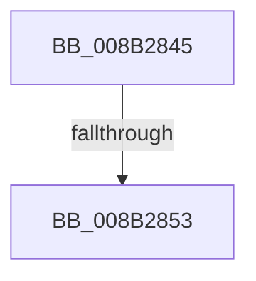

# sub_008B2845

- RVA: `0x008B2845`–`0x008B2872` (길이 `45` bytes)
- VA: `0x00000001408B2845`
- 실행 섹션: `PAGE`
- PDB 이름 있음: `아니요`; PDB Function 태그: `아니요`
- unwind 정보 RVA: `0x00082638`
- 디코드: `11`개 명령, `45/45` bytes 표시
- 미해석 바이트: `0` (있으면 어셈블리에 `.byte`로 보존)

> 이 문서는 커널 이미지의 기계어와 PDB 기호를 분석해 생성했습니다. 4번과 5번은 함수 원형과 자료형을 바이너리 사용 방식에서 추정한 C 해석이며 원본 소스 복구 결과는 아닙니다.

## 1. Dependencies

- 직접 호출 지점: **1**; 고유 호출 대상: **1**
- 직접 호출자로 확인된 함수: **0**
- RIP 상대 이미지 참조: **0**

### Outgoing calls
- `0x008B285F` → [memset](../../text/6C/memset_function_006C6C40.md) (function, `0x006C6C40`)

### Direct callers
- 이 함수 시작 RVA로 연결되는 직접 call은 확인되지 않았습니다. 간접 호출은 완전히 역산할 수 없습니다.

### Static image references
- 디코드된 RIP-relative 메모리 참조가 없습니다.

## 2. Other-region calls and transfers

- 다른 실행 섹션으로 향하는 call: **1**
  - `0x008B285F` → [memset](../../text/6C/memset_function_006C6C40.md) (`PAGE` → `.text`)
- call이 아닌 외부 분기/꼬리 이동: **1**
  - `0x008B2851` → [sub_008B288E](Unknown_function_008B288E.md) (`tail-transfer`)

## 3. Assembly (complete function range)

```asm
008B2845  48 89 BC 24 D8 00 00 00         mov qword ptr [rsp + 0xd8], rdi
008B284D  48 83 FB 40                     cmp rbx, 0x40
008B2851  77 3B                           ja 0x1408b288e
008B2853  48 8D 7E 11                     lea rdi, [rsi + 0x11]
008B2857  4C 8B C3                        mov r8, rbx
008B285A  48 8B CF                        mov rcx, rdi
008B285D  33 D2                           xor edx, edx
008B285F  E8 DC 43 E1 FF                  call 0x1406c6c40
008B2864  48 89 7E 08                     mov qword ptr [rsi + 8], rdi
008B2868  8B C5                           mov eax, ebp
008B286A  48 8B BC 24 D8 00 00 00         mov rdi, qword ptr [rsp + 0xd8]
```

## 4. C-style interpretation (structured pseudocode)

```c
__int64 __fastcall sub_008B2845(__int64 a1, int a2, __int64 a3, __int64 a4, __int64 a5, __int64 a6, __int64 a7, __int64 a8, __int64 a9, __int64 a10, __int64 a11, __int64 a12, __int64 a13, __int64 a14, __int64 a15, __int64 a16, __int64 a17, __int64 a18, __int64 a19, __int64 a20, __int64 a21, __int64 a22, __int64 a23, __int64 a24, __int64 a25, __int64 a26, __int64 a27)
{
    __int64 result;
    unsigned __int64 v_stack_pD8;

    v_stack_pD8 = v_rdi;
    a2 = 0;
    result = memset(v_rsi + 17, a2, v_rbx, a4);
    *(unsigned __int64 *)(v_rsi + 8) = v_rsi + 17;
    return (unsigned int)((unsigned int)(v_rbp));
}
```

## 5. (Beta) C Style

```c
int64_t sub_008B2845(int64_t Arg1, int32_t Arg2, int64_t Arg3, int64_t Arg4, uint64_t Arg5, uint64_t Arg6, uint64_t Arg7, uint64_t Arg8, uint64_t Arg9, uint64_t Arg10, uint64_t Arg11, uint64_t Arg12, uint64_t Arg13, uint64_t Arg14, uint64_t Arg15, uint64_t Arg16, uint64_t Arg17, uint64_t Arg18, uint64_t Arg19, uint64_t Arg20, uint64_t Arg21, uint64_t Arg22, uint64_t Arg23, uint64_t Arg24, uint64_t Arg25, uint64_t Arg26, int64_t Arg27)
{
    int64_t result;
    uint64_t v_stack_pD8;

    v_stack_pD8 = local_rdi;
    Arg2 = 0;
    result = memset(local_rsi + 17, Arg2, local_rbx, Arg4);
    *(uint64_t *)(local_rsi + 0x8) = local_rsi + 17;
    return (uint32_t)((uint32_t)(local_rbp));
}
```

## 6. Execution-region graph

[열기: 2D/3D 그래프와 함수 탐색 컨트롤 패널](../../../control-panel.html?section=page&rva=0x008B2845&view=graph)

- 2D 그래프는 위에서 아래로 흐르고, 3D 그래프는 빈 공간을 드래그해 회전합니다. Shift+드래그는 이동, 휠은 확대·축소, 함수 노드 선택은 대상 보고서 이동입니다.

### Static fallback


