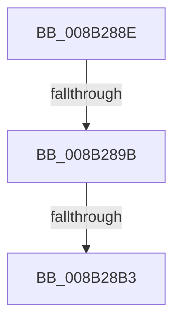

# sub_008B288E

- RVA: `0x008B288E`–`0x008B28C6` (길이 `56` bytes)
- VA: `0x00000001408B288E`
- 실행 섹션: `PAGE`
- PDB 이름 있음: `아니요`; PDB Function 태그: `아니요`
- unwind 정보 RVA: `0x00082660`
- 디코드: `13`개 명령, `56/56` bytes 표시
- 미해석 바이트: `0` (있으면 어셈블리에 `.byte`로 보존)

> 이 문서는 커널 이미지의 기계어와 PDB 기호를 분석해 생성했습니다. 4번과 5번은 함수 원형과 자료형을 바이너리 사용 방식에서 추정한 C 해석이며 원본 소스 복구 결과는 아닙니다.

## 1. Dependencies

- 직접 호출 지점: **2**; 고유 호출 대상: **2**
- 직접 호출자로 확인된 함수: **0**
- RIP 상대 이미지 참조: **1**

### Outgoing calls
- `0x008B28A2` → [ExAllocateFromLookasideListEx](../../text/3C/ExAllocateFromLookasideListEx_function_003CD390.md) (function, `0x003CD390`)
- `0x008B28BB` → [memset](../../text/6C/memset_function_006C6C40.md) (function, `0x006C6C40`)

### Direct callers
- 이 함수 시작 RVA로 연결되는 직접 call은 확인되지 않았습니다. 간접 호출은 완전히 역산할 수 없습니다.

### Static image references
- `0x008B289B` → RVA `0x00E2CA40` (`.data`; read)

## 2. Other-region calls and transfers

- 다른 실행 섹션으로 향하는 call: **2**
  - `0x008B28A2` → [ExAllocateFromLookasideListEx](../../text/3C/ExAllocateFromLookasideListEx_function_003CD390.md) (`PAGE` → `.text`)
  - `0x008B28BB` → [memset](../../text/6C/memset_function_006C6C40.md) (`PAGE` → `.text`)
- call이 아닌 외부 분기/꼬리 이동: **3**
  - `0x008B2895` → [sub_008B2988](Unknown_function_008B2988.md) (`tail-transfer`)
  - `0x008B28AD` → [sub_008B2988](Unknown_function_008B2988.md) (`tail-transfer`)
  - `0x008B28C4` → [sub_008B2845 + 0x1F](Unknown_function_008B2845.md) (`tail-transfer`)

## 3. Assembly (complete function range)

```asm
008B288E  48 81 FB 00 10 00 00            cmp rbx, 0x1000
008B2895  0F 87 ED 00 00 00               ja 0x1408b2988
008B289B  48 8D 0D 9E A1 57 00            lea rcx, [rip + 0x57a19e]
008B28A2  E8 E9 AA B1 FF                  call 0x1403cd390
008B28A7  48 8B F8                        mov rdi, rax
008B28AA  48 85 C0                        test rax, rax
008B28AD  0F 84 D5 00 00 00               je 0x1408b2988
008B28B3  4C 8B C3                        mov r8, rbx
008B28B6  33 D2                           xor edx, edx
008B28B8  48 8B C8                        mov rcx, rax
008B28BB  E8 80 43 E1 FF                  call 0x1406c6c40
008B28C0  80 4E 10 01                     or byte ptr [rsi + 0x10], 1
008B28C4  EB 9E                           jmp 0x1408b2864
```

## 4. C-style interpretation (structured pseudocode)

```c
__int64 __fastcall sub_008B288E(__int64 a1, int a2)
{
    __int64 result;

    result = ExAllocateFromLookasideListEx(v_rip + 5743006, a2, a3, a4);
    a2 = 0;
    result = memset(result, a2, v_rbx, a4);
}
```

## 5. (Beta) C Style

```c
int64_t sub_008B288E(int64_t Arg1, int32_t Arg2)
{
    int64_t result;

    result = ExAllocateFromLookasideListEx(v_rip + 5743006, Arg2, a3, a4);
    Arg2 = 0;
    result = memset(result, Arg2, local_rbx, a4);
}
```

## 6. Execution-region graph

[열기: 2D/3D 그래프와 함수 탐색 컨트롤 패널](../../../control-panel.html?section=page&rva=0x008B288E&view=graph)

- 2D 그래프는 위에서 아래로 흐르고, 3D 그래프는 빈 공간을 드래그해 회전합니다. Shift+드래그는 이동, 휠은 확대·축소, 함수 노드 선택은 대상 보고서 이동입니다.

### Static fallback


