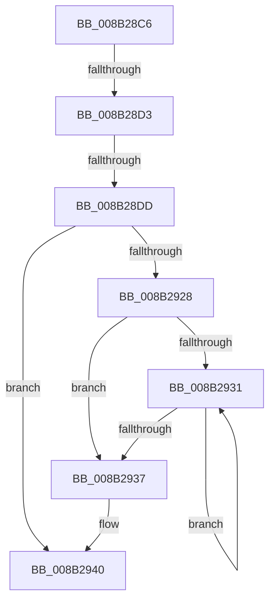

# sub_008B28C6

- RVA: `0x008B28C6`–`0x008B2988` (길이 `194` bytes)
- VA: `0x00000001408B28C6`
- 실행 섹션: `PAGE`
- PDB 이름 있음: `아니요`; PDB Function 태그: `아니요`
- unwind 정보 RVA: `0x00082674`
- 디코드: `39`개 명령, `194/194` bytes 표시
- 미해석 바이트: `0` (있으면 어셈블리에 `.byte`로 보존)

> 이 문서는 커널 이미지의 기계어와 PDB 기호를 분석해 생성했습니다. 4번과 5번은 함수 원형과 자료형을 바이너리 사용 방식에서 추정한 C 해석이며 원본 소스 복구 결과는 아닙니다.

## 1. Dependencies

- 직접 호출 지점: **1**; 고유 호출 대상: **1**
- 직접 호출자로 확인된 함수: **0**
- RIP 상대 이미지 참조: **3**

### Outgoing calls
- `0x008B297E` → [tlgWriteAgg](../../text/2F/tlgWriteAgg_function_002F0F7C.md) (function, `0x002F0F7C`)

### Direct callers
- 이 함수 시작 RVA로 연결되는 직접 call은 확인되지 않았습니다. 간접 호출은 완전히 역산할 수 없습니다.

### Static image references
- `0x008B28C6` → RVA `0x00E09F68` (`.data`; read)
- `0x008B2942` → RVA `0x00E09F58` (`.data`; read)
- `0x008B294E` → RVA `0x0005627C` (`.rdata`; read)

## 2. Other-region calls and transfers

- 다른 실행 섹션으로 향하는 call: **1**
  - `0x008B297E` → [tlgWriteAgg](../../text/2F/tlgWriteAgg_function_002F0F7C.md) (`PAGE` → `.text`)
- call이 아닌 외부 분기/꼬리 이동: **3**
  - `0x008B28CD` → [sub_008B29A4 + 0x2D](Unknown_function_008B29A4.md) (`tail-transfer`)
  - `0x008B28D7` → [sub_008B2845](Unknown_function_008B2845.md) (`tail-transfer`)
  - `0x008B2983` → [sub_008B2845](Unknown_function_008B2845.md) (`tail-transfer`)

## 3. Assembly (complete function range)

```asm
008B28C6  F6 05 9B 76 55 00 04            test byte ptr [rip + 0x55769b], 4
008B28CD  0F 85 FE 00 00 00               jne 0x1408b29d1
008B28D3  32 C0                           xor al, al
008B28D5  84 C0                           test al, al
008B28D7  0F 84 68 FF FF FF               je 0x1408b2845
008B28DD  48 8D 44 24 38                  lea rax, [rsp + 0x38]
008B28E2  48 C7 44 24 38 01 00 00 00      mov qword ptr [rsp + 0x38], 1
008B28EB  48 89 44 24 70                  mov qword ptr [rsp + 0x70], rax
008B28F0  8B D3                           mov edx, ebx
008B28F2  0F B6 84 24 F0 00 00 00         movzx eax, byte ptr [rsp + 0xf0]
008B28FA  88 44 24 30                     mov byte ptr [rsp + 0x30], al
008B28FE  48 8D 44 24 30                  lea rax, [rsp + 0x30]
008B2903  48 89 84 24 80 00 00 00         mov qword ptr [rsp + 0x80], rax
008B290B  41 8D 40 FF                     lea eax, [r8 - 1]
008B290F  48 C7 44 24 78 08 00 00 00      mov qword ptr [rsp + 0x78], 8
008B2918  48 C7 84 24 88 00 00 00 01 00 00 00  mov qword ptr [rsp + 0x88], 1
008B2924  85 C3                           test ebx, eax
008B2926  74 18                           je 0x1408b2940
008B2928  B9 FF FF FF FF                  mov ecx, 0xffffffff
008B292D  85 DB                           test ebx, ebx
008B292F  74 06                           je 0x1408b2937
008B2931  FF C1                           inc ecx
008B2933  D1 EA                           shr edx, 1
008B2935  75 FA                           jne 0x1408b2931
008B2937  FF C1                           inc ecx
008B2939  BA 01 00 00 00                  mov edx, 1
008B293E  D3 E2                           shl edx, cl
008B2940  8B C2                           mov eax, edx
008B2942  48 8D 0D 0F 76 55 00            lea rcx, [rip + 0x55760f]
008B2949  48 89 44 24 40                  mov qword ptr [rsp + 0x40], rax
008B294E  48 8D 15 27 39 7A FF            lea rdx, [rip - 0x85c6d9]
008B2955  48 8D 44 24 40                  lea rax, [rsp + 0x40]
008B295A  48 C7 84 24 98 00 00 00 08 00 00 00  mov qword ptr [rsp + 0x98], 8
008B2966  48 89 84 24 90 00 00 00         mov qword ptr [rsp + 0x90], rax
008B296E  41 B9 05 00 00 00               mov r9d, 5
008B2974  48 8D 44 24 50                  lea rax, [rsp + 0x50]
008B2979  48 89 44 24 20                  mov qword ptr [rsp + 0x20], rax
008B297E  E8 F9 E5 A3 FF                  call 0x1402f0f7c
008B2983  E9 BD FE FF FF                  jmp 0x1408b2845
```

## 4. C-style interpretation (structured pseudocode)

```c
__int64 __fastcall sub_008B28C6(__int64 a1, __int64 a2, __int64 a3, __int64 a4, __int64 a5, __int64 a6, __int64 a7, __int64 a8, __int64 a9, __int64 a10, __int64 a11, __int64 a12, __int64 a13, __int64 a14, __int64 a15, __int64 a16, __int64 a17, __int64 a18, __int64 a19, __int64 a20, __int64 a21, __int64 a22, __int64 a23, __int64 a24, __int64 a25, __int64 a26, __int64 a27, __int64 a28, __int64 a29, unsigned __int8 a30)
{
    __int64 result;
    unsigned __int64 v_stack_p20;
    unsigned __int8 v_stack_p30;
    unsigned __int64 v_stack_p38;
    unsigned __int64 v_stack_p40;
    unsigned __int64 v_stack_p70;
    unsigned __int64 v_stack_p78;
    unsigned __int64 v_stack_p80;
    unsigned __int64 v_stack_p88;
    unsigned __int64 v_stack_p90;
    unsigned __int64 v_stack_p98;

    result = 0;
    v_stack_p38 = 1;
    v_stack_p70 = a7;
    v_stack_p30 = a30;
    v_stack_p80 = a6;
    v_stack_p78 = 8;
    v_stack_p88 = 1;
    if ((((unsigned int)(v_rbx)) & ((unsigned int)(a3 - 1))) == 0) goto loc_008B2940;
    if ((unsigned int)(v_rbx) == 0) goto loc_008B2937;
loc_008B2931:
    a1 = (unsigned int)(((unsigned int)(0xFFFFFFFFULL)) + 1);
    a2 = (unsigned int)(((unsigned int)((unsigned int)(v_rbx))) >> (1));
    if (condition_is_not_equal) goto loc_008B2931;
loc_008B2937:
    a1 = (unsigned int)((a1) + 1);
    a2 = (unsigned int)((1) << ((unsigned __int8)(a1)));
loc_008B2940:
    v_stack_p40 = (unsigned int)((unsigned int)(a2));
    v_stack_p98 = 8;
    v_stack_p90 = a8;
    v_stack_p20 = a10;
    result = tlgWriteAgg(v_rip + 5600783, v_rip - 8767193, a3, 5);
}
```

## 5. (Beta) C Style

```c
int64_t sub_008B28C6(int64_t Arg1, int64_t Arg2, void *Arg3, int64_t Arg4, uint64_t Arg5, int64_t Arg6, int64_t Arg7, int64_t Arg8, uint64_t Arg9, int64_t Arg10, uint64_t Arg11, uint64_t Arg12, uint64_t Arg13, uint64_t Arg14, uint64_t Arg15, uint64_t Arg16, uint64_t Arg17, uint64_t Arg18, uint64_t Arg19, uint64_t Arg20, uint64_t Arg21, uint64_t Arg22, uint64_t Arg23, uint64_t Arg24, uint64_t Arg25, uint64_t Arg26, uint64_t Arg27, uint64_t Arg28, uint64_t Arg29, uint8_t Arg30)
{
    uint8_t *arg3 = (uint8_t *)Arg3;

    int64_t result;
    uint64_t v_stack_p20;
    uint8_t v_stack_p30;
    uint64_t v_stack_p38;
    uint64_t v_stack_p40;
    uint64_t v_stack_p70;
    uint64_t v_stack_p78;
    uint64_t v_stack_p80;
    uint64_t v_stack_p88;
    uint64_t v_stack_p90;
    uint64_t v_stack_p98;

    result = 0;
    v_stack_p38 = 1;
    v_stack_p70 = Arg7;
    v_stack_p30 = Arg30;
    v_stack_p80 = Arg6;
    v_stack_p78 = 8;
    v_stack_p88 = 1;
    if ((((uint32_t)(local_rbx)) & ((uint32_t)(Arg3 - 1))) == 0) goto loc_008B2940;
    if ((uint32_t)(local_rbx) == 0) goto loc_008B2937;
loc_008B2931:
    Arg1 = (uint32_t)(((uint32_t)(0xFFFFFFFFULL)) + 1);
    Arg2 = (uint32_t)(((uint32_t)((uint32_t)(local_rbx))) >> (1));
    if (condition_is_not_equal) goto loc_008B2931;
loc_008B2937:
    Arg1 = (uint32_t)((Arg1) + 1);
    Arg2 = (uint32_t)((1) << ((uint8_t)(Arg1)));
loc_008B2940:
    v_stack_p40 = (uint32_t)((uint32_t)(Arg2));
    v_stack_p98 = 8;
    v_stack_p90 = Arg8;
    v_stack_p20 = Arg10;
    result = tlgWriteAgg(v_rip + 5600783, v_rip - 8767193, Arg3, 5);
}
```

### 관측된 메모리 오프셋

구조체 형식이 확인되지 않은 접근은 인자 기준의 오프셋으로만 기록했습니다.

| 기준 인자 | 오프셋 표현 | 폭 (bit) | 접근 |
|---|---:|---:|---|
| `Arg3` | `- 0x1` | `32` | `R` |

## 6. Execution-region graph

[열기: 2D/3D 그래프와 함수 탐색 컨트롤 패널](../../../control-panel.html?section=page&rva=0x008B28C6&view=graph)

- 2D 그래프는 위에서 아래로 흐르고, 3D 그래프는 빈 공간을 드래그해 회전합니다. Shift+드래그는 이동, 휠은 확대·축소, 함수 노드 선택은 대상 보고서 이동입니다.

### Static fallback


