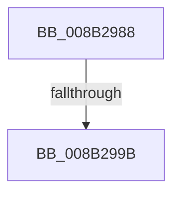

# sub_008B2988

- RVA: `0x008B2988`–`0x008B29A4` (길이 `28` bytes)
- VA: `0x00000001408B2988`
- 실행 섹션: `PAGE`
- PDB 이름 있음: `아니요`; PDB Function 태그: `아니요`
- unwind 정보 RVA: `0x00082684`
- 디코드: `7`개 명령, `28/28` bytes 표시
- 미해석 바이트: `0` (있으면 어셈블리에 `.byte`로 보존)

> 이 문서는 커널 이미지의 기계어와 PDB 기호를 분석해 생성했습니다. 4번과 5번은 함수 원형과 자료형을 바이너리 사용 방식에서 추정한 C 해석이며 원본 소스 복구 결과는 아닙니다.

## 1. Dependencies

- 직접 호출 지점: **1**; 고유 호출 대상: **1**
- 직접 호출자로 확인된 함수: **0**
- RIP 상대 이미지 참조: **0**

### Outgoing calls
- `0x008B2991` → [CmpAllocateTransientPoolWithQuota](../../text/46/CmpAllocateTransientPoolWithQuota_function_00461190.md) (function, `0x00461190`)

### Direct callers
- 이 함수 시작 RVA로 연결되는 직접 call은 확인되지 않았습니다. 간접 호출은 완전히 역산할 수 없습니다.

### Static image references
- 디코드된 RIP-relative 메모리 참조가 없습니다.

## 2. Other-region calls and transfers

- 다른 실행 섹션으로 향하는 call: **1**
  - `0x008B2991` → [CmpAllocateTransientPoolWithQuota](../../text/46/CmpAllocateTransientPoolWithQuota_function_00461190.md) (`PAGE` → `.text`)
- call이 아닌 외부 분기/꼬리 이동: **2**
  - `0x008B2999` → [sub_008B29EF](Unknown_function_008B29EF.md) (`tail-transfer`)
  - `0x008B299F` → [sub_008B2845 + 0x23](Unknown_function_008B2845.md) (`tail-transfer`)

## 3. Assembly (complete function range)

```asm
008B2988  41 B8 43 4D 42 42               mov r8d, 0x42424d43
008B298E  48 8B D3                        mov rdx, rbx
008B2991  E8 FA E7 BA FF                  call 0x140461190
008B2996  48 85 C0                        test rax, rax
008B2999  74 54                           je 0x1408b29ef
008B299B  48 89 46 08                     mov qword ptr [rsi + 8], rax
008B299F  E9 C4 FE FF FF                  jmp 0x1408b2868
```

## 4. C-style interpretation (structured pseudocode)

```c
__int64 __fastcall sub_008B2988(void)
{
    __int64 result;

    result = CmpAllocateTransientPoolWithQuota(a1, v_rbx, (unsigned int)(0x42424D43ULL), a4);
    *(unsigned __int64 *)(v_rsi + 8) = result;
}
```

## 5. (Beta) C Style

```c
void sub_008B2988(void)
{
    int64_t result;

    result = CmpAllocateTransientPoolWithQuota(a1, local_rbx, (uint32_t)(0x42424D43ULL), a4);
    *(uint64_t *)(local_rsi + 0x8) = result;
}
```

## 6. Execution-region graph

[열기: 2D/3D 그래프와 함수 탐색 컨트롤 패널](../../../control-panel.html?section=page&rva=0x008B2988&view=graph)

- 2D 그래프는 위에서 아래로 흐르고, 3D 그래프는 빈 공간을 드래그해 회전합니다. Shift+드래그는 이동, 휠은 확대·축소, 함수 노드 선택은 대상 보고서 이동입니다.

### Static fallback


